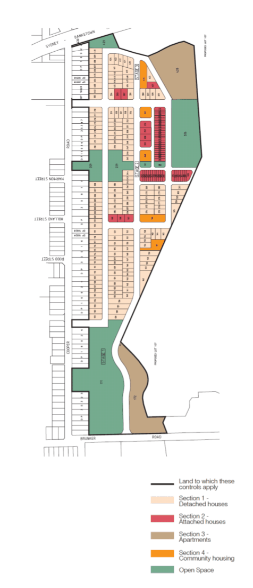

## SECTION 1–INTRODUCTION

#### Explanation

The Canterbury-Bankstown Local Environmental Plan 2023 and Canterbury-Bankstown Development Control Plan 2023 combine to regulate effective and orderly development, consistent with Connective City 2036.

The Canterbury-Bankstown Local Environmental Plan 2023 is Council's principal planning document. It provides objectives, zones and development standards such as lot sizes, floor space ratios and building heights.

The Canterbury-Bankstown Development Control Plan 2023 supports the LEP by providing additional objectives and development controls to enhance the function, design and amenity of the former Potts Hill Reservoirs site, Potts Hill. Note: If applicable to an application, the development controls of Chapter 11.6 of this DCP will prevail if there is an inconsistency with any other development controls in this DCP.

#### Objectives

O1 To ensure development is compatible with the desired character of the former Potts Hill Reservoirs site, Potts Hill.

O2 To achieve good design in terms of building form, bulk, architectural treatment, visual amenity and landscape.

O3 To ensure the building form and design provide appropriate amenity to residents.

O4 To ensure development is compatible with the prevailing suburban character and amenity of neighbouring residential areas.

#### Desired character

Development in the former Potts Hill Reservoirs site will ensure that high quality built form and urban design outcomes are realised within the approved subdivision layout for the Western Residential Precinct. The development controls aim to achieve a generally consistent built form across the precinct.

#### Land to which chapter applies

Chapter 11.6 of this DCP applies to the former Potts Hill Reservoir site, Potts Hill as shown in Figure 1. It applies to residential development for dwelling houses, dual occupancies, attached dwellings, residential flat buildings and community housing development that are identified within specific areas shown on the Land Application Map.

> [Picture on page 5: a picture, saved as a picture (images/ch-11-06-former-potts-hill-reservoirs-site-page-5-1.gif, 150 dpi).]

Figure 1: Land Application Map
