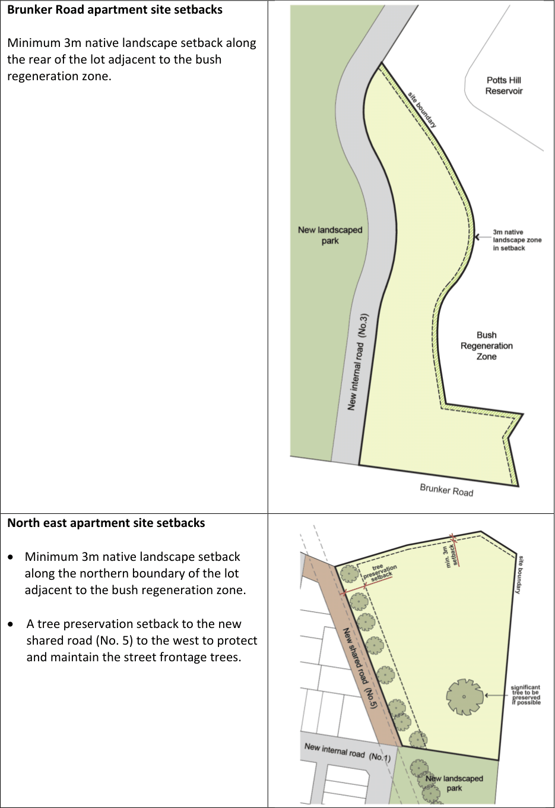
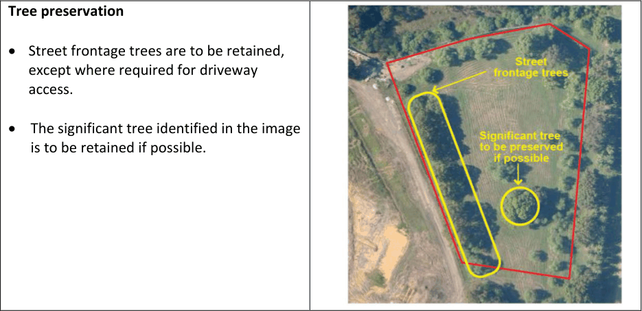

## SECTION 4–RESIDENTIAL FLAT BUILDINGS

#### Development controls

> [Picture on page 17: a picture, saved as a picture (images/ch-11-06-former-potts-hill-reservoirs-site-page-17-3.gif, 150 dpi).]
> Words printed on the picture (title and legend, copied from the PDF):
> Brunker Road apartment site setbacks
> Minimum 3m native landscape setback along
> the rear of the lot adjacent to the bush
> regeneration zone.
> North east apartment site setbacks
> • Minimum 3m native landscape setback
> along the northern boundary of the lot
> adjacent to the bush regeneration zone.
> • A tree preservation setback to the new
> shared road (No. 5) to the west to protect
> and maintain the street frontage trees.

> [Picture on page 18: a picture, saved as a picture (images/ch-11-06-former-potts-hill-reservoirs-site-page-18-1.gif, 150 dpi).]
> Words printed on the picture (title and legend, copied from the PDF):
> Tree preservation
> • Street frontage trees are to be retained,
> except where required for driveway
> access.
> • The significant tree identified in the image
> is to be retained if possible.
