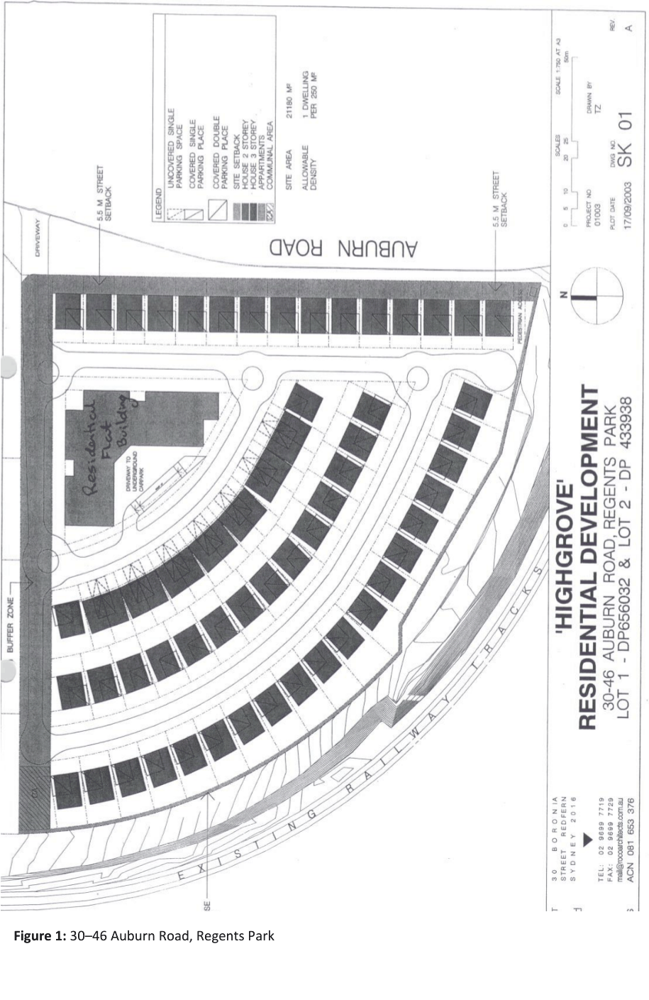

## Chapter 11 Key Development Sites

11.7 30–46 Auburn Road,

### Regents Park

June 2023 (Amended August 2024)

Welcome to the

### City of Canterbury-Bankstown

#### Great Cities

We believe in creating vibrant, dynamic, and diverse communities that offer opportunities for people to connect, pursue their passions, and contribute to the world around them.

#### Naturally Green

We protect and prioritise nature in and around our city to enhance environmental sustainability and improve the quality of life for our residents.

#### Design Excellence

We encourage buildings, spaces, and objects that are both beautiful and practical, enhancing the beauty, accessibility, and safety of our built environment.

#### People First

We prioritise the needs, preferences, and aspirations of our community in all aspects of urban planning and design, creating supportive and enriching places people love.

#### Community

We engage with our community to ensure their needs and aspirations are reflected in the outcome, creating sustainable, resilient, vibrant, diverse, and inclusive places.

#### Sustainability

We seek designs that reduce negative impacts on the environment while also promoting social and economic well-being.

#### Net-Zero

We encourage our community to design buildings and places that produce as much renewable energy as they consume, reducing greenhouse gas emissions, lowering energy bills, and increasing resilience to environmental shocks and stresses.

#### Join us in creating a City that's liveable, loveable, and sustainable for all!

## SECTION 1–DEVELOPMENT SITE AT 30–46 AUBURN ROAD, REGENTS PARK

#### Explanation

The Canterbury-Bankstown Local Environmental Plan 2023 and Canterbury-Bankstown Development Control Plan 2023 combine to regulate effective and orderly development, consistent with Connective City 2036.

The Canterbury-Bankstown Local Environmental Plan 2023 is Council's principal planning document. It provides objectives, zones and development standards such as lot sizes, floor space ratios and building heights.

The Canterbury-Bankstown Development Control Plan 2023 supports the LEP by providing additional objectives and development controls to enhance the function, design and amenity of the site at 30–46 Auburn Road, Regents Park. Note: If applicable to an application, the development controls of Chapter 11.7 of this DCP will prevail if there is an inconsistency with any other development controls in this DCP.

#### Objectives

O1 To ensure development is compatible with the desired character of the site at 30–46 Auburn Road, Regents Park.

O2 To achieve good design in terms of building form, bulk, architectural treatment, visual amenity and landscape.

O3 To ensure the building form and design provide appropriate amenity to residents in terms of access to sunlight, privacy and protection from freight railway noise.

O4 To ensure development is compatible with the prevailing suburban character and amenity of neighbouring residential areas.

#### Desired character

Residential development will be compatible with the character of the neighbouring Zone R2 Low Density Residential and railway corridor.

#### Development controls

#### Dwelling yield

1.1 The maximum number of dwellings permissible on the site is 85.

#### Storey limit (not including basements)

1.2 The storey limit is three storeys with the exception of the dwellings fronting Auburn Road where the storey limit is two storeys, generally in accordance with Figure 1.

> [Picture on page 4: a picture, saved as a picture (images/ch-11-07-30-46-auburn-road-regents-park-page-4-1.gif, 150 dpi).]

Figure 1: 30–46 Auburn Road, Regents Park
