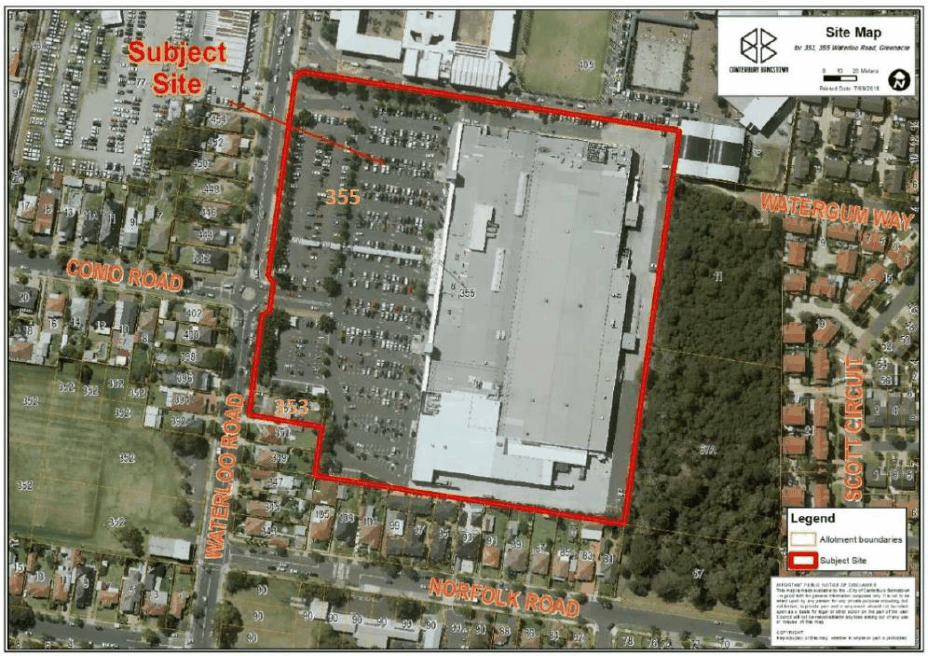
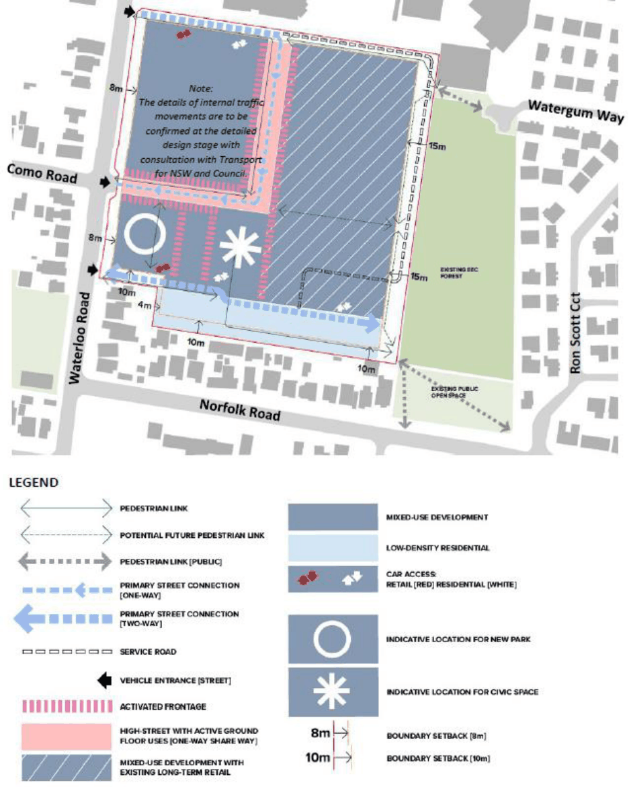
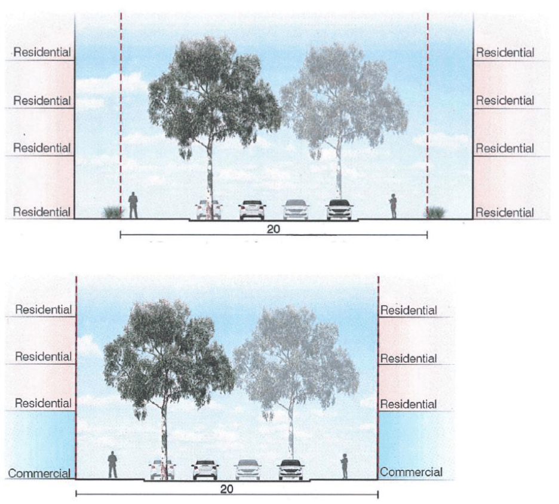
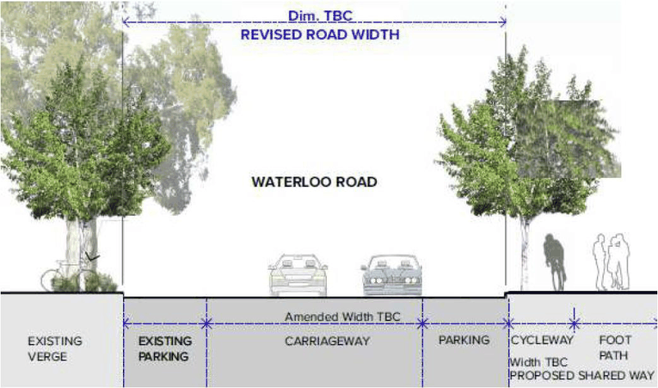

## Chapter 11 Key Development Sites

### 11.10 Chullora Marketplace, Greenacre

June 2023 (Amended April 2025)

Welcome to the

### City of Canterbury-Bankstown

#### Great Cities

We believe in creating vibrant, dynamic, and diverse communities that offer opportunities for people to connect, pursue their passions, and contribute to the world around them.

#### Naturally Green

We protect and prioritise nature in and around our city to enhance environmental sustainability and improve the quality of life for our residents.

#### Design Excellence

We encourage buildings, spaces, and objects that are both beautiful and practical, enhancing the beauty, accessibility, and safety of our built environment.

#### People First

We prioritise the needs, preferences, and aspirations of our community in all aspects of urban planning and design, creating supportive and enriching places people love.

#### Community

We engage with our community to ensure their needs and aspirations are reflected in the outcome, creating sustainable, resilient, vibrant, diverse, and inclusive places.

#### Sustainability

We seek designs that reduce negative impacts on the environment while also promoting social and economic well-being.

#### Net-Zero

We encourage our community to design buildings and places that produce as much renewable energy as they consume, reducing greenhouse gas emissions, lowering energy bills, and increasing resilience to environmental shocks and stresses.

#### Join us in creating a City that's liveable, loveable, and sustainable for all!

#### CONTENTS

Section 1 – Introduction ......................................................................................................... 4

Section 2 – Central civic plaza and publicly accessible open spaces ..................................... 8

Section 3 – Access and movement ...................................................................................... 10

Section 4 – Land use and site layout .................................................................................... 14

Section 5 – Built form ........................................................................................................... 16

Section 6 – Architectural diversity and articulation ............................................................ 18

Section 7 – Facade design, streetscape activation and passive surveillance ...................... 19

Section 8 – Landscaping and public domain ........................................................................ 21

Section 9 – Heritage ............................................................................................................. 23

Section 10 – Rooftop solar features and lighting................................................................. 25

## SECTION 1–INTRODUCTION

#### Explanation

The Canterbury-Bankstown Local Environmental Plan 2023 and Canterbury-Bankstown Development Control Plan 2023 combine to regulate effective and orderly development, consistent with Connective City 2036.

The Canterbury-Bankstown Local Environmental Plan 2023 is Council's principal planning document. It provides objectives, zones and development standards such as lot sizes, floor space ratios and building heights.

The Canterbury-Bankstown Development Control Plan 2023 supports the LEP by providing additional objectives and development controls to enhance the function, design and amenity of the development site at 353–355 Waterloo Road, Greenacre. Note: If applicable to an application, the development controls of Chapter 11.10 of this DCP will prevail if there is an inconsistency with any other development controls in this DCP.

#### Desired character for the Chullora Local Centre

The desired character for the Chullora Local Centre is to create a vibrant mixed use commercial destination with generous green and public open spaces, which also provides a ‘sense of community’ for future residents and the surrounding neighbourhoods. Council’s Local Strategic Planning Statement ‘Connective City 2036’ envisages centres like Chullora Marketplace as being ‘hubs of community life, with high quality public, civic and community spaces and places. They are places designed for pedestrians’.

The Chullora Local Centre will provide a high degree of amenity of future residents, visitors and workers through delivery of increased tree canopy, communal open space, a public Central Civic Plaza and public open space. The Central Civic Plaza is pedestrian focused, with active retail frontages on at least two sides of the Plaza. The Central Civic Plaza is to be a space designed for pedestrians and vehicle access will be limited.

The new internal street network must be permeable, legible and provide a 24 hour safe access to pedestrians and cyclists via inclusion of shared paths. High Street is pedestrian focused and located near the Central Civic Plaza. Retail parking and servicing will not be provided from the ‘High Street’ or adjacent to active retail frontages.

High Street and the Central Civic Plaza will incorporate public art, heritage interpretation of the site and appropriate drop off zones for ride share vehicles and taxis. All retail and residential parking will be predominantly underground except for some limited on-street parking.

Well-designed terrace houses, shop top housing, residential flat buildings and mixed use buildings with new pedestrian-orientated streets and civic places will enhance the vitality and attractiveness of the local centre. New development will exhibit design excellence, provide appropriate articulation and architectural styles to add visual interest and avoid large blank walls along public domain.

The site will have a tree canopy that complements the built development on the site, mitigate urban heat, significantly cool streets and improve air quality. The future built form will also protect the ecologically significant Norfolk Reserve from unreasonable impacts.

Retaining the existing commercial floor space in the future redevelopment of the Chullora Marketplace is important and is to occur in accordance with the principles for local centres as stipulated in the South District Plan, Connective City 2036 and Council’s Employment Lands Strategy.

#### Land to which chapter applies

Chapter 11.10 of this DCP applies to the Chullora Marketplace site at 353–355 Waterloo Road, Greenacre as shown in Figure 1.

> [Picture on page 5: a picture, saved as a picture (images/ch-11-10-chullora-marketplace-greenacre-page-5-11.gif, 150 dpi).]

Figure 1: Existing Chullora Marketplace Shopping Centre

#### Staged development

To ensure a viable ongoing operation of the existing shopping centre, the future development of the site may be undertaken progressively and incrementally, consistent with an indicative concept plan (applying to the whole site) which is required to be lodged with Council at the lodgement of the first development application. Each stage of development proposed to be delivered will involve a detailed plan specific to that stage and should demonstrate consistency with the indicative concept plan (applying to the whole site).

The indicative concept plan (applying to the whole site) is required at each stage of the development application to ensure each stage is consistent will the overarching key design principles and desired character for the site. Council may consider amendments to the indicative concept plan (applying to the entire site) at each stage where required consistent with the desired character and key design principles for the centre.

The development at 353–355 Waterloo Road, Greenacre must be designed using the advice from a suitably qualified ecologist at the preparation of an indicative concept plan or the first stage of any staged development application (whichever occurs first) to ensure the following:

(a) minimise the overshadowing of Norfolk Reserve (67–67A Norfolk Road and 11 Watergum Way in Greenacre), and

(b) avoid overshadowing the ecologically endangered communities and habitat of threatened species in Norfolk Reserve, and

(c) avoid any other potential adverse environmental impact on the ecologically endangered communities and habitat of threatened species in Norfolk Reserve.

#### Key design principles and indicative structure plan

The key design principles and priorities to guide any future application for the site are:

(a) Deliver a Central Civic Plaza as a community hub including a high quality public open spaces: Create a new Central Civic Plaza as a focal point for Chullora Local Centre. The Central Civic Plaza must have active uses to at least two of its sides and linked to its surrounding with a network of pedestrian friendly internal streets.

(b) Create a vibrant local centre which protects and enhances existing commercial floor space: Ensure the future development protects and enhances the commercial floor space and local employment opportunities within the local centre. Retail and commercial use will continue to remain as the key land use of the local centre, having regard to the objectives of Zone E1 Local Centre.

(c) Improve permeability and access: Introduce a legible and permeable pattern of new streets which are publicly accessible 24 hours a day and responds to key connections within and adjacent neighbourhood. All internal streets must consist of shared paths to prioritise access to pedestrians and cyclists.

(d) Create a new, activated ‘High Street’: Ensure new development has permeable and active street frontages along the new High Street. The use of blank walls should be minimised and major retail parking and service areas of buildings should not be provided from the High Street or adjacent to active retail frontages.

(e) Primary retail and service access from Waterloo Road: Ensure the retail, service vehicles and residential vehicle accesses the site from Waterloo Road. The proposed access is to be highly legible, minimise traffic congestion and vehicle/pedestrian conflict. Major retail parking and servicing should not be provided from the High Street or adjacent to active retail frontages.

(f) New development along Waterloo Road to respect the residential amenity of surrounding low density residential properties: Ensure that any new development along Waterloo Road must not adversely impact on the amenity of the existing low density residential properties along Waterloo Road. The use of blank walls is to be minimised along Waterloo Road and new development facing the road is to facilitate passive surveillance.

(g) Minimise overlooking and overshadowing impacts: Provide sufficient setbacks and landscape buffers where appropriate to address issues such as visual privacy, amenity and solar access to the surrounding properties and protect the Norfolk Reserve.

> [Picture on page 7: a picture, saved as a picture (images/ch-11-10-chullora-marketplace-greenacre-page-7-10.gif, 150 dpi).]

Figure 2: Indicative structure plan

## SECTION 2–CENTRAL CIVIC PLAZA AND PUBLICLY ACCESSIBLE OPEN SPACES

#### Objectives

O1 To create civic spaces of sufficient size, configuration and design that provide for a wide variety of community activities and events.

O2 Provide a Central Civic Plaza that is vibrant and a focus of activity during the day and night.

O3 To provide public domain and publicly accessible open spaces that is consistent with the needs of the local community.

O4 To create public domain that is visually cohesive, safe and functional and attractive destination.

O5 To increase the available public open space in Canterbury-Bankstown.

#### Development controls

2.1 As a minimum, a total of 5,000m2 of the site area shall be provided as a sum of the Central Civic Plaza and other additional public open space throughout the site. Public open space refers to land such as civic spaces, green spaces and shared ways, that has no buildings or other built structures, and is always accessible to the public.

2.2 Within the minimum of 5,000m2 public open space provision, a new Central Civic Plaza must be delivered and include:

(a) A minimum area of 950m2 and a minimum width of 25m. The new Central Civic plaza should function as a vibrant outdoor location, with a focus on food and drink premises with outdoor dining adjacent to a retail setting to provide a social ‘hub’ for the local community.

(b) Be activated with retail uses on at least two sides, overlooking and facing the open space.

2.3 Within the minimum of 5,000m2 provision, and in addition to a new Central Civic Plaza, provide a new publicly accessible local open space or a combination of local open spaces which consists of at least one park that has a minimum area of 1,500m2. The new local open space must be visible from Waterloo Road and be predominately landscaped:

(a) The design of the Central Civic Plaza and the publicly accessible open spaces must consider the following:

(i) Be always publicly accessible.

(ii) Be of dimensions which create useable spaces and accommodate a range of passive and recreational activities.

(iii) Have a minimum of four hours of continuous solar access with at least 50% of direct sunlight between 8.00am–4.00pm at the mid-winter solstice.

(iv) Have sheltered edges, with places for people to sit back and relax.

(v) Be accessible from at least one, or ideally two streets.

(vi) Include tree plantings, landscaping for shading and cooling.

(vii) Include appropriate colour, lighting, signage, heritage interpretation of the site and other forms of public art and materials to improve wayfinding and provide a high-quality public domain for pedestrians and cyclists.

(viii) Be designed with high quality and robust material to accommodate a diverse range of activities, events and users.

(ix) Include water sensitive urban design principles and features as an integral part of the designing of the public domain.

(b) All spaces within the public domain should be accessible by people with disabilities (including those in wheelchairs) and elderly people.

## SECTION 3–ACCESS AND MOVEMENT

#### Objectives

O1 To provide a clear and legible street and movement network with through-site connectivity that is as safe as possible for all users at all hours.

O2 To ensure pedestrians and cyclists receive priority movement within and around the site.

O3 To change the current outlook of the site from a standalone car-orientated shopping centre to a vibrant local centre prioritising people over the cars.

O4 To encourage a reduced dependence on private motor vehicle trips by providing connections to existing and proposed walking, cycling and public transport infrastructure that services the site.

#### Development controls

3.1 The first development application for each stage of the development of any land within the site that includes residential accommodation, either standalone or part of a mixed use development, must be accompanied by an appropriate urban design and traffic and transport studies to demonstrate how that stage of development indicatively informs the design of the future development on the balance of the site consistent with the indicative concept plan (applying to the whole site) and to inform in detail the design of that specific stage the following:

(a) new streets and connections including any easements/right of way where required;

(b) car park layout and access to separate traffic within the site between different uses and services, including residential, retail/commercial, service vehicles, other different uses and drop off areas to fully assess the impact of the development on the receiving road network and functionality of the site;

(c) locations of the public open space, including the Central Civic Plaza and the High Street; and

(d) publicly accessible open spaces.

3.2 New streets must be highly legible, permeable and publicly accessible 24 hours a day. New streets must respond to key connections within and adjacent neighbourhood. All internal streets must consist of shared paths to prioritise access to pedestrians and cyclists.

3.3 New streets and connections should generally be in accordance with the key design principles and indicative structure plan outlined in Section 1 and the typical street sections outlined in Figure 3. Provide new publicly accessible streets and pedestrian connections including:

(a) Minimum 20m wide internal streets for vehicles (two-way traffic)

(b) Minimum 15m wide internal streets for vehicles (one-way traffic)

(c) Minimum 12m wide for pedestrian only links.

> [Picture on page 11: a picture, saved as a picture (images/ch-11-10-chullora-marketplace-greenacre-page-11-1.gif, 150 dpi).]

Figure 3: Typical street sections – residential street and shop top housing street

3.4 High Street should accommodate shared paths on either side for pedestrians and cyclists. High Street will have a provision of limited on-street retail parking and dedicated areas for ride share vehicles and taxi zone near the Central Civic Plaza. The design of internal road widths and manoeuvring paths must accommodate large vehicles including emergency, waste collection, delivery and removalist vehicles. High Street may require up to two lanes of vehicle traffic in each direction, subject to detailed design and supporting traffic and urban design studies submitted at the development application stage.

NOTE: Where Council collection staff or Council vehicles are required to enter private property to perform waste collection services, Council will require an unimpeded easement for access to undertake on-site or collect and return service.

3.5 Major retail, service vehicles and/or residential vehicles should access the site either via Waterloo Road or via the northern entry as close to Waterloo Road as possible. Retail and residential traffic must be separated from service vehicles when moving within the site.

3.6 Major retail parking and servicing must not be provided from the High Street or adjacent to active retail frontages.

3.7 Major retail parking and servicing access roads must not encroach into the landscape buffer zone along the eastern boundary of the site.

3.8 Development must optimise the opportunities for active street frontages and streetscape design by:

(a) limiting the number of vehicle accessways to a minimum; and

(b) avoiding the location of car park entries, driveways and loading docks at the corners of street intersections.

3.9 The preferred parking within the centre is underground parking. New car parking must avoid poor streetscape outcomes and ensure better utilisation of available land in the local centre. If underground car parking is not practicable, car parking is to be ‘sleeved’ with retail and other active uses at ground level.

3.10 Internal streets will have provision for limited on-street residential and visitor parking, interspersed with street trees, to provide convenient visitor parking for ground level commercial/retail. All internal road reserves must also accommodate footpaths, cycleways, street tree planting and services.

3.11 Traffic calming techniques should be adopted for all roads within the public domain with appropriate design considerations.

3.12 On-site parking provision must comply with Chapter 3.2 Parking of the Canterbury- Bankstown Development Control Plan 2023.

3.13 The provision of a cycleway along the site frontage on Waterloo Road must be located as an off-road cycleway and not located within the road carriageway. Refer to Figure 4.

> [Picture on page 12: a picture, saved as a picture (images/ch-11-10-chullora-marketplace-greenacre-page-12-23.gif, 150 dpi).]

Figure 4: Waterloo Road section concept diagram. Note: final location and design of future cycleway to be approved by Council and Transport for NSW.

Consultation with the Transport for NSW

Waterloo Road is classified as a regional road. Prior to preparing a Transport Impact Assessment Report (TIA) on each stage of the development application, the applicant must consult with the Transport of NSW (TfNSW) to confirm scope of assessment to resolve the following issues:

• access arrangements (including emergency vehicle access);

• potential upgrade requirement including network and intersection assessment;

• potential road safety deficiencies;

• pedestrian accessibility, demand management measures and trip generation rates;

• public transport access;

• any road network capacity;

• air quality and Noise Impact Assessment for development fronting Waterloo Road;

• cumulative impact of progressive development applications on the surrounding road networks especially on Waterloo, Como and Norfolk Roads.

## SECTION 4–LAND USE AND SITE LAYOUT

#### Objectives

O1 The site must function as a local neighbourhood centre that allows for a range of uses including retail, commercial, residential, community and recreational uses to support the existing and future population of Greenacre.

O2 To promote mixed use development to enhance the vitality and attractiveness of the site which provides for the needs of the local community of Greenacre.

O3 To ensure that Chullora Marketplace Local Centre fits appropriately within the centres hierarchy of Canterbury-Bankstown.

O4 To minimise overshadowing and visual impacts to adjoining properties and streets.

O5 Provide passive surveillance to Norfolk Reserve and along Waterloo Road.

O6 To minimise potential conflict between existing and proposed vehicle access routes and pedestrian access points.

#### Development controls

4.1 Land use shall be designed and located in accordance with the indicative structure plan and key design principles.

4.2 Ground level non-residential uses or active street frontages are to be located around the Central Civic Plaza and/or the new High Street to activate the public domain.

4.3 Community uses such as childcare centres and community facilities are encouraged to be located in areas where they will assist in activating the public domain.

4.4 Taller buildings, up to six storeys are to be located in the centre of the site. The maximum building height of buildings will transition to four storeys along Waterloo Road and Norfolk Reserve boundary; and to two storeys along southern boundary.

4.5 Buildings which interface with low density properties to the south must be designed to:

(a) Maximise street activity through front gardens, terraces and the facade of the building.

(b) Be directly accessible from the new internal street.

(c) Minimise overlooking into the private open space of adjoining residential properties to the south.

4.6 Buildings along eastern boundary are designed to overlook Norfolk Reserve providing passive surveillance to the reserve and the informal pedestrian access point in the south east corner and the formal pedestrian access point in the north east corner (Watergum Way).

4.7 Building sections shall be provided with any application describing the relationship of the proposal to neighbours. These shall show boundary walls between sites, built form on the site and neighbouring open spaces and buildings with windows facing the site.

## SECTION 5–BUILT FORM

#### Objectives

O1 To minimise overshadowing impacts to the surrounding residents.

O2 To minimise overshadowing impacts to the reserve and avoid net additional overshadowing of any mapped endangered ecological community in Norfolk Reserve.

O3 To allow for an appropriate transition to adjoining uses including low density residential development.

O4 To allow for medium density living of high amenity and design excellence.

#### Development controls

#### Storey limit (not including basements)

5.1 Development must not exceed the building storey limit that corresponds with the maximum building height shown for the site on the Height of Building Map and detailed in Table 1:

Table 1: Building storey limits – Chullora Marketplace

| Maximum building height as shown on the Height of Buildings Map | Storey limit (not including basements) |
|---|---|
| 9m | 2 storeys (plus attic) |
| 11m | 3 storeys (plus attic) |
| 14m | 4 storeys (plus attic) |
| 20m | 6 storeys (plus attic) |

5.2 Development must comply with the maximum building height shown for the site on the Height of Building Map in the Canterbury-Bankstown Local Environmental Plan 2023.

5.3 The minimum floor to floor height for commercial development is 4.5m. Further increases may be required for servicing, removalist and waste truck clearance levels.

#### Setbacks to Waterloo Road

5.4 An 8m minimum front setback shall be provided from Waterloo Road to the development for a provision of landscape buffer along Waterloo Road.

#### Setbacks to Zone R2 Low Density Residential on the south

5.5 A 10m minimum setback shall be provided to the rear boundary of properties facing Norfolk Road and to the northern side boundary of the property at 351 Waterloo Road.

5.6 A 4m minimum setback shall be provided to the rear boundary of the properties at 349 and 351 Waterloo Road.

#### Setbacks to Zone SP2 Infrastructure to the north

5.7 For commercial uses, a nil setback is permitted to the Zone SP2 Infrastructure boundary for ground and first storey. Commercial uses on second, third and fourth storeys must be setback a minimum of 6m from the boundary. Commercial uses on fifth and sixth storeys must be setback a minimum of 10m from the boundary.

5.8 For residential uses, a minimum of 10m setback is required to the Zone SP2 boundary for up to four storeys and a minimum of 13m setback is required for fifth and sixth storeys from Zone SP2 boundary. Setbacks to adjacent properties must be compliant with the State Environment Planning Policy (Housing) 2021 (Chapter 4) separation distances.

#### Setback to the eastern boundary along Norfolk Reserve

5.9 Development must incorporate a minimum setback (buffer zone) of 15m along the eastern boundary of the site. Within this setback, a minimum 6m wide deep soil zone is required along the reserve.

5.10 Despite clause 5.10 which requires a minimum setback of 15m, Council may require a setback greater than 15m at certain parts of the site along the eastern boundary if considered appropriate by a suitably qualified ecologist in order to avoid adverse impacts of overshadowing to the ecologically endangered communities within the reserve.

## SECTION 6–ARCHITECTURAL DIVERSITY AND ARTICULATION

#### Objectives

O1 To ensure the scale, modulation and facade articulation of development responds to its context.

O2 To achieve architectural diversity and interest in the architectural character.

#### Development controls

6.1 The building length should not exceed 45m.

6.2 If unavoidable and the building length exceeds 45m, it should be broken into two or more components, so no length is longer than 45m, before which a:

(a) Minimum 3m x 3m inset is to be provided at all levels up to four storeys. The inset must incorporate a green wall.

(b) Minimum 9m separation is to be provided for all levels above four storeys.

6.3 Each component of a building should have a different architectural character to the street or public domain and be articulated into smaller components at a scale or grain that reflects the interior and exterior uses and circulation of the building and site.

## SECTION 7–FACADE DESIGN, STREETSCAPE ACTIVATION AND PASSIVE SURVEILLANCE

#### Objectives

O1 To provide high quality facade treatments that contribute positively to streetscape character and the view from neighbouring properties.

O2 To activate and meaningfully address streets and public places with ‘fine-grained’ and articulated building frontages.

O3 To support pedestrian comfort and enjoyment with design elements that provide climate control and enable activity to occur in most weather conditions.

O4 To require a continuous built edge to the street at locations where it is essential to have active street frontages.

O5 To promote passive surveillance of Norfolk Reserve and along Waterloo Road.

O6 Ensure that the building design contributes design excellence to the public domain for the duration of the building life.

#### Development controls

7.1 Buildings are to be designed with a high level of architectural detail and articulation consisting of a variety of materials for an architectural response that creates a sense of depth and visual diversity.

7.2 Facade treatments are to provide a high-quality visual outlook from adjacent residential neighbours, the school and the public domain, including Norfolk Reserve.

7.3 Active ground level frontages are to be provided and focused along High Street and facing the Central Civic Plaza. Active frontages are to be designed with fine grained detailing, and provide for commercial, retail or other non-residential uses at ground level.
