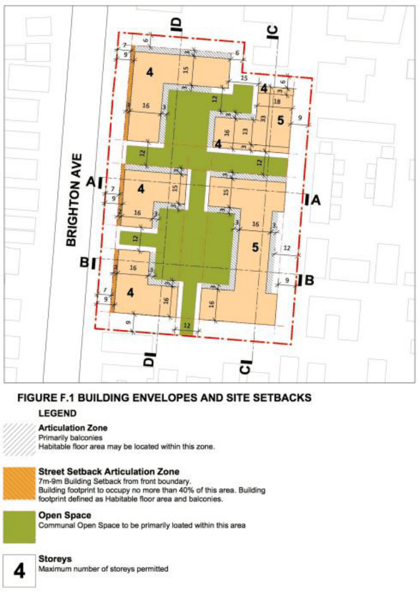
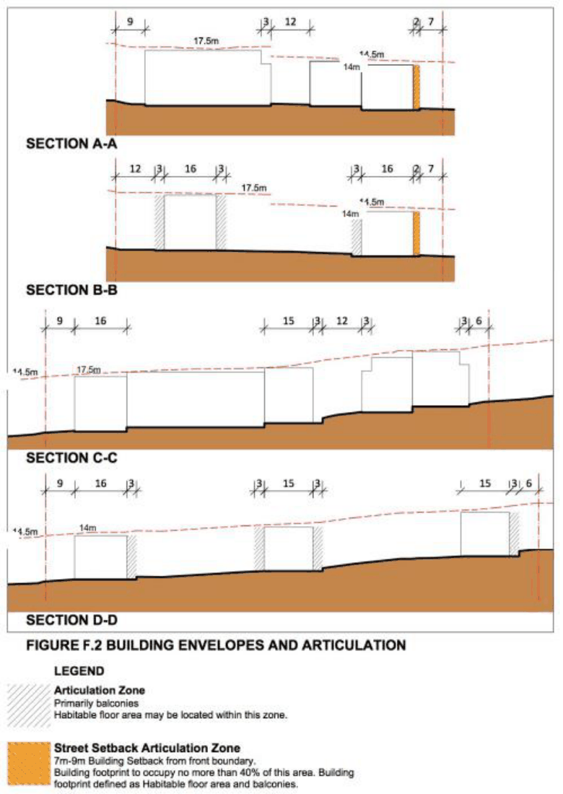
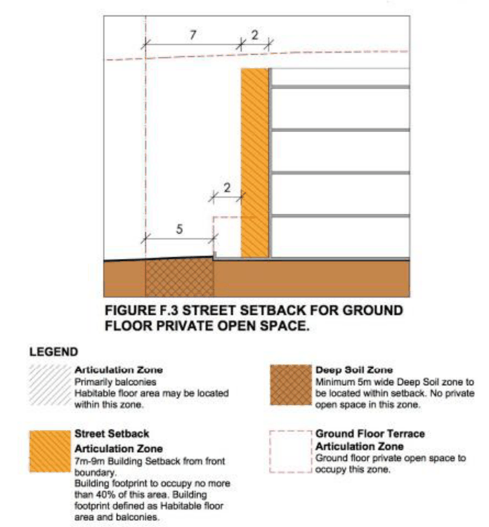

# Canterbury-Bankstown Development Control Plan 2023 - Chapter 11.11 15–33 Brighton Avenue, Croydon Park

Source PDF: [2024.08.06 - DCP 2023 - AMENDMENT 4 - Chapter 11.11 - Brighton Avenue.pdf](2024.08.06%20-%20DCP%202023%20-%20AMENDMENT%204%20-%20Chapter%2011.11%20-%20Brighton%20Avenue.pdf)

### Canterbury-Bankstown Development Control Plan 2023

## Chapter 11 Key Development Sites

11.11 15–33 Brighton Avenue,

### Croydon Park

June 2023 (Amended August 2024)

Welcome to the

### City of Canterbury-Bankstown

#### Great Cities

We believe in creating vibrant, dynamic, and diverse communities that offer opportunities for people to connect, pursue their passions, and contribute to the world around them.

#### Naturally Green

We protect and prioritise nature in and around our city to enhance environmental sustainability and improve the quality of life for our residents.

#### Design Excellence

We encourage buildings, spaces, and objects that are both beautiful and practical, enhancing the beauty, accessibility, and safety of our built environment.

#### People First

We prioritise the needs, preferences, and aspirations of our community in all aspects of urban planning and design, creating supportive and enriching places people love.

#### Community

We engage with our community to ensure their needs and aspirations are reflected in the outcome, creating sustainable, resilient, vibrant, diverse, and inclusive places.

#### Sustainability

We seek designs that reduce negative impacts on the environment while also promoting social and economic well-being.

#### Net-Zero

We encourage our community to design buildings and places that produce as much renewable energy as they consume, reducing greenhouse gas emissions, lowering energy bills, and increasing resilience to environmental shocks and stresses.

#### Join us in creating a City that's liveable, loveable, and sustainable for all!

#### CONTENTS

Section 1 – Introduction ....................................................................................................... 4

Section 2 – Siting the development ..................................................................................... 5

Section 3 – Street setback .................................................................................................... 6

Section 4 – Side and rear setbacks ....................................................................................... 7

Section 5 – Building separation ............................................................................................ 8

Section 6 – Building height ................................................................................................... 9

Section 7 – Deep soil landscaping ...................................................................................... 10

Section 8 – Car parking....................................................................................................... 11

Section 9 – Communal open space .................................................................................... 12

Section 10 – Ground floor apartments ............................................................................... 13

Section 11 – Communal building entries ............................................................................ 14

Section 12 – Top floor and roof design .............................................................................. 15

Section 13 – Built form and facades ................................................................................... 16

Section 14 – Fences ............................................................................................................ 17

Section 15 – Waste management ...................................................................................... 18

Section 16 – Contamination ............................................................................................... 21

## SECTION 1–INTRODUCTION

#### Explanation

The Canterbury-Bankstown Local Environmental Plan 2023 and Canterbury-Bankstown Development Control Plan 2023 combine to regulate effective and orderly development, consistent with Connective City 2036.

The Canterbury-Bankstown Local Environmental Plan 2023 is Council's principal planning document. It provides objectives, zones and development standards such as lot sizes, floor space ratios and building heights.

The Canterbury-Bankstown Development Control Plan 2023 supports the LEP by providing additional objectives and development controls to enhance the function, design and amenity of development at 15–33 Brighton Avenue, Croydon Park. Note: If applicable to an application, the development controls of Chapter 11.11 of this DCP will prevail if there is an inconsistency with any other development controls in this DCP.

#### General objectives

O1 To create a site layout and built form that is appropriate to the Croydon Park context.

O2 To achieve a high-quality development outcome that is responsive to the natural and built form context around the site.

O3 To enhance the existing Brighton Avenue streetscape and provide new pedestrian pathways that enhance the landscape character of the area.

O4 To minimise the visibility of taller development within the precinct from surrounding streets site and achieve a transition in scale of development from Brighton Avenue.

O5 To achieve a high standard of residential amenity to adjacent development and new development within the precinct.

O6 To minimise the bulk and scale of the development by appropriately responding to the topography of the site.

O7 To achieve amalgamated sites that can deliver the building footprints and building envelopes in Figures F.1 and F.2.

O8 To encourage consolidated development of the site which will facilitate quality landscaping, efficient building layouts with appropriate separation, resident amenity and avoid site isolation.

## SECTION 2–SITING THE DEVELOPMENT

#### Objectives

O1 To create a site layout and built form that is appropriate to the Croydon Park context and enhances the character of the Brighton Avenue.

O2 To maximise the opportunities for high quality landscape and the opportunity for deep soil within the site and along its edges.

O3 To create a site layout and built form which will provide high residential amenity for residents and minimise the impacts on adjoining properties.

O4 To ensure areas of open space are consolidated and provide landscape and visual relief between building forms and along site edges.

O5 To provide appropriate access and address to the rear buildings.

#### Development controls

2.1 In the event that lots within 15–33 Brighton Avenue (or a collection thereof) are developed separately from the other lots as envisaged in Figure F.1, appropriate setbacks must be provided to not unfairly encumber the neighbouring lots with building separation requirements. This should be consistent with the side setbacks and frontage prescribed for residential flat buildings in Chapter 5.2.

2.2 Any variation from the building footprints and heights shown in Figures F.1 and F.2 must demonstrate that it achieves a higher quality outcome in terms of:

• scale transition across the site

• amenity to adjacent lots

• visual and physical permeability through and into the site

• consolidated landscape areas throughout the site.

2.3 Locate building form within the development in accordance with the building footprints and envelopes shown in Figure F.1 Building Envelopes and Site Setbacks and Figure F.2 Building Envelopes and Articulation.

2.4 The buildings at the rear of the property shall be designed to address the internal public domain with active edges to all roads, pathways and communal open space.

2.5 All buildings (other than those fronting Brighton Avenue), must have an entry and identifiable address to a street or pathway within the development, with clear and legible pathways for residents, visitors and deliveries.

2.6 Communal Open Space throughout is to be designed as public domain with active street edges, street furniture, lighting and planting.

## SECTION 3–STREET SETBACK

#### Objectives

O1 To provide front building setbacks that are consistent with existing setbacks in Brighton Avenue.

O2 To create an articulated built form with buildings stepped in plan and elevation.

O3 To provide deep soil in the front setback to create a landscaped setting, including substantial trees.

O4 To allow for a limited area of private open space in the front setback.

O5 To ensure balcony design is integrated into and contributes to the overall architectural form and detail of the building, while maximising resident amenity and liveability.

#### Development controls

3.1 Provide building setbacks in accordance with Figure F.1 and F.3. Minimum front setback is to be 7m to the articulation zone.

3.2 Provide building articulation within a 2m articulation zone (maximum 40% in plan occupied by the building) in accordance with Figure F.1.

3.3 Provide a minimum width of 5m deep soil within the front setback, allowing for vehicle cross-overs, paths and the like within the 5m deep area.

3.4 Private open space in ground floor terraces is to be set back a minimum of 5m from the street boundary.

3.5 Provide a combination of solid and transparent materials that balances the need for privacy with surveillance of the public domain on balconies and terraces which are visible from the street frontage.

3.6 Full height solid masonry balustrades are not acceptable on the balconies.

## SECTION 4–SIDE AND REAR SETBACKS

#### Objectives

O1 To minimise bulk and scale impacts on neighbouring development.

O2 To allow for visual privacy and deep soil landscaping in side and rear setbacks including substantial trees.

O3 To ensure that the landscape setting and amenity of adjoining neighbours is maintained with proposed driveways.

#### Development controls

4.1 Side and rear setbacks are to be in accordance with Figures F.1 and F.2.

4.2 Provide a minimum width of 5m deep soil within side and rear setbacks, allowing for fences, paths and the like within the 5m deep area.

4.3 The side setback area behind the front building line are not to be used for car driveways or vehicular entry ramps to basement levels.

4.4 Provide a combination of solid and transparent materials that balances the need for privacy with surveillance of the public domain on balconies and terraces which are visible from the street frontage.

4.5 Solid masonry balustrades are not acceptable on the balconies.

## SECTION 5–BUILDING SEPARATION

#### Objectives

O1 To provide canopy trees between buildings on the same development site to create a landscaped setting for individual buildings.

O2 To create separations between buildings that provide adequate space between buildings and privacy between apartments.

#### Development controls

5.1 Areas of deep soil are to be provided between buildings on the site so that large canopy trees are visible from the public domain and from within the courtyards.

5.2 The minimum separation between residential buildings on the development site is to comply with the following controls:

Up to 4th Storey

a. 12m between habitable rooms/balconies

b. 9m between habitable rooms/balconies and non-habitable rooms

5th Storey

c. 18m between habitable rooms/balconies.

## SECTION 6–BUILDING HEIGHT

#### Objectives

O1 To match the building height in storeys in this DCP to the building height in metres in the Canterbury-Bankstown LEP 2023.

#### Development controls

6.1 The maximum building height in storeys is to comply with that shown in Figure F.1.

## SECTION 7–DEEP SOIL LANDSCAPING

#### Objectives

O1 To provide consolidated deep soil zones of adequate area for substantial tree planting and water infiltration of the soil and to reduce stormwater run-off.

O2 To create spaces in courtyards and between buildings on site that contain some deep soil that can sustain large trees.

O3 To provide deep soil in the front setback to create a landscape setting including large canopy trees within the front garden setbacks to enhance the current landscape character of Brighton Avenue.

#### Development controls

7.1 A minimum of 21% of the site area is to be provided as deep soil. A minimum of one-third of the deep soil area (7 % of the site area) is to be located in the communal open space area(s) in the centre of the site. Basement car parking is not to intrude into these areas.

7.2 The minimum dimension of any area of deep soil is to be 5m in any direction.

7.3 Consolidated deep soil zones are to be provided in front, side and rear setbacks, in courtyards and between buildings to allow for substantial tree planting.

7.4 Deep soil landscaping areas in the street setback are to be maximised.

7.5 Existing mature trees are to be retained wherever possible and entries to new development is to be designed to maximise retention.

7.6 Hard landscaping is to be minimised and opportunities for landscape planting are to be maximised.

7.7 In addition to tall canopy trees that are of a scale commensurate to the development, a range of small trees and shrubs are to be selected to ensure that vegetation softens the building form and creates a landscaped setting.

## SECTION 8–CAR PARKING

#### Objectives

O1 To locate and design car parking which is adapted to the site topography and building design and which does not increase the bulk and scale of the building.

O2 To ensure car parking does not impact upon deep soil landscaping controls.

#### Development controls

8.1 Driveways are not to dominate the street setback area.

8.2 Car park entry is to be located behind the building line and integrated within the building. Any driveway between the front boundary and the building is to have a maximum 1:20 gradient.

8.3 Basement car park areas are to be predominantly under building footprints, where possible.

## SECTION 9–COMMUNAL OPEN SPACE

#### Objectives

O1 To provide residents with sufficient, useful, safe and attractive communal open space.

#### Development controls

9.1 A minimum of 15% of the site area is to be provided as communal open space.

9.2 The front street setback area is not to be included in the 15% of communal open space as its exposure to the public street does not make it suitable for social interaction.

9.3 At least one single area of communal open space is to be provided with a minimum area of 900m2 across the addresses 15–33 Brighton Avenue, Croydon Park.

9.4 Communal open space may be permitted in the rear and side setbacks, however it is not preferred.

9.5 Communal open space is not to be provided on roof tops.

9.6 Any area of communal open space is to have a minimum dimension of 6m, in any direction.

9.7 Every lift and stair core on the site is to have direct access to a part of the communal open space.

9.8 Communal open space is to be comprised of a range of different spaces offering a range of facilities such as seating, barbecue facilities, shade structures, pet facilities and children’s play areas.

## SECTION 10–GROUND FLOOR APARTMENTS

#### Objectives

O1 To provide access from the street and communal courtyards to the private open space of ground floor apartments.

O2 To provide sufficient light and outlook for ground floor apartments and private open spaces by minimising site excavation.

O3 To improve safety and social interaction by avoiding long, high blank walls or fences that detract from the appearance of the public domain.

#### Development controls

10.1 A path and gate is to be provided from the street and communal courtyards to ground floor apartment private open spaces.

10.2 Living rooms and private open spaces at the ground floor are not to be excessively excavated into the ground, to allow sufficient outlook from the apartment.

10.3 A ground floor apartment can be no more than 1m above the footpath and/or adjoining public domain to ensure appropriate residential amenity and passive surveillance of the public domain.

10.4 Ground floor apartments must generally align with the footpath level or public domain levels.

10.5 Solid masonry balustrades up to a maximum of 1.2m in height may be acceptable on the ground floor apartments depending on its relationship to the footpath or communal open space.

## SECTION 11–COMMUNAL BUILDING ENTRIES

#### Objectives

O1 To clearly identify main building entries with distinctive architectural design.

O2 To provide high quality, equitable, safe and pleasant walking environments along the street and into the development.

O3 To prioritise pedestrian access and entries over vehicle access.

#### Development controls

11.1 Communal building entries are to be accentuated within the building façades with a range of elements such as taller proportions, large windows and doors, structural projections (i.e. canopies, awnings, blade walls), landscaping, distinctive materials and colour.

11.2 The path to building entries at the rear of the site is to be easily visible from the street and access to the entry is to be reasonably direct with appropriate wayfinding elements.

## SECTION 12–TOP FLOOR AND ROOF DESIGN

#### Objectives

O1 To create a distinctive top to the building with the roof design and top floor design.

O2 To encourage and maximise the use of renewable energy.

#### Development controls

12.1 The additional height allowance between the top storey and the maximum height is to be used to achieve an interesting roof form and building silhouette appropriate to its context on the site and to accommodate lift overruns and plant only. It is encourages that the expression of building modulation to development along Brighton Avenue responds to the ‘grain’ of the traditional lot widths.

12.2 The top floor may have architectural elements that are different to lower floors to assist in creating a top to the buildings.

12.3 Functional elements such as lift overruns, air conditioning units, plant equipment, vent stacks and communication devices are to be visually discreet and concealed within the roof form as far possible to avoid visibility, particularly from the public domain.

12.4 Installation of solar panels is required to supply energy to the common areas of building and communal open space. Adequate areas for residents to install and benefit from solar panels is to be allocated on the roof, including connections to battery storage within individual apartments. The solar panels must not adversely affect the architectural presentation of the building or views from the streetscape.

12.5 The use, location and placement of photovoltaic solar panels is to take into account surrounding built forms and the likely permissible built form on adjacent properties.

12.6 The development will include the installation of a solar PV system. The application must provide a roof plan showing the area(s) allocated to PVs, necessary access requirements for cleaning and maintenance, other plant and equipment that may include solar water heater storage tanks, ventilators, wind generators, air conditioning units and satellite dishes and antennae.

## SECTION 13–BUILT FORM AND FACADES

#### Objectives

O1 To create buildings which contribute positively to the desired future character of the area.

O2 To minimise the extent of flat, undifferentiated surface areas.

O3 To create a cohesive design element across the various buildings of the site that can contribute to a human scale development.

#### Development controls

13.1 The base of the building is to be consistent across all buildings within these sites and be expressed through a change in materiality, colour, treatment and projections either at a one or two storey height planes. The consistent requirement at a one or two storey height is to be informed by the first building to be approved and constructed on the site.

13.2 Buildings are to be well designed, with good proportions and facade composition, using high quality, durable materials.

13.3 Designs are to avoid having excessive areas of flat wall of one material or finish.

13.4 Indentations or slots in facades are to be as wide as they are deep.

13.5 External shading devices, projections, awnings, communication devices and the like are to be integrated into the design of the facade.

13.6 Air conditioning units are not to be located within private or communal open spaces unless appropriately screened or treated. Alternatively, air conditioning units should be located in concealed areas such as the basement, roof or grouped at every floor level in designated areas.

13.7 Facades are to be articulated with steps in plan, recessed and projecting balconies and deep windows; are to express a building base, middle and top; provide a range of window types; employ external shading devices that respond to the solar orientation of the facade and balconies; employ changes of materials, colours and textures to articulate the built form.

## SECTION 14–FENCES

#### Objectives

O1 To provide fencing that responds to the character of the streetscape, with low, visually open fencing which is complemented by landscape.

#### Development controls

14.1 Fencing to Brighton Avenue is to be low, visually open and designed in conjunction with landscaping in the front setback zone to provide an attractive streetscape and provide visual privacy for ground level private open space terraces.

14.2 Fully masonry fences are not appropriate within the streetscape character of Brighton Avenue.

14.3 Low level walls less than 1m high may be appropriate to step down the contours along Brighton Avenue.

14.4 Fencing is to respond to building entries and allow for mail boxes, seats and the like at the building entry.

14.5 Fencing to ground level private open spaces around internal courtyards and along Brighton Avenue is to provide privacy through a combination of level transition up to the terrace, landscaping and fencing design.

## SECTION 15–WASTE MANAGEMENT

Note: This section is intended to supplement controls on Waste Management contained in Chapter 3.3, in order to ensure adequate provision for waste management on this site. Where there is an inconsistency in requirements, this section shall prevail in relation to the

site. Applicants should consult with Council’s Waste Section to discuss waste requirements at an early stage in the process.

#### Objectives

O1 To maximise resource recovery through waste avoidance, source separation and recycling.

O2 To ensure that the disposal of waste is managed appropriately, efficiently and provides for maximum resource recovery or reuse.

O3 To ensure well-designed and responsive bin storage and collection facilities that are convenient and accessible to occupants.

O4 To require that bin storage and collection facilities are designed so that they can be integrated with and comply with the requirements for Council’s domestic waste services.

O5 To ensure all waste streams being handled, stored and collected in a manner to reduce risk to health and safety of all users, including residents, maintenance (e.g. caretakers), collection staff, and contractors (and required vehicles and equipment).

O6 To allow for kerbside waste collection.

O7 To ensure that bin storage for units are appropriately stored do not impact negatively on the streetscape.

#### Development controls

#### Residential development

15.1 Bins shall be stored on appropriate properties and be suitably screened or internally stored from view of the street. Bin carting routes are not to pass through any internal doorways.

15.2 Bin and waste areas must be integrated into the building.

15.3 The communal storage area(s) of residential flat building development must be of sufficient size to accommodate all allocated bins, bulky waste and the additional recycling service. This is to be achieved through the provision of a waste communal bin storage area(s) within the basement footprint of the development, which:

(a) Provides direct and convenient access for the occupants of the development, at a maximum distance of 30m from each dwelling.

(b) Allows for the safe and direct transfer of all bins from the bin storage area to the collection point (if required).

(c) Does not adversely impact the occupants within and adjoining the development in relation to visual amenity, noise and odour.

(d) Does not interfere with car parking, landscaping and any existing trees and vegetation.

Note: Prior to lodgement of a DA or at pre-DA stage the applicant shall contact Council’s Team Leader–Waste Strategy Section to discuss waste requirements. This may include requirements for communal bin areas for each building, the need for a larger communal bin storage room, and the need for 660 litre and 1100 litre bins and/or the need for decanting equipment. The location and design of the communal storage area(s) must comply with the requirements of the Waste Design for New Developments Guides.

15.4 Development must designate an on-site collection point that is integrated into the design of the development. The collection point should be a nominated holding area. It will be the responsibility of the property manager or caretaker to move bins from the storage area(s) to the holding area. The bin–carting route is to have or be:

(a) Paved and a minimum 2m for 660L or 2.5m wide for larger bins.

(b) Non-slip, free from obstacles and steps.

(c) A maximum grade of 1:30 Note: Bin carting equipment may be required. The design of the on-site collection point must comply with the requirements of the Waste Design for New Developments Guides.

15.5 The design of the on-site collection point must comply with the requirements of the Waste Design for New Developments Guides.

#### Bulky waste storage

15.6 Separate bulky waste storage areas or rooms are to be provided for residents to store bulky waste (e.g. white goods, mattresses, furniture) awaiting collection to prevent the illegal dumping of materials on the kerbside or in common areas.

15.7 The bulky waste storage areas or rooms are to be designed to comply with the requirements detailed in the Waste Design for New Developments Guides.

15.8 On-site collection of bulky waste is required where waste and recycling bins are collected on-site. The bulky waste storage room must be within 5m to the nominated collection point.

15.9 The carting route from the bulky storage area(s) to the collection point is to connect with the on-site collection point pathways.

#### Chute service and bin storage rooms

If chutes are utilised in the development the following controls apply.

15.10 These must be located directly under where the chute terminates and allow a space large enough for the bin to fit under the chute base and at the correct angle.

15.11 The bin storage room must be large enough to fit the allocated number of bins with additional room for manoeuvring bins and lift lids.

15.12 There must be sufficient bin volume under the chute for a minimum of three days waste generation. Where volume-handling equipment is required to automatically change the bin under the chute when it becomes full (such as bin lifting equipment or linear tracks or carousels), the bin storage room must be of adequate size to accommodate all required equipment and operate it. Resident access to the volume handling equipment will be restricted. Bin storage room and chute service room may be two separate rooms but next to each other.

#### Easement

15.13 Council must be provided with an easement for unimpeded access to and from the waste collection locations for Council and its contractors to enter and exit for the purpose of waste and recycling collection. The development is also required to indemnify Council and its contractors against claims for loss or damage or wear and tear of access roads or to other parts of the building. A positive covenant shall be placed on the property title, such as section 88B certificate.

Note: By entering into an agreement with Council for waste collection, the development will be required to operate in full compliance with Council’s Waste Management collection requirements. The provision of Council’s waste collection service will not commence until formalisation of the agreement.

## SECTION 16–CONTAMINATION

#### Objectives

O1 To ensure all development approvals for the site require remediation appropriate for the intended use.

#### Development controls

16.1 Remediation Action Plan (RAP) to be reviewed as part of any DA approval with appropriate conditions of consent applied to ensure implementation of the RAP approved by Council.

16.2 Applicant to provide a Section A or B Site Audit Statement with the DA application, as relevant.

Note: Conditions of consent for any DA for the site may include – Provide a Section A Site Audit Statement and any accompanying Site Audit Report or Environmental Management Plan as prepared by an NSW EPA accredited Site Auditor to Council prior to achieving the Occupation Certificate.

> [Picture on page 22: a picture, saved as a picture (images/ch-11-11-15-33-brighton-avenue-croydon-park-page-22-1.gif, 150 dpi).]

> [Picture on page 23: a picture, saved as a picture (images/ch-11-11-15-33-brighton-avenue-croydon-park-page-23-1.gif, 150 dpi).]

> [Picture on page 24: a picture, saved as a picture (images/ch-11-11-15-33-brighton-avenue-croydon-park-page-24-1.gif, 150 dpi).]
