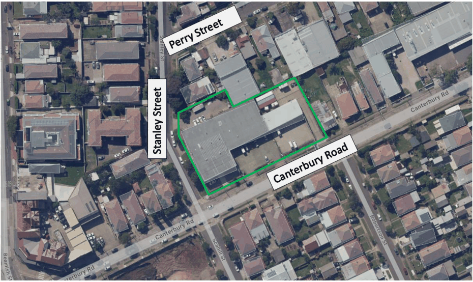

## SECTION 1–INTRODUCTION

#### Explanation

The Canterbury-Bankstown Local Environmental Plan 2023 and Canterbury-Bankstown Development Control Plan 2023 combine to regulate effective and orderly development, consistent with Connective City 2036.

The Canterbury-Bankstown Local Environmental Plan 2023 is Council's principal planning document. It provides objectives, zones and development standards such as lot sizes, floor space ratios and building heights.

The Canterbury-Bankstown Development Control Plan 2023 supports the LEP by providing additional objectives and development controls specific to development for the purpose of a hospital at 445 Canterbury Road, Campsie.

The site is zoned E3 Productivity Support. It is bound by low density residential and commercial uses to the immediate north and east and has frontage to Canterbury Road to the south. Stanley Street forms the western boundary.

Further north are high density zoned sites. On the southern side of Canterbury Road, sites are zoned for high-density residential uses. The site forms part of the Campsie Strategic Centre where a Master Plan has been prepared for this area with the objective to ‘deliver a medical precinct along Canterbury Road, anchored by Canterbury Hospital’.

#### Land to which Chapter 11.12 applies

This chapter applies to development for the purpose of a hospital at 445 Canterbury Road, Campsie. For other development types, the other chapters of the DCP apply. Note: If applicable to an application, the development controls of Chapter 11.12 of this DCP will prevail if there is an inconsistency with any other development controls in this DCP.

| Address | Lot and DP | Site Area (approximately) |
|---|---|---|
| 445 Canterbury Road, Campsie | Lot 3, DP 337683 Lots A and B, DP 355656 Lot A and B, DP 416123 Lot 15, DP 3995 Lots A and B, DP 391661 Lot 13, DP 3995 | 4,414m2 |

Table 1: Description of the subject site

> [Picture on page 5: a picture, saved as a picture (images/ch-11-12-445-canterbury-road-campsie-page-5-1.gif, 150 dpi).]

Figure 1: The site context, with the subject site outlined in green. Source: Mecone Mosaic

#### General objectives

O1 To provide for a hospital that is compatible with surrounding land uses and responds to site constraints.

O2 To enable a scale of built form which provides the quantum of floor space required to deliver the facilities and functions of a contemporary hospital.

O3 To ensure that the design of the building breaks down its form to reduce visual imposition and employs good design at ground level to create a human scale.

O4 To maintain acceptable solar access to surrounding properties and the public domain.

O5 To provide for a new public laneway from Stanley Street for vehicular and pedestrian access.

O6 To ensure the hospital is easy to use and that pedestrians are prioritised.

O7 To provide for a new public pocket park to the west of the site to provide amenity for patients’, the public, staff and visitors.

O8 To provide a new landscaped mid-block link from Canterbury Road through to the proposed laneway that is accessible to all pedestrians and safe and of high amenity.

O9 To ensure that the hospital exhibits design excellence and uses high quality, long lasting materials and finishes.
