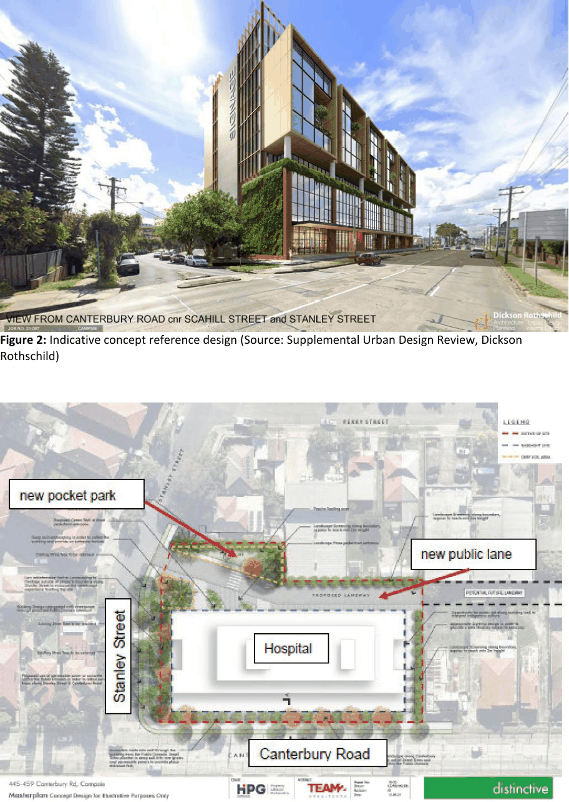

## SECTION 2–DESIRED CHARACTER FOR THE CAMPSIE HOSPITAL

The following outlines the character for the development of the site, which is derived from the planning proposal and the vision for the site as part of the Campsie Town Centre masterplan.

The site will accommodate of a hospital providing a range of high-quality medical care including inpatient and outpatient care. Further development will also align with the key objectives of the Campsie Town Centre masterplan, which includes the site within a ‘high intensification area’ and ‘Campsie Medical Precinct’.

The proposed development will be of high quality, be well-designed and respond to the planned future context for Canterbury Road as outlined in the masterplan, while mitigating as far as reasonable or appropriate (given other relevant standards or controls) negative impacts to the existing and future residential context. The hospital will be an anchor building within the new precinct.

The future hospital development on the site will be developed in accordance with the setback controls in this DCP to ensure acceptable solar access, in accordance with the State Environment Planning Policy (Housing) 2021 (Chapter 4) and the Apartment Design Guide to sites on the southern side of Canterbury Road. These sites include 412-416 Canterbury Road and 1-5 Robertson Street, Campsie.

> [Picture on page 7: a picture, saved as a picture (images/ch-11-12-445-canterbury-road-campsie-page-7-1.gif, 150 dpi).]

Figure 2: Indicative concept reference design (Source: Supplemental Urban Design Review, Dickson Rothschild)

Figure 3: Concept Plan (Landscaping Strategy Report, Distinctive Living Design 2021)
