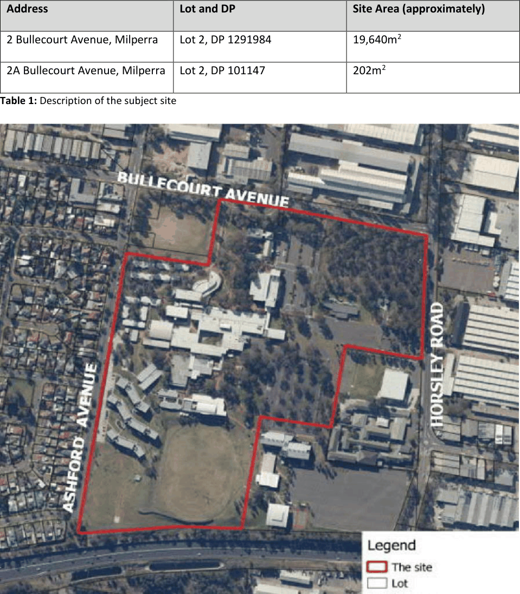
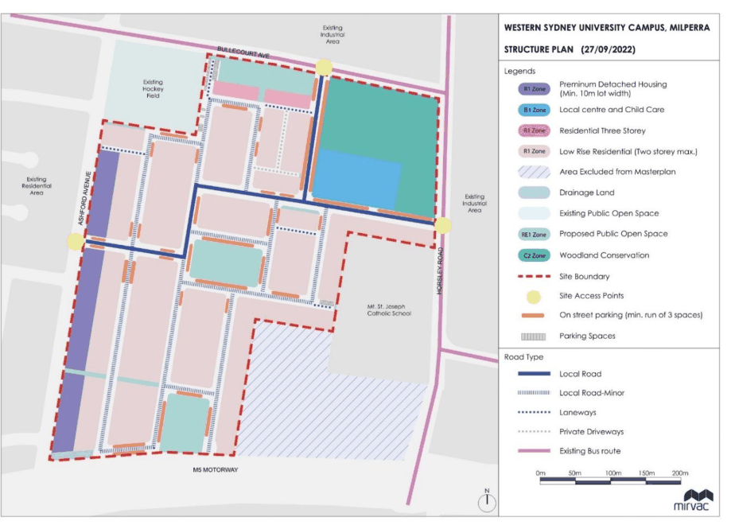

## Chapter 11 Key Development Sites

### 11.13 Former WSU Campus, Milperra

June 2023 (Amended April 2025)

Welcome to the

### City of Canterbury-Bankstown

#### Great Cities

We believe in creating vibrant, dynamic, and diverse communities that offer opportunities for people to connect, pursue their passions, and contribute to the world around them.

#### Naturally Green

We protect and prioritise nature in and around our city to enhance environmental sustainability and improve the quality of life for our residents.

#### Design Excellence

We encourage buildings, spaces, and objects that are both beautiful and practical, enhancing the beauty, accessibility, and safety of our built environment.

#### People First

We prioritise the needs, preferences, and aspirations of our community in all aspects of urban planning and design, creating supportive and enriching places people love.

#### Community

We engage with our community to ensure their needs and aspirations are reflected in the outcome, creating sustainable, resilient, vibrant, diverse, and inclusive places.

#### Sustainability

We seek designs that reduce negative impacts on the environment while also promoting social and economic well-being.

#### Net-Zero

We encourage our community to design buildings and places that produce as much renewable energy as they consume, reducing greenhouse gas emissions, lowering energy bills, and increasing resilience to environmental shocks and stresses.

#### Join us in creating a City that's liveable, loveable, and sustainable for all!

#### CONTENTS

Section 1 – Introduction ......................................................................................................... 4

Section 2 – Vision and character ............................................................................................ 7

Section 3 – Subdivision and site layout ................................................................................ 10

Section 4 – Residential ......................................................................................................... 33

Section 5 – E1 Local Centre .................................................................................................. 47

Section 6 – Bushfire hazard management ........................................................................... 48

Section 7 – Waste ................................................................................................................. 50

## SECTION 1–INTRODUCTION

#### Explanation

This chapter has been made in accordance with section 3.43 of the Environmental Planning and Assessment Act 1979 (the Act) and complements the provisions of the Canterbury- Bankstown Local Environmental Plan 2023 (the LEP). It should be read in conjunction with the WSU Bankstown Campus (2 and 2a Bullecourt Avenue, Milperra) Voluntary Planning Agreement adopted by Canterbury-Bankstown Council at its Ordinary Meeting of 24 October 2023.

This chapter provides more detailed provisions than those within the LEP for development within the land to which this DCP applies that will:

(1) communicate the planning, design, environmental objectives and controls against which the Canterbury-Bankstown Council will assess future applications;

(2) consolidate and simplify the planning controls to ensure the orderly, economic and environmentally sensitive development of the key precincts as envisaged in the Structure Plan adopted for 2 and 2A Bullecourt Avenue Milperra (Figure 2);

(3) provide high-quality housing and urban design outcomes that are commensurate with the surrounding land uses and is sensitive to site constraints;

(4) maintain high street view amenity through an appropriate mix of dwelling lot configurations and dwelling types;

(5) ensure the development will not detrimentally affect the environment and ensure that satisfactory measures are incorporated to mitigate any impacts arising from the proposed development;

(6) provide safe and high-quality environments for the residents, workers and visitors of 2 and 2A Bullecourt Avenue Milperra; and

(7) improve liveability, sustainability and resilience to urban heat for future residents and the broader community.

Compliance with the controls of this DCP does not necessarily guarantee that consent to an application will be granted. Each application will be assessed having regard to the LEP, this DCP, other matters contained with section 4.15 of the Act and any other policies adopted by the consent authority.

#### Land to which Chapter 11.13 applies

This chapter of the DCP applies to the subject site being the properties at 2 and 2A Bullecourt Avenue Milperra, formerly known as the Western Sydney University (WSU) campus at Milperra. Refer Table 1.

This chapter of the DCP also applies to the C2 Woodland Conservation Zone as shown in Figure 2: Concept Plan (Source: Mirvac, 2022).

> [Picture on page 5: a picture, saved as a picture (images/ch-11-13-former-wsu-campus-milperra-page-5-7.gif, 150 dpi).]
> Words printed on the picture (title and legend, copied from the PDF):
> Lot and DP
> Site Area (approximately)
> Address
> Lot 2, DP 1291984
> 19,640m2
> 2 Bullecourt Avenue, Milperra
> Lot 2, DP 101147
> 202m2
> 2A Bullecourt Avenue, Milperra

Table 1: Description of the subject site

Figure 1: The site context, with the subject site outlined in red

#### Relationship to other planning instruments and development control plans

This DCP provides the framework for future development on the subject site. It contains objectives and controls that will deliver the desired outcome for future development. Any application for future development is to demonstrate how it meets the objectives and controls as set out in this DCP. The controls contained in this DCP provide clear and measurable benchmarks for how the objectives can be practically achieved.

Where there are any inconsistencies between the DCP and the LEP, the LEP prevails. The provisions in this DCP provide specific guidance for development on land covered by this DCP and complement any other applicable DCPs. In the event of any inconsistency between the controls of this DCP and any other DCP, the provisions in this DCP prevail to the extent of any inconsistency.

In this DCP, ‘consent authority’ means the Canterbury-Bankstown Council in its capacity under the Environmental Planning and Assessment Act 1979, or the Canterbury-Bankstown Local Planning Panel (CBLPP), and ‘Council’ means the Canterbury-Bankstown Council in its capacities outside the Environmental Planning and Assessment Act 1979, such as a landowner or authority under the Local Government Act 1993, or similar.

## SECTION 2–VISION AND CHARACTER

This section of the DCP describes the vision and objectives relating to the overall layout and character of the future development of the subject site.

> [Picture on page 7: a picture, saved as a picture (images/ch-11-13-former-wsu-campus-milperra-page-7-4.gif, 150 dpi).]

Figure 2: Concept Plan (Source: Mirvac, 2022)

#### Locality statement

The planning for the subject site promotes the development of a vibrant residential urban area that responds to the precinct’s natural environment and inherent characteristics by providing a balanced mix of recreation and residential uses. A safe and connected street network promotes accessibility, connectivity and social interaction.

The subject site will accommodate a new low-rise medium density residential precinct that will provide 430 dwellings, offering a diverse housing product that will help to meet existing and future local housing demand.

The proposed development must aim provide a positive contribution to the existing and future residential context, while conserving any significant remnant vegetation. New tree planting will be provided in the public domain, including within the streets and public parks, and within private development to ensure an increased canopy cover across the site and a leafy neighbourhood character.

The redevelopment of the precinct will create new destinations for public interaction by integrating the new residential neighbourhood with the existing community through the creation of new proposed open spaces and connected streets, pedestrian paths and cycleways that increase connectivity across the precinct.

Additionally, a neighbourhood centre will cater for small scale retail opportunities and businesses whilst supporting the precinct’s existing childcare services, providing a high-quality community meeting point. The remnant Cumberland Plain woodland (identified as

C2 Conservation Zone in Figure 2) in the north-eastern corner of the site will be retained and maintained.

#### Key principles

The relocation of the Western Sydney University Milperra Campus to the purpose-built Bankstown City Campus provides an opportunity for the site to be transformed into a master planned residential neighbourhood, providing a variety of high-quality and diverse housing opportunities, public open space, enhanced environmental outcomes and improved connectivity.

The redevelopment of the site is to be in accordance with the following principles:

• Diversity of housing types: The proposal will provide a diversity of housing types that respond to changing family structures and increased inter-generational housing needs of the community. A mix of low-rise housing types will include attached dwellings, semi-detached dwellings, and dwelling houses. Buildings will be designed to activate streets and provide natural surveillance of the public domain. All dwellings will achieve high amenity in terms of adequate private open space, landscape, and solar access mid-winter.

• Community gathering spaces: Proposed open spaces will importantly cater for social and communal needs of residents attached to the residential complexion established through new high-quality housing developments. The existing childcare centre will be integrated into a neighbourhood centre which will include small scale employment generating space. Proposed communal spaces will provide thermal comfort and refuge from urban heat to encourage community use of gathering spaces, enhancing health and wellbeing and social cohesion.

• A connected network of open spaces: There will be a network of new tree-lined pedestrian-friendly streets that connect shared facilities and open spaces to encourage residents to engage with each other and the broader Milperra community. New and upgraded parks are positioned across the site, co-located with mature trees. The existing vegetated woodland area at the corner of Bullecourt Avenue and Horsley Road (noted as the C2 Conservation Zone in Figure 2) will be retained and will contribute significantly to the existing street character. These landscape and public realm components will anchor the neighbourhood and contribute to a sense of community.

• Sensitive interfaces: The proposal will use landscaped, green streets and verges to sensitively integrate with the surrounding neighbourhood. The proposed housing along Ashford Avenue will be limited to a maximum of two storeys and comprise freestanding housing. Attached and semi-detached housing will visually and acoustically screen the neighbourhood from adjoining industrial/employment uses and the adjoining school.

• Tree canopy and sustainability: Contemporary sustainability features will be integrated into buildings and the public domain, including a 35% tree canopy target and management of water in the landscaping areas to mitigate against the effects of climate change and urban heat. Mature high-value trees across the site will be retained where possible.

## SECTION 3–SUBDIVISION AND SITE LAYOUT
