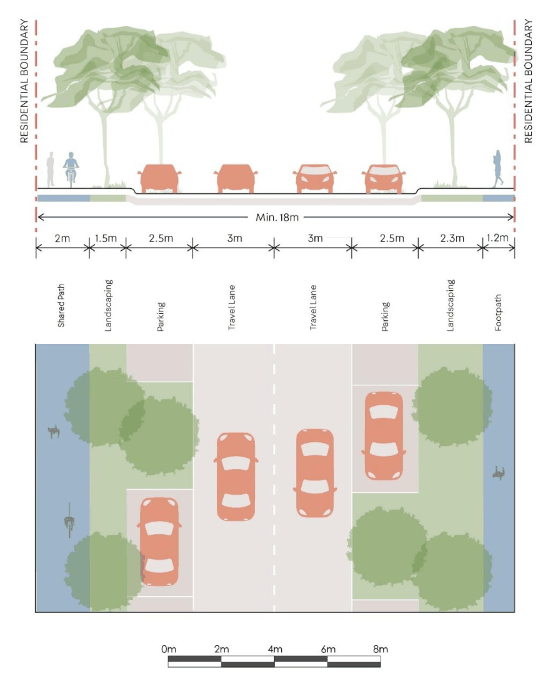
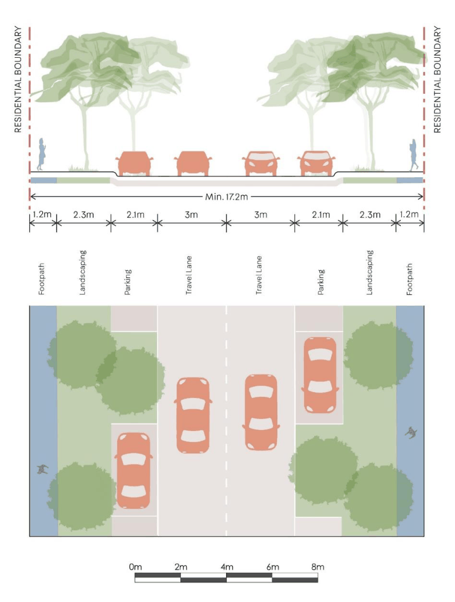
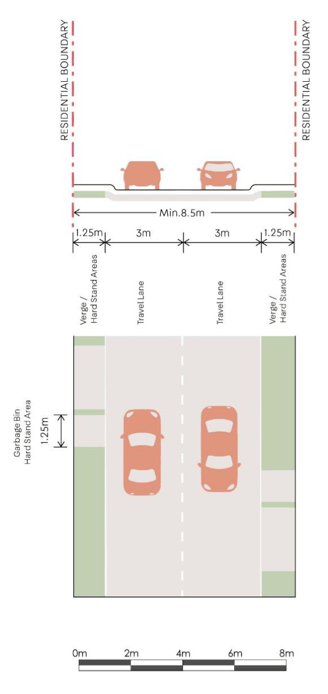
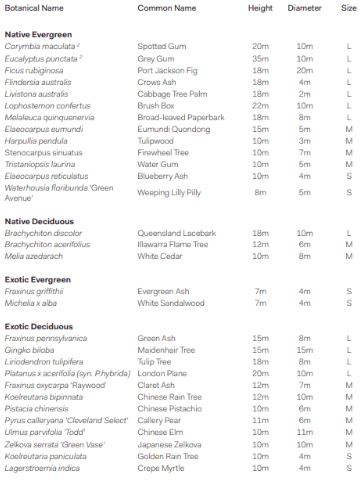

### 3.1 Street and block layout

#### Objectives

O1 To provide a hierarchy of interconnected streets that provides safe, convenient and clear access within and beyond the precinct.

O2 To establish a place framework that ensures that the hierarchy of streets is clearly discernible through variations in the carriageway width, on street parking, street tree planting and pedestrian amenities.

O3 To encourage the use of streets by pedestrians and cyclists and encourage sustainable travel behaviour.

O4 To ensure garage provision is managed across the site and does not dominate the streetscape.

O5 To provide safe access and manoeuvrability for service vehicles.

O6 To provide block that can accommodate a range of densities and lot sizes with appropriate solar orientation.

O7 To ensure development minimises impacts on any significant remnant vegetation.

#### Development controls

C1 Road network to be provided is consistent with the Concept Masterplan (Refer to Figure 2).

C2 Local roads are to measure a minimum of 18m in road reservation width and incorporate the following:

(a) 11m wide road carriageway.

(b) 3.5m verge width on each side (including a 1.2m wide footpath on one side of the road and a 2m shared path on either side of the road).

(c) Provision is to be made for vehicular footway crossing where required.

(d) The remainder of the verge is to be landscaped and include street trees in accordance with Figure 3.

C3 Minor local roads are to measure a minimum of 17.2m in width and incorporate the following:

(a) 10.2m wide road carriageway.

(b) 3.5m verge width on each side (including 1.2m wide footpath on both sides of road).

(c) Provision is to be made for vehicular footway crossing where required.

(d) The remainder of the verge is to be landscaped and include street trees in accordance with Figure 4.

C4 Laneways are to measure 8.5m in width and incorporate the following:

(a) 6m wide road carriageway.

(b) 1.25m verges with suitable provision of 1.25m x 1.25m garbage bin hard stand areas on each side for each dwelling (to allow for bin placement for council collection).

(c) The remainder of the verge on each side of the lane is to be landscaped in accordance with Figure 5.

C5 Based on traffic volumes, cross intersections of roads must be treated with roundabouts to modulate traffic flows where required.

C6 Straight road sections longer than 200m must provide speed calming devices such as raised thresholds or chicanes to self-enforce speed limits.

C7 Pedestrian crossings must be installed at least 5m away from stop/give way lines to allow one car space.

C8 Street layouts should prioritise connectivity and avoid dead-ends. Where dead-ends are proposed, provisions must allow vehicles to enter and exit in a forward direction.

C9 Where lots are proposed to be serviced by Council service vehicles provision should be made to allow for vehicles to enter and exit in a forward direction.

C10 Where the above cannot be provided to Council’s satisfaction, these roads and laneways shall remain in private ownership (e.g. shared carriageway, community title).

C11 Laneways are to be provided to facilitate waste collection from the rear of properties and to minimise driveway crossings and impediments to pedestrian and vehicle traffic flow along all roads.

C12 Where laneways are provided, vehicle access to sites is to be provided only via the laneway.

C13 The entrance from Bullecourt Avenue is to have a median for at least the first 50m into the site, measured from the Bullecourt boundary. The median is to be a minimum of 2.5m wide and must provide street tree plantings.

C14 A pedestrian crossing point with a pedestrian island is to be located near the existing vehicle entry point along Ashford Avenue. Note: Due to the high level of traffic generation and peak nature of traffic volumes accessing these forms of land uses, assessment of traffic impacts and pedestrian requirements is required by Council and Council may reasonably enforce the provision of mitigation measures that need to be incorporated into the design. Such measures may include, but are not limited to:

(a) raised pedestrian thresholds (wombat crossings);

(b) speed control devices;

(c) pedestrian refuges on streets, especially along streets which the development fronts; and

(d) provision of bus and drop off bays.

> [Picture on page 12: a picture, saved as a picture (images/ch-11-13-former-wsu-campus-milperra-page-12-1.gif, 150 dpi).]

Figure 3: Local road cross-section

Note: Landscaped ‘blisters’ may be supported by Council as areas to provide street tree planting, subject to application approval.

> [Picture on page 13: a picture, saved as a picture (images/ch-11-13-former-wsu-campus-milperra-page-13-1.gif, 150 dpi).]

Figure 4: Minor local road cross-section

Note: Landscaped ‘blisters’ may be supported by Council as areas to provide street tree planting, subject to application approval.

> [Picture on page 14: a picture, saved as a picture (images/ch-11-13-former-wsu-campus-milperra-page-14-1.gif, 150 dpi).]

Figure 5: Laneway cross-section

C15 Where a proposed residential property directly adjoins an open space (not separated by a road), fencing shall be a maximum 1.8m high with the part of the fence 1.5m above ground level to be a minimum 50% open construction and integrate with open space to ensure passive surveillance and a high quality design.

C16 All street parking spaces must be provided in accordance with Figure 2.

C17 Access to individual lots must consider and maximise opportunity for street parking and tree planting. Where a run of attached dwellings is proposed and there is insufficient space for street parking between driveways, a large canopy tree should be provided in the parking lane (refer to Figure 4 ‘landscape blisters’).

C18 A Vegetation Management Plan is prepared and implemented by a suitably qualified bush regenerator for the rehabilitation, management and long-term maintenance of any retained Cumberland Plain Woodland. Prior to felling trees, a nest box management plan must be prepared which includes details on:

(a) the number, size, type and location of tree hollows to be removed.

C19 The size, type, number and location of where the replacement nest boxes and/or compensatory artificial hollows using a HollowHog tool (https://www.hollowhog.com.au/) are to be installed based on the results of the pre-clearing survey. Prior to felling the trees, a suitably qualified ecologist must endeavour to individually remove sections of a tree containing a hollow or other habitat features for relocation and reuse by the project:

(a) trees with hollows should be lopped in such a way that the risk of injury or mortality to fauna is minimised, such as top-down lopping, with lopped sections gently lowered to the ground, or by lowering whole trees to the ground with the “grab” attachment of a machine;

(b) where it is not possible to remove a tree hollow/habitat feature prior to felling the tree, native fauna should first be removed before tree felling and the hollow bearing trees may then be slowly pushed over to avoid damage to hollows.

C20 Street tree planting and landscaping should be provided on both sides of the street at the site. The street setbacks shall be wide enough to:

(a) retain existing trees and allow for new planted street trees to grow to maturity without the need for lopping and trimming;

(b) accommodate any proposed footpaths plus allow for the street trees to grow to maturity.

C21 Lots and vehicular footway crossings fronting Ashford Avenue should be designed to retain existing street trees.

C22 A maximum block length of 180m applies, before providing a pedestrian through site link connection. These connections should line up with adjacent streets to allow for long views through the site.

C23 Pedestrian through site links are to be:

(a) 9m wide, including a 5m shared path and a 2m wide vegetated verge either side of the shared path.

(b) Open to the sky.

(c) Be accessible to pedestrians 24 hours a day and designed to be accessible for people of all abilities.

(d) Be designed to ensure pedestrian safety through the limiting of vehicular access (other than temporary maintenance or emergency vehicles).

(e) Provide a safe environment, including appropriate lighting and clear straight sightlines.

(f) Lighting shall be designed and installed in accordance with Australian Standards AS/NZS 1158 Lighting for roads and public spaces and AS/NZS 4282 Control of the obtrusive effects of outdoor lighting and to the satisfaction of Council.

(g) Tree species used within the pedestrian links are to be selected from the list below:

> [Picture on page 16: a picture, saved as a picture (images/ch-11-13-former-wsu-campus-milperra-page-16-16.gif, 150 dpi).]

(h) Understory planting to use low maintenance turf species (e.g. kikuyu or couch).

(i) The through site link path should be constructed to the Canterbury-Bankstown Council Standard Drawing S-029.

(j) Vehicle barriers are to be installed at path ends to comply with the Canterbury- Bankstown Council Standard Drawing S-033.

C24 Through site links are to be provided as an easement on title for public right of way. The landowner and/or developer may seek to enter into a planning agreement with Council for dedication of the land for pedestrian through site links to be dedicated as public roadways, as part of an application. Such a planning agreement would need to be subject to acceptable terms for Council, including but not limited to, a monetary contribution for the ongoing maintenance of the pedestrian through site link.

C25 Consideration must be given for the inclusion of a future pedestrian link along the southern boundary (north of the M5) to Horsley Road as part of any subdivision layout submitted to ensure this link is futureproofed as part of any subdivision DAs issued.

Note: Pedestrian through site links are to be constructed as part of the infrastructure works for each residential stage with detailed designs to be submitted as part of any construction certificate application. Authorisation of concepts for pedestrian through site links must occur as part of the DA stage.
