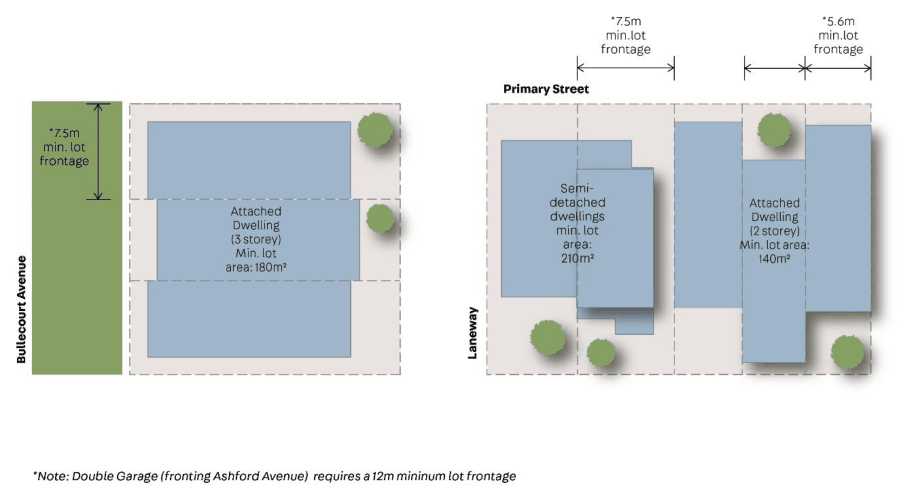

### 3.2 Residential lots

#### Objectives

O1 To provide an appropriate range and mix of housing typologies throughout the area.

O2 To provide an appropriate interface with the existing residential neighbourhood and Ashford Avenue.

O3 To ensure that the proposed density as conditional to the planning proposal and Instrument Change (PP-2021-5837) is applied in a manner that does not adversely impact the amenity of future residents.

O4 To create attractive streetscapes with distinctive characters and enhance walkability.

#### Development controls

C1 Lots are to comply with the following minimum areas and dimensions for the specified dwelling type as listed in Table 2.

| Type | Minimum lot area (m2) | Minimum parent lot area (m2) | Minimum lot frontage (m) |
|---|---|---|---|
| Attached dwelling (3 storeys) | 180m2 | 540m2 | 7.5m |
| Attached dwelling (2 storeys) | 140m2 | 420m2 | 5.6m |

| Type | Minimum lot area (m2) | Minimum parent lot area (m2) | Minimum lot frontage (m) |
|---|---|---|---|
| Semi-detached dwelling | 210m2 | 420m2 | 7.5m |
| Dwelling house | 245m2 | 245m2 | 9m |
| Dwelling House (including double garage fronting Ashford Avenue) | 300m2 | 300m2 | Equal to or greater than 12m |
| Dwelling House (including single garage fronting Ashford Avenue) | 300m2 | 300m2 | Equal to or greater than 10m |

Table 2: Lot areas and frontages (see Figure 6 for representation of each dwelling type)

C2 Lot sizes are to be generally consistent with the minimum lot sizes shown on Table 2 and be reflective of the intended dwelling type as shown in Figure 6.

C3 The width of the parent lot must not be less than the following when measured from the building line:

(a) 15m when front loaded

(b) 11.2m where the car parking is provided at the rear of the lot and accessed only from a secondary road, parallel road or lane.

C4 A maximum of six (6) attached dwellings (2 storey) (or a street wall length of 45 are permitted to be attached in a row before a break in the built form is required and a 0.9m side setback is applied.

C5 For attached dwellings, lots with a width less than 6m must be located opposite open space.

C6 The maximum width of all garage door openings facing a primary, secondary, or parallel road is to be in accordance with the following:

(a) For lot widths at the building line ranging from 8m to 12m, the maximum permissible width for garage door(s) is 3.2m.

(b) For lot widths at the building line that are equal to or greater than 12m, the maximum permissible width for garage door(s) is 6m.

(c) For any sized lots that have a boundary to a laneway, there is no maximum garage door opening size. Note, this will permit lots with a lot width of less than 10m to have a double garage to a rear lane.

C7 On all lots where a zero-lot line is permitted, the side of the allotment that may have a zero-lot alignment must be shown on the proposed subdivision plan.

C8 Where a zero-lot line is nominated on an allotment on the subdivision plan, the adjoining (burdened) allotment is to include a 900mm easement for zero lot walls to enable servicing, construction and maintenance of the adjoining dwelling. No overhanging eaves, gutters or services (including rainwater tanks, hot water units, air-conditioning units or the like) of the dwelling on the benefited lot will be permitted within the easement. Any services and projections permitted under clause 4.4(6) within the easement to the burdened lot dwelling should not impede the ability for maintenance to be undertaken to the benefitted lot.

C9 Subdivision of land creating residential lots equal to or less than 245m2 or lots equal to or less than 9m wide shall include an indicative dwelling design as part of the subdivision development application. The dwelling design is to be included on the S88B instrument attached to the lot. The indicative dwelling design is to include:

(a) proposed site plan

(b) proposed floor plans

(c) proposed roof plan.

> [Picture on page 19: a picture, saved as a picture (images/ch-11-13-former-wsu-campus-milperra-page-19-16.gif, 150 dpi).]

Figure 6: Minimum residential lot area and lot frontage for attached dwellings (3 storeys), semi-detached dwellings and dwelling houses

#### 3.2.1 Additional controls for certain dwelling types – studio dwellings

Note: Any reference to ‘studio dwelling’ development deemed permissible under this DCP should be interpreted as ‘multi dwelling housing’, consistent with the definitions outlined in the Canterbury-Bankstown Local Environmental Plan 2023. In the instances where an application includes the development of a ‘studio dwelling’, it must be lodged as a multi dwelling housing development and the controls specified for studio dwellings in this section are applicable.

#### Objectives

O1 To enable the development of a diversity of dwelling types across the subject site.

O2 To contribute to the availability of affordable housing options across the subject site.

O3 To promote the implementation of innovative housing solutions that are compatible with the prevailing residential context.

O4 To provide passive surveillance to rear lanes.

#### Development controls – studio dwelling

C1 Studio dwellings are to comply with the controls in Section 3 of this chapter, except where the controls within Section 3.2.1 differ, in which case the controls within Section 3.2.1 take precedence.

C2 Studio dwellings are to comply with the key controls in Table 4.

C3 The maximum gross floor area of a studio dwelling is 75m2.

C4 The finishes, materials and colours of the studio dwelling are to complement the principal dwelling to ensure studio dwellings visually integrate with the adjoining development.

C5 Windows and private open spaces must not overlook the private open space of any adjacent dwellings including the principal dwelling. Where windows may potentially overlook adjacent lots or the principal dwelling, windows and private open spaces must be obscured by glazing or screening or have a minimum sill height of 1.5m above floor level.

C6 Studio dwellings and associated garages may have a zero-lot setback to one side boundary and may be attached to another garage.

C7 Studio dwellings are to be located at the rear of a lot only where the lot has access from a rear lane or secondary street on a corner lot.

C8 Studio dwellings must not be attached to another studio lot where the second studio dwelling is associated with a dual occupancy or multi dwelling housing.

C9 Where a studio dwelling is built to a zero-lot line on a side boundary, the studio dwelling must not provide windows that are located along the zero-lot wall unless the wall adjoins a laneway, public open space or SP2 Drainage land.

C10 Rear garages with studio dwellings may have first level balconies facing the lane provided the balcony remains within the lot boundary. Where balconies are 2m deep and balconies overhang the lot line of the studio dwelling, the application must demonstrate how the garage setbacks underneath the studio dwelling will avoid creating opportunities for illegally parked cars and trailers.

C11 In the case of a studio dwelling constructed above a rear garage of a principal dwelling, it is mandatory to maintain a minimum separation distance of 5 meters between the upper floor rear facade of the principal dwelling and the studio dwelling.

C12 Studio dwellings are required to adhere to the separation controls specified in the latest edition of the National Construction Code.

Table 3: Additional controls for studio dwellings

| Element | Studio dwelling (strata) |
|---|---|
| On-site car parking | • One dedicated on-site car parking space. • Car parking space to be located behind building facade line of principal dwelling. Alternatively, parking can present to a laneway or secondary street. • Car parking space not to be in a stacked configuration. |
| Habitable rooms | • Habitable room depths are to be limited to a limited maximum of 2.5 x the ceiling height. • Every habitable room must have a window in an external wall with a total minimum glass area of not less than 10% of the floor area of the room. Daylight and air may not be borrowed from other rooms. • In open plan layouts (where the living, dining and kitchens are combined), the maximum habitable room depth is 8m from a window. |
| Bedrooms | • Master bedrooms must have a minimum area of 10m2 (excluding wardrobe space). • All bedrooms are to have a minimum dimension of 3m. |
| Living rooms/dining rooms | • Living rooms or combined living/dining rooms are to have a minimum width of 3.6m. |
| Principal private open space | • Balcony accessed directly off living space having minimum size of 8m² with a minimum dimension of 2m. |
| Subdivision | • Strata title subdivision only from the principal dwelling on the land. |
| Pedestrian access | Access to be separate from the principal dwelling and is to front a secondary street, lane or shared private access way and be clearly identifiable as a building entry and visually separated from the associated garage. |
| Services and facilities | Provision for separate services, such as mail delivery and waste collection, and an on-site garbage storage area so that bins are not visible from public street or laneway. To be located on a street address that can be accessed by garbage collection and mail delivery services. May be serviced from the front residential street via the principal dwelling lot. |
| Storage | • In addition to storage in kitchens, bathrooms and bedrooms, a minimum of 4m3 of storage must be provided for each studio dwelling. • At least 50% of the 4m3 of storage to be provided for studio dwellings (excluding storage for kitchens, bathrooms, and bedrooms) must be located within the apartment. |
| Passive surveillance | Balconies and living areas must be located to overlook laneways to enable passive surveillance. |

#### Development controls – multi dwelling housing containing one studio dwelling

C1 All studio dwellings contained within the same lot as a multi dwelling configuration must be designed in accordance with the controls provided in Table 3.

C2 The parent lot size must be equal to or greater than 450m2.

#### Development controls – dual occupancy containing a studio dwelling

Studio dwellings can be delivered as a dual occupancy comprising of one dwelling and a ‘subdividable studio’. A studio dwelling consists of a dwelling constructed above a garage that is associated with the principal dwelling or are free standing. The studio lot must be located to address a road or laneway. A subdividable (via strata) studio shall comply with the following:

C1 All studio dwellings contained within the same lot as a dual occupancy must be designed in accordance with the controls provided in Table 3.

C2 The parent lot size must be equal to or greater than 350m2.
