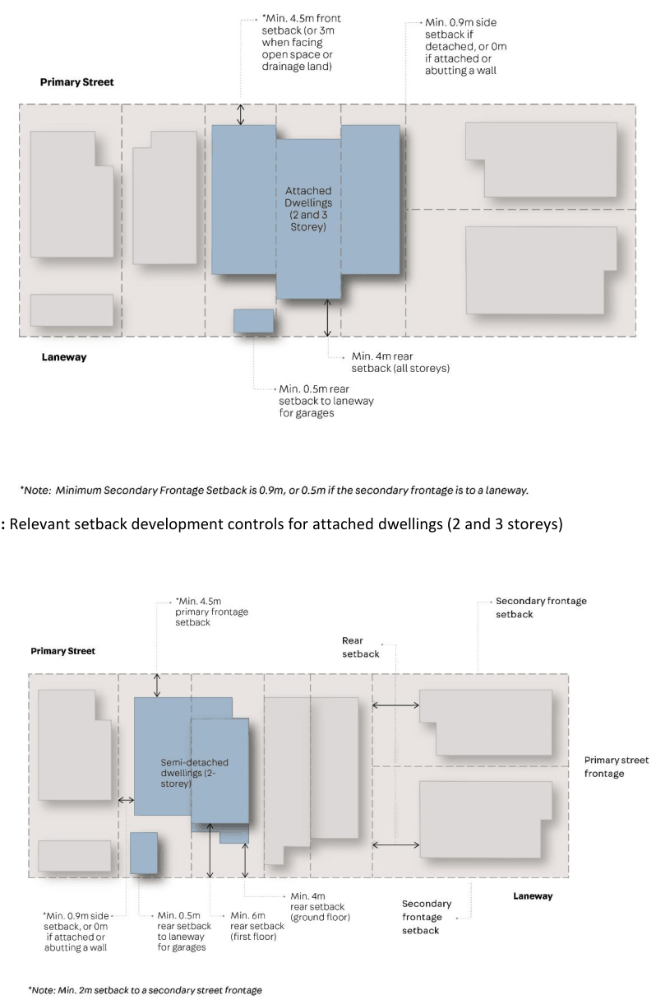
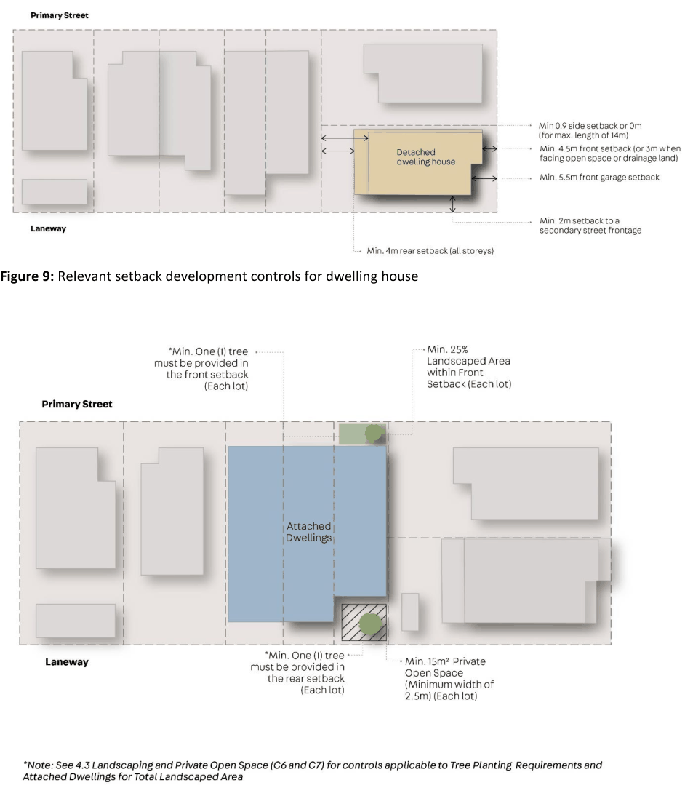
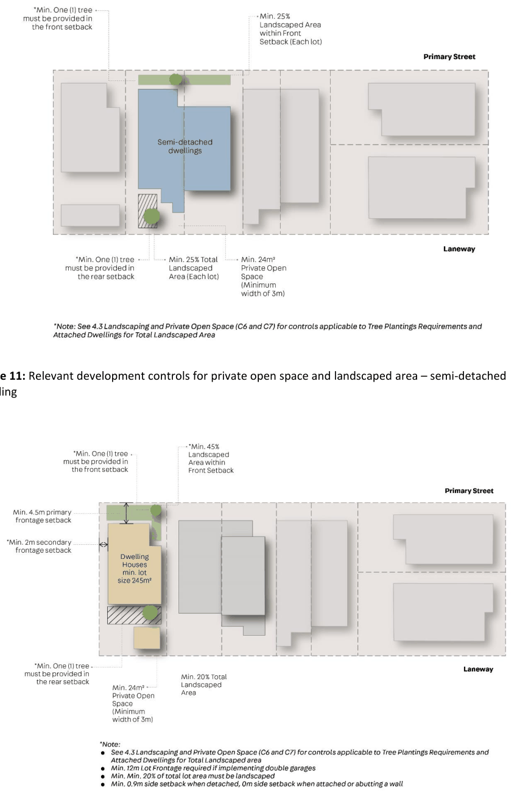
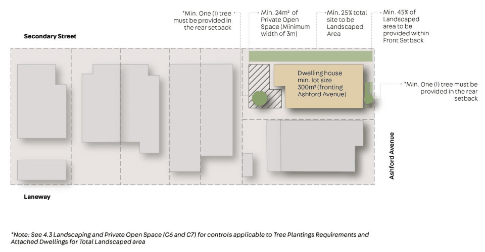
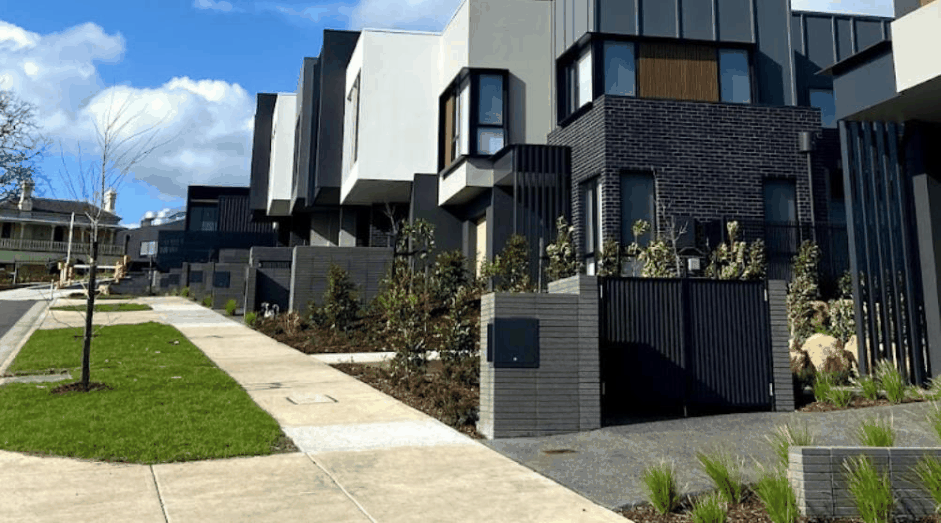

### 4.2 Dwelling design

#### Objectives

O1 To encourage high quality design that enhances the built form and character of the neighbourhood.

O2 To provide spaces between buildings and streets to maintain and reinforce streetscape character and provide for air flow, sunlight, landscaping and general amenity.

O3 To provide areas of high-quality landscaping that allow for the planting and growth of trees.

O4 Ensure garages to not dominate the streetscape.

O5 To allow for flexibility in block configuration in terms of the final dwelling mix and arrangement of residential products.

#### Development controls

C1 Dwellings must be designed to be consistent with the controls in the Table 5.

C2 0m side setback controls for attached dwellings are as follows:

(a) Permitted for a maximum length of 21m on the ground floor.

(b) Permitted for a maximum length of 16m for the 2nd and 3rd storey.

(c) All eaves and gutters will be contained within the lot boundary of the associated dwelling.

C3 Dwellings are required to have their main orientation towards the primary street or open space. This control excludes studio dwellings. Front pedestrian entrances to all dwellings must be visible from the primary street.

C4 Front building facades must be articulated. This articulation may include front porches, entries, wall indents, changes in finishes, balconies, and verandas.

C5 For two and three storey developments, side walls (where not attached to another development) must be articulated if the wall has a continuous length greater than 10m.

Note: Articulation is taken to mean a change in the use of materiality or consistent change in building form along the continuous length of a wall.

Table 5: Residential development controls (Note: all controls stipulated apply to each single residential lot created by any subdivision and not the parent lot)

| Type | Minimum private open space | Minimum landscaped area (% of lot) | Minimum primary frontage setback | Minimum secondary frontage setback | Minimum side setback | Minimum rear setback |
|---|---|---|---|---|---|---|
| Attached dwelling (3 Storey) | 15m2 (minimum dimension of 2.5m) | 15% | 4.5m, or 3m when facing open space or drainage land. | 0.9m, or 0.5m if the secondary frontage is to a laneway. | 0.9m or 0m if adjoining lot building is less than 900mm from boundary and building wall are of masonry construction with no window. | 4m for all storeys. Garages along a laneway must be setback 500mm from the property boundary. |
| Attached dwelling (2 Storey) | 15m2 (minimum dimension of 2.5m) | 15-25%. See Section 4.3 C6below. | 4.5m, or 3m when facing open space or drainage land. | 0.9m, or 0.5m if the secondary frontage is to a laneway. | 0.9m or 0m if adjoining lot building is less than 900mm from boundary and building wall is of masonry construction with no window. | 4m for all storeys. Garages along a laneway must be setback 500mm from the property boundary. |
| Semi-detached dwelling (2 Storey) | 24m2 (minimum dimension of 3m) | 25% | 4.5m, or 3m when facing open space or drainage land. | 2m | 0.9m or 0m if adjoining lot building is less than 900mm from boundary and building wall is of masonry construction with no window. | Garages along a laneway must be setback 500mm from the property boundary. |
| Dwelling house | 24m2 (minimum dimension of 3m) | 25% | 4.5m | 2m | 0.9m or 0m for a maximum length of 14m | Ground floor: 4m. First Floor: 6m. Garages along a laneway must be setback 500mm from the property |

| Type | Minimum private open space | Minimum landscaped area (% of lot) | Minimum primary frontage setback | Minimum secondary frontage setback | Minimum side setback | Minimum rear setback boundary. |
|---|---|---|---|---|---|---|
| Dwelling house (fronting Ashford Avenue) | 24m2 (minimum dimension of 3m) | 25% | 5.5m | 2m | 0.9m or 0m for a maximum length of 14m. | Ground floor: 4m. First Floor: 6m. Garages along a laneway must be setback 500mm from the property boundary. |
| Dwelling house (including double garage) (fronting Ashford Avenue) | 24m2 (minimum dimension of 3m) | 25% | 5.5m | 2m | 0.9m or 0m for a maximum length of 14m. | Ground floor: 4m. First Floor: 6m. Garages along a laneway must be setback 500mm from the property boundary. |
| Dwelling house (including single garage) (fronting Ashford Avenue) | 24m2 (minimum dimension of 3m) | 25% | 5.5m | 2m | 0.9m or 0m for a maximum length of 14m. | Ground floor: 4m. First Floor: 6m. Garages along a laneway must be setback 500mm from the property boundary. |

> [Picture on page 37: a picture, saved as a picture (images/ch-11-13-former-wsu-campus-milperra-page-37-1.gif, 150 dpi).]

Figure 7: Relevant setback development controls for attached dwellings (2 and 3 storeys)

Figure 8: Relevant setback development controls for semi-detached dwelling. Note the above figure shows the relevant frontages and rear setbacks for dwellings that are located on corner lots.

> [Picture on page 38: a picture, saved as a picture (images/ch-11-13-former-wsu-campus-milperra-page-38-1.gif, 150 dpi).]

Figure 9: Relevant setback development controls for dwelling house

Figure 10: Relevant development controls for private open space and landscaped area – attached dwellings (2 and 3 storey)

> [Picture on page 39: a picture, saved as a picture (images/ch-11-13-former-wsu-campus-milperra-page-39-1.gif, 150 dpi).]

Figure 11: Relevant development controls for private open space and landscaped area – semi-detached dwelling

Figure 12: Relevant development controls for private open space and landscaped area – dwelling house

> [Picture on page 40: a picture, saved as a picture (images/ch-11-13-former-wsu-campus-milperra-page-40-1.gif, 150 dpi).]

Figure 13: Relevant development controls for private open space and landscaped area – dwelling house (fronting Ashford Avenue)

C6 Dwellings that face two frontages or a street and a public space must address both frontages using verandas, windows, or other similar modulating elements.

C7 Garage doors must comply with Section 3.2 (Residential Lots), C6 to ensure garage doors do not detract from the amenity of the streetscape.

C8 Driveways should have a maximum width of 3m at the front boundary. Where double garages are proposed, driveway must have maximum width of 4m at the street boundary.

C9 Within a DA proposing two (2) or more residential dwellings, it is accepted to provide less than the required quantum of landscaped area per dwelling if the average landscaped area across the residential dwellings is the minimum stipulated within Table 5 for that type of residential dwelling, and:

(a) 35% tree canopy coverage to the street is provided, including all lots with primary frontage to the street.

(b) Landscaping should consist of a mix of high canopy trees, and low under-storey planting.

Note: The average applies to the lots that form part of a single DA that proposes construction for the dwellings.

C10 A planted area of at least 1m x 0.5m is to be provided in the laneway setback for each lot with the remainder used for garage access, rear gates and temporary bin storage.

C11 Fences forward of the front building line have a maximum height of 1.1m.

C12 On corner lots 1.8m high fences to rear gardens should not exceed 50% of the lot boundary. The materials and design of fences is to be of high quality – such as battens or pickets.

C13 Where a run of attached dwellings is proposed on narrow lots (less than 7.5m wide), driveways should be paired and limited to provide maximal opportunity for street parking and promote the retention of existing trees.

C14 Where a run of attached dwellings is proposed, a large canopy tree should be provided in the parking lane.

C15 All services should be concealed within the streetscape and should not detract from the visual amenity of streets. Bin enclosures should be set back from the front boundary, behind landscaping or letterboxes. Refer to Figure 14 for an example of a well-designed bin enclosure forward of the front building line.

C16 Where a double garage is proposed, the upper-level building line must extend forward over the line of the garage doors.

> [Picture on page 41: a picture, saved as a picture (images/ch-11-13-former-wsu-campus-milperra-page-41-12.gif, 150 dpi).]

Figure 14: Example of bin enclosure well integrated with the dwelling design and streetscape

C17 Dwellings can provide an articulation zone as follows:

(a) 1.5 metres beyond front building line and a maximum of 25% of lot width.

(b) This zone permits additional building elements within this zone such as entry features and porticos, balconies, decks, verandas, blade walls and bay windows.

(c) An awning or other feature over a window including sun shading devices are not included in the 25% maximum area as defined in this clause.
