## Section 4 - General Provisions

#### 23

### 4.1	 Traffic, Access and Parking

24

### 4.2	 Sustainability

27

### 4.3	 Heritage

28

### 4.4	 Waste

32

## SECTION 1 INTRODUCTION

### 1.1	 Name of this Plan

5

### 1.2	 Purpose of this Chapter

5

### 1.3	 Land to which this DCP applies

5

### 1.4	 Relationship to other planning instruments

and DCPs

6

### 1.1 - Name of this Plan

This Plan is known as the Stage 1 Riverwood

Estate Development Control Plan 2023 (DCP).

### 1.2 - Purpose of this Chapter

The purpose of this DCP is to provide detailed

controls to guide the first stage of development

at the Riverwood Estate.

### 1.3 - Land to which this DCP

### applies

This section of the DCP applies to part of the

land within the Riverwood Estate, as outlined in

blue and illustrated in Figure 1.

The proposed first stage of development is

located to the north east of the Riverwood

Estate bound by Washington Avenue to the

north, Belmore Road North to the east, and

Roosevelt Avenue to the south.

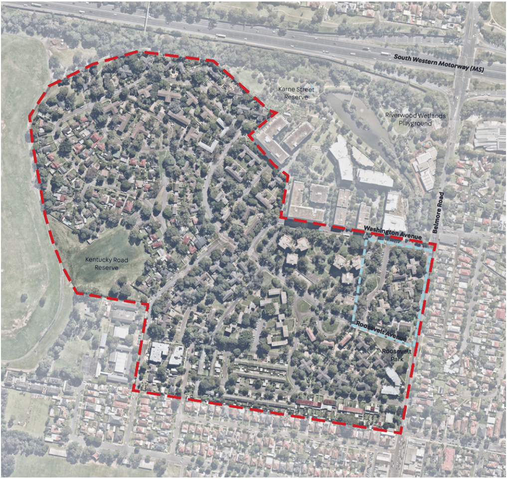

> [Picture on page 5: a picture, saved as a picture (images/ch-11-14-riverwood-estate-page-5-18.gif, 150 dpi).]

Figure 1. The site (outlined in blue) within the Riverwood Estate (outlined in red)

### 1.4 - Relationship to other planning instruments and DCPs

This DCP is for the purposes of Section 4.15 of the Environmental Planning and Assessment Act 1979 (EP&A Act).

This DCP adopts the provisions of the Canterbury- Bankstown DCP 2023 (DCP 2023) in accordance with 3.43(3) of the EP&A Act.

This DCP is to be read in conjunction with the provisions and requirements of:

•	 The Canterbury-Bankstown Local Environmental Plan 2023 (LEP 2023); and

•	 Any other relevant policy adopted by Canterbury-Bankstown Council.

•	 Any other relevant policy adopted by the Department of Planning, Housing and Infrastructure

References in this DCP to the LEP 2023 or DCP 2023 are also references to any replacement of those plans.

If there is an inconsistency between this DCP and the provisions of the DCP 2023, this DCP prevails to the extent of the inconsistency.

Canterbury-Bankstown Development Control Plan 2023

In this DCP ‘

•	 ‘Consent Authority’ means:

— Canterbury-Bankstown Council in its

capacity under the Environmental Planning

and Assessment Act 1979; or

— The Canterbury-Bankstown Local Planning

Panel (CBLPP); or

— The Land and Environment Court of New

South Wales; or

— The Department of Planning, Housing and

Infrastructure.

•	 ‘Council’ means Canterbury-Bankstown

Council in its capacities outside the

Environmental Planning and Assessment Act

1979, such as a landowner or authority under

the Local Government Act 1993, or similar.

•	 ‘SSP’ refers to State Significant Precinct, being

areas identified by the NSW Government as

having state or regional importance due to their

social, economic, or environmental value.

•	 The ‘Court’ refers to the Land and Environment

Court of New South Wales , established on 1

September 1980 by the Land and Environment

Court Act 1979 (the Court Act).

Chapter 11.14 - Riverwood Estate

## SECTION 2 VISION AND CHARACTER

### 2.1	 Vision

8

### 2.2	 Project Objectives

9

### 2.1 - Vision

Our vision is to deliver a new neighbourhood in Riverwood that contributes to the growth of Greater Sydney as a more liveable, productive and sustainable metropolis and provides a greater supply of diverse and affordable housing in an area identified for renewal.

The Riverwood Estate will be transformed into an attractive and safe neighbourhood with a mixture of private and social housing. People will choose to live here because of the high-quality buildings, facilities and open space, and connections to nearby transport, schools, employment opportunities and services.

New housing, transport and social infrastructure will support a growing and more diverse community with different housing needs. The development will be accessible and welcoming, complementing the site’s natural setting with new and upgraded parks positioned amongst mature trees and improved connections to Salt Pan Creek, a central part of Metropolitan Sydney’s Blue-Green Grid.

Canterbury-Bankstown Development Control Plan 2023

It will be a place that celebrates the site’s history

and provide opportunities to re-establish

Connection to Country. There will be a network of

new and reinstated tree-lined pedestrian-friendly

streets that connect shared facilities and open

spaces to encourage residents to engage with

each other and the broader Riverwood community.

Buildings and dwellings will be designed to activate

streets and provide natural surveillance of the

public domain.

The development will be a sustainable built

environment. Contemporary sustainability features

will be integrated into buildings and the public

domain, including commitments to a tree canopy

target and management of water in the landscape

to mitigate against the effects of climate change

and urban heat.

Chapter 11.14 - Riverwood Estate

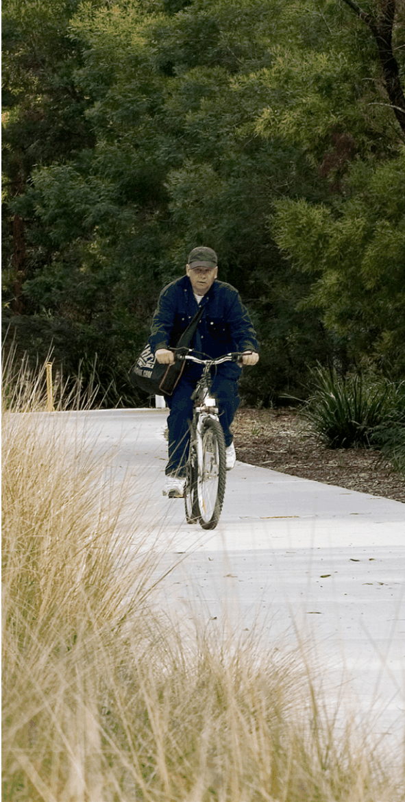

> [Picture on page 8: a picture, saved as a picture (images/ch-11-14-riverwood-estate-page-8-46.gif, 150 dpi).]

### 2.2 - Project Objectives

The redevelopment of the site is to be in accordance with the following project objectives:

•	 To deliver the sustainable renewal of the Riverwood Estate, transforming it into a more safe, attractive, and connected neighbourhood with a strong connection to its past.

•	 To increase housing supply, diversity, and affordability in a mixed tenure development that meets the needs of current and future residents.

•	 To integrate development with the natural environment, surrounding neighbourhood and Riverwood centre.

•	 To provide a high-quality public domain where it is enjoyable to move around the precinct, play and relax.

•	 To provide welcoming community spaces and facilities that support people to connect with others.

•	 To achieve high environmental performance that addresses the effects of climate change and urban heat through management of water in the landscape, tree retention and planting, and sustainable buildings.

> [Picture on page 9: a picture, saved as a picture (images/ch-11-14-riverwood-estate-page-9-27.gif, 150 dpi).]

## SECTION 3 STRUCTURE PLAN AND BUILT FORM

3.1	 Structure Plan, Street and Block Layout 11

### 3.2	 Height

14

### 3.3	 Setbacks and Street Wall Heights

15

### 3.4	 Building Design

17

### 3.5	 Open Space and Landscaping

18

### 3.6	 Water Sensitive Urban Design and Stormwater

Management

20

### 3.7	 Solar Access

22

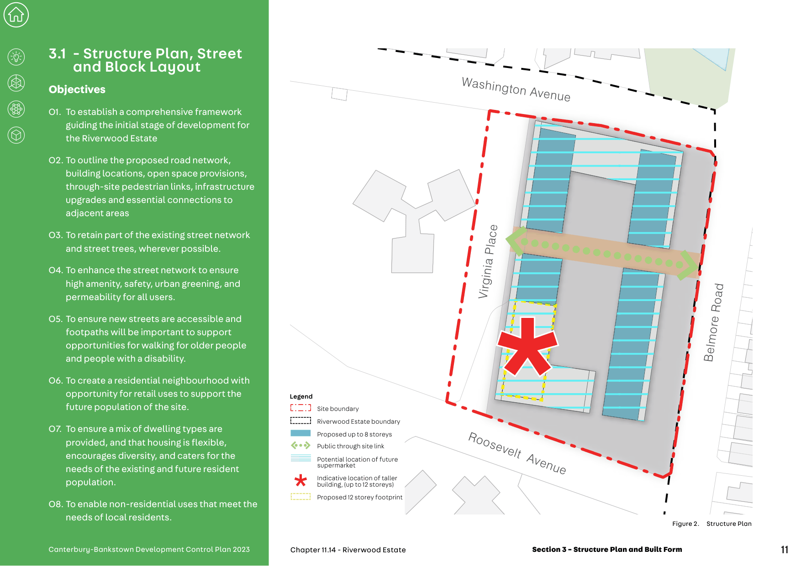

> [Picture on page 11: a picture, saved as a picture (images/ch-11-14-riverwood-estate-page-11-1.gif, 150 dpi).]
> Words printed on the picture (title and legend, copied from the PDF):
> needs of local residents.
> Canterbury-Bankstown Development Control Plan 2023
> Indicative location of taller
> building, (up to 12 storeys)
> Proposed 12 storey footprint
> Chapter 11.14 - Riverwood Estate

Figure 2. Structure Plan

### 3.1	 - Structure Plan, Street

### and Block Layout

#### Objectives

O1.	 To establish a comprehensive framework guiding the initial stage of development for the Riverwood Estate

O2.	To outline the proposed road network, building locations, open space provisions, through-site pedestrian links, infrastructure upgrades and essential connections to adjacent areas

O3.	To retain part of the existing street network and street trees, wherever possible.

O4.	To enhance the street network to ensure high amenity, safety, urban greening, and permeability for all users.

O5.	To ensure new streets are accessible and footpaths will be important to support opportunities for walking for older people and people with a disability.

O6. To create a residential neighbourhood with opportunity for retail uses to support the future population of the site.

O7.	 To ensure a mix of dwelling types are provided, and that housing is flexible, encourages diversity, and caters for the needs of the existing and future resident population.

O8.	To enable non-residential uses that meet the

#### Washington Avenue

| Place |
|---|

#### Virginia

|  | * |
|---|---|
| Legend Site boundary Riverwood Estate boundary |  |
| Proposed up to 8 | storeys |
| Public through site link | Roosevelt |
| Potential location of | future |
| supermarket | Avenue |

#### Road Belmore

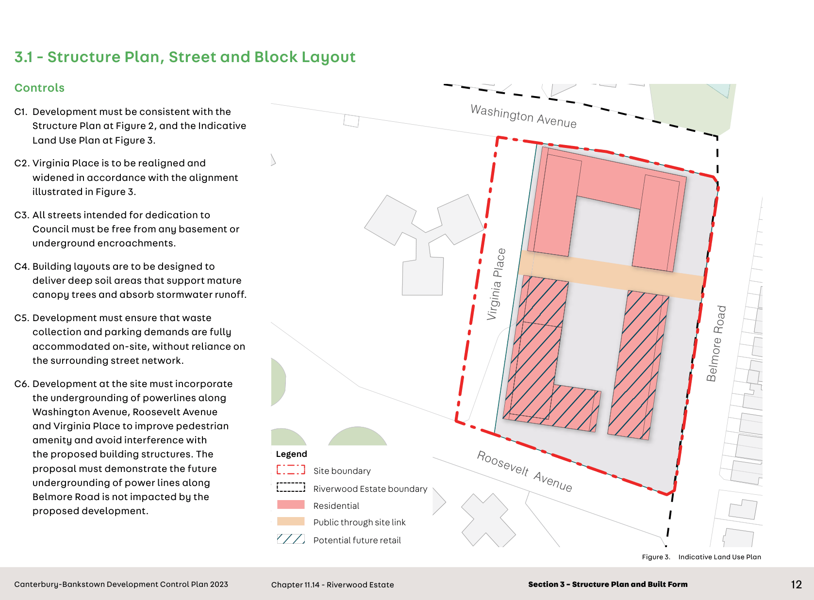

> [Picture on page 12: a picture, saved as a picture (images/ch-11-14-riverwood-estate-page-12-1.gif, 150 dpi).]
> Words printed on the picture (title and legend, copied from the PDF):
> Legend
> Site boundary
> Riverwood Estate boundary
> Residential
> Public through site link
> Potential future retail

Figure 3. Indicative Land Use Plan

### 3.1 - Structure Plan, Street and Block Layout

#### Controls

C1.	 Development must be consistent with the

#### Washington Avenue

Structure Plan at Figure 2, and the Indicative Land Use Plan at Figure 3.

C2.	Virginia Place is to be realigned and widened in accordance with the alignment illustrated in Figure 3.

C3.	All streets intended for dedication to Council must be free from any basement or underground encroachments.

C4.	Building layouts are to be designed to deliver deep soil areas that support mature canopy trees and absorb stormwater runoff.

#### Virginia Place

C5.	Development must ensure that waste collection and parking demands are fully accommodated on-site, without reliance on the surrounding street network.

#### Belmore Road

C6.	Development at the site must incorporate

#### Roosevelt  Avenue

the undergrounding of powerlines along Washington Avenue, Roosevelt Avenue and Virginia Place to improve pedestrian amenity and avoid interference with the proposed building structures. The proposal must demonstrate the future undergrounding of power lines along Belmore Road is not impacted by the proposed development.

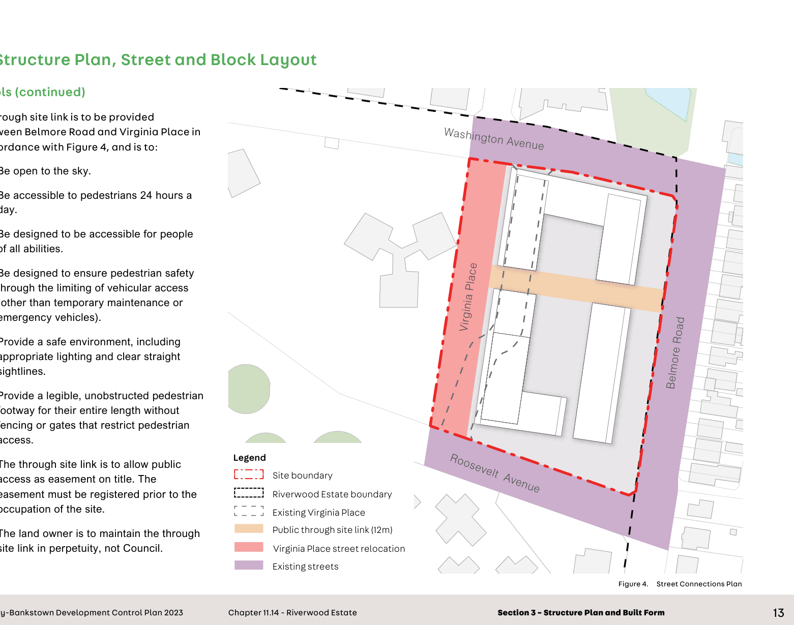

> [Picture on page 13: a picture, saved as a picture (images/ch-11-14-riverwood-estate-page-13-1.gif, 150 dpi).]
> Words printed on the picture (title and legend, copied from the PDF):
> Washington Avenue
> (a) Be open to the sky.
> (b) Be accessible to pedestrians 24 hours a
> day.
> (c) Be designed to be accessible for people
> of all abilities.
> (d) Be designed to ensure pedestrian safety
> through the limiting of vehicular access
> (other than temporary maintenance or
> emergency vehicles).
> Virginia Place
> (e) Provide a safe environment, including
> appropriate lighting and clear straight
> sightlines.
> Belmore Road
> (f) Provide a legible, unobstructed pedestrian
> footway for their entire length without
> fencing or gates that restrict pedestrian
> access.
> Legend
> (g) The through site link is to allow public
> Site boundary
> Roosevelt  Avenue
> Riverwood Estate boundary
> access as easement on title. The
> easement must be registered prior to the
> occupation of the site.
> Existing Virginia Place
> Public through site link (12m)
> (h) The land owner is to maintain the through
> Virginia Place street relocation
> site link in perpetuity, not Council.
> Existing streets

Figure 4. Street Connections Plan

### 3.1 - Structure Plan, Street and Block Layout

#### Controls (continued)

C7.	 A through site link is to be provided between Belmore Road and Virginia Place in accordance with Figure 4, and is to:

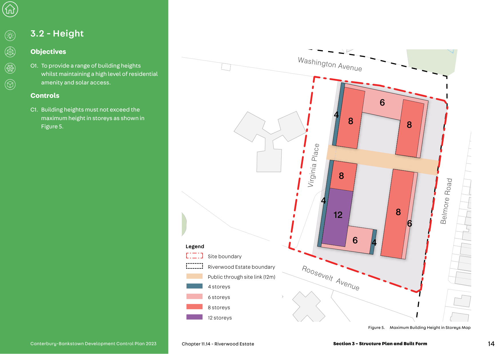

> [Picture on page 14: a picture, saved as a picture (images/ch-11-14-riverwood-estate-page-14-1.gif, 150 dpi).]
> Words printed on the picture (title and legend, copied from the PDF):
> Canterbury-Bankstown Development Control Plan 2023
> Legend
> Site boundary
> Riverwood Estate boundary
> Public through site link (12m)
> 4 storeys
> 6 storeys
> 8 storeys
> 12 storeys
> Chapter 11.14 - Riverwood Estate

Figure 5.

Figure 5. Maximum Building Height in Storeys Map

### 3.2 - Height

#### Objectives

O1.	 To provide a range of building heights whilst maintaining a high level of residential amenity and solar access.

#### Controls

C1.	 Building heights must not exceed the maximum height in storeys as shown in

#### Washington Avenue

### 6

### 4

### 8

### 8

### 8

#### Virginia Place

### 4

### 8

### 12

#### Belmore Road

### 6

### 6

### 4

#### Roosevelt  Avenue

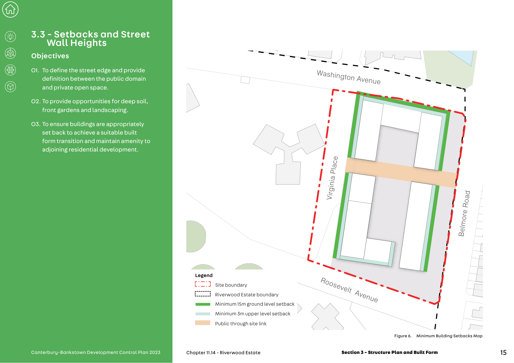

> [Picture on page 15: a picture, saved as a picture (images/ch-11-14-riverwood-estate-page-15-1.gif, 150 dpi).]
> Words printed on the picture (title and legend, copied from the PDF):
> front gardens and landscaping.
> Canterbury-Bankstown Development Control Plan 2023
> Chapter 11.14 - Riverwood Estate

Figure 6. Minimum Building Setbacks Map

### 3.3 - Setbacks and Street

### Wall Heights

#### Objectives

O1.	 To define the street edge and provide definition between the public domain and private open space.

O2.	To provide opportunities for deep soil,

O3.	To ensure buildings are appropriately set back to achieve a suitable built form transition and maintain amenity to adjoining residential development.

| Washington Avenue Place Virginia Road Belmore Legend Riverwood Site boundary Estate boundary Roosevelt Minimum 15m ground level setback Avenue Minimum 3m upper level setback Public through site link |
|---|

### 3.3 - Setbacks and Street Wall Heights

#### Controls

C1.	 Minimum setbacks are to be provided in

C7.	 Where height controls allow, any building

accordance with Figure 6.

C2.	Building setbacks must retain existing trees

above 8 storeys should be limited to a single tower form only (this is to prevent the provision of multiple tall building elements).

that fall within the setbacks and accommodate additional tree planting.

C8.	Any building component that is 8 storeys high or more must:

C3.	To Belmore Road, a minimum setback of

(a)	 Be of a slender form to reduce visual

15m is required up to 6 storeys. Any building component that is above 6 storeys is to be setback a further 3m. The maximum height of any street wall shall not exceed 6 storeys.

impacts where the size of any floor plate above 8 storeys must not exceed 750 square metres Gross Floor Area (GFA).

C4.	To Washington Avenue, a minimum setback

(b)	 Have a maximum street frontage length of no greater than 50m.

(c)	 Be setback by a minimum of 3 metres above the podium level.

of 3m is required up to 6 storeys. Any building component above 6 storeys is to be setback a further 3m. The maximum height of any street wall shall not exceed 6 storeys.

(d)	 Be aligned north-south to maximise solar

C5.	To Virginia Place, a minimum setback of

access to the public domain

3m is required up to 4 storeys. Any building component that is above 4 storeys is to be setback a further 3m. The maximum height of any street wall shall not exceed 4 storeys.

C6.	To Roosevelt Avenue, minimum setbacks for buildings up to 6 storeys are to be provided in accordance with Figure 6. Any building component above 6 storeys is to be setback a further 3m. The maximum height of any street wall shall not exceed 6 storeys.

Image 4.	 Source: Canterbury-Bankstown Council

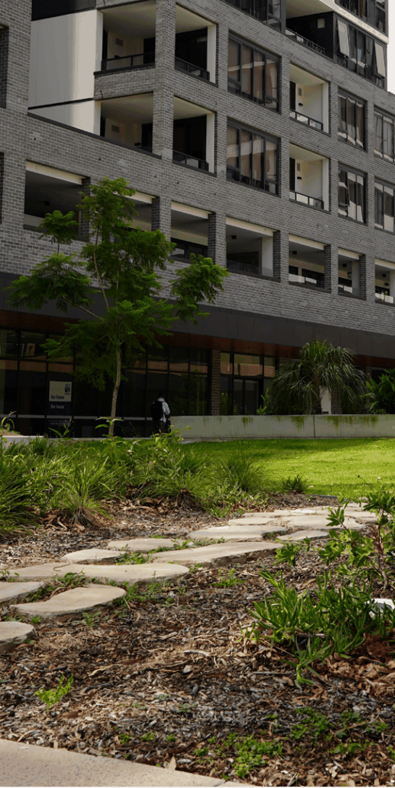

> [Picture on page 16: a picture, saved as a picture (images/ch-11-14-riverwood-estate-page-16-46.gif, 150 dpi).]

### 3.4 - Building Design

#### Objectives

O1.	 To provide high quality architecture and contribute positively to the streetscape.

O2.	To enhance the amenity of occupants in buildings in terms of daylight, outlook, view sharing, ventilation, wind mitigation, and privacy.

Canterbury-Bankstown Development Control Plan 2023

#### Controls

C1.	 Buildings are to be designed to face the street, and to enhance the public domain through building entrances, active uses at ground level, good quality finishes and well resolved architectural design.

C2.	 Regular Building indentations must be provided for all buildings along street frontages every 45 metres, with a width-to-depth ratio of at least 3:1 to enhance the architectural form and introduce visual interest.

C3.	 Building facades must be articulated if the building is less than 8 storeys and has a continuous street frontage length over 60m.

C4.	 Building façades are to be articulated into smaller elements or distinctive treatments, at a scale or grain that reflects:

(a)	 Different uses and/or components of the building.

(b)	 Two storey maisonette typology.

(c)	 The residential entries and/or lobby.

(d)	 The ground floor, lower floors, top floor, and roof.

Chapter 11.14 - Riverwood Estate

C5.	 Blank solid walls at ground level, facing the street and public domain are to be avoided.

C6.	 Ensure social housing is designed to be indistinguishable from other forms of housing.

C7.	 Roof forms, plant and lift overruns are to be designed to be simple compact forms that are visually unobtrusive.

C8.	 Balconies, sun shading devices, and architectural features may extend up to a maximum of 1 metre beyond the primary building setback. Architectural features extending beyond the main building setback must not exceed 65% of the building’s street frontage length at any floor level.

C9.	 Residential entries and lobbies are to be clearly visible, unobstructed, and easily identifiable from the street and public domain.

C10.	To ensure the appearance of the development provides a positive impact to the surrounding area, an indicative schedule must be submitted with the Development Application that demonstrates the new buildings on the site will be maintained by the land owners in perpetuity.

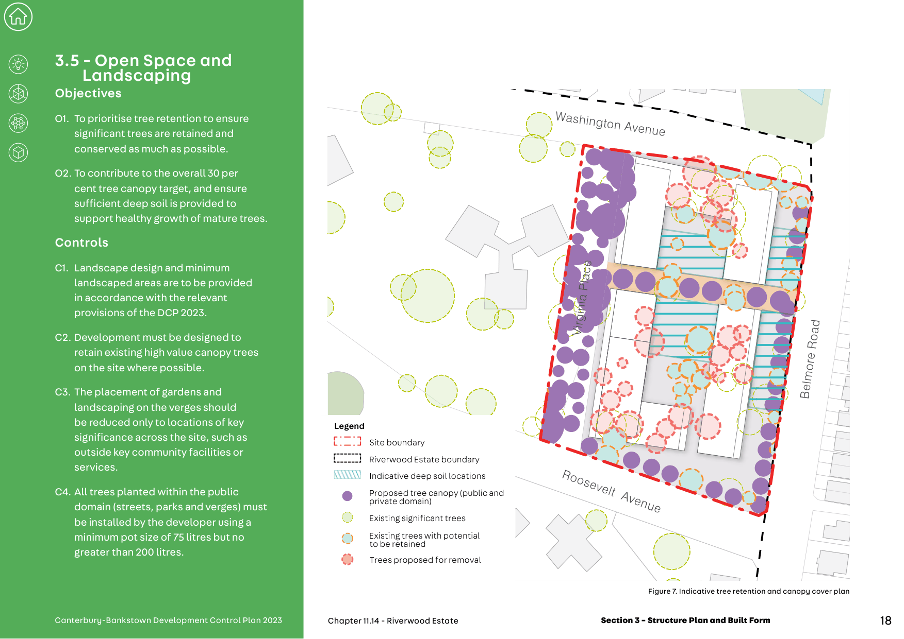

> [Picture on page 18: a map, saved as a picture (images/ch-11-14-riverwood-estate-page-18-1.gif, 150 dpi); the street names and other small labels are on the picture.]
> Words printed on the picture (title and legend, copied from the PDF):
> Canterbury-Bankstown Development Control Plan 2023
> Riverwood Estate boundary
> Indicative deep soil locations
> Proposed tree canopy (public and
> Existing significant trees
> Existing trees with potential
> to be retained
> Trees proposed for removal
> Chapter 11.14 - Riverwood Estate

Figure 7. Indicative tree retention and canopy cover plan

3.5 - Open Space and

### Landscaping

#### Objectives

O1.	 To prioritise tree retention to ensure significant trees are retained and conserved as much as possible.

O2.	To contribute to the overall 30 per cent tree canopy target, and ensure sufficient deep soil is provided to support healthy growth of mature trees.

#### Controls

C1.	 Landscape design and minimum landscaped areas are to be provided in accordance with the relevant provisions of the DCP 2023.

C2.	Development must be designed to retain existing high value canopy trees on the site where possible.

C3.	The placement of gardens and landscaping on the verges should be reduced only to locations of key significance across the site, such as outside key community facilities or services.

C4.	All trees planted within the public domain (streets, parks and verges) must be installed by the developer using a minimum pot size of 75 litres but no greater than 200 litres.

### 3.5 - Open Space and Landscaping

### Controls (continued)

C12.	Deep soil targets are to be provided in

C5. A consistent deep soil zone should be

accordance with the Apartment Design Guide (ADG).

provided along all street boundaries to facilitate a generous landscaped buffer with substantial canopy trees.

C13.	Deep soil areas must be consolidated to allow

C6.	 A continuous canopy coverage of street trees must be provided at least 10-15m intervals either on the landscaped verge or in the parking lane.

for effective planting. These areas should be identified based on local soil conditions, free from structures and services, and connected to the local groundwater to help manage storm water where needed.

C7.	 Tree plantings must be strategically placed

C14.	Where landscaping is provided within the

along pedestrian and cycle paths to provide natural shade and help mitigate the effects of urban heat.

C8.	 All street furniture and other outdoor fixtures must be designed to match the Council’s furniture palette.

public domain and includes elements that require more than minimal maintenance, the applicant must enter into a Planning Agreement or other suitable mechanism to allocate ongoing funding and responsibility. The planning agreement must:

C9.	 Development must ensure that the current and

(a) Demonstrate how ongoing maintenance will be managed without cost to Council.

future use of any existing parking lanes is not impeded.

(b) Ensure landscaping is maintained in

C10.	The placement of trees along the road reserve

perpetuity to the satisfaction of Council.

C15.	Kerbside planting must:

must also provide sufficient separation among other trees to ensure potential for their robust growth

C11.	 The placement of amenities such as bins and

(a) Provide a clear functional benefit, such as delineating pedestrian zones or improving safety; and

(b) Be designed using low-maintenance

toilets must be planned in a way that does not limit potential infrastructure developments, like pedestrian crossings.

species and materials.

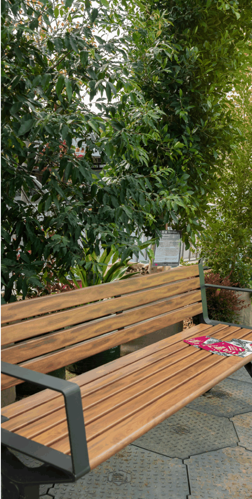

> [Picture on page 19: a picture, saved as a picture (images/ch-11-14-riverwood-estate-page-19-55.gif, 150 dpi).]

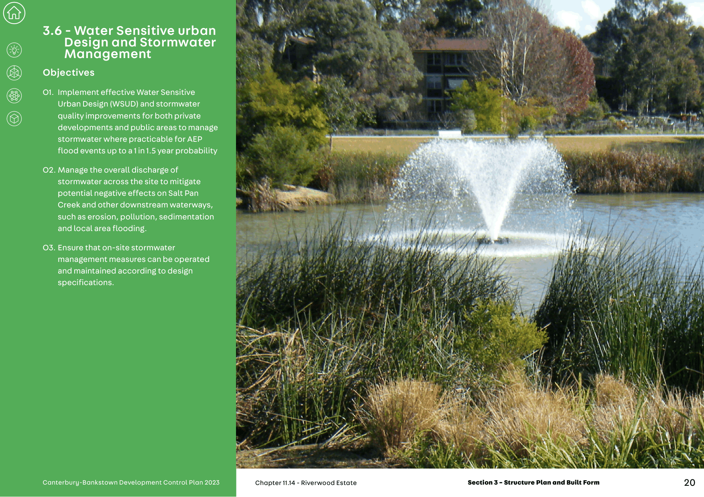

> [Picture on page 20: a picture, saved as a picture (images/ch-11-14-riverwood-estate-page-20-1.gif, 150 dpi).]

### 3.6 - Water Sensitive urban

### Design and Stormwater

### Management

#### Objectives

O1.	 Implement effective Water Sensitive Urban Design (WSUD) and stormwater quality improvements for both private developments and public areas to manage stormwater where practicable for AEP flood events up to a 1 in 1.5 year probability

O2.	Manage the overall discharge of stormwater across the site to mitigate potential negative effects on Salt Pan Creek and other downstream waterways, such as erosion, pollution, sedimentation and local area flooding.

O3.	Ensure that on-site stormwater management measures can be operated and maintained according to design specifications.

### 3.6 - Water Sensitive urban Design and Stormwater Management

#### Controls

C1.	 All developments must implement rainwater retention and WSUD measures. The extent of Rainwater Collection and WSUD provision is to be determined by Council in proportion to the scale of development.

C2.	 Unless otherwise advised by Council, WSUD systems must be designed to treat AEP flood events up to the 1-1.5 year probability. Low flows of this frequency must be separated from higher flows, which will be diverted into on-site detention (OSD) and other stormwater quantitative management systems.

C3.	 Developments must maximise the capture and reuse of rainwater from roofs.

C4.	 WSUD treatments must be implemented so that mechanical treatment technology is only used if necessary.

C5.	 WSUD principles must be integrated into the development through the design of stormwater drainage, on-site detention, and landscaping, as well as in the orientation of the development and should avoid reliance on ‘end of pipe’ treatment devices prior to discharge.

C6.	 Impervious surfaces are to be avoided.

C7.	 Above ground OSD basins are not allowed for residential development.

Canterbury-Bankstown Development Control Plan 2023

C8.	 Rainwater storage and tanks are encouraged for along with a certificate from a qualified and

practicing plumber certifying the functionality and condition of the system, must be submitted with the Development Application.

all developments, with a provision for greater

capacity than the minimum BASIX requirement for

residential developments.

C16.	 All developments involving site disturbance must

C9.	 Developments must be sited and built to minimise

disturbances on natural drainage systems

C10.	 Adequate provisions must be made for the

include details of Erosion and Sedimentation Control measures designed in accordance with the Soil and Water Management for Urban Development – NSW Department of Housing and Council’s Development Engineering Design Guidelines

C17.	 Connection of any stormwater or drainage

control and discharge of stormwater runoff

from the site to ensure that it does not adversely

impact Council’s stormwater drainage systems,

waterways, the development itself, or adjoining

properties.

C11.	 The construction of stormwater drainage lines

systems to Council’s systems must be undertaken in accordance with Councils Development Engineering Design Guidelines.

through public reserves or land that may be

dedicated to Council is not permitted

C18.	 The discharge of stormwater to Council

C12.	 Run-off entering directly into salt pan creek

infrastructure must be by gravity

C19.	 Private drainage easements must be designed

and the surrounding remnant bushland is to be

avoided to the greatest extent possible

C13.	 Stormwater drainage is to be designed in

accordance with Council’s Development

Engineering Design Guidelines.

and located on the lower side of a property, be free of building encroachments and must comply with Council’s Development Engineering Design Guidelines.

C14.	 Stormwater runoff must not adversely impact

surrounding properties or Council infrastructure

and assets through the diversion and

concentration of flows.

C15.	 For developments connecting to the existing site

stormwater drainage system, a plan indicating

the layout and details of the existing system,

Chapter 11.14 - Riverwood Estate

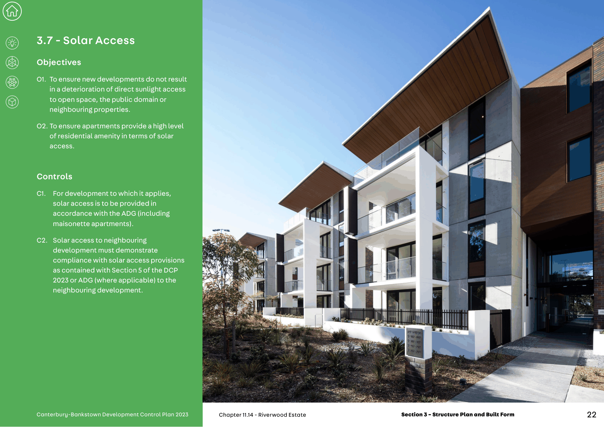

> [Picture on page 22: a picture, saved as a picture (images/ch-11-14-riverwood-estate-page-22-1.gif, 150 dpi).]

### 3.7 - Solar Access

#### Objectives

O1.	 To ensure new developments do not result in a deterioration of direct sunlight access to open space, the public domain or neighbouring properties.

O2.	To ensure apartments provide a high level of residential amenity in terms of solar access.

#### Controls

C1.	 For development to which it applies, solar access is to be provided in accordance with the ADG (including maisonette apartments).

C2.	 Solar access to neighbouring development must demonstrate compliance with solar access provisions as contained with Section 5 of the DCP 2023 or ADG (where applicable) to the neighbouring development.

## SECTION 4 GENERAL PROVISIONS

### 4.1	 Traffic, Access and Parking

24

### 4.2	 Sustainability

27

### 4.3	 Heritage

28

### 4.4	 Waste

32

4.1 - Traffic, Access and

### Parking

#### Objectives

O1.	 To provide an appropriate level of on-site parking to cater for a mix of development and vehicle types, including cars, motorcycles and bicycles.

O2.	To provide suitable access arrangement for walking and cycling that prioritise pedestrian safety and amenity

Canterbury-Bankstown Development Control Plan 2023

#### Controls

C1.	 A swept path analysis must be included in

any Development Application (DA) submitted

for the site. This analysis will demonstrate

the ability of large vehicles to enter the site

in a forward direction and provide bypass

opportunities.

C2.	 All kerb ramps that require replacement

are required to comply with the Disability

Discrimination Act 1992 (DDA) design

standards.

C3.	 For development located within 800m of

the train station, car parking rates are in

accordance with the ADG and DCP 2023

(where applicable).

C4.	 Car parking rates for certain residential

accommodation including social and

affordable housing is to be provided in

accordance with the State Environmental

Planning Policy (Housing) 2021.

C5.	 Car parking rates for non-residential uses is to

be provided in accordance with the DCP 2023.

C6.	 Accessible car parking for residential

and non-residential development is to be

provided in accordance with the DCP 2023.

C7.	 Car share parking must be included in the on-

street parking at the site.

Chapter 11.14 - Riverwood Estate

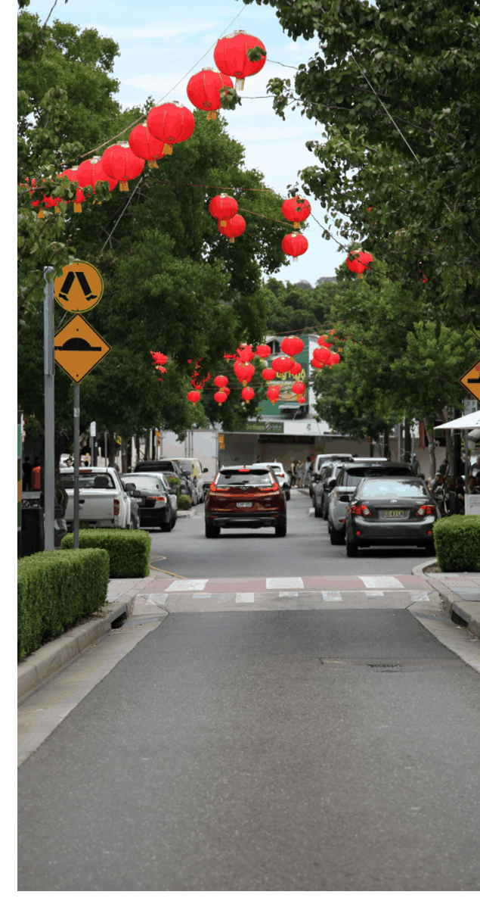

> [Picture on page 24: a picture, saved as a picture (images/ch-11-14-riverwood-estate-page-24-40.gif, 150 dpi).]

### 4.1 - Traffic, Access and Parking

#### Controls (continued)

C8.	 Road design elements must include wide footpaths, suitable street trees for shade, and strategically positioned seating areas for residents and visitors to gather.

C9.	 Bicycle parking is to be provided for all developments in accordance with the rates outlined in the DCP 2023.

C10.	 Bicycle parking and cycling facilities must be clearly signposted and located in an area that is convenient to access from within the building and from the street.

C11.	 Off-street car parking facilities should be designed in accordance with AS2890.1:2004 (Parking Facilities – Off-Street Parking) and Council’s relevant design standards.

C12.	 On-street parking spaces are to be provided based on the requirements set out in AS2890.5:2020 (Parking Facilities – On-Street Parking) and Council standards.

Canterbury-Bankstown Development Control Plan 2023

| Washington Avenue Place Virginia Road Belmore Legend Site boundary Riverwood Estate boundary Roosevelt Open space Avenue Potential deep soil Indicative deep soil (16%) Ground floor maisonettes Indicative residential lobby entries Indicative vehichle access Figure 8. Indicative residential entries and basement access plan |
|---|

Chapter 11.14 - Riverwood Estate

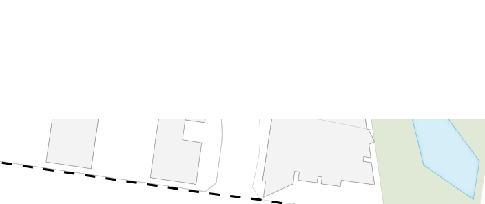

> [Picture on page 25: a picture, saved as a picture (images/ch-11-14-riverwood-estate-page-25-25.gif, 150 dpi).]

### 4.1 - Traffic, Access and Parking

#### Proposed Street Sections

#### Controls (continued)

C13.	 All vehicle access, including any loading and service areas for non-residential development are to be located along Virginia Place.

C14.	 Bus stops that are impacted (or required to be replaced) as a result of development, (including through increased patronage), should be upgraded to include bus shelters, seating and real time service information.

C15.	 Appropriate street lighting must be installed to a degree that promotes pedestrian safety and enhances the overall amenity of the area.

C16.	 Pedestrian crossings must be setback a minimum of 5m from key intersections.

C17.	 Bus Zones must be signposted adequately.

C18.	 Upgrades to Virginia Place are to be designed in accordance with Figure 9

C19.	 Dedicated loading bays must be provided to ensure trucks have adequate space to stop without occupying parking bays.

Land and Housing Corporation

Canterbury-Bankstown Development Control Plan 2023

Viginia Place - Proposed 20m wide Local Street

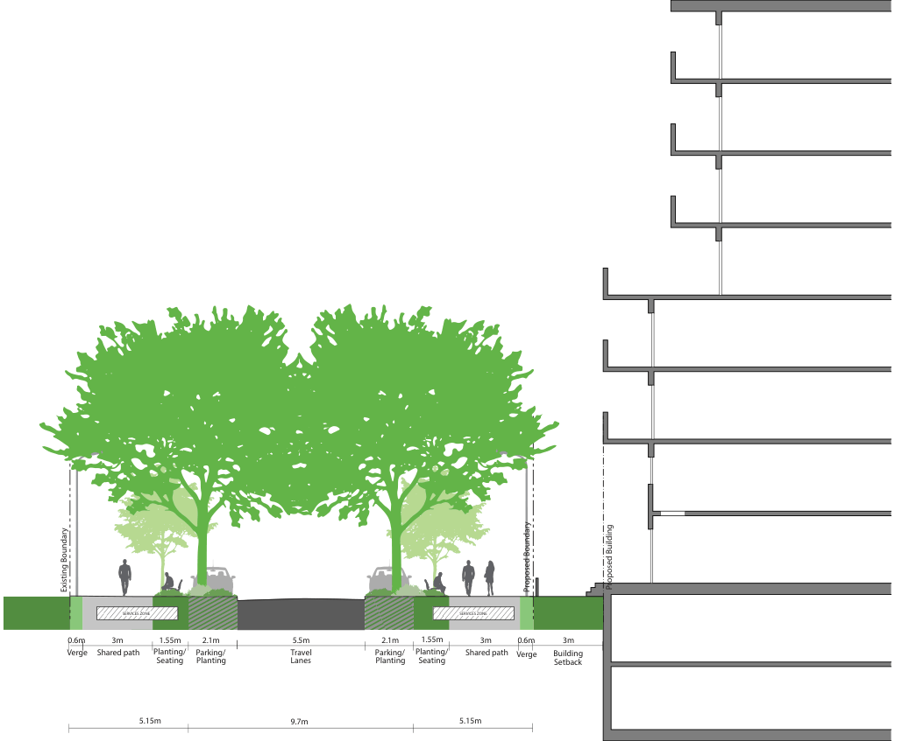

> [Picture on page 26: a map, saved as a picture (images/ch-11-14-riverwood-estate-page-26-27.gif, 150 dpi); the street names and other small labels are on the picture.]
> Words printed on the picture (title and legend, copied from the PDF):
> Shared path Verge

20m

20m wide Local Street

Scenario B - No Bus Route

41

Figure 9. Virginia Place section JMD design | Architectus

Chapter 11.14 - Riverwood Estate

### 4.2 - Sustainability

#### Objectives

O1.	 To establish benchmarks to achieve ecologically sustainable development.

O2.	To ensure the efficient use of resources in building design, construction and operation and reduce over-all environmental impact.

O3.	To ensure that development is resilient against the effects of climate change.

O4.	To reduce urban heat load and increase canopy coverage and ground absorption of water.

O5.	To minimise discharge of stormwater from site.

O6.	To reduce water demand over time and protect the downstream environment.

O7.	 To minimise the impact of new development on the existing stormwater system.

O8.	Prioritise electric-only developments and allow flexibility in the design for the uptake of future technologies that reduce carbon emissions.

Canterbury-Bankstown Development Control Plan 2023

#### Controls

C1.	 Development should aim to achieve a 6-star rating under the Green Star – Communities v1.1 tool (or the equivalent rating as this tool is updated over time).

C2.	 NABERS for Apartment ratings to be managed by strata or building management for all eligible buildings in the redevelopment.

C3.	 Development is to consider the use of hard-wearing materials that can withstand climatic extremes, including, wind, rain and temperature extremes (each of which may cause warping, bending, blistering, fading or melting) through:

(a) Minimising applied finishes where possible.

(b) Specifying durable materials, to ensure longevity and withstand the extremes of weather and climate.

(c) Specify materials and finishes which patina, weather or age favourably over time, rather than deteriorate.

(d) Selection of materials with longer design life.

(e) Selection of materials with better performance in hot temperatures.

Chapter 11.14 - Riverwood Estate

C4.	 All new residential developments must be designed as all-electric buildings, with future capability to be completely offset by renewable energy sources

C5.	 Consider the provision of roof overhangs (eaves) and incorporating additional shading to balconies/verandas, where possible.

C6.	 Green roofs are encouraged, wherever practical.

C7.	 Any green roof is to be planted using locally native plants including a variety of plant sizes and layers of planting.

C8.	 Stormwater from roofs, streets, pavements and lawns are to be captured and re-used, wherever possible.

C9.	 Stormwater drainage and on-site detention is to be designed in accordance with Chapter 3 of the DCP.

C10.	 Drainage systems should be sized to consider increases in rainfall intensity, frequency and duration under future climate change.

### 4.3 - Heritage

#### 4.3.1 European Heritage Objectives

O1.	 To promote consideration of the heritage values of the Riverwood Estate.

O2.	To ensure that heritage values in the Riverwood Estate are investigated, identified, conserved, interpreted and appropriately managed in the context of new development.

Canterbury-Bankstown Development Control Plan 2023

#### Controls

C1.	 Prior to the submission of a Development Application (DA) involving physical works, a qualified community historian should be engaged to investigate and document the social history of the Herne Bay and Riverwood Estates to inform the preparation of a Heritage Interpretation Plan.

Note: The term ‘Herne Bay’ refers to the former name of the suburb now known as Riverwood, which was officially renamed on 1 February 1958.

C2.	Prior to the submission of a Development Application (DA) involving physical works, a precinct wide Archaeological Research Design (ARD) must be prepared to:

(a) Identify any sites requiring archaeological investigation (focusing on significant areas within the former hospital, such as nurse’s quarters or surgical facilities).

(b) Set out a methodology for an archaeological excavation program for any identified sites.

(c) Inform the preparation of a Heritage Interpretation Plan.

Chapter 11.14 - Riverwood Estate

C3.	Prior to the submission of a Development Application (DA) involving physical works, a Heritage Interpretation Plan (for both non- Aboriginal and Aboriginal heritage) based on the Heritage Interpretation Strategy (Artefact 2022) must be prepared that reflects the varied and significant social history of the site.

C4.	Archaeological investigations are to be completed in accordance with the Heritage Act 1977, including requirement for either a s.140 Excavation Permit, or a s139(4) Exception and associated Heritage NSW guidelines.

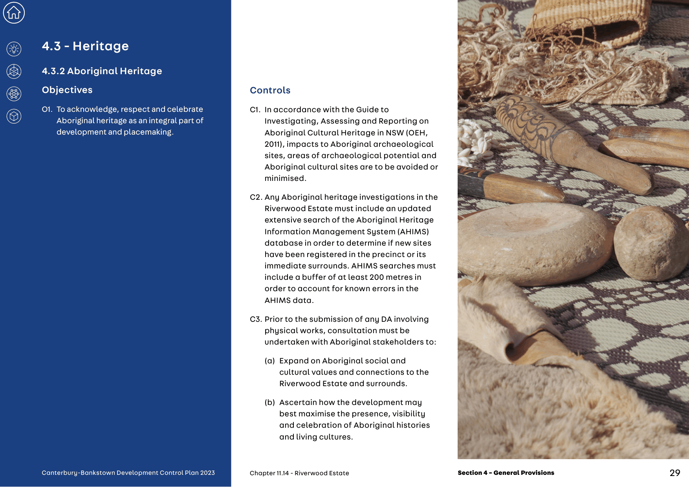

> [Picture on page 29: a picture, saved as a picture (images/ch-11-14-riverwood-estate-page-29-1.gif, 150 dpi).]
> Words printed on the picture (title and legend, copied from the PDF):
> Canterbury-Bankstown Development Control Plan 2023

#### 4.3.2 Aboriginal Heritage Objectives

O1.	 To acknowledge, respect and celebrate Aboriginal heritage as an integral part of development and placemaking.

#### Controls

C1.	 In accordance with the Guide to

Investigating, Assessing and Reporting on

Aboriginal Cultural Heritage in NSW (OEH,

2011), impacts to Aboriginal archaeological

sites, areas of archaeological potential and

Aboriginal cultural sites are to be avoided or

minimised.

C2.	Any Aboriginal heritage investigations in the

Riverwood Estate must include an updated

extensive search of the Aboriginal Heritage

Information Management System (AHIMS)

database in order to determine if new sites

have been registered in the precinct or its

immediate surrounds. AHIMS searches must

include a buffer of at least 200 metres in

order to account for known errors in the

AHIMS data.

C3.	Prior to the submission of any DA involving

physical works, consultation must be

undertaken with Aboriginal stakeholders to:

(a)	 Expand on Aboriginal social and

cultural values and connections to the

Riverwood Estate and surrounds.

(b)	 Ascertain how the development may

best maximise the presence, visibility

and celebration of Aboriginal histories

and living cultures.

Chapter 11.14 - Riverwood Estate

#### 4.3.3 Connecting with Country

Objectives

O1.	 To acknowledge and reflect Aboriginal connection to Country in the design and development of the Riverwood Estate, and particularly for the adjacent Salt Pan Creek area as a site of early social justice and political activism.

O2.	To ensure ongoing meaningful engagement with Aboriginal stakeholders, building upon engagement undertaken for the Riverwood Estate State Significant Precinct (SSP) Connecting with Country Framework (Artefact 2022).

O3.	To provide opportunities for collaboration and co-designing with Aboriginal people for development within the site.

O4.	To celebrate Aboriginal culture through opportunities to embed Aboriginal heritage Interpretation elements, artworks and use of language/naming within the Riverwood Estate, in collaboration with locally connected community and knowledge holders.

O5.	To create opportunities for capacity building and economic development for Aboriginal people and organisations across planning, design, construction and operation of the Riverwood Estate.

Canterbury-Bankstown Development Control Plan 2023

Controls

C1.	 The Riverwood Estate SSP Connecting with Country Framework (Artefact 2022) and associated Design Principles are to inform any future DAs involving physical works

C2.	Throughout each key development stage of the renewal of Riverwood Estate, the applicant will be responsible for ongoing consultation with the Aboriginal community, including regular updates.

C3.	Integrate meaningful, co-designed interpretation, artwork and landscape elements within the design development stages of the project that reflect and honour Country, through the development of a Heritage Interpretation Plan and Public Art Plan which build on the Heritage Interpretation Strategy (Artefact 2022).

C4.	Development is to contribute to strengthening the sense of Aboriginal people in the Precinct, and create spaces for Aboriginal people to gather and connect.

C5.	Prior to the submission of a Development Application (DA) involving physical works, consultation should be undertaken with relevant Aboriginal persons and bodies (such as oral history projects with Aboriginal stakeholders and knowledge holders) to:

Chapter 11.14 - Riverwood Estate

(a)	 Establish and further expand any Aboriginal social and cultural values and connections to the Riverwood Estate and surrounds.

(b)	 Ascertain how the development may best maximise the presence, visibility and celebration of Aboriginal histories and living cultures.

(c)	 This consultation should be carried out separate to general project community consultation and must be carried out by suitably qualified practitioners who are accepted by the Aboriginal community as appropriate for the task.

C6.	DAs for new buildings and alterations, or that propose or include parts of the public domain are to include consultation with Aboriginal stakeholders and a consultation report which details:

(a)	 Pre-lodgement consultation activities.

(b)	 The outcomes of consultation.

(c)	 How consultation has informed design of the proposed development.

#### 4.3.3 Connecting with Country Controls (continued)

C7.	 Ensure the consideration of the Connecting with Country Design Principles within the first stage of development of the Riverwood Estate, including:

(a)	 Provide acknowledgement, interpretation and learning opportunities about Country through such devices as artworks, installations, architectural design, engravings in pathways, lighting installations, interpretative panels, public programs, native gardens and landscaping.

(b)	 Wayfinding and interpretative signage should include Aboriginal text with English translations; consider audio devices in interpretative media so language is spoken and heard on Country.

(c)	 Enhance the Connection to Country through naming of parks, public spaces, and new streets using Aboriginal words for aspects of Country (including flora and fauna) or prominent individuals associated with the history of the area.

Canterbury-Bankstown Development Control Plan 2023

(d)	 Use modern technology to enhance and

share Aboriginal cultural knowledge,

and connect site users and local

communities with the Aboriginal

history and significance of the place,

including referencing the early use of

film technology as a tool for political

activism at Salt Pan Creek.

(e)	 Consider use of locally available

sustainable materials in construction.

(f)	 Reconnect site users and local

communities to Country through

inclusion of endemic native plantings,

bushtucker plants and community

gardens within the project landscaping,

accompanied by interpretative signage

where needed.

C8.	Engagement of local Aboriginal run

businesses through different phases of

the project’s development should be

considered. Evidence of consultation must

be submitted as an Engagement Outcomes

report, to support the DA

C9.	Cultural Awareness Training should be

arranged for project team members

throughout all key stages of the renewal of

the Estate, in consultation with stakeholder

organisations.

Chapter 11.14 - Riverwood Estate

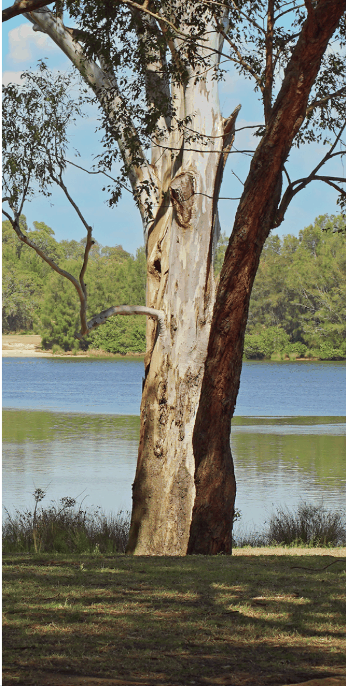

> [Picture on page 31: a picture, saved as a picture (images/ch-11-14-riverwood-estate-page-31-57.gif, 150 dpi).]

### 4.4 - Waste

#### Objectives

O1.	 Reduce the amount of construction and demolition waste going to landfill.

O2.	Reduce amount of waste generated in the operation of a development from going to landfill and maximise resource recovery.

O3.	Safeguard the visual amenity, safety, and functional integrity of the entire development

O4.	Optimise waste collection logistics and to minimise truck movements to reduce traffic congestion, noise pollution, poor amenity, and environmental impact within the community

O5.	Enable food waste and garden organic waste collection servicing.

Canterbury-Bankstown Development Control Plan 2023

#### Controls

C1.	 All residential waste collection services must exclusively occur on-site via an HRV per the Australian Standards 2890.2 preventing disruptions to roads, laneways and maintaining the visual and functional quality of these spaces.

C2.	Mandatory separation of food and garden organic waste at its source is required to meet the EPA FOGO Mandate and align with council’s commitment to fostering a circular economy.

Chapter 11.14 - Riverwood Estate

#### Residential development

C3.	Each dwelling is to have suitable space within the kitchen for a caddy to collect organic waste.

C4.	Development must comply with the requirements of the applicable Waste Design for New Developments Guide.

C5.	In addition to Controls C1-4, the waste management system is to be designed to incorporate one of the following waste management solutions:

(a)	 A communal bin storage room on the ground floor or within the basement footprint of the development,

(b)	 A waste services room on each individual residential level, or

(c)	 An alternative solution that incorporates a well-designed innovative waste and recycling facilities within the development that caters for all three waste streams: general waste, recycling, food organics and garden organics.

#### Multi Dwelling Housing and Residential

#### Flat Buildings

C6.	In selecting an appropriate waste management system for the development, the following is to be demonstrated:

(a)	 The waste management system is integrated into the overall design of the development and takes into consideration all users (including residents, caretaker/building manager and waste collection staff;

(b)	 The waste management system maximises waste separation and resource recovery and minimises waste going to landfill;

(c)	 The waste management system caters for all three waste streams: general waste, recycling and food organics (and garden organics);

(d)	 Supports waste management and collection services to occur in a safe, efficient, cost-effective and timely manner; and

(e)	 The waste management system protects resident health, safety and amenity (in terms of noise, odour, visual impacts).

Canterbury-Bankstown Development Control Plan 2023

#### Waste Service Rooms

C7.	 A waste service room on each habitable floor is to be provided that can store up to three days of general waste (or chute hopper) and recycling for the number of dwellings on that floor, and one 240L bin for FOGO.

C8.	The waste service rooms must be of sufficient size to accommodate all allocated bins, and the location and design is to meet the following requirements:

(a)	 Must be conveniently located for residents on each residential level of the development (maximum distance of 30m);

(b)	 Access is to be in accordance with AS 1428 (Set) - 2003: Design for access and mobility;

(c)	 Only contain general waste (or chute hopper), recycling and FOGO bins;

(d)	 Must be of adequate size to accommodate one 240L bin for FOGO and the required number of general waste (or chute hopper) and recycling bins, which allows for three days of general waste and recycling generated by the number of dwellings on that floor;

Chapter 11.14 - Riverwood Estate

(e)	 Signage is to be placed on the room on every residential level indicating how to use the system effectively;

(f)	 A site caretaker will be required to rotate general waste, recycling and FOGO bins from the cupboards to the bin storage area as a minimum every three days; and

(g)	 A communal bin storage area on the ground floor is to be provided for the collection of bulk 660L and 1,100L bins by collection staff.

C9.	 All waste rooms must be designed so doors are of sufficient width to allow the transfer/ rotation of 240L bins

C10.	All waste rooms must incorporate lighting and temperature control devices that are controllable from inside and outside the

room.  Sensor lights may also be installed.

C11.	 A separate ventilation system must be installed in all waste rooms and must comply with AS 1668 – The use of mechanical ventilation and air-conditioning in buildings

C12.	The floor of all waste rooms must be constructed of a durable and impervious material with a smooth finish.

#### Subdivisions

C13.	 Subdivision design and road layout is to ensure that a HRV as per Australian Standard 2890.2 Parking Facilities: Off Street Commercial Vehicle Facilities can enter and exit the development (the subdivision) in a forward direction without the need to reverse.

C14.	 Plans illustrating turning paths for a HRV are to be provided to demonstrate that the vehicle can safely manoeuvre with no reverse vehicle movements.

C15.	 Temporary turning facilities and access roads for a HRV are to be provided for staged subdivision development where the entire road network will not be completed as part of Stage 1. This will ensure waste collection vehicles are able to enter and exit the development in a forward direction and can continue to service existing buildings.

Canterbury-Bankstown Development Control Plan 2023

#### Laneways

C16.	 All laneways must be of a sufficient width

to accommodate a HRV (as per AS2890.2)

collection vehicle movements entering

and exiting and required manoeuvring to

service future dwellings.

C17.	 Laneways are to be sufficiently wide for a

vehicle to pass a stationary waste truck.

C18.	Length of laneways need to be considered

to ensure collection staff are able to

maintain appropriate and safe sight

distances to view any obstructions.

C19.	 Waste collection vehicles have sufficient

overhead clearance. Collection points

needs to be located away from any

overhead wires, street tree canopies,

building awning and overhangs and

other structures that can impede waste

collection access.

Chapter 11.14 - Riverwood Estate

### A.2	 Acronyms

#### CB City

Canterbury-Bankstown Council

#### DCP

Development Control Plan

### A.3	 List of figures

Figure 1.

Figure 2. Figure 3. Figure 4. Figure 5.

Figure 6. Figure 7.

Figure 8.

Figure 9.

The site (outlined in blue) within the Riverwood Estate (outlined in red)

5

Structure Plan

11

Indicative Land Use Plan

12

Street Connections Plan

13

Maximum Building Height in Storeys Map

14

Minimum Building Setbacks Map 15 Indicative tree retention and canopy cover plan

18

Indicative residential entries and basement access plan

25

Section of Virginia Place

26

> [Picture on page 36, not reproduced as text; see the original PDF.]
> Words on this picture, read by OCR (may contain errors): CANTERBURY BANKSTOWN
