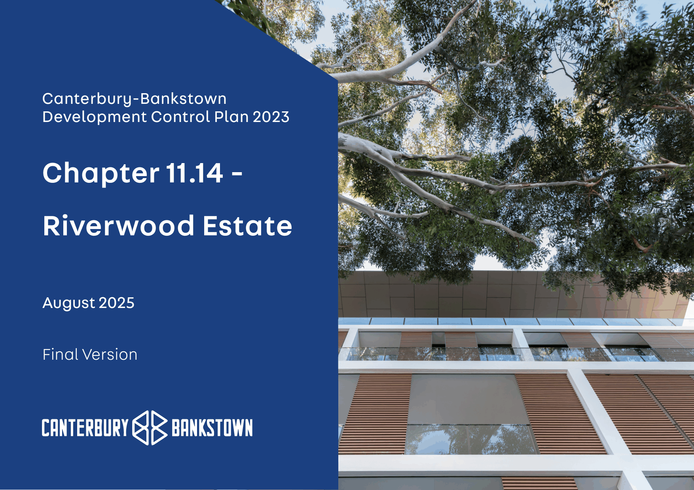
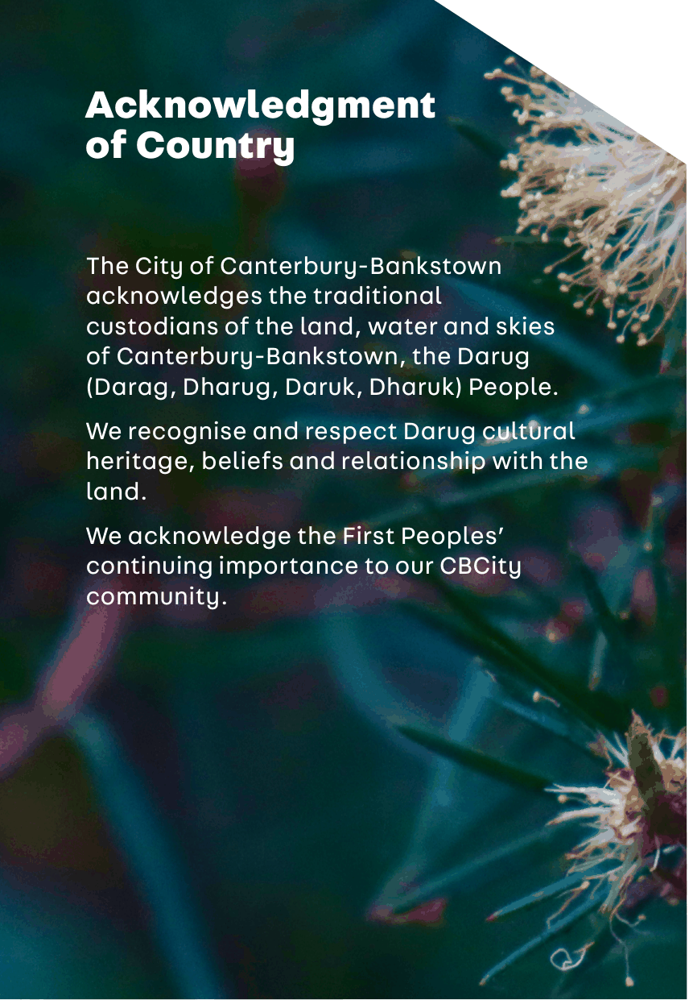

# Canterbury-Bankstown Development Control Plan 2023 - Chapter 11.14 Riverwood Estate

> This chapter is split into 4 section file(s), one per numbered heading, in the order they appear in the PDF.

Source PDF: [2025.09.02 - DCP 2023 - AMENDMENT 9 - Chapter 11.14 - Riverwood Estate.pdf](2025.09.02%20-%20DCP%202023%20-%20AMENDMENT%209%20-%20Chapter%2011.14%20-%20Riverwood%20Estate.pdf)

> [Picture on page 1: a picture, saved as a picture (images/ch-11-14-riverwood-estate-page-1-1.gif, 150 dpi).]

### Canterbury-Bankstown

### Development Control Plan 2023

### Chapter 11.14 - Riverwood Estate

### August 2025

### Final Version

> [Picture on page 2: a picture, saved as a picture (images/ch-11-14-riverwood-estate-page-2-1.gif, 150 dpi).]

### Acknowledgment

### of Country

### The City of Canterbury-Bankstown

### acknowledges the traditional

### custodians of the land, water and skies

### of Canterbury-Bankstown, the Darug

### (Darag, Dharug, Daruk, Dharuk) People. We recognise and respect Darug cultural

heritage, beliefs and relationship with the

### land. We acknowledge the First Peoples’

### continuing importance to our CBCity

### community.

### We’re committed to creating

### a liveable and loveable City

### for all our residents

#### Great Cities

We believe in creating vibrant, dynamic, and diverse communities that offer opportunities for people to connect, pursue their passions, and contribute to the world around them.

#### Naturally Green

We protect and prioritise nature in and around our city to enhance

environmental sustainability and improve the quality of life for our

#### Design Excellence

We encourage buildings, spaces, and objects that are both beautiful and practical, enhancing the beauty, accessibility, and safety of our built environment.

#### People First

We prioritise the needs, preferences, and aspirations of our community in all aspects of urban planning and design, creating supportive and enriching places people love.

#### Community

We engage with our community to ensure their needs and aspirations are reflected in the outcome, creating sustainable, resilient, vibrant, diverse, and inclusive places.

#### Sustainability

We seek designs that reduce negative impacts on the environment while also promoting social and economic well-being.

#### Net-Zero

We encourage our community to design buildings and places that produce as much renewable energy as they consume, reducing greenhouse gas emissions, lowering energy bills, and increasing resilience to environmental shocks and stresses.

### CONTENTS

<!-- sections -->
## Sections

1. [1 - Introduction](01-introduction.md)
2. [2 - Vision and Character](02-vision-and-character.md)
3. [3 - Structure Plan and Built Form 10](03-structure-plan-and-built-form-10.md)
4. [4 - General Provisions](04-general-provisions.md)
