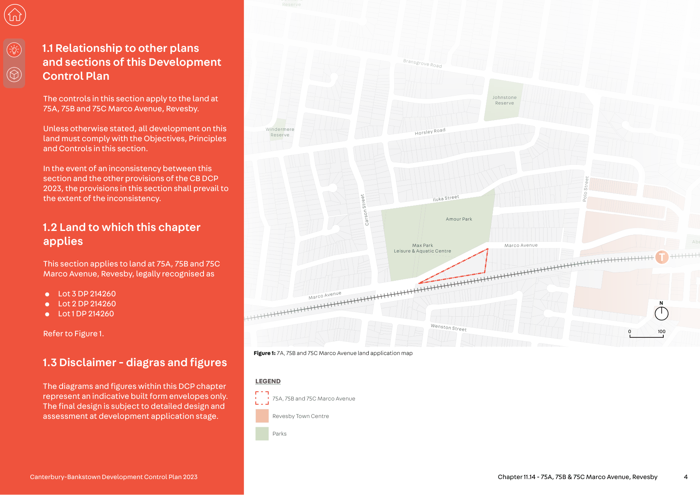

### 1.3 Disclaimer - diagras and figures

The diagrams and figures within this DCP chapter represent an indicative built form envelopes only. The final design is subject to detailed design and assessment at development application stage.

Gowlland

> [Picture on page 4: a map, saved as a picture (images/ch-11-15-75a-75b-75c-marco-avenue-revesby-page-4-26.gif, 150 dpi); the street names and other small labels are on the picture.]
> Words printed on the picture (title and legend, copied from the PDF):
> Refer to Figure 1.
> Leisure & Aquatic Centre
> 75A, 75B and 75C Marco Avenue
> Revesby Town Centre
> Chapter 11.14 - 75A, 75B & 75C Marco Avenue, Revesby 4

Figure 1: 7A, 75B and 75C Marco Avenue land application map

## SECTION 2 BUILT FORM AND DESIGN

2.1 2.2 2.3

Objectives

8

Principles

9

Controls
