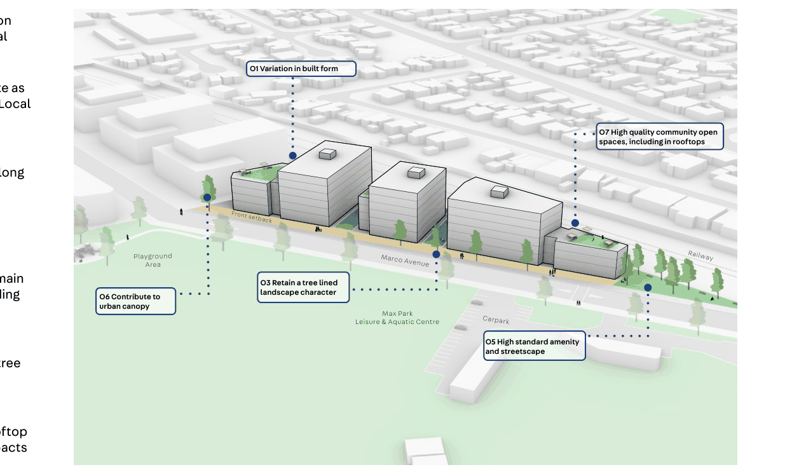

### 2.1 Objectives

O1. Create visual interest through variation in built form, articulation  and material choice.

O2. Reinforce the western entry of the site as a prominent gateway to the Revesby Local Centre.

O3. Retain and enhance the tree-lined landscaped character streetscape along Marco Avenue.

O4. Ensure buildings provide a gradual transition in scale from west to east.

O5 Provide a high standard of public domain amenity for residents of the surrounding neighbourhood.

O6. Ensure development contributes to urban tree canopy by providing new tree planting and landscaping.

O7. Provide high quality privately owned communal open space, including rooftop spaces, located away from noise impacts from the adjacent road and rail line

O8. Increase the diversity of housing types within Revesby Local Centre located within walking distance of shopping, services and recreational areas.

> [Picture on page 6: a map, saved as a picture (images/ch-11-15-75a-75b-75c-marco-avenue-revesby-page-6-27.gif, 150 dpi); the street names and other small labels are on the picture.]
> Words printed on the picture (title and legend, copied from the PDF):
> O6 Contribute to
> O1 Variation in built form
> O3 Retain a tree lined
> Leisure & Aquatic Centre
> O7 High quality community open
> spaces, including in rooftops
> O5 High standard amenity

Figure 2: Overview of built form objectives

Note: Figures 2 and 3 illustrate possible compliant built form scenarios for the site and are intended for illustrative purposes only. Final built form and design outcomes will be subject to detailed design and assessment at the Development Application stage.
