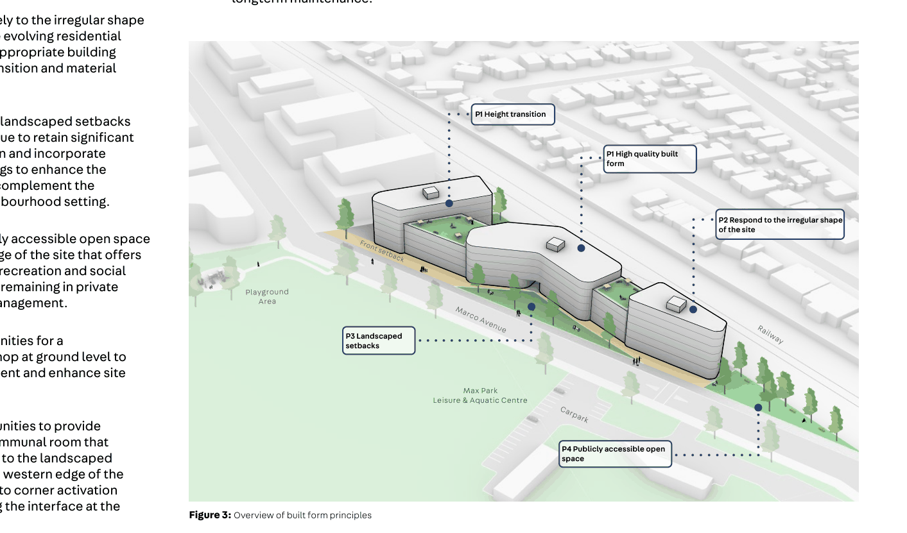
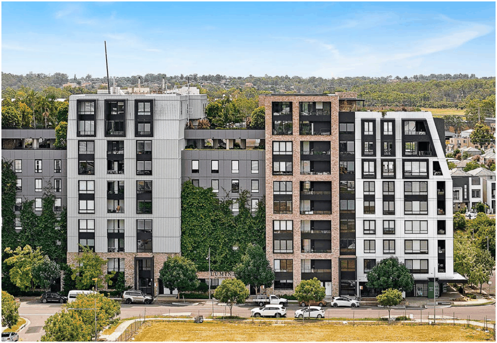
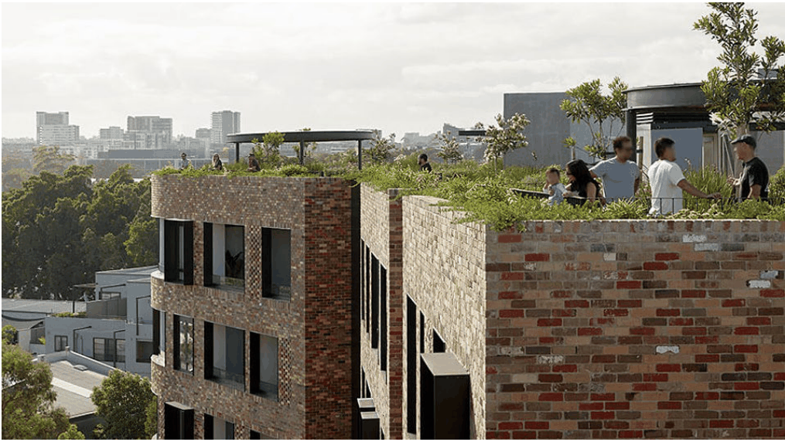
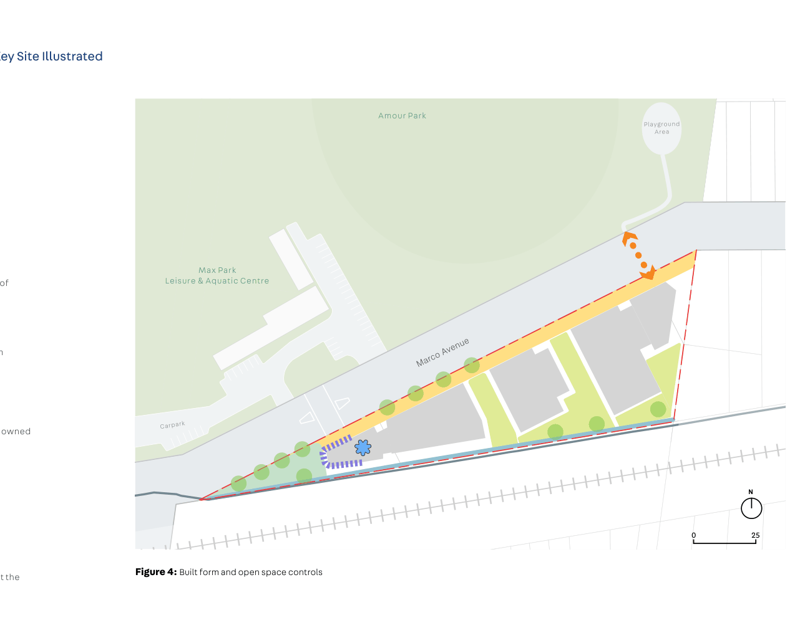
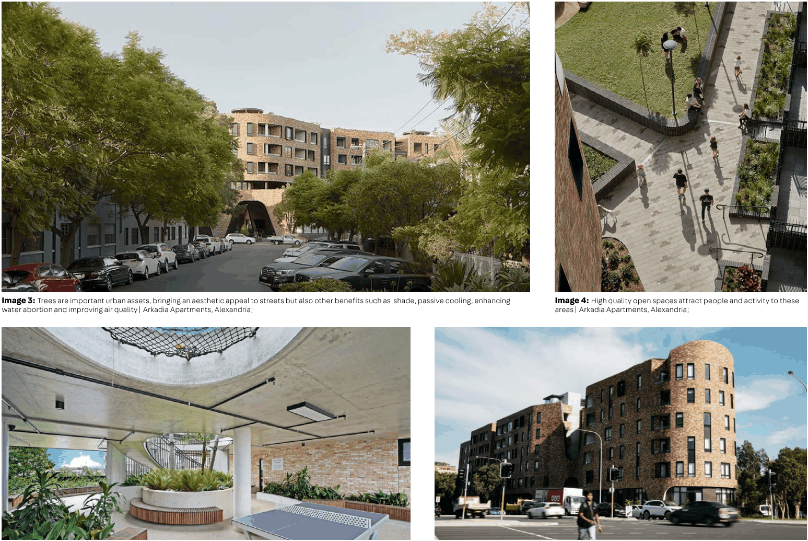

### 2.2 Principles

P1. Support the transition to higher density living in Revesby through high-quality built form that achieves design excellence.

P2. Respond sensitively to the irregular shape of the site and the evolving residential context through appropriate building design, height transition and material selection.

P3. Provide generous landscaped setbacks along Marco Avenue to retain significant existing vegetation and incorporate additional plantings to enhance the streetscape and complement the surrounding neighbourhood setting.

P4. Establish a publicly accessible open space at the western edge of the site that offers opportunities for recreation and social interaction, while remaining in private ownership and management.

P5. Consider opportunities for a neighbourhood shop at ground level to support employment and enhance site activation.

P6. Consider opportunities to provide a ground-level communal room that connects directly to the landscaped open space at the western edge of the site, contributing to corner activation and strengthening the interface at the intersection.

Implement the use of face brickwork and

P7

other durable design features that provide visual interest and reduce the need for

> [Picture on page 7: a map, saved as a picture (images/ch-11-15-75a-75b-75c-marco-avenue-revesby-page-7-36.gif, 150 dpi); the street names and other small labels are on the picture.]
> Words printed on the picture (title and legend, copied from the PDF):
> P1 Height transition
> Leisure & Aquatic Centre
> P1 High quality built
> P4 Publicly accessible open
> P2 Respond to the irregular shape
> of the site

Figure 3: Overview of built form principles

longterm maintenance.

Chapter 11.14 - 75A, 75B & 75C Marco Avenue, Revesby 7

Setbacks

C1. All buildings, including basements, must provide a minimum 6 metre setback from Marco Avenue for all buildings to maintain a consistent landscaped frontage that and retain existing trees.

Building facade, openings and materials

C2. Building facades longer than 35 meters must be visually broken up using a combination of at least two of the following

a. Changes in building mass

b. Recessed sections

c. Different materials

d. Window placement and design

C3. Buildings at the western corner must have visible entrances, windows, or architectural features.

C4. Building facades must incorporate high-quality, durable materials that contribute to a cohesive and attractive streetscape.

> [Picture on page 8: a picture, saved as a picture (images/ch-11-15-75a-75b-75c-marco-avenue-revesby-page-8-22.gif, 150 dpi).]

Image 1: Building articulation and different materiality aids in breaking down long building facades  (The height of the building in this photo does not reflect the Height permitted at the Marco Avenue site)| Lord Sheffield Circuit, Penrith

Landscaping and open space

C5. Development must be designed to retain significant trees on-site and on adjoining land. A minimum setback of 6m or greater should be provided to support tree retention. An arborist report must accompany the Development Application to confirm the viability of tree retention.

C6. A minimum of 18% of the total site area must be provided as deep soil zones and particularly where existing mature trees are to be retained.

C7. A minumum of 30% of the total site area must be provided as landscaped area.

C8. Rooftops may be used as private communal open space for residents, provided any potential visual or amenity impacts are appropriately mitigated.

C9. Rooftop communal spaces should incorporate weather protection structures that complement the building’s overall design.

Note: This control overrides Section 8.20 in Chapter 5.1 - Former Bankstown LGA Section.

Vehicle access

C10. Vehicle access for residents and service vehicles must be strategically located to minimise conflicts with existing and future pedestrian crossings on Marco Avenue.

C11. The number of vehicle access points should be minimised to maximise pedestrian safety and support the retention of existing trees.

Railway and Pipeline Corridors

C11. Applicants must consult with Sydney Trains prior to lodging a DA to address any issues arising from the proximity to the rail corridor.

C12. The design of buildings must comply with the requirements of Chapter 2 Site Considerations, Section 2.4 – Pipeline Corridors of the CBDCP 2023.

> [Picture on page 9: a picture, saved as a picture (images/ch-11-15-75a-75b-75c-marco-avenue-revesby-page-9-44.gif, 150 dpi).]

Image 2: Rooftop used as communal open space providing valuable greenary and opportunities to socialise| Arkadia Apartments, Alexandria

> [Picture on page 10: a picture, saved as a picture (images/ch-11-15-75a-75b-75c-marco-avenue-revesby-page-10-1.gif, 150 dpi).]
> Words printed on the picture (title and legend, copied from the PDF):
> Max Park
> Leisure & Aquatic Centre
> Carpark
> Amour Park
> Playground
> Area
> Marco Avenue
> N
> 0 25

Figure 4: Built form and open space controls

75A, 75B and 75C Marco Avenue Key Site Illustrated Buit Form and Design Controls

#### LEGEND

Key site boundary

Indicative building

footprint

Pipeline corridor - Refer to chapter 2.4 of CBDCP 2023

Minimum 3m setback from boundary as per Chapter 2.4 of CBDCP 2023

Minimum 6m street setback

Design feature at the western corner

Indicative landscaped areas

Publicly accessible privately owned communal open space

Existing significant trees to be retained

Existing pedestrian refuge island

Potential future pedestrian crossing to be investigated at the DA stage

Rail corridor

Preferred location the

communal room

> [Picture on page 11: a picture, saved as a picture (images/ch-11-15-75a-75b-75c-marco-avenue-revesby-page-11-1.gif, 150 dpi).]

Image 3: Trees are important urban assets, bringing an aesthetic appeal to streets but also other benefits such as  shade, passive cooling, enhancing water abortion and improving air quality| Arkadia Apartments, Alexandria;

Image 5: Recreational facilities add value to apartment living | Lord Sheffield Circuit, Penrith.

Image 4: High quality open spaces attract people and activity to these areas| Arkadia Apartments, Alexandria;

Image 6:  Building emphasising its corner location | Arkadia Apartments, Alexandria

> [Picture on page 12: a picture, saved as a picture (images/ch-11-15-75a-75b-75c-marco-avenue-revesby-page-12-1.gif, 150 dpi).]
