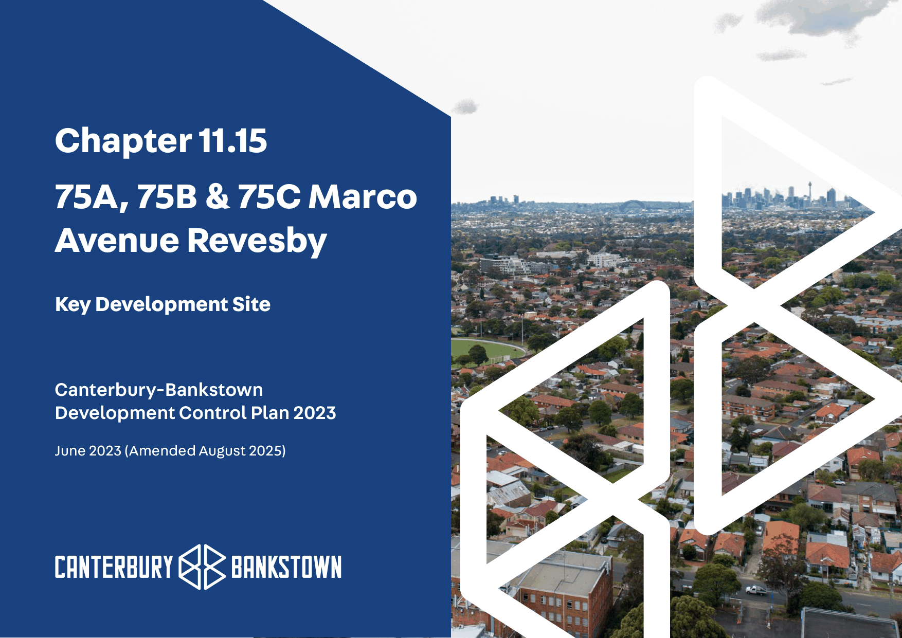

# Canterbury-Bankstown Development Control Plan 2023 - Chapter 11.15 75A, 75B & 75C Marco Avenue Revesby

> This chapter is split into 6 section file(s), one per numbered heading, in the order they appear in the PDF.

Source PDF: [2025.12.12 - DCP 2023 - AMENDMENT 10 - Chapter 11.15 - Marco Avenue.pdf](2025.12.12%20-%20DCP%202023%20-%20AMENDMENT%2010%20-%20Chapter%2011.15%20-%20Marco%20Avenue.pdf)

> [Picture on page 1: a picture, saved as a picture (images/ch-11-15-75a-75b-75c-marco-avenue-revesby-page-1-1.gif, 150 dpi).]

<!-- sections -->
## Sections

1. [11.15 75A, 75B & 75C Marco](01-11-15-75a-75b-and-75c-marco.md)
2. [1.1 Relationship to other plans](02-1-1-relationship-to-other-plans.md)
3. [1.2 Land to which this chapter](03-1-2-land-to-which-this-chapter.md)
4. [1.3 Disclaimer - diagras and figures](04-1-3-disclaimer-diagras-and-figures.md)
5. [2.1 Objectives](05-2-1-objectives.md)
6. [2.2 Principles](06-2-2-principles.md)
