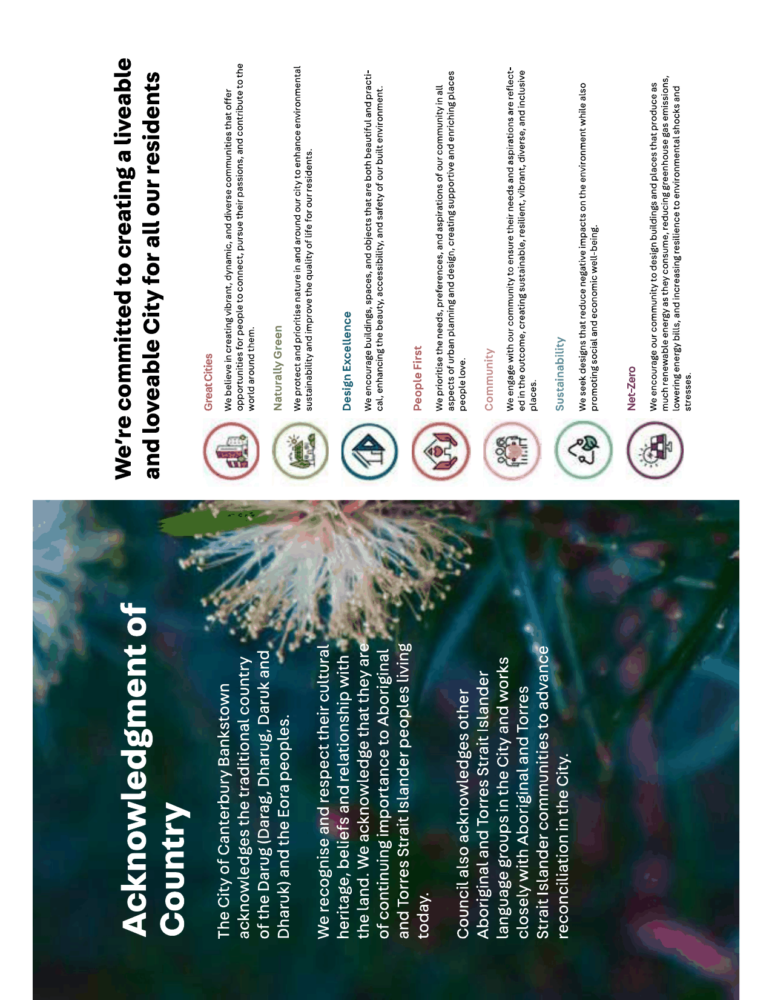
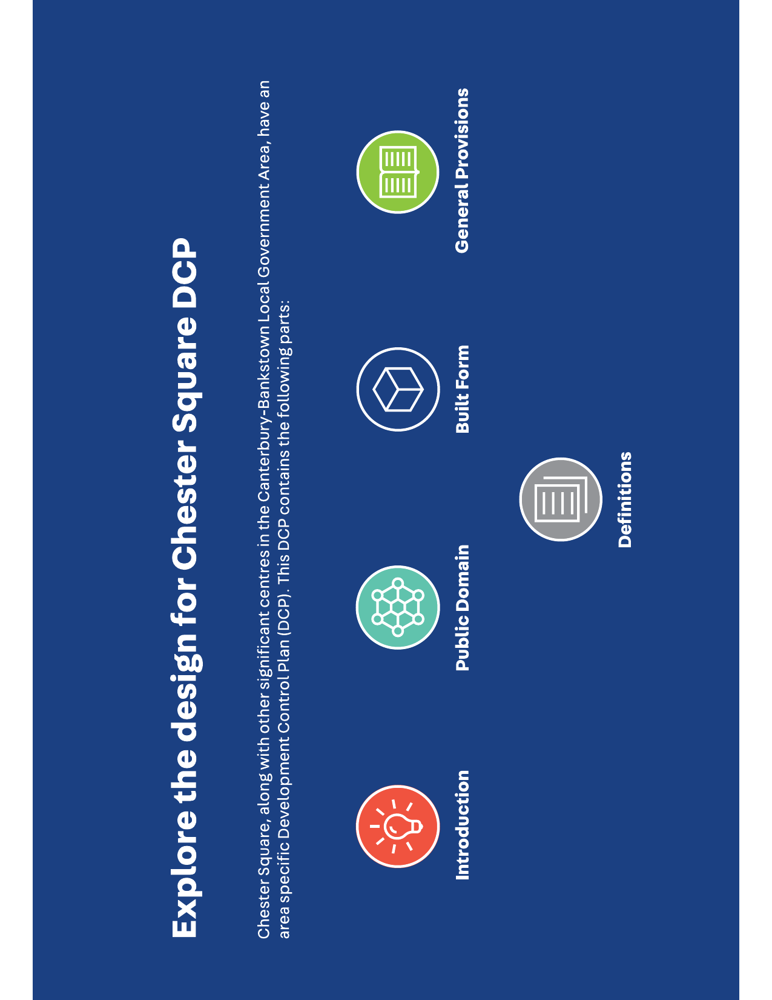
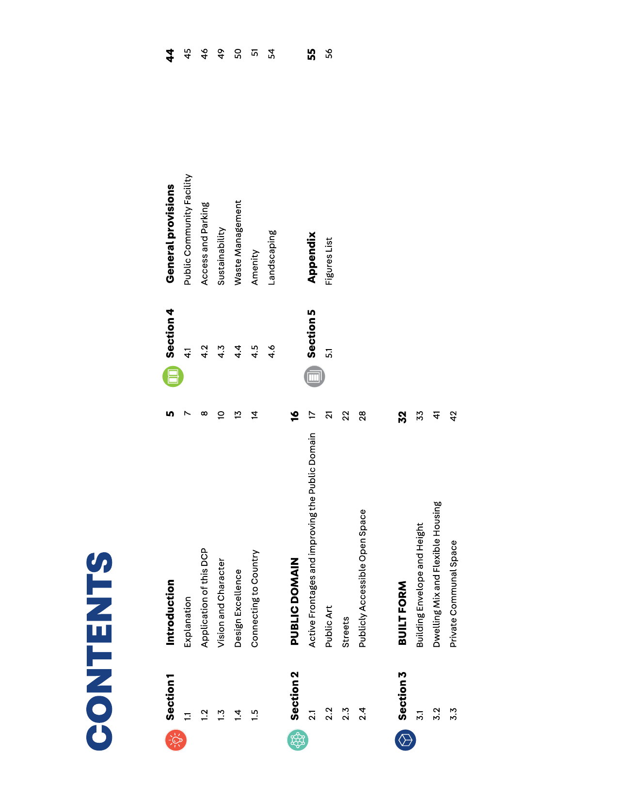
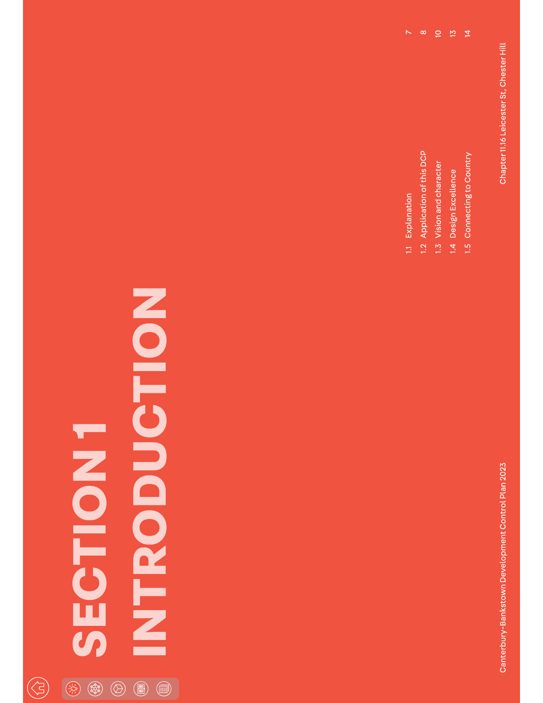
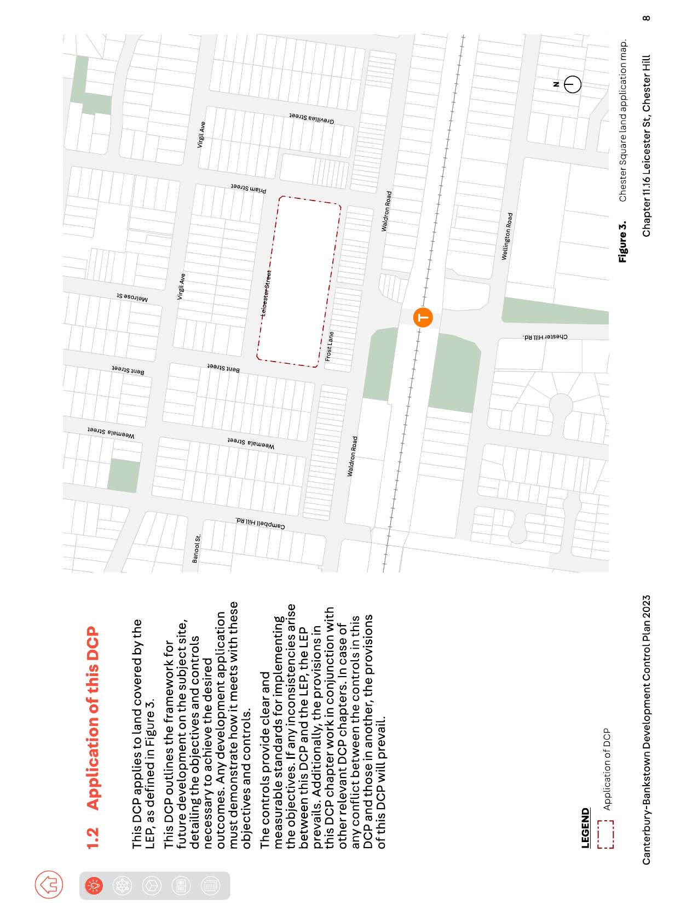

#### 1 Leicester St,

Chester Hill

#### Canterbury-Bankstown

#### Development Control Plan 2023

#### March 2026

#### CANTERBURY tS BANKSTOWN

> [End of OCR text from page 1.]

> [Page 2 is a scanned picture of text. The text below was read by OCR (machine reading) and may contain errors; check it against the original PDF.]

Acknowledgment of

#### Country

The City of Canterbury Bankstown acknowledges the traditional country of the Darug (Darag, Dharug, Daruk and, Dharuk) and the Eora peoples.

We recognise and respect their cultural « heritage, beliefs and relationship with the land. We acknowledge that they are of continuing importance to Aboriginal and Torres Strait Islander peoples living today.

Council also acknowledges other Aboriginal and Torres Strait Islander language groups in the City and works closely with Aboriginal and Torres Strait IsLander communities to advance reconciliation in the City.

#### We’re committed to creating a liveable

and loveable City for all our residents

We believe in creating vibrant, dynamic, and diverse communities that offer opportunities for people to connect, pursue their passions, and contribute to the world around them.

Naturally Green

We protect and prioritise nature in and around our city to enhance environmental sustainability and improve the quality of life for our residents.

#### Design Excellence

We encourage buildings, spaces, and objects that are both beautiful and practi-cal, enhancing the beauty, accessibility, and safety of our built environment.

We prioritise the needs, preferences, and aspirations of our community in all aspects of urban planning and design, creating supportive and enriching places people love.

We engage with our community to ensure their needs and aspirations are reflect-ed inthe outcome, creating sustainable, resilient, vibrant, diverse, and inclusive places.

#### Sustainability

We seek designs that reduce negative impacts on the environment while also promoting social and economic well-being.

Net-Zero

We encourage our community to design buildings and places that produce as much renewable energy as they consume, reducing greenhouse gas emissions, lowering energy bills, and increasing resilience to environmental shocks and stresses.

> [End of OCR text from page 2.]

> [Page 3 is a scanned picture of text. The text below was read by OCR (machine reading) and may contain errors; check it against the original PDF.]

#### Explore the design for Chester Square DCP

Chester Square, along with other significant centres in the Canterbury-Bankstown Local Government Area, have an area specific Development Control Plan (DCP). This DCP contains the following parts:

#### Introduction Public Domain Built Form General Provisions

#### Definitions

> [End of OCR text from page 3.]

> [Page 4 is a scanned picture of text. The text below was read by OCR (machine reading) and may contain errors; check it against the original PDF.]

#### CONTENTS

sly

Ve 1S

1 1.2 1.3 1.4 1.5

## Section 2

24 2.2 2.3 2.4

3A 3.2 3.3

Introduction 5 Explanation 7 Application of this DCP 8 Vision and Character 10 Design Excellence 13

Connecting to Country 14

PUBLIC DOMAIN 16 Active Frontages and improving the Public Domain 17 Public Art 21 Streets 22 Publicly Accessible Open Space 28

BUILT FORM 32 Building Envelope and Height 33 Dwelling Mix and Flexible Housing 4

Private Communal Space 42

@

51

General provisions Public Community Facility Access and Parking Sustainability

#### Waste Management

Amenity

#### Landscaping

#### Appendix

Figures List

44 45 46 49 50

51 54

55 56

> [End of OCR text from page 4.]

> [Page 5 is a scanned picture of text. The text below was read by OCR (machine reading) and may contain errors; check it against the original PDF.]

@)

## SECTION 1 INTRODUCTION

11 Explanation 7

1.2 Application of this DCP 8 1.3. Vision and character 10

1.4 Design Excellence 13

1.5 Connecting to Country 14

Canterbury-Bankstown Development Control Plan 2023 Chapter 11.16 Leicester St, Chester Hill

> [End of OCR text from page 5.]

> [Picture on page 6, not reproduced as text; see the original PDF.]

> [Picture on page 7, not reproduced as text; see the original PDF.]
> Words on this picture, read by OCR (may contain errors): NIH ‘1S 493899107 OL |}. Z $N1JO7 ‘aueNbs 19}S9YD JOJ UOISIA BU) JO

> [Page 8 is a scanned picture of text. The text below was read by OCR (machine reading) and may contain errors; check it against the original PDF.]
