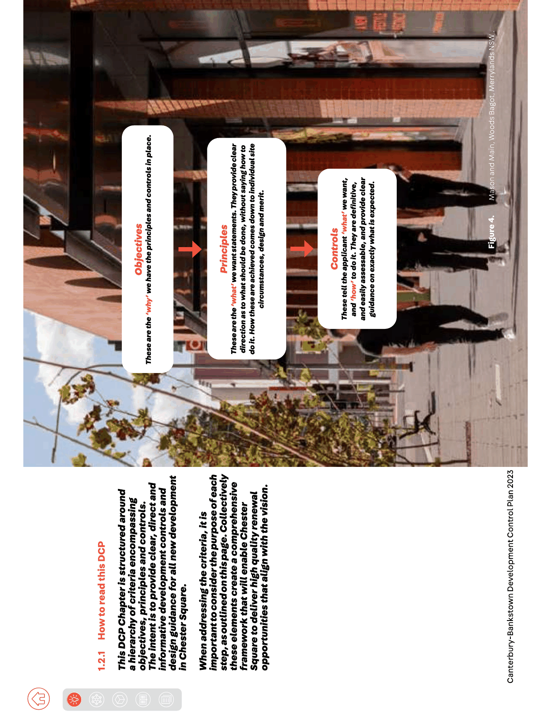
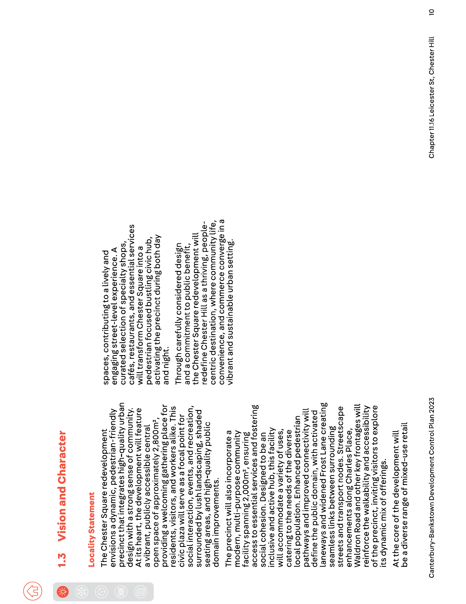

### 1.2 Application of this DCP

This DCP applies to land covered by the LEP, as defined in Figure 3. This DCP outlines the framework for future development on the subject site, detailing the objectives and controls Banool st necessary to achieve the desired outcomes. Any development application must demonstrate how it meets with these objectives and controls. The controls provide clear and measurable standards for implementing the objectives. If any inconsistencies arise between this DCP and the LEP, the LEP prevails. Additionally, the provisions in this DCP chapter work in conjunction with other relevant DCP chapters. In case of any conflict between the controls in this

DCP and those in another, the provisions a

of this DCP will prevail.

LEGEND | | Application of DCP

1 L.—-4

Canterbury-Bankstown Development Control Plan 2023

‘Pay

Wang

298.98 30%

Waldron Road

792.9

1S aso. EW

Ave Virgil Ave

Waldron Road

Wellington Road

©

“pa TH

Figure 3. Chester Square land application map.

Chapter 11.16 Leicester St, Chester Hill

> [End of OCR text from page 8.]

> [Page 9 is a scanned picture of text. The text below was read by OCR (machine reading) and may contain errors; check it against the original PDF.]

This DCP Chapter is structured around a hierarchy of criteria encompassing objectives, principles and controls. - The intent is to provide clear, directand * informative development controls and

design guidance for all new development i aes

in Chester Square.

When addressing the criteria, it is important to consider the purpose of each step, as outlined onthis page. Collectively these elements create a comprehensive framework that will enable Chester Square to deliver high quality renewal opportunities that align with the vision.

Canterbury-Bankstown Development Control Plan 2023

These are the we have the principles and controls in place.

These are the we want statements. They provide clear

direction as to what should be done, without saying how to

do it. How these are achieved comes down to individual site circumstances, design and merit.

These tell the applicant we want, and to doit. They are definitive, and easily assessable, and provide clear guidance on exactly what is expected.

> [End of OCR text from page 9.]

> [Page 10 is a scanned picture of text. The text below was read by OCR (machine reading) and may contain errors; check it against the original PDF.]

ons

WW
