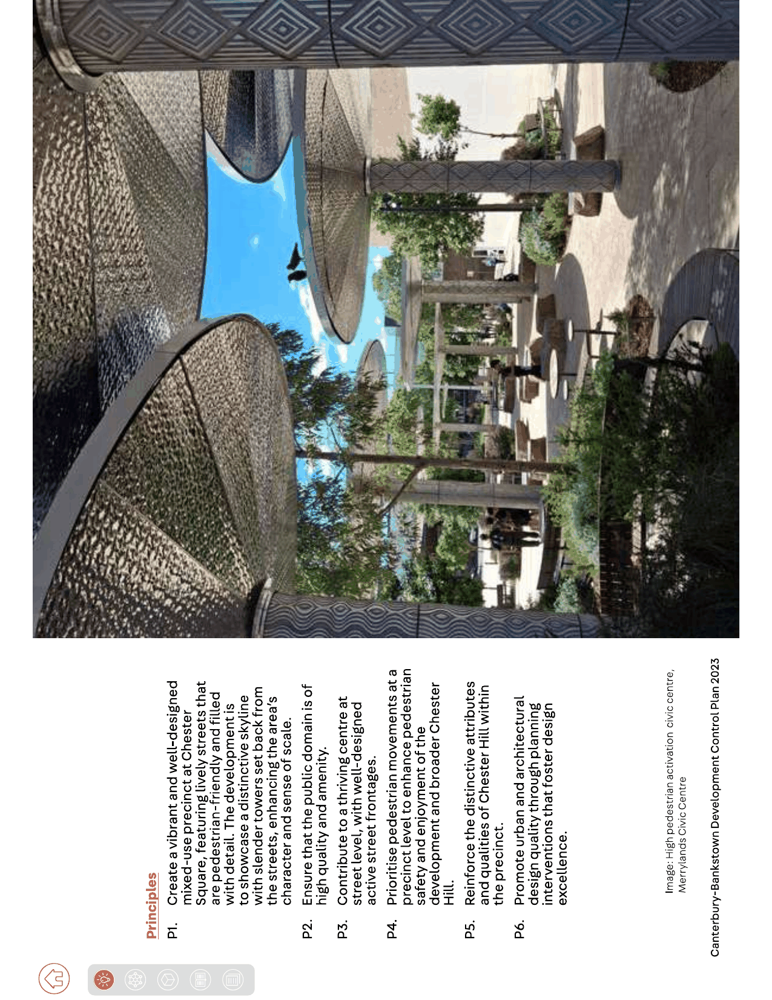
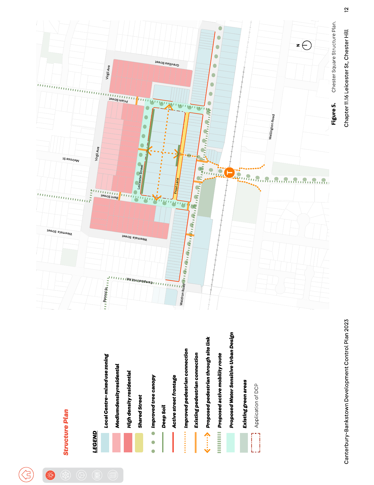
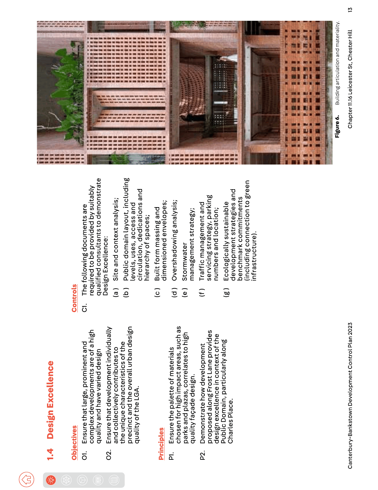

### 1.3. Vision and Character

#### Locality Statement

The Chester Square redevelopment envisions a dynamic, pedestrian-friendly precinct that integrates high-quality urban design with a strong sense of community. At its heart, the development will feature publicly accessible central open space of approximately 2,800m², providing a welcoming gathering place for residents, visitors, and workers alike. This civic plaza will serve as a focal point for socialinteraction, events, and recreation, surrounded by lush landscaping, shaded seating areas, and high-quality public domain improvements.

The precinct will also incorporate a modern, multi-purpose community facility spanning ensuring access to essential services and fostering social cohesion. Designed to be an inclusive and active hub, this facility

will accommodate a variety of uses, catering to the needs of the diverse

local population. Enhanced pedestrian pathways and improved connectivity will define the public domain, with activated laneways and widened Frost Lane creating seamless links between surrounding streets and transport nodes. Streetscape enhancements along Charles Place, Waldron Road and other key frontages will reinforce the walkability and accessibility of the precinct, inviting visitors to explore its dynamic mix of offerings.

At the core of the development will be a diverse range of mixed-use retail

Canterbury-Bankstown Development Control Plan 2023

spaces, contributing to a lively and engaging street-level experience. A curated selection of specialty shops, cafés, restaurants, and essential services will transform Chester Square into a pedestrian focused bustling civic hub, activating the precinct during both day and night.

#### Through carefully considered design

and acommitment to public benefit,

the Chester Square redevelopment will redefine Chester Hill as a thriving, people-centric destination, where community life, convenience, and commerce converge ina vibrant and sustainable urban setting.

Chapter 11.16 Leicester St, Chester Hill

10

> [End of OCR text from page 10.]

> [Page 11 is a scanned picture of text. The text below was read by OCR (machine reading) and may contain errors; check it against the original PDF.]

Create a vibrant and well-designed mixed-use precinct at Chester Square, featuring lively streets that are pedestrian-friendly and filled with detail. The developmentis

to showcase a distinctive skyline with slender towers set back from the streets, enhancing the area’s character and sense of scale.

Ensure that the public domain is of high quality and amenity.

Contribute to a thriving centre at street level, with well-designed active street frontages.

Prioritise pedestrian movements at a precinct level to enhance pedestrian safety and enjoyment of the development and broader Chester Hill.

Reinforce the distinctive attributes and qualities of Chester Hill within the precinct.

Promote urban and architectural design quality through planning interventions that foster design excellence.

Image: High pedestrian activation civic centre, Merrylands Civic Centre

Canterbury-Bankstown Development Control Plan 2023

> [End of OCR text from page 11.]

> [Page 12 is a scanned picture of text. The text below was read by OCR (machine reading) and may contain errors; check it against the original PDF.]

~ 2 s a

4S

#### Structure Plan

Virgit Ave

LEGEND Local Centre- mixed use zoning

| | Mediumdensityresidential | | High density residential

Shared Street

@ ©@ © canopy

Deep Soil Active street frontage

#### Improved pedestrian connection

#### Existing pedestrian connection

active mobility route

Proposed pedestrian through site link

a

e

on

Proposed Water Sensitive Urban Design

Tiny Pen men

°

e

Existing green areas

| | . ' Application of DCP Wellington Road

©

Figure 5. Chester Square Structure Plan. Chapter 11.16 Leicester St, Chester Hill 12

Canterbury-Bankstown Development Control Plan 2023

> [End of OCR text from page 12.]

> [Page 13 is a scanned picture of text. The text below was read by OCR (machine reading) and may contain errors; check it against the original PDF.]

77
