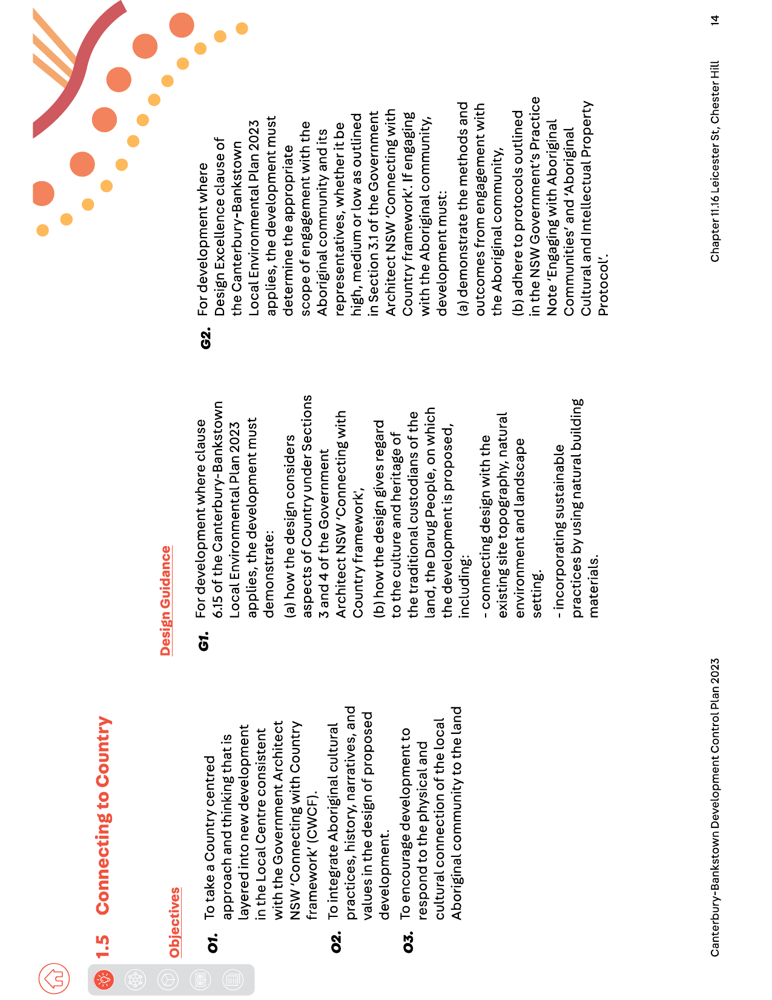

### 1.4 Design Excellence

#### Objectives

O1.

O2.

Ensure that large, prominent and complex developments are of a high quality and have varied design

#### Ensure that development individually

and collectively contributes to

the unique characteristics of the precinct and the overall urban design quality of the LGA.

#### Principles

P1.

P2

Canterbury-Bankstown Development Control Plan 2023

Ensure the palette of materials chosen for highimpact areas, such as parks and plazas, correlates to high quality fagade design.

Demonstrate how development proposed along Frost Lane provides design excellence in context of the Public Domain, particularly along Charles Place.

#### Controls

C1. The following documents are required to be provided by suitably qualified consultants to demonstrate Design Excellence:

(a) (b)

(c)

(d) (e)

(f )

(g)

Site and context analysis;

Public domain layout, including levels, uses, access and circulation, dedications and hierarchy of spaces;

Built form massing and

#### dimensioned envelopes;

#### Overshadowing analysis;

#### Stormwater

#### management strategy;

Traffic management and servicing strategy, parking numbers and location;

Ecologically sustainable development strategies and benchmark commitments (including connection to green infrastructure).

a ee eee

T a a

4

1S ee

PL

—— i a

===

i : i

Figure 6 Building articulation and materiality.

Chapter 11.16 Leicester St, Chester Hill

13

> [End of OCR text from page 13.]

> [Page 14 is a scanned picture of text. The text below was read by OCR (machine reading) and may contain errors; check it against the original PDF.]

wan
