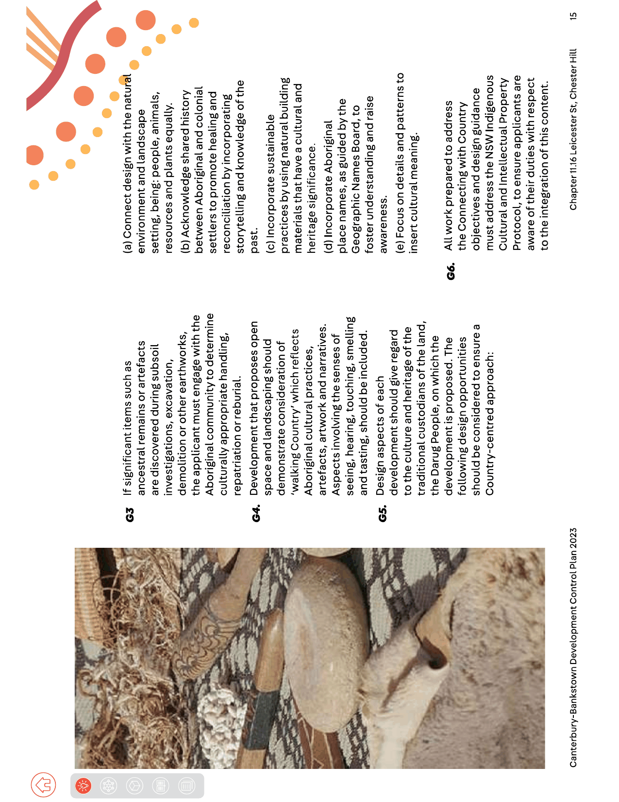
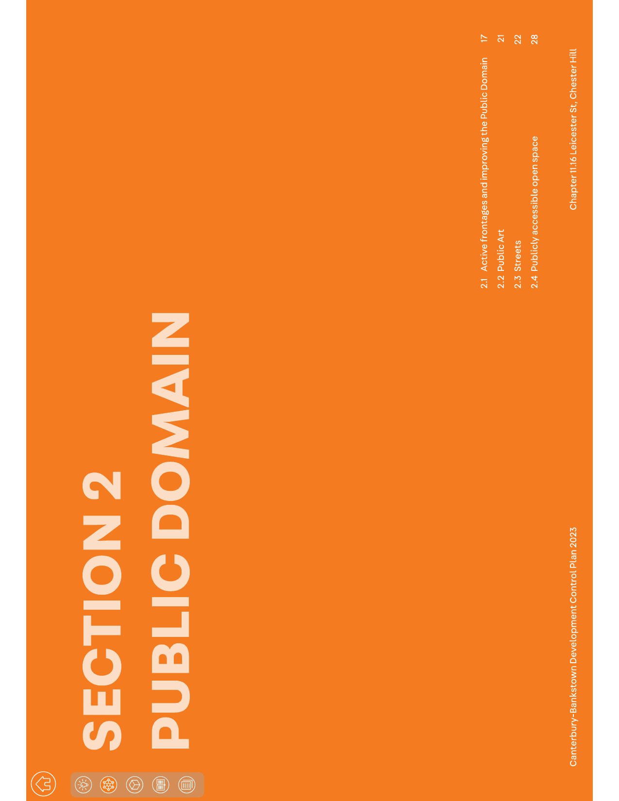
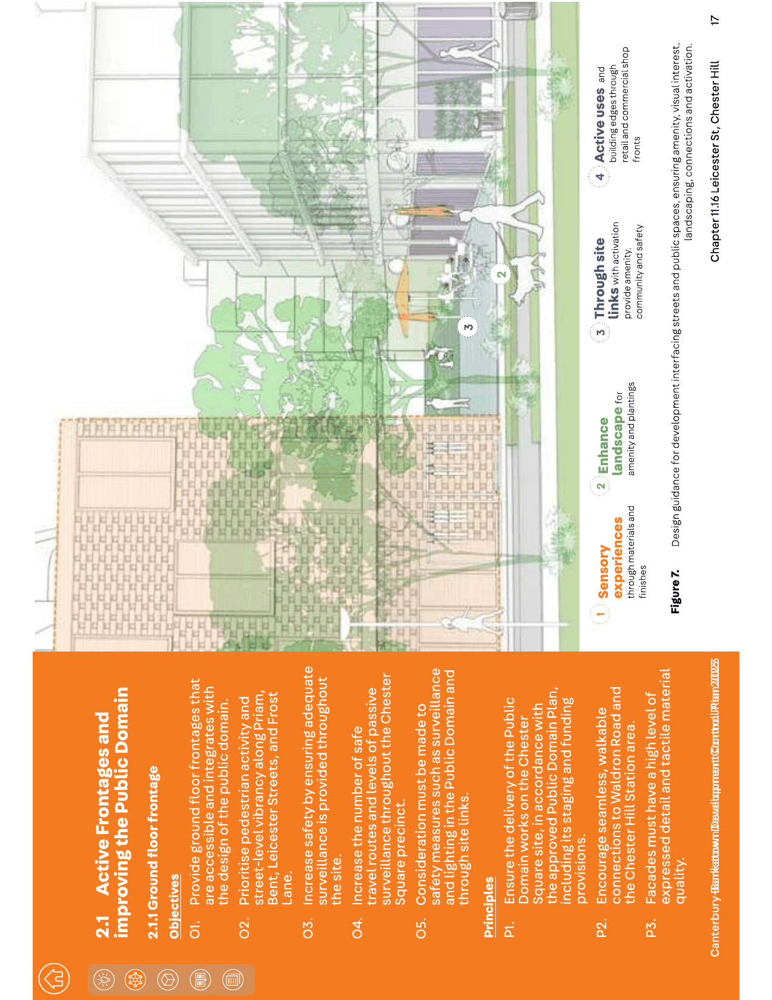
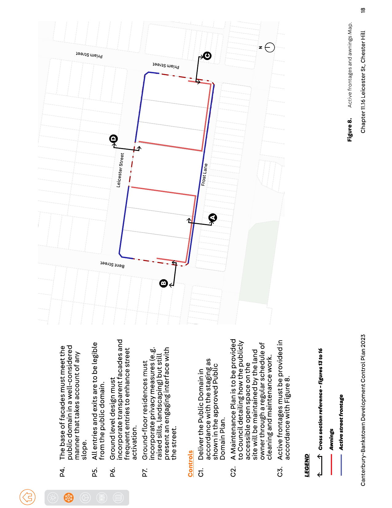
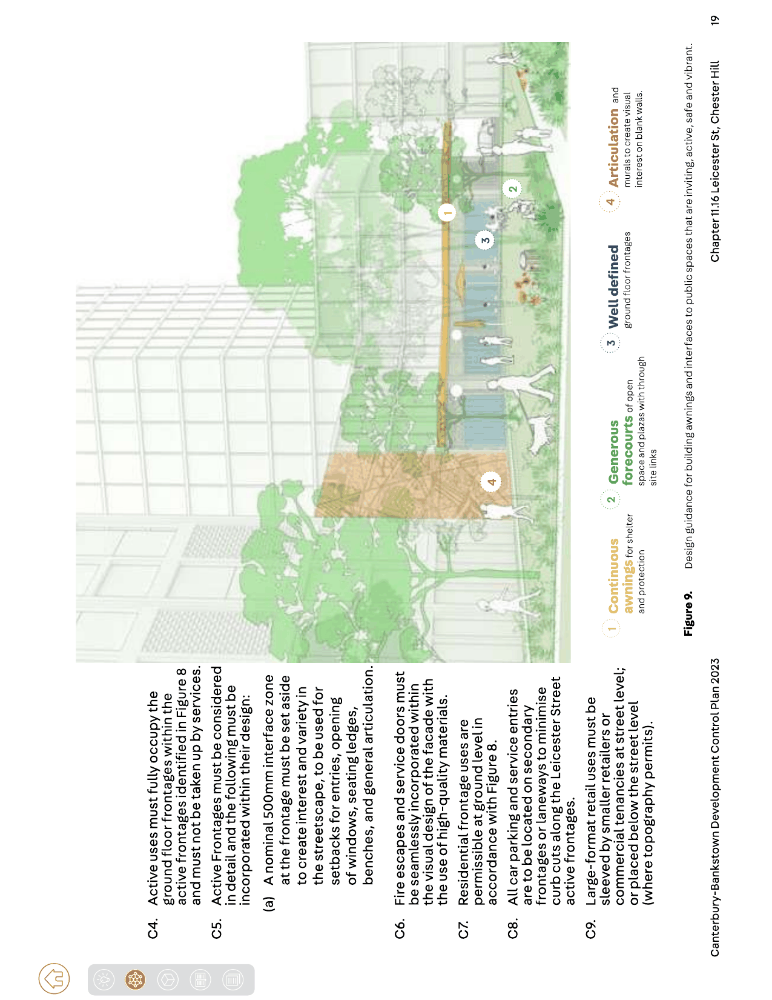
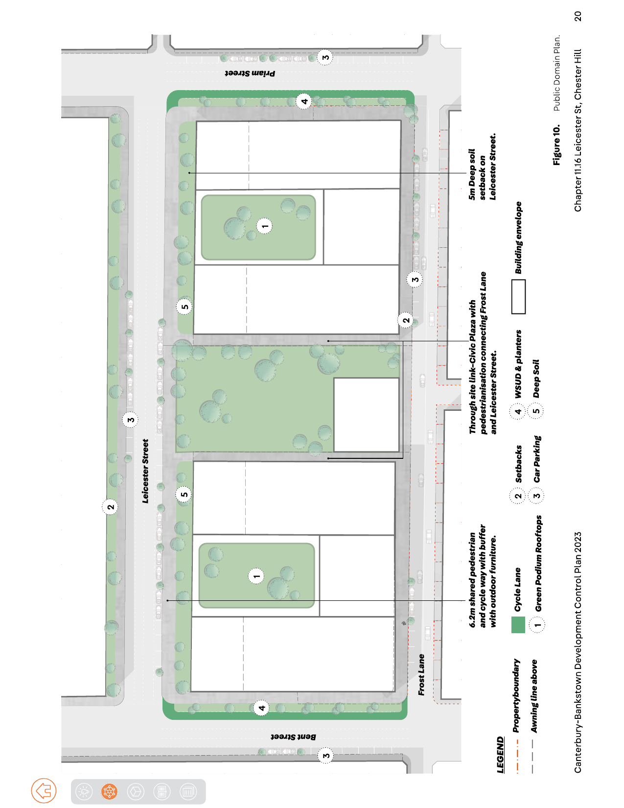
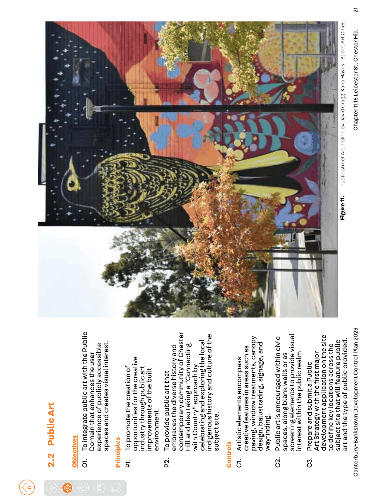
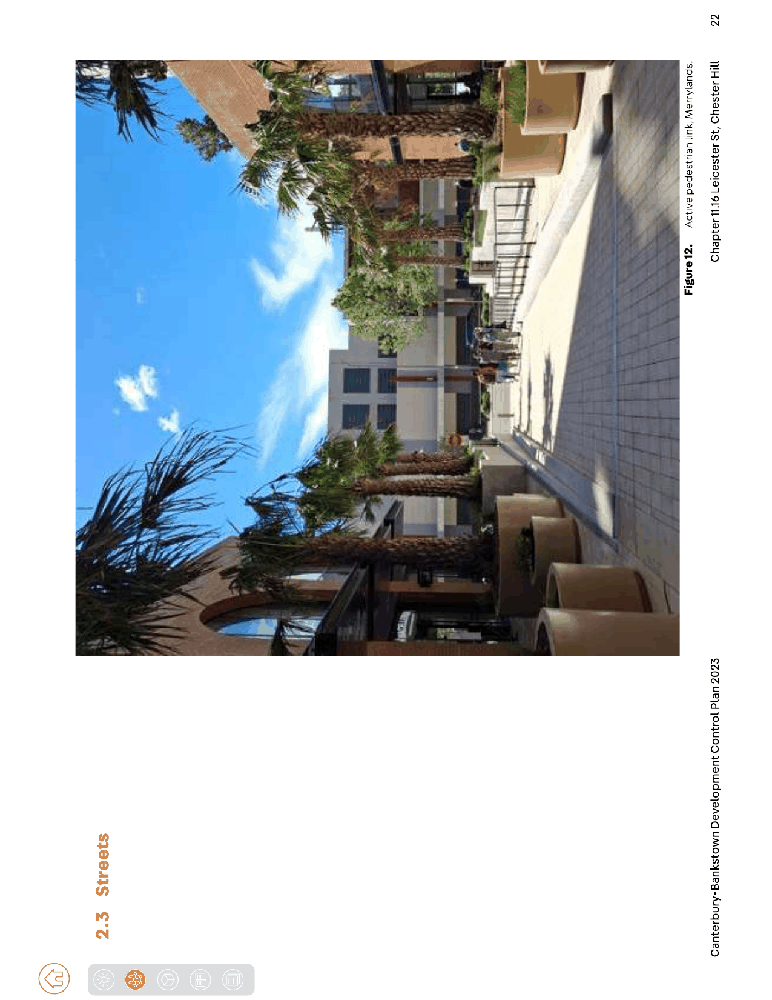

### 1.5 Connecting to Country

#### Objectives

o1. TotakeaCountry centred approach and thinking that is layered into new development in the Local Centre consistent with the Government Architect NSW ‘Connecting with Country framework’ (CWCEF).

O2, Tointegrate Aboriginal cultural practices, history, narratives, and values in the design of proposed development.

O3. development to respond to the physical and cultural connection of the local Aboriginal community to the land

Canterbury-Bankstown Development Control Plan 2023

#### Design Guidance

G1.

For development where clause

6.15 of the Canterbury-Bankstown Local Environmental Plan 2023 applies, the development must demonstrate:

(a) how the design considers aspects of Country under Sections 3 and 4 of the Government Architect NSW ‘Connecting with Country framework’,

(b) how the design gives regard to the culture and heritage of the traditional custodians of the land, the Darug People, on which the development is proposed, including:

- connecting design with the existing site topography, natural environment and landscape setting.

- incorporating sustainable practices by using natural building materials.

G2.

For development where

Design Excellence clause of

the Canterbury-Bankstown Local Environmental Plan 2023 applies, the development must determine the appropriate scope of engagement with the Aboriginal community and its representatives, whether it be high, medium or low as outlined in Section 3.1 of the Government Architect NSW ‘Connecting with Country framework’. If engaging with the Aboriginal community, development must:

(a) demonstrate the methods and outcomes from engagement with the Aboriginal community,

(b) adhere to protocols outlined in the NSW Government’s Practice Note ‘Engaging with Aboriginal Communities’ and ‘Aboriginal Cultural and Intellectual Property Protocol’.

Chapter 11.16 Leicester St, Chester Hill

14

> [End of OCR text from page 14.]

> [Page 15 is a scanned picture of text. The text below was read by OCR (machine reading) and may contain errors; check it against the original PDF.]

Canterbury-Bankstown Development Control Plan 2023

G3

G4.

G5.

If significant items such as

#### ancestral remains or artefacts

are discovered during subsoil investigations, excavation, demolition or other earthworks, the applicant must engage with the Aboriginal community to determine culturally appropriate handling, repatriation or reburial.

Development that proposes open space and landscaping should demonstrate consideration of ‘walking Country’ which reflects Aboriginal cultural practices, artefacts, artwork and narratives. Aspects involving the senses of seeing, hearing, touching, smelling and tasting, should be included.

Design aspects of each development should give regard to the culture and heritage of the traditional custodians of the land, the Darug People, on which the development is proposed. The following design opportunities should be considered to ensure a Country-centred approach:

G6.

(a) Connect design with the natural

#### environment and landscape

setting, being: people, animals, resources and plants equally.

(b) Acknowledge shared history between Aboriginal and colonial settlers to promote healing and reconciliation by incorporating storytelling and knowledge of the past.

(c) Incorporate sustainable practices by using natural building materials that have a cultural and heritage significance.

(d) Incorporate Aboriginal place names, as guided by the Geographic Names Board, to foster understanding and raise awareness.

(e) Focus on details and patterns to insert cultural meaning.

All work prepared to address

the Connecting with Country objectives and design guidance must address the NSW Indigenous Cultural and Intellectual Property Protocol, to ensure applicants are aware of their duties with respect to the integration of this content.

Chapter 11.16 Leicester St, Chester Hill 15

> [End of OCR text from page 15.]

> [Page 16 is a scanned picture of text. The text below was read by OCR (machine reading) and may contain errors; check it against the original PDF.]

## SECTION 2 PUBLIC DOMAIN

Canterbury-Bankstown Development Control Plan 2023

21 Active frontages and improving the Public Domain 17

2.2 Public Art 21

2.3 Streets 22

2.4 Publicly accessible open space 28

Chapter 11.16 Leicester St, Chester Hill

> [End of OCR text from page 16.]

> [Page 17 is a scanned picture of text. The text below was read by OCR (machine reading) and may contain errors; check it against the original PDF.]

it

HARE

ce

ee

1c

id el bd ie E

a Hi

oo

i em

‘2 ‘Enhance 3 Through site 4} Active uses ana landscape for Links with activation building edges through through materials and amenity and plantings provide amenity, retail and commercial shop finishes community and safety fronts

Figure 7. Design guidance for development interfacing streets and public spaces, ensuring amenity, visual interest,

#### landscaping, connections and activation.

Chapter 11.16 Leicester St, Chester Hill

17

> [End of OCR text from page 17.]

> [Page 18 is a scanned picture of text. The text below was read by OCR (machine reading) and may contain errors; check it against the original PDF.]

P4.

P5.

Pé.

P7.

The base of facades must meet the public domain in a well-considered manner that takes account of any slope.

All entries and exits are to be legible from the public domain.

Ground level design must incorporate transparent facades and frequent entries to enhance street activation.

Ground-floor residences must incorporate privacy measures (e.g. raised sills, landscaping) but still present an engaging interface with the street.

Controls

C1.

C2.

C3.

Deliver the Public Domain in accordance with the staging as shown in the approved Public Domain Plan.

A Maintenance Plan is to be provided to Council detailing how the publicly accessible open space on the

site will be maintained by the land owner through a regular schedule of cleaning and maintenance work.

Active frontages must be provided in accordance with Figure 8.

LEGEND

41 Cross section reference - figures 13 to 16

Awnings

Active street frontage

Canterbury-Bankstown Development Control Plan 2023

Street

—

—

292.18

Figure 8. Active frontages and awnings Map.

Chapter 11.16 Leicester St, Chester Hill

18

> [End of OCR text from page 18.]

> [Page 19 is a scanned picture of text. The text below was read by OCR (machine reading) and may contain errors; check it against the original PDF.]

@

C4.

C5.

C6.

C7.

C8.

C9.

Active uses must fully occupy the ground floor frontages within the active frontages identified in Figure 8 and must not be taken up by services.

Active Frontages must be considered in detail and the following must be

incorporated within their design:

(a) Anominal 500mm interface zone at the frontage must be set aside to create interest and variety in the streetscape, to be used for setbacks for entries, opening of windows, seating ledges, benches, and general articulation. * —~

Fire escapes and service doors must be seamlessly incorporated within the visual design of the facade with the use of high-quality materials.

Residential frontage uses are permissible at ground level in accordance with Figure 8.

All car parking and service entries are to be located on secondary frontages or laneways to minimise curb cuts along the Leicester Street active frontages.

Large-format retail uses must be sleeved by smaller retailers or commercial tenancies at street level; or placed below the street level (where topography permits).

Continuous — Generous Well defined Articulation ana

awnings for shelter forecourts of open ground floor frontages murals to create visual

and protection space and plazas with through interest on blank walls. site links

Figure 9. Design guidance for building awnings and interfaces to public spaces that are inviting, active, safe and vibrant.

Canterbury-Bankstown Development Control Plan 2023 Chapter 11.16 Leicester St, Chester Hill

> [End of OCR text from page 19.]

> [Picture of page 20: Chester Hill - a detailed map drawn with 77,220 lines, saved as a picture (images/ch-11-16-1-leicester-street-chester-hill-page-20.gif, 150 dpi); the street names and other labels are on the picture.]

> [Page 21 is a scanned picture of text. The text below was read by OCR (machine reading) and may contain errors; check it against the original PDF.]

O1.

P1.

P2.

C1.

C2.

C3.

To integrate public art with the Public Domain that enhances the user experience of publicly accessible spaces and creates visual interest.

To promote the creation of opportunities for the creative industry through public art improvements of the built environment.

To provide public art that

embraces the diverse history and contemporary community of Chester Hill and also taking a “Connecting with Country” approach by celebrating and exploring the local indigenous history and culture of the subject site.

Artistic elements encompass creative features in areas such as paving, window treatments, canopy design, balustrading, signage, and wayfinding.

Public art is encouraged within civic spaces, along blank walls or as screening elements to provide visual interest within the public realm.

Prepare and submit a Public

Art Strategy with the first major development application on the site to define key locations across the subject site that will feature public art and the type of public provided.

Canterbury-Bankstown Development Control Plan 2023

_2

Figure 11.

Public street Art, Pollen by David Cragg, Karla Hayes - Street Art Cities

Chapter 11.16 Leicester St, Chester Hill

21

> [End of OCR text from page 21.]

> [Page 22 is a scanned picture of text. The text below was read by OCR (machine reading) and may contain errors; check it against the original PDF.]

@)
