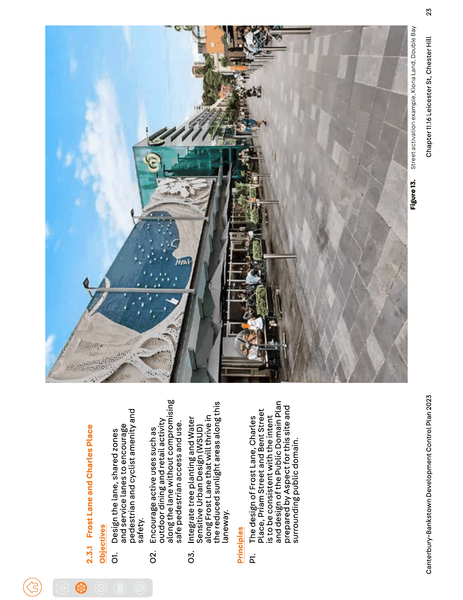

### 2.3 Streets

Canterbury-Bankstown Development Control Plan 2023

Figure12. Active pedestrian link, Merrylands.

Chapter 11.16 Leicester St, Chester Hill

22

> [End of OCR text from page 22.]

> [Page 23 is a scanned picture of text. The text below was read by OCR (machine reading) and may contain errors; check it against the original PDF.]

@)
