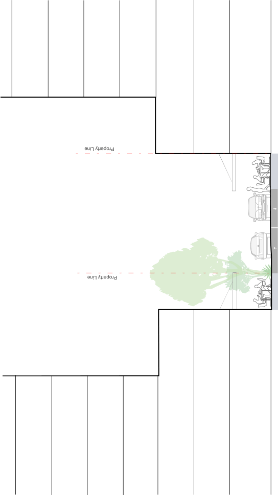
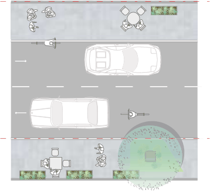
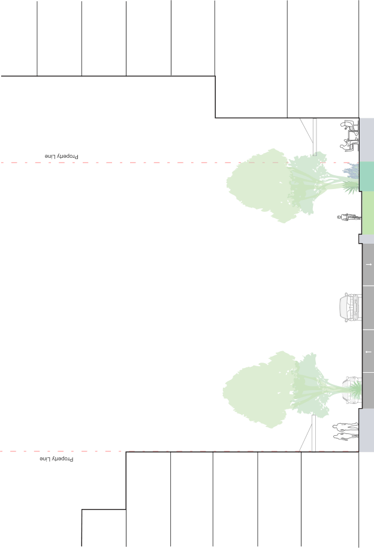
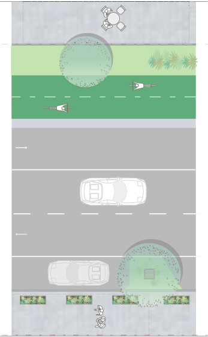
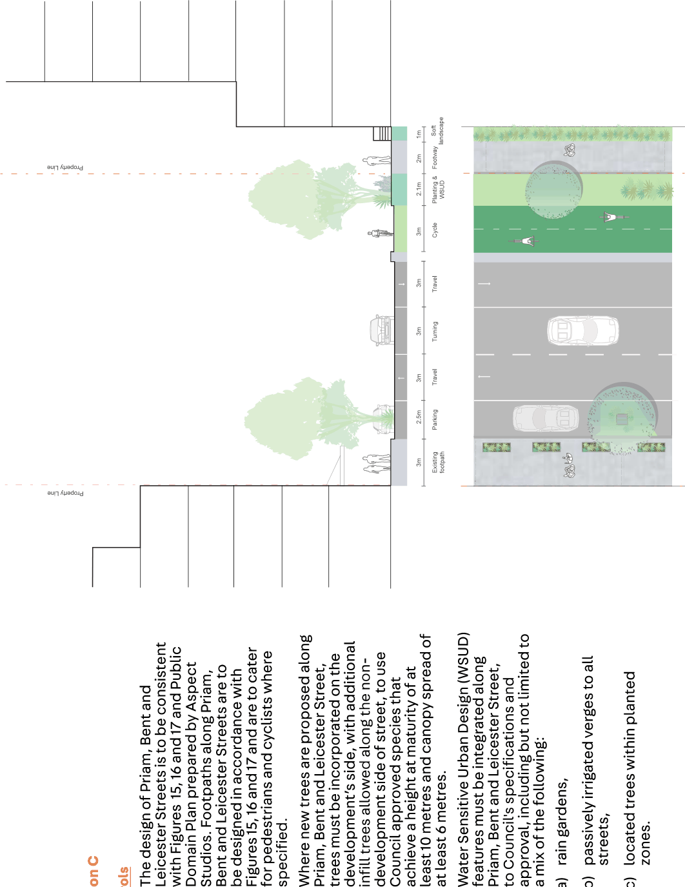
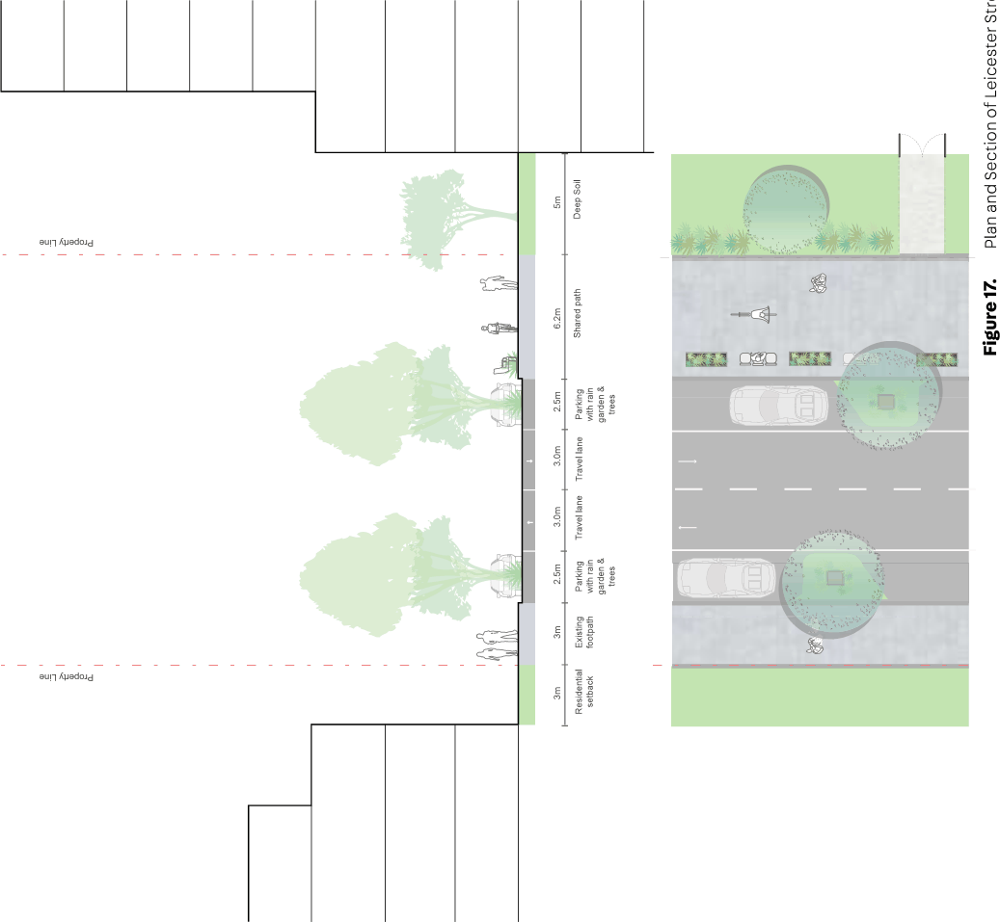
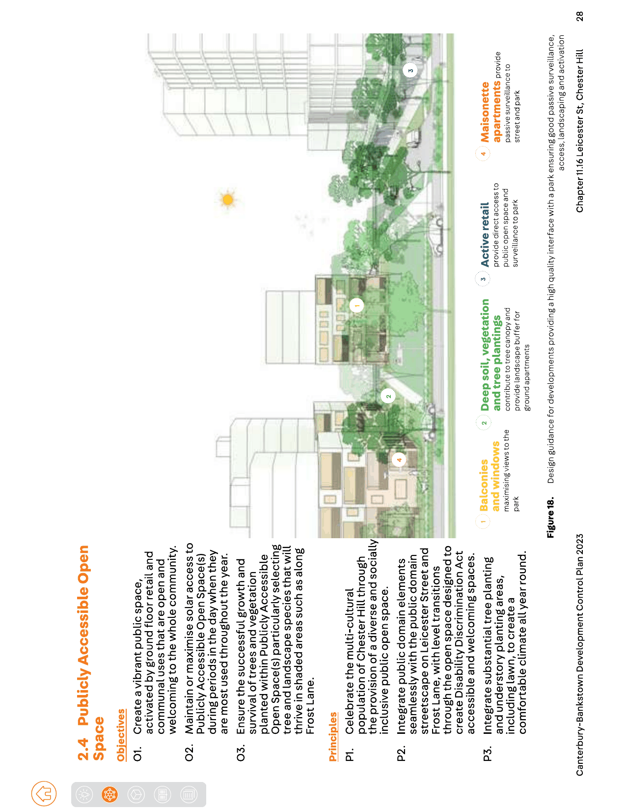

#### 2.3.1 Frost Lane and Charles Place

#### Objectives

O1. Design the lane, shared zones and service lanes to encourage pedestrian and cyclist amenity and safety.

O2. Encourage active uses such as outdoor dining and retail activity along the lane without compromising safe pedestrian access and use.

O3. Integrate tree planting and Water Sensitive Urban Design (WSUD) along Frost Lane that will thrive in the reduced sunlight areas along this laneway.

#### Principles

Pi. Thedesign of Frost Lane, Charles Place, Priam Street and Bent Street is to be consistent with the intent and design of the Public Domain Plan prepared by Aspect for this site and surrounding public domain.

a

ae

Figure13. Street activation example, Kiona Land, Double Bay

Canterbury-Bankstown Development Control Plan 2023 Chapter 11.16 Leicester St, Chester Hill

> [End of OCR text from page 23.]

> [Picture on page 24: a picture, saved as a picture (images/ch-11-16-1-leicester-street-chester-hill-page-24-1.gif, 150 dpi).]
> Words printed on the picture (title and legend, copied from the PDF):
> Property Line
> Property Line

> [Picture on page 24: a picture, saved as a picture (images/ch-11-16-1-leicester-street-chester-hill-page-24-2.gif, 150 dpi).]

> [Picture on page 25: a picture, saved as a picture (images/ch-11-16-1-leicester-street-chester-hill-page-25-1.gif, 150 dpi).]
> Words printed on the picture (title and legend, copied from the PDF):
> Property Line
> Property Line

> [Picture on page 25: a picture, saved as a picture (images/ch-11-16-1-leicester-street-chester-hill-page-25-2.gif, 150 dpi).]

> [Picture on page 26: a picture, saved as a picture (images/ch-11-16-1-leicester-street-chester-hill-page-26-1.gif, 150 dpi).]
> Words printed on the picture (title and legend, copied from the PDF):
> Property Line
> Property Line

> [Picture on page 27: a picture, saved as a picture (images/ch-11-16-1-leicester-street-chester-hill-page-27-1.gif, 150 dpi).]
> Words printed on the picture (title and legend, copied from the PDF):
> Property Line
> Property Line

> [Page 28 is a scanned picture of text. The text below was read by OCR (machine reading) and may contain errors; check it against the original PDF.]

@)
