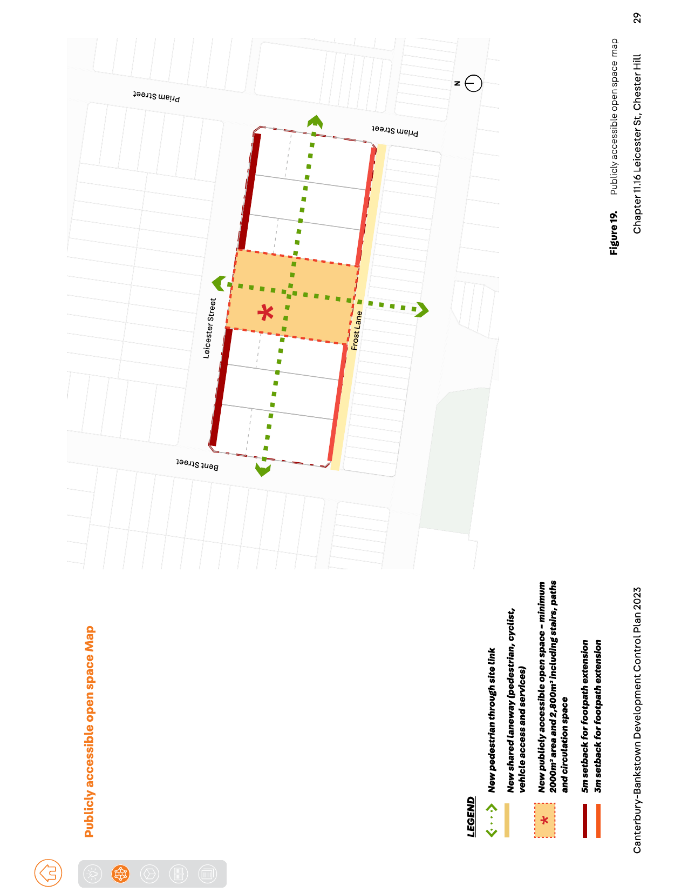
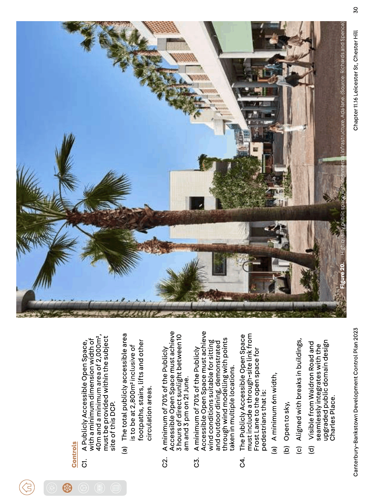
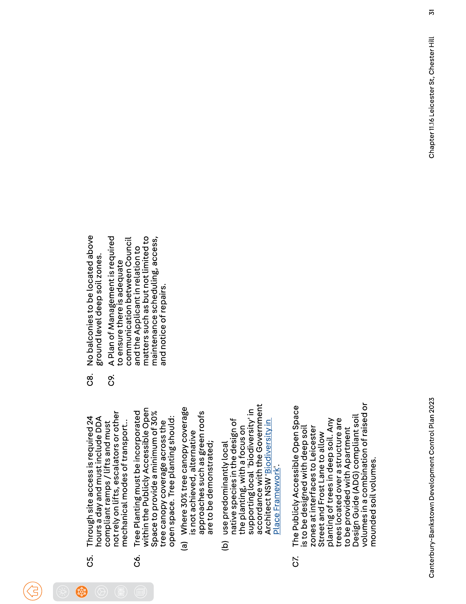
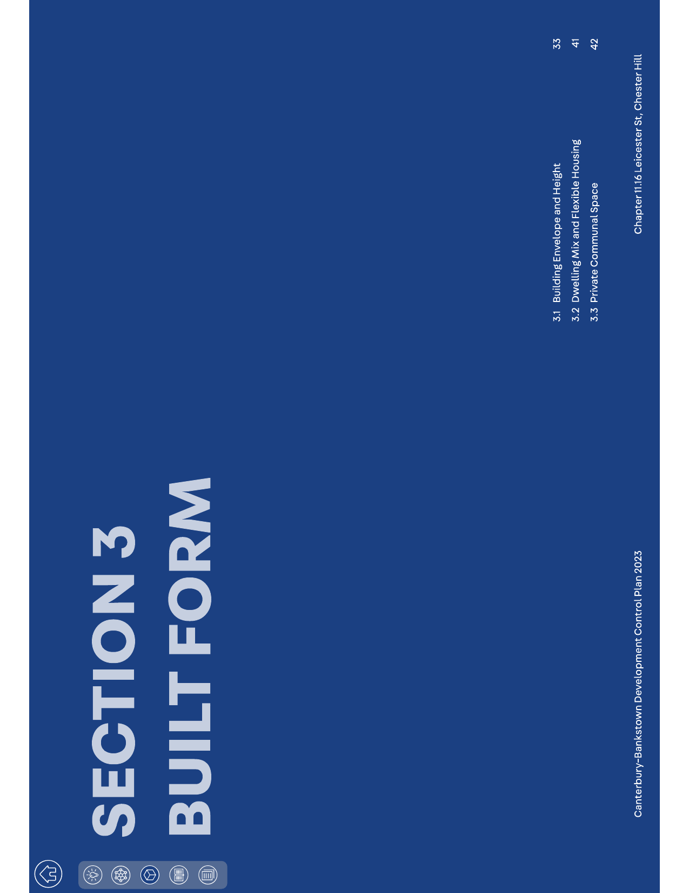

### 2.4 Publicly Accessible Open

#### Space

#### Objectives

O1. Create public space, activated by ground floor retail and communal uses that are open and welcoming to the whole community.

O2. Maintain or maximise solar access to Publicly Accessible Open Space(s) during periods in the day when they are most used throughout the year.

O3. Ensure the successful growth and survival of trees and vegetation planted within Publicly Accessible Open Space(s) particularly selecting tree and landscape species that will } | 7 thrive in shaded areas such as along

Frost Lane.

#### Principles

Pi. Celebrate the multi-cultural population of Chester Hill through the provision of a diverse and inclusive public open space.

P2. Integrate public domain elements seamlessly with the public domain streetscape on Leicester Street and Frost Lane, with level transitions through the open space designed to create Disability Discrimination Act accessibleandwelcomingspaces.

P3. Integrate substantialtree planting | Deep soil, vegetation. Active retail _4. Maisonette

and understory planting areas, andwindows andtree plantings provide direct access to apartments provide including lawn, to maximising views to the contribute to tree canopy and public open space and passive surveillance to

park provide landscape buffer for surveillance to park street and park comfortable climate all year round. ground apartments

Figure18. Design guidance for developments providing a high quality interface with a park ensuring good passive surveillance, access, landscaping and activation

Canterbury-Bankstown Development Control Plan 2023 Chapter 11.16 Leicester St, Chester Hill

28

> [End of OCR text from page 28.]

> [Page 29 is a scanned picture of text. The text below was read by OCR (machine reading) and may contain errors; check it against the original PDF.]

Publicly accessible open space Map

LEGEND <  Newpedestrian through site link

=" New shared laneway (pedestrian, cyclist, vehicle access and services)

| New publicly accessible open space - minimum 2000m² area and 2,800m² including stairs, paths

and circulation space

mum setback for footpath extension 3m setback for footpath extension

Canterbury-Bankstown Development Control Plan 2023

Publicly accessible open space map

Figure 19.

Chapter 11.16 Leicester St, Chester Hill

29

> [End of OCR text from page 29.]

> [Page 30 is a scanned picture of text. The text below was read by OCR (machine reading) and may contain errors; check it against the original PDF.]

@)

©

Cc

1.

(

Controls

A Publicly Accessible Open Space, with a minimum dimension width of 40m and a minimum area of 2,000m², must be provided within the subject site of this DCP.

(a) The total publicly accessible area is to be at 2,800m² inclusive of footpaths, stairs, lifts and other circulation areas.

C2. Aminimum of 70% of the Publicly

Cc

Cc

3.

A

( ( ( (

Accessible Open Space must achieve 3 hours of direct sunlight between 10 am and 3pm on 21 June.

A minimum of 70% of the Publicly Accessible Open Space must achieve wind conditions suitable for sitting and outdoor dining, demonstrated through wind modelling with points taken in multiple locations.

The Publicly Accessible Open Space must include a through-site link from Frost Lane to the open space for pedestrians that is:

a) Aminimum 6m width,

b) Opento sky,

c) Aligned with breaks in buildings,

d) Visible from Waldron Road and seamlessly integrates with the upgraded public domain design Charles Place.

Canterbury-Bankstown Development Control Plan 2023

ae

el ea

LE

gt

Figure 20.

—

a

High qua public spage. jth eommerd jl infrastructure, Ada lane. (Source: Richards and Spence)

Chapter 11.16 Leicester St, Chester Hill

30

> [End of OCR text from page 30.]

> [Page 31 is a scanned picture of text. The text below was read by OCR (machine reading) and may contain errors; check it against the original PDF.]

@)

C5.

C6.

Through site access is required 24 hours a day and must include DDA compliant ramps / lifts and must not rely on lifts, escalators or other mechanical modes of transport..

Tree Planting must be incorporated within the Publicly Accessible Open Space to provide a minimum of 30% tree canopy coverage across the open space. Tree planting should:

(a) Where 30% tree canopy coverage is not achieved, alternative approaches such as green roofs are to be demonstrated;

(b) use predominantly local native species in the design of the planting, with a focus on supporting local 'biodiversity' in accordance with the Government Architect NSW in Place Framework’.

C7. The Publicly Accessible Open Space

is to be designed with deep soil zones at interfaces to Leicester Street and Frost Lane to allow planting of trees in deep soil. Any trees located over a structure are

to be provided with Apartment Design Guide (ADG) compliant soil volumes in a combination of raised or mounded soil volumes.

Canterbury-Bankstown Development Control Plan 2023

C8.

C9.

No balconies to be located above ground level deep soil zones.

A Plan of Management is required to ensure there is adequate communication between Council and the Applicant in relation to matters such as but not limited to maintenance scheduling, access, and notice of repairs.

Chapter 11.16 Leicester St, Chester Hill

31

> [End of OCR text from page 31.]

> [Page 32 is a scanned picture of text. The text below was read by OCR (machine reading) and may contain errors; check it against the original PDF.]

## SECTION 3 BUILT FORM

3.1 Building Envelope and Height 33
