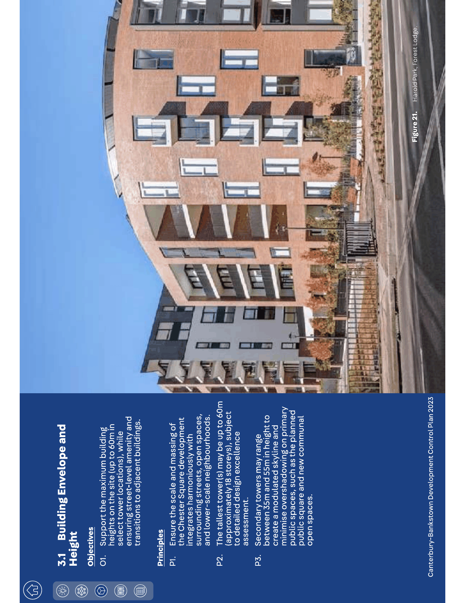

### 3.2 Dwelling Mix and Flexible Housing Al

3.3 Private Communal Space 42

Canterbury-Bankstown Development Control Plan 2023 Chapter 11.16 Leicester St, Chester Hill

> [End of OCR text from page 32.]

> [Page 33 is a scanned picture of text. The text below was read by OCR (machine reading) and may contain errors; check it against the original PDF.]

@)
