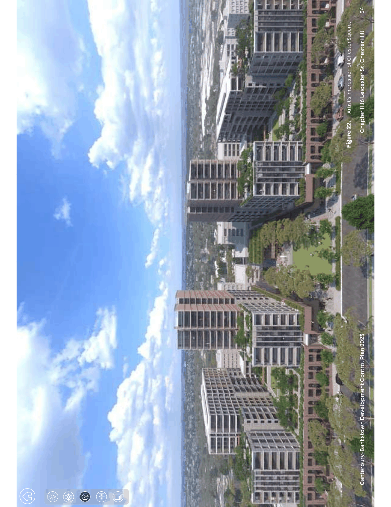
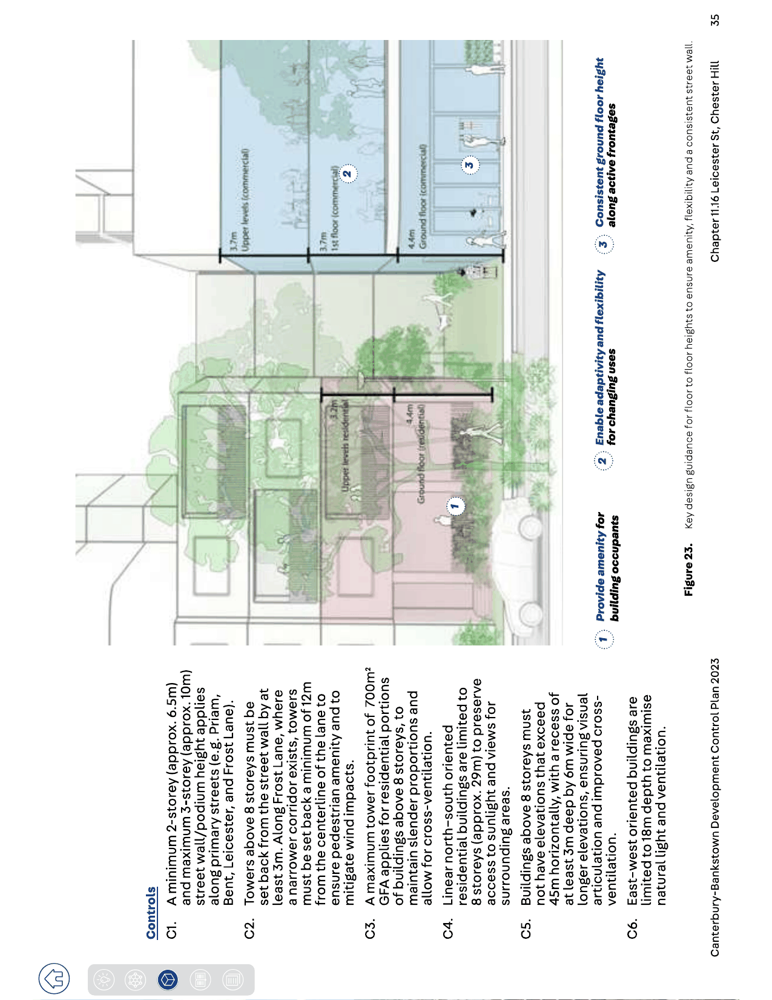
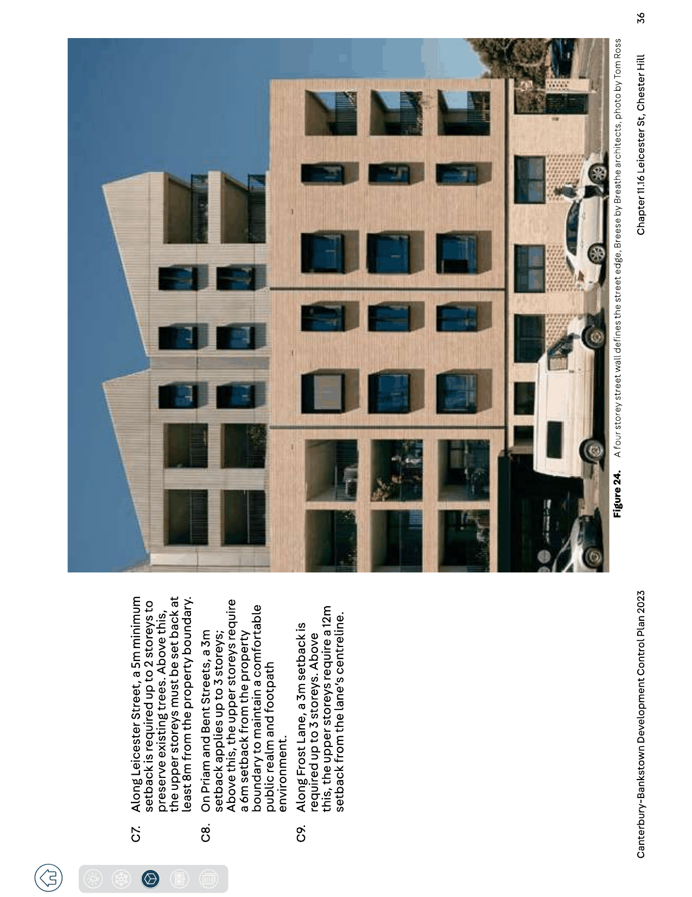
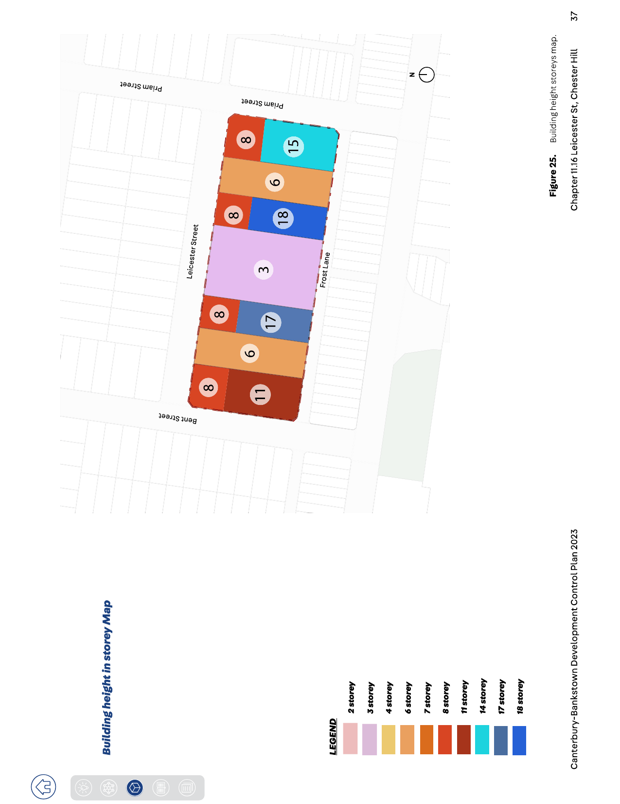
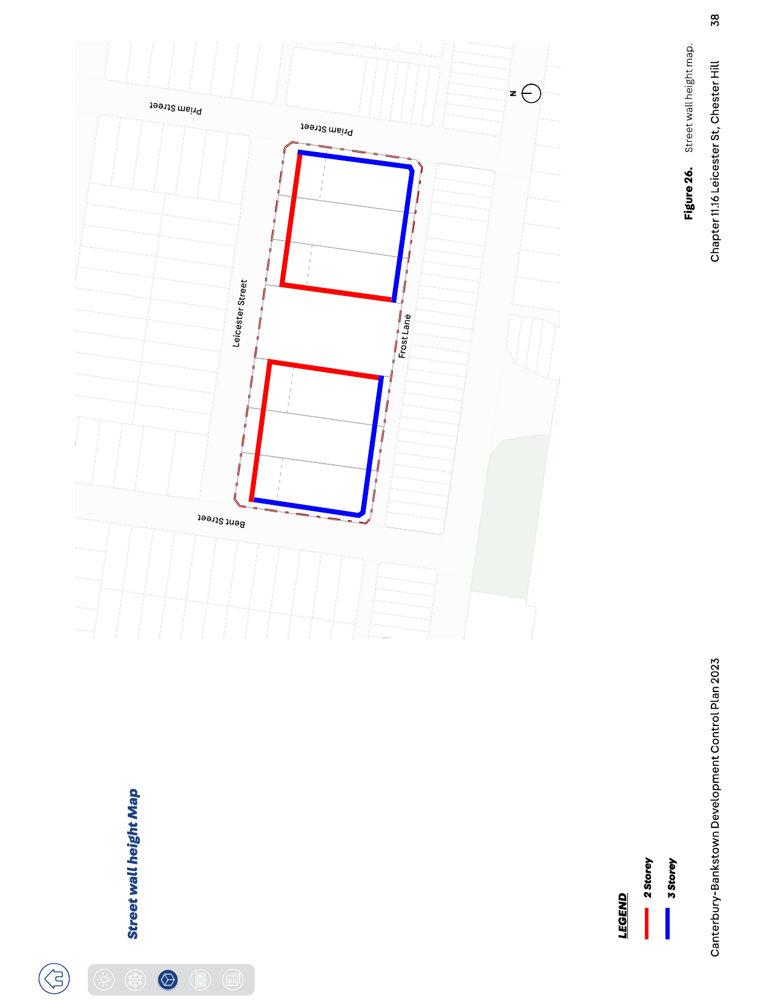
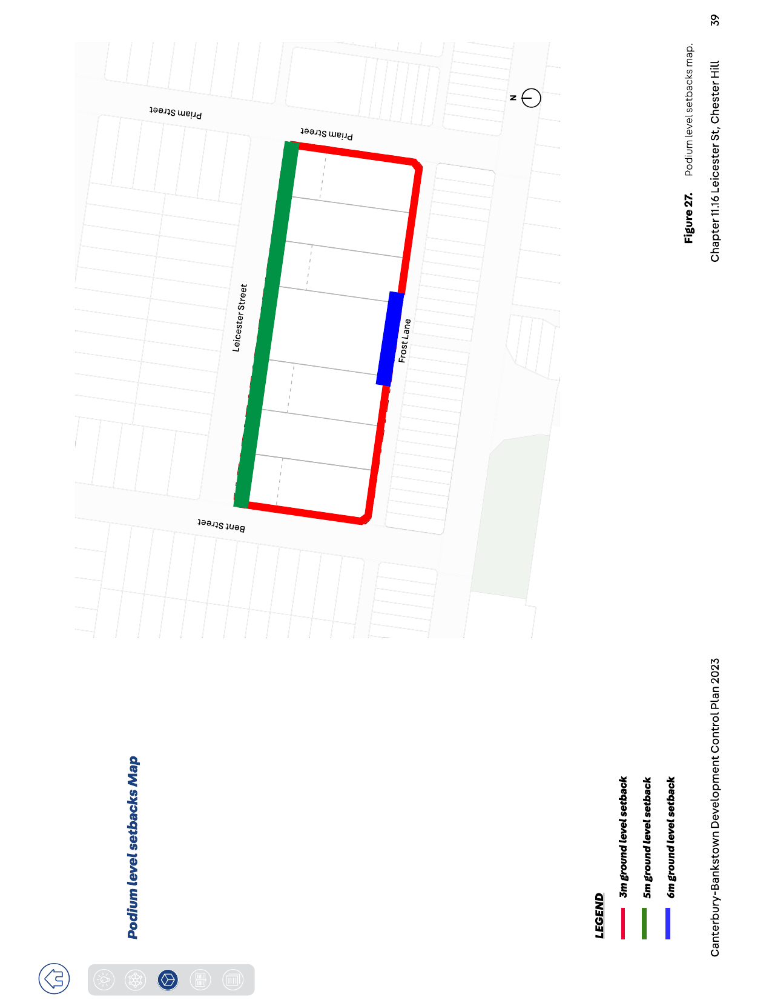
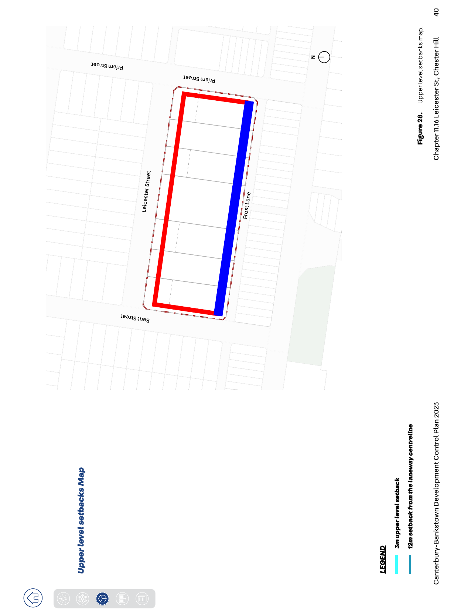
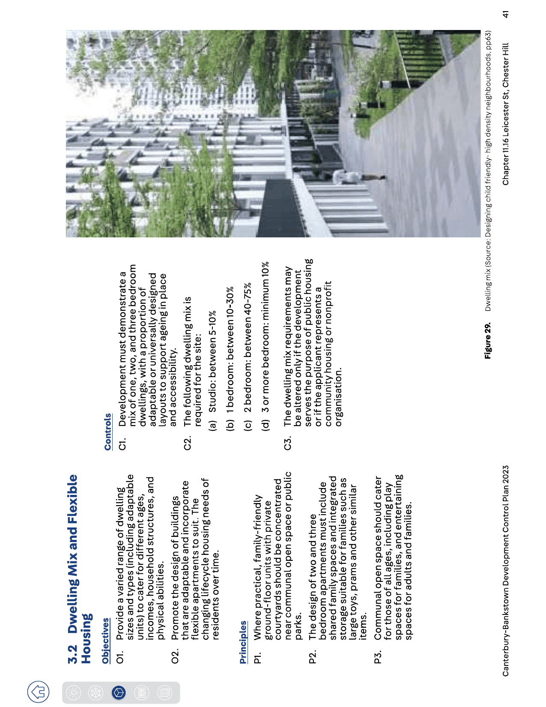

### 3.1 Building Envelope and

#### Height

#### Objectives

O1. Support the maximum building heights on the site (up to 60m in select tower locations), while ensuring street-level amenity and transitions to adjacent buildings.

#### Principles

P1. Ensure the scale and massing of the Chester Square development integrates harmoniously with surrounding streets, open spaces, and lower-scale neighbourhoods.

P2. Thetallest tower(s) may be up to 60m (approximately 18 storeys), subject to detailed design excellence assessment.

P3. Secondary towers may range between 35m and 55m in height to create a modulated skyline and minimise overshadowing on primary public spaces, such as the planned public square and new communal

open spaces. a

:

en

d ih | i fl {| | eb i 1 i = =

a

SS — ai = —_ - 3 - = —

25.

Figure Harold Park, Forest Lodge:

Canterbury-Bankstown Development Control Plan 2023

> [End of OCR text from page 33.]

> [Page 34 is a scanned picture of text. The text below was read by OCR (machine reading) and may contain errors; check it against the original PDF.]

Sree eee

ime, i + i = i ant = — eS Figure 22. Artist's impression of Chester Square.

7, 3 Chapter 11.16 Leicester St, Chester Hill

> [End of OCR text from page 34.]

> [Page 35 is a scanned picture of text. The text below was read by OCR (machine reading) and may contain errors; check it against the original PDF.]

Controls

C1.

C2.

C3.

C4.

C5.

C6.

Canterbury-Bankstown Development Control Plan 2023

A minimum 2-storey (approx. 6.5m) and maximum 3-storey (approx. 10m) street wall/podium height applies along primary streets (e.g. Priam, Bent, Leicester, and Frost Lane).

Towers above 8 storeys must be set back from the street wall by at least 3m. Along Frost Lane, where a narrower corridor exists, towers must be set back a minimum of 12m from the centerline of the lane to ensure pedestrian amenity and to mitigate wind impacts.

A maximum tower footprint of 700m² GFA applies for residential portions of buildings above 8 storeys, to maintain slender proportions and allow for cross-ventilation.

Linear north-south oriented residential buildings are limited to 8 storeys (approx. 29m) to preserve access to sunlight and views for surrounding areas.

Buildings above 8 storeys must not have elevations that exceed 45m horizontally, with a recess of at least 3m deep by 6m wide for longer elevations, ensuring visual articulation and improved cross-ventilation.

East-west oriented buildings are limited to 18m depth to maximise natural light and ventilation.

. Provide amenity for Enable adaptivity and flexibility building occupants changing uses

Figure 23.

, Consistent ground floor height along active frontages

Key design guidance for floor to floor heights to ensure amenity, flexibility and a consistent street wall.

Chapter 11.16 Leicester St, Chester Hill

35

> [End of OCR text from page 35.]

> [Page 36 is a scanned picture of text. The text below was read by OCR (machine reading) and may contain errors; check it against the original PDF.]

@)

C7.

C8.

C9.

Along Leicester Street, a 5m minimum setback is required up to 2 storeys to preserve existing trees. Above this, the upper storeys must be set back at least 8m from the property boundary.

On Priam and Bent Streets, a 3m setback applies up to 3 storeys; Above this, the upper storeys require a 6m setback from the property boundary to maintain a comfortable public realm and footpath

#### environment.

Along Frost Lane, a 3m setback is required up to 3 storeys. Above this, the upper storeys require a 12m setback from the lane’s centreline.

Canterbury-Bankstown Development Control Plan 2023

Ee = |

Figure 24. A four storey street wall defines the street edge, Breese by Breathe architects, photo by Tom Ross

Chapter 11.16 Leicester St, Chester Hill

36

> [End of OCR text from page 36.]

> [Page 37 is a scanned picture of text. The text below was read by OCR (machine reading) and may contain errors; check it against the original PDF.]

@)

Building height in storey Map

191g

Leiceste; Street

LEGEND

2 storey 3 storey 6 storey 7 storey @ 8 storey 14 storey

17 storey

18 storey Figure 25. Building height storeys map.

Chapter 11.16 Leicester St, Chester Hill 37

Canterbury-Bankstown Development Control Plan 2023

> [End of OCR text from page 37.]

> [Page 38 is a scanned picture of text. The text below was read by OCR (machine reading) and may contain errors; check it against the original PDF.]

@)

Street wall height Map

LEGEND 62 Storey uuu" 3Storey

Canterbury-Bankstown Development Control Plan 2023

Leicester Street

292.18

Figure 26.

Chapter 11.16 Leicester St, Chester Hill

Street wall height map.

38

> [End of OCR text from page 38.]

> [Page 39 is a scanned picture of text. The text below was read by OCR (machine reading) and may contain errors; check it against the original PDF.]

@)

292.18

Podium level setbacks Map

Leicester, Street

LEGEND

3m ground level setback Figure 27. Podium level setbacks map.

“=m 5m ground level setback Chapter 11.16 Leicester St, Chester Hill 39

“=== ground level setback

Canterbury-Bankstown Development Control Plan 2023

> [End of OCR text from page 39.]

> [Page 40 is a scanned picture of text. The text below was read by OCR (machine reading) and may contain errors; check it against the original PDF.]

@)

©

Upper level setbacks Map

LEGEND

== 3m upper level setback === 12m setback from the laneway centreline

Canterbury-Bankstown Development Control Plan 2023

292.18

Figure 28.

Chapter 11.16 Leicester St, Chester Hill

Upper level setbacks map.

40

> [End of OCR text from page 40.]

> [Page 41 is a scanned picture of text. The text below was read by OCR (machine reading) and may contain errors; check it against the original PDF.]

@)
