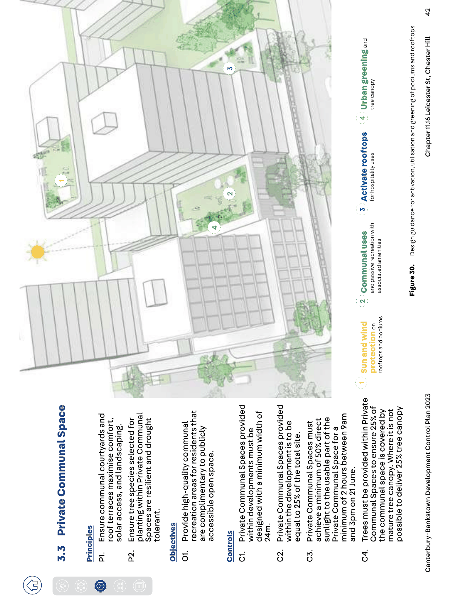

### 3.2 Dwelling Mix and Flexible

#### Housing

#### Objectives

O1. Provide range of dwelling sizes and types (including adaptable units) to cater for different ages, incomes, household structures, and physical abilities.

O2. Promote the design of buildings that are adaptable and incorporate flexible apartments to suit. The changing lifecycle housing needs of residents over time.

#### Principles

P1. Where practical, family-friendly ground-floor units with private courtyards should be concentrated near communal open space or public parks.

P2. Thedesign of two and three bedroom apartments must include shared family spaces and integrated storage suitable for families such as large toys, prams and other similar items.

P3. Communal open space should cater for those of all ages, including play spaces for families, and entertaining spaces for adults and families.

Canterbury-Bankstown Development Control Plan 2023

Controls

C1.

C2.

C3.

Development must demonstrate a mix of one, two, and three bedroom dwellings, with a proportion of adaptable or universally designed layouts to support ageing in place and accessibility.

The following dwelling mix is required for the site:

(a) Studio: between 5-10%

(b) 1bedroom: between 10-30%

(c) 2bedroom: between 40-75%

#### (d) 30rmore bedroom: minimum 10%

The dwelling mix requirements may be altered only if the development serves the purpose of public housing the applicant represents a community housing or nonprofit organisation.

Figure 29. Dwelling mix (Source: Designing child friendly- high density neighbourhoods, pp63)

Chapter 11.16 Leicester St, Chester Hill

41

> [End of OCR text from page 41.]

> [Page 42 is a scanned picture of text. The text below was read by OCR (machine reading) and may contain errors; check it against the original PDF.]
