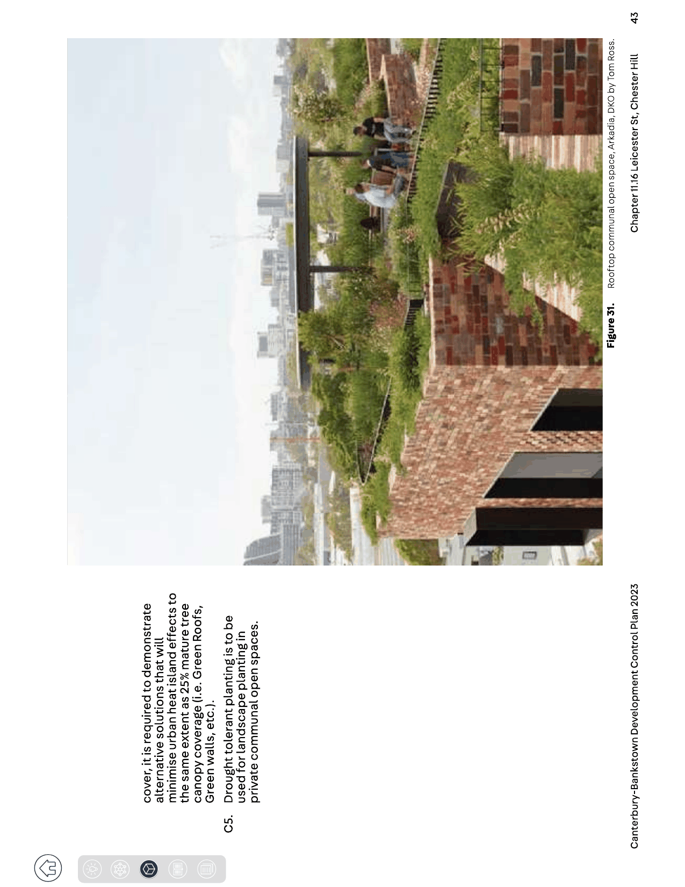
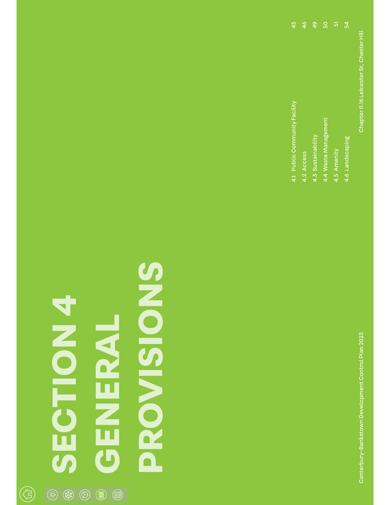
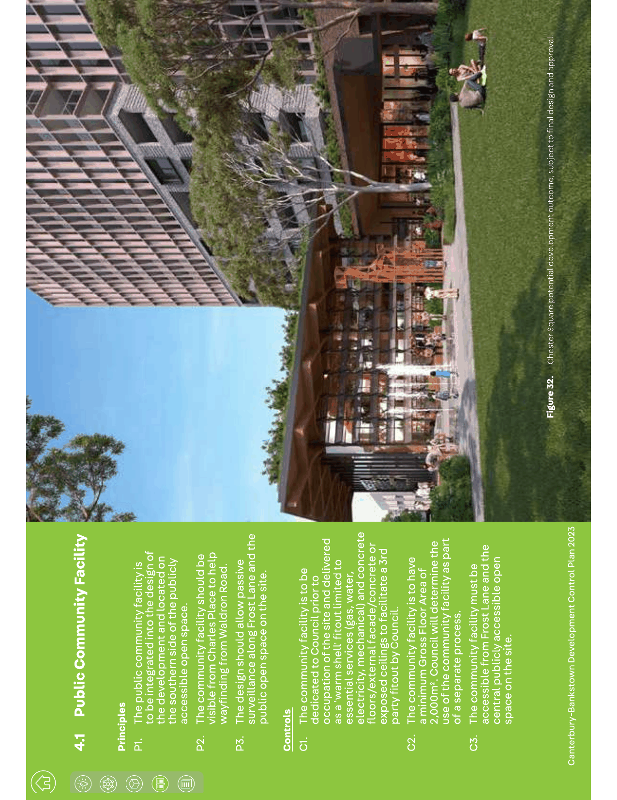

### 3.3 Private Communal Space =< | :

Principles = Wi + —

(9) P1. Ensure communal courtyards and ————— | A, roof terraces maximise comfort, A | solar access, and landscaping. i ——"|

P2. Ensure tree species selected for — SS) planting within PrivateCommunal | \ = Spaces are resilient and drought a tolerant. i

#### Objectives \

O1. Provide high-quality communal recreation areas for residents that are complimentary to publicly accessible open space.

Controls

Ci. Private Communal Spaces provided within developments must be designed with a minimum width of 24m.

C2. Private Communal Spaces provided within the development is to be equal to 25% of the total site.

C3. Private Communal Spaces must achieve a minimum of 50% direct sunlight to the usable part of the Private Communal Space for a minimum of 2 hours between 9am and 3pm on 21 June.

C4. Trees must be provided within Private Sunandwind .2. Communaluses rooftops Urban greening ang Communal Spaces to ensure 25% of protection on and passive recreation with for hospitality uses tree canopy the communal space is covered by rooftops and podiums associated amenities

mature tree canopy. Where it is not possible to deliver 25% tree canopy

Figure 30. Design guidance for activation, utilisation and greening of podiums and rooftops

Canterbury-Bankstown Development Control Plan 2023 Chapter 11.16 Leicester St, Chester Hill 42

> [End of OCR text from page 42.]

> [Page 43 is a scanned picture of text. The text below was read by OCR (machine reading) and may contain errors; check it against the original PDF.]

cover, it is required to demonstrate alternative solutions that will minimise urban heat island effects to the same extent as 25% mature tree canopy coverage (i.e. Green Roofs, Green walls, etc.).

C5. Drought tolerant planting is to be used for landscape planting in private communal open spaces.

Canterbury-Bankstown Development Control Plan 2023

Figure 31.

Rooftop communal open space, Arkadia, DKO by Tom Ross.

Chapter 11.16 Leicester St, Chester Hill

43

> [End of OCR text from page 43.]

> [Page 44 is a scanned picture of text. The text below was read by OCR (machine reading) and may contain errors; check it against the original PDF.]

## SECTION 4 GENERAL PROVISIONS

41 Public Community Facility 45

4.2 Access 46

4.3 Sustainability 49

4.4 Waste Management 50

4.5 Amenity 51

4.6 Landscaping 54

Canterbury-Bankstown Development Control Plan 2023 Chapter 11.16 Leicester St, Chester Hill

> [End of OCR text from page 44.]

> [Page 45 is a scanned picture of text. The text below was read by OCR (machine reading) and may contain errors; check it against the original PDF.]

@)
