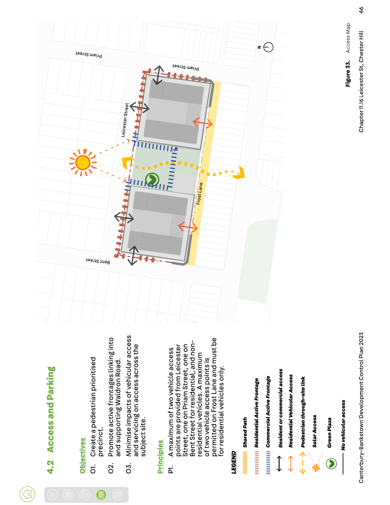

### 4.1 Public Community Facility

Oe

#### Principles

P1. The public community facility is to be integrated into the design of the development and located on the southern side of the publicly accessible open space.

P2. Thecommunity facility should be visible from Charles Place to help wayfinding from Waldron Road.

P3. should allow passive surveillance along Frost Lane and the public open space on the site.

Controls

Ci. facility is to be dedicated to Council prior to occupation of the site and delivered as a'warm shell fitout limited to essential services (gas, water, electricity, mechanical) and concrete floors/external facade/concrete or exposed ceilings to facilitate a 3rd party fitout by Council.

C2. The community facility is to have a minimum Gross Floor Area of 2,000m2. Council will determine the use of the community facility as part of aseparate process.

C3. The community facility must be accessible from Frost Lane and the central publicly accessible open space on the site.

Figure 32. Chester Square potential outcome, subject to final design and approval.

Canterbury-Bankstown Development Control Plan 2023

> [End of OCR text from page 45.]

> [Page 46 is a scanned picture of text. The text below was read by OCR (machine reading) and may contain errors; check it against the original PDF.]

@)
