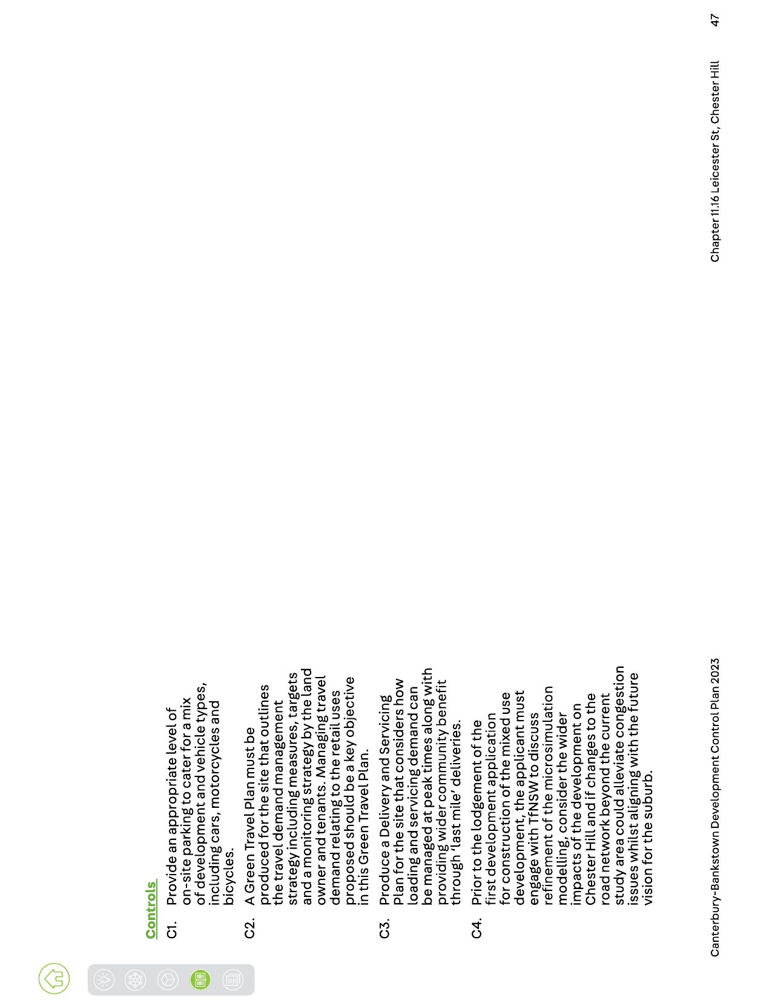
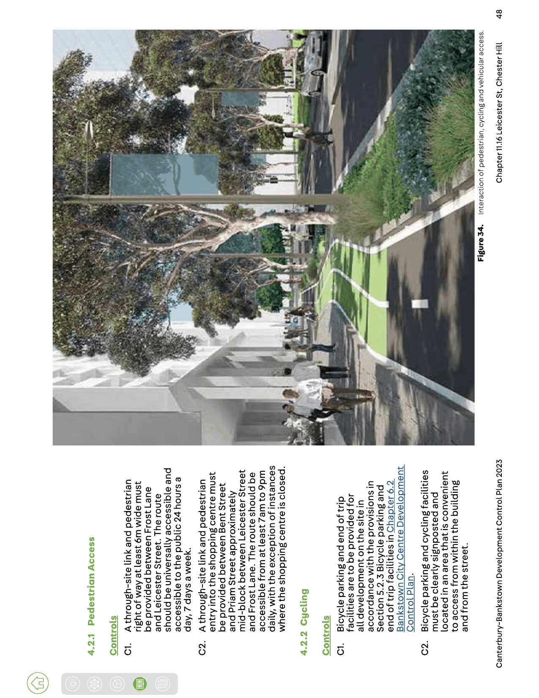
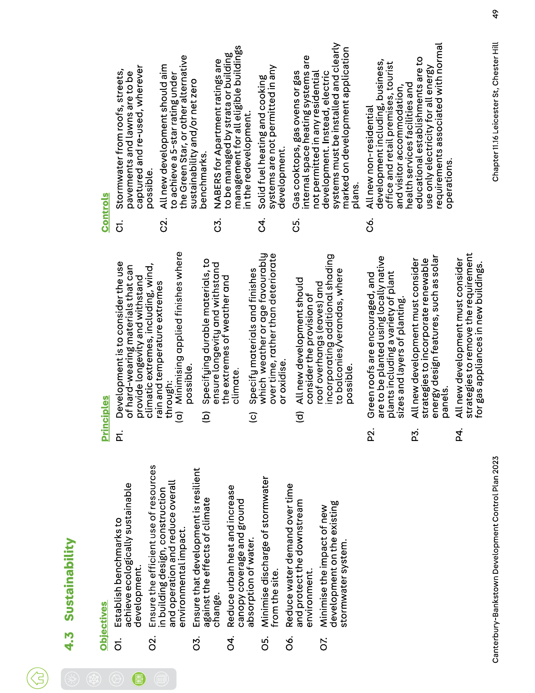

### 4.2 Access and Parking

Objectives O1. Create a pedestrian prioritised G precinct. O2. Promote active frontages linking into and supporting Waldron Road.

O03. Minimise impacts of vehicular access and servicing on access across the

subject site.

#### Principles

P1. Amaximum of two vehicle access points are provided from Leicester Street, one on Priam Street, one on Bent Street for residential, and non-residential vehicles. A maximum of two vehicle access points is permitted on Frost Lane and must be

for residential vehicles only. LEGEND Shared Path Active Frontage

Commercial Active Frontage

<— _ Resident or commercial access

Vehicular Access

< = > Pedestrian through-site link

Solar Access

3

w Green Plaza

No vehicular access

Canterbury-Bankstown Development Control Plan 2023

7929.18 uag

398115

Access Map.

Chapter 11.16 Leicester St, Chester Hill

46

> [End of OCR text from page 46.]

> [Page 47 is a scanned picture of text. The text below was read by OCR (machine reading) and may contain errors; check it against the original PDF.]

C1.

C2.

C3.

C4.

#### Controls

Provide an appropriate level of on-site parking to cater for a mix of development and vehicle types, including cars, motorcycles and bicycles.

A Green Travel Plan must be produced for the site that outlines the travel demand management strategy including measures, targets and a monitoring strategy by the land owner and tenants. Managing travel demand relating to the retail uses proposed should be a key objective in this Green Travel Plan.

Produce a Delivery and Servicing Plan for the site that considers how loading and servicing demand can be managed at peak times along with providing wider community benefit through ‘last mile’ deliveries.

Prior to the lodgement of the

#### first development application

for construction of the mixed use development, the applicant must engage with TfNSW to discuss refinement of the microsimulation modelling, consider the wider impacts of the development on Chester Hill and if changes to the road network beyond the current study area could alleviate congestion issues whilst aligning with the future vision for the suburb.

Canterbury-Bankstown Development Control Plan 2023

Chapter 11.16 Leicester St, Chester Hill

47

> [End of OCR text from page 47.]

> [Page 48 is a scanned picture of text. The text below was read by OCR (machine reading) and may contain errors; check it against the original PDF.]

C1.

C2.

C1.

C2.

A through-site link and pedestrian right of way at least 6m wide must be provided between Frost Lane and Leicester Street. The route should be universally accessible and accessible to the public 24 hours a day, 7 days a week.

A through-site link and pedestrian entry into the shopping centre must be provided between Bent Street and Priam Street approximately mid-block between Leicester Street and Frost Lane. The route should be accessible from at least 7am to 9pm daily, with the exception of instances where the shopping centre is closed.

Bicycle parking and end of trip facilities are to be provided for

all development on the site in accordance with the provisions in Section 5.2.3 Bicycle parking and end of trip facilities in Chapter 6.2 Bankstown City Centre Development Control Plan.

Bicycle parking and cycling facilities must be clearly signposted and located in an area that is convenient to access from within the building and from the street.

Canterbury-Bankstown Development Control Plan 2023

Wea,

Figure 34. Interaction of pedestrian, cycling and vehicular access.

Chapter 11.16 Leicester St, Chester Hill

48

> [End of OCR text from page 48.]

> [Page 49 is a scanned picture of text. The text below was read by OCR (machine reading) and may contain errors; check it against the original PDF.]
