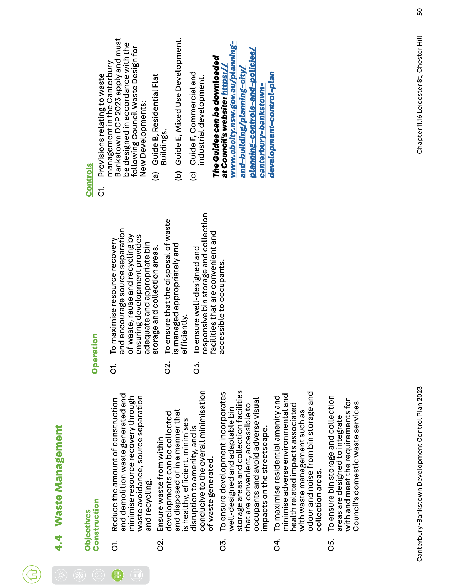

### 4.3 Sustainability

#### Objectives

O2.

O3.

O04.

O5.

06.

O7.

Establish benchmarks to achieve ecologically sustainable development.

Ensure the efficient use of resources in building design, construction

and operation and reduce overall

#### environmental impact.

Ensure that development is resilient against the effects of climate change.

Reduce urban heat and increase canopy coverage and ground absorption of water.

#### Minimise discharge of stormwater

from the site.

Reduce water demand over time and protect the downstream environment.

Minimise the impact of new development on the existing stormwater system.

Canterbury-Bankstown Development Control Plan 2023

#### Principles

P1.

P2.

P3.

P4.

Development is to consider the use of hard-wearing materials that can provide longevity and withstand climatic extremes, including, wind, rain and temperature extremes through:

(a) Minimising applied finishes where

#### possible.

(b) Specifying durable materials, to ensure longevity and withstand the extremes of weather and climate.

(c) Specify materials and finishes which weather or age favourably over time, rather than deteriorate or oxidise.

(d) Allnew development should consider the provision of roof overhangs (eaves) and incorporating additional shading to balconies/verandas, where possible.

Green roofs are encouraged, and are to be planted using locally native plants including a variety of plant sizes and layers of planting.

All new development must consider strategies to incorporate renewable energy design features, such as solar panels.

All new development must consider strategies to remove the requirement for gas appliances in new buildings.

#### Controls

C1.

C2.

C3.

C4.

C5.

C6.

Stormwater from roofs, streets, pavements and lawns are to be captured and re-used, wherever possible.

All new development should aim to achieve a 5-star rating under the Green Star, or other alternative sustainability and/or net zero benchmarks.

NABERS for Apartment ratings are

to be managed by strata or building management for all eligible buildings in the redevelopment.

Solid fuel heating and cooking systems are not permitted in any development.

Gas cooktops, gas ovens or gas internal space heating systems are not permitted in any residential development. Instead, electric systems must be installed and clearly marked on development application plans.

All new non-residential development including, business, office and retail premises, tourist and visitor accommodation,

health services facilities and educational establishments are to use only electricity for all energy requirements associated with normal operations.

Chapter 11.16 Leicester St, Chester Hill

49

> [End of OCR text from page 49.]

> [Page 50 is a scanned picture of text. The text below was read by OCR (machine reading) and may contain errors; check it against the original PDF.]
