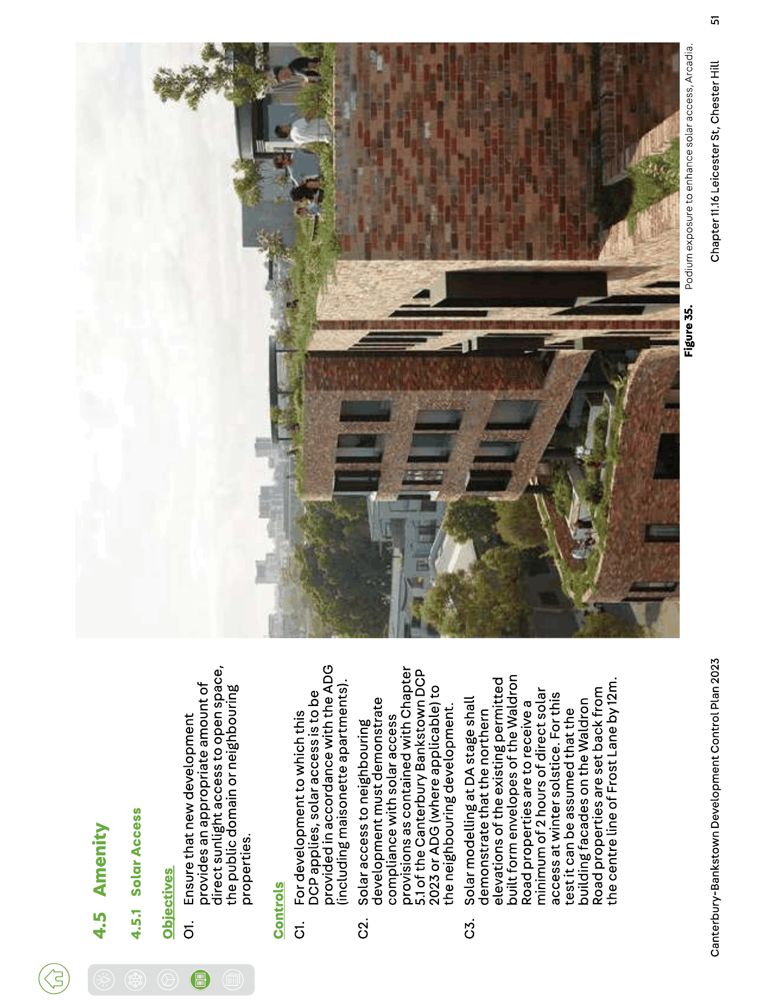
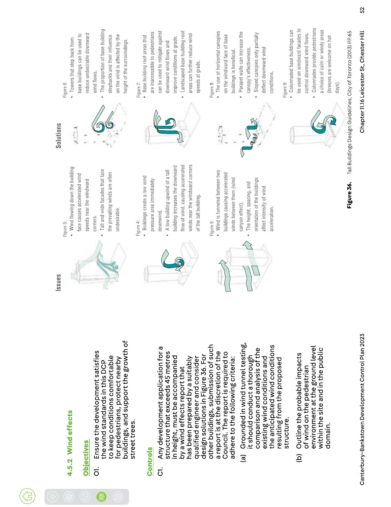

### 4.4 Waste Management

#### Objectives

#### Construction

O1.

O3.

04.

O5.

Reduce the amount of construction Ol. and demolition waste generated and minimise resource recovery through

#### waste avoidance, source separation

#### and recycling.

Ensure waste from within

developments can be collected O2.

and disposed of in a manner that

#### is healthy, efficient, minimises

disruption to amenity, and is O3.

conducive to the overall minimisation of waste generated.

To ensure development incorporates well-designed and adaptable bin storage areas and collection facilities that are convenient, accessible to occupants and avoid adverse visual impacts on the streetscape.

To maximise residential amenity and minimise adverse environmental and health related impacts associated with waste management such as odour and noise from bin storage and collection areas.

To ensure bin storage and collection areas are designed to integrate

with and meet the requirements for

#### Council's domestic waste services.

Canterbury-Bankstown Development Control Plan 2023

#### Operation

To maximise resource recovery and encourage source separation of waste, reuse and recycling by ensuring development provides adequate and appropriate bin storage and collection areas.

To ensure that the disposal of waste is managed appropriately and efficiently.

To ensure well-designed and responsive bin storage and collection facilities that are convenient and accessible to occupants.

#### Controls

C1.

Provisions relating to waste management in the Canterbury Bankstown DCP 2023 apply and must be designed in accordance with the following Council Waste Design for New Developments:

(a) Guide B, Residential Flat

#### Buildings.

(b) Guide E, Mixed Use Development.

(c) Guide F, Commercial and

#### industrial development.

The Guides can be downloaded at Council's website: https:// www.cbcity.nsw. gov.au

and-buildin planning-controls-and-policies/ canterbury-bankstown-development-control-plan

Chapter 11.16 Leicester St, Chester Hill

50

> [End of OCR text from page 50.]

> [Page 51 is a scanned picture of text. The text below was read by OCR (machine reading) and may contain errors; check it against the original PDF.]

O1.

C1.

C2.

C3.

Ensure that new development provides an appropriate amount of direct sunlight access to open space, the public domain or neighbouring properties.

For development to which this

DCP applies, solar access is to be provided in accordance with the ADG (including maisonette apartments).

Solar access to neighbouring development must demonstrate compliance with solar access provisions as contained with Chapter

5.1 of the Canterbury Bankstown DCP 2023 or ADG (where applicable) to the neighbouring development.

Solar modelling at DA stage shall demonstrate that the northern elevations of the existing permitted built form envelopes of the Waldron Road properties are to receive a minimum of 2 hours of direct solar access at winter solstice. For this test it can be assumed that the building facades on the Waldron Road properties are set back from the centre line of Frost Lane by 12m.

Canterbury-Bankstown Development Control Plan 2023

Figure 35.

Podium exposure to enhance solar access, Arcadia.

Chapter 11.16 Leicester St, Chester Hill

51

> [End of OCR text from page 51.]

> [Page 52 is a scanned picture of text. The text below was read by OCR (machine reading) and may contain errors; check it against the original PDF.]

©
