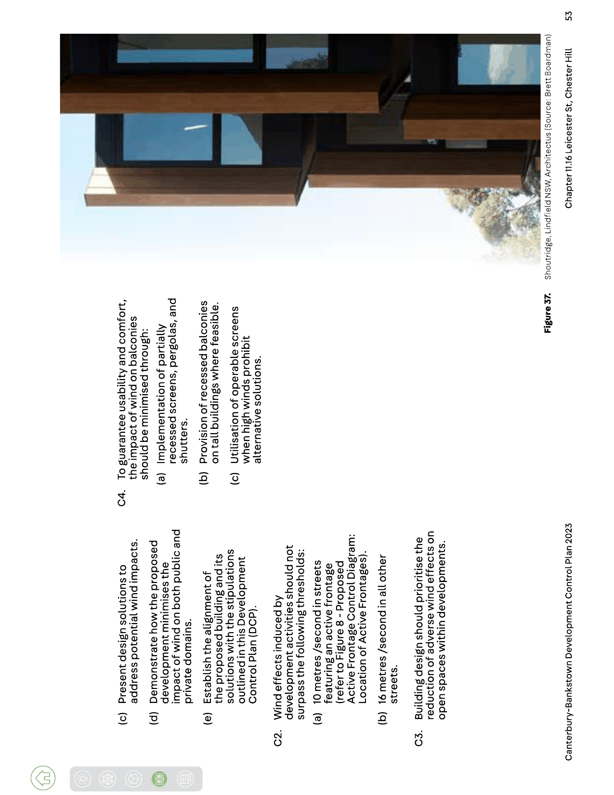
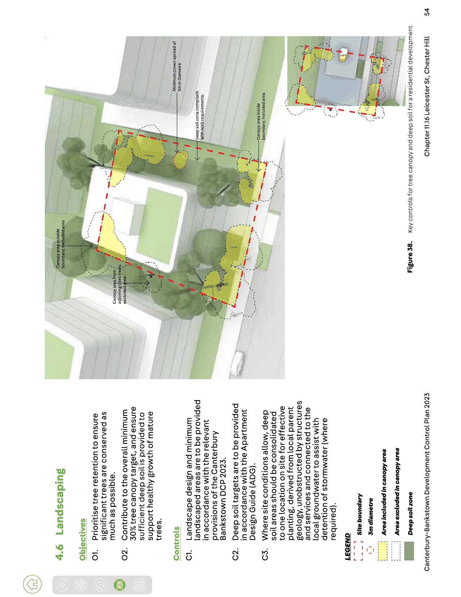

#### 4.5.2 Wind effects

#### Objectives

O1. Ensure the development satisfies the wind standards in this DCP to keep conditions comfortable for pedestrians, protect nearby buildings, and support the growth of street trees.

#### Controls

C1. application fora structure that exceeds 45 metres in height, must be accompanied by awind effects report that has been prepared by a suitably qualified engineer and consider design solutions in Figure 36. For other buildings, submission of such areport is at the discretion of the Council. The report is required to adhere to the following criteria:

(a) Grounded in wind tunnel testing, it should conduct a thorough comparison and analysis of the existing wind conditions and the anticipated wind conditions resulting from the proposed structure.

(b) Outline the probable impacts of wind on the pedestrian environment at the ground level within the site and in the public domain.

Canterbury-Bankstown Development Control Plan 2023

Issues

Figure 3:

e Wind flowing down the building face causes accelerated wind speeds near the windward corners.

¢ Tall and wide facades that face the prevailing winds are often undesirable.

Figure 4:

e Buildings create a low wind pressure area immediately downwind.

¢ A low building upwind of a tall building increases the downward flow of wind, causing accelerated winds near the windward corners of the tall building.

Figure 5: e Wind is funneled between two

buildings causing accelerated winds between them (wind canyon effect).

The height, spacing, and orientation of the buildings affect intensity of wind acceleration.

Solutions

Figure 6:

¢ Towers that step back from base buildings can be used to reduce undesirable downward

Gs wind flows. 1 i ¢ The proportion of base building

stepbacks and their influence on the wind is affected by the height of the surroundings.

Figure 7: e Base building roof areas that

are inaccessible to pedestrians can be used to mitigate against downward wind flows and improve conditions at grade.

e Landscaped base building roof areas can further reduce wind speeds at grade.

Figure 8: e The use of horizontal canopies

on the windward face of base buildings is beneficial.

¢ Parapet walls can increase the canopy’s effectiveness.

¢ Sloped canopies only partially deflect downward wind conditions.

Figure 9: ¢ Colonnaded base buildings can

be used on windward facades to control downward wind flows.

¢ Colonnades provide pedestrians a choice of calm or windy areas (breezes are welcome on hot days).

Figure 36. Tall Buildings Design Guidelines, City of Toronto (2013) PP.65

Chapter 11.16 Leicester St, Chester Hill

52

> [End of OCR text from page 52.]

> [Page 53 is a scanned picture of text. The text below was read by OCR (machine reading) and may contain errors; check it against the original PDF.]

(c) Present design solutions to

#### address potential wind impacts.

(d) Demonstrate how the proposed development minimises the impact of wind on both public and private domains.

(e) Establish the alignment of the proposed building and its solutions with the stipulations outlined in this Development Control Plan (DCP).

C2. Wind effects induced by development activities should not surpass the following thresholds:

(a) 10 metres /second in streets featuring an active frontage (refer to Figure 8 - Proposed Active Frontage Control Diagram: Location of Active Frontages).

(b) 16metres /second in all other streets.

C3. Building design should prioritise the reduction of adverse wind effects on open spaces within developments.

Canterbury-Bankstown Development Control Plan 2023

C4. To guarantee usability and comfort, the impact of wind on balconies should be minimised through:

(a) Implementation of partially recessed screens, pergolas, and shutters.

#### (b) Provision of recessed balconies

on tall buildings where feasible.

(c) Utilisation of operable screens when high winds prohibit alternative solutions.

Figure Lindfield NSW, Architectus (Source: Brett Boardman)

Chapter 11.16 Leicester St, Chester Hill

53

> [End of OCR text from page 53.]

> [Page 54 is a scanned picture of text. The text below was read by OCR (machine reading) and may contain errors; check it against the original PDF.]
