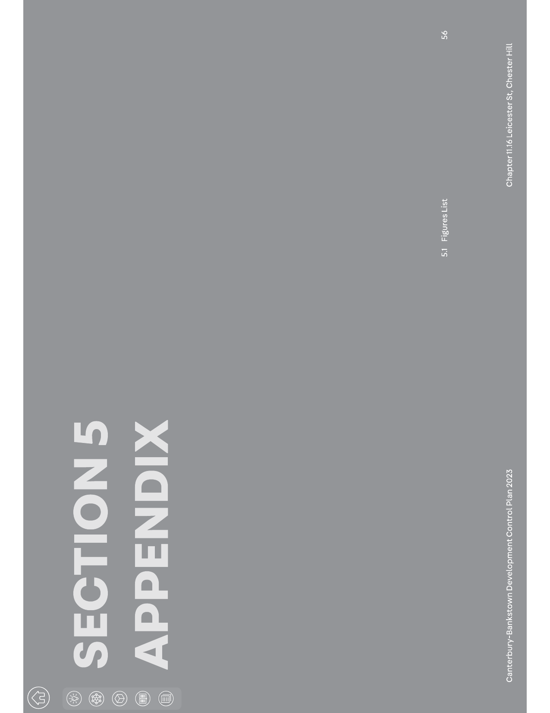
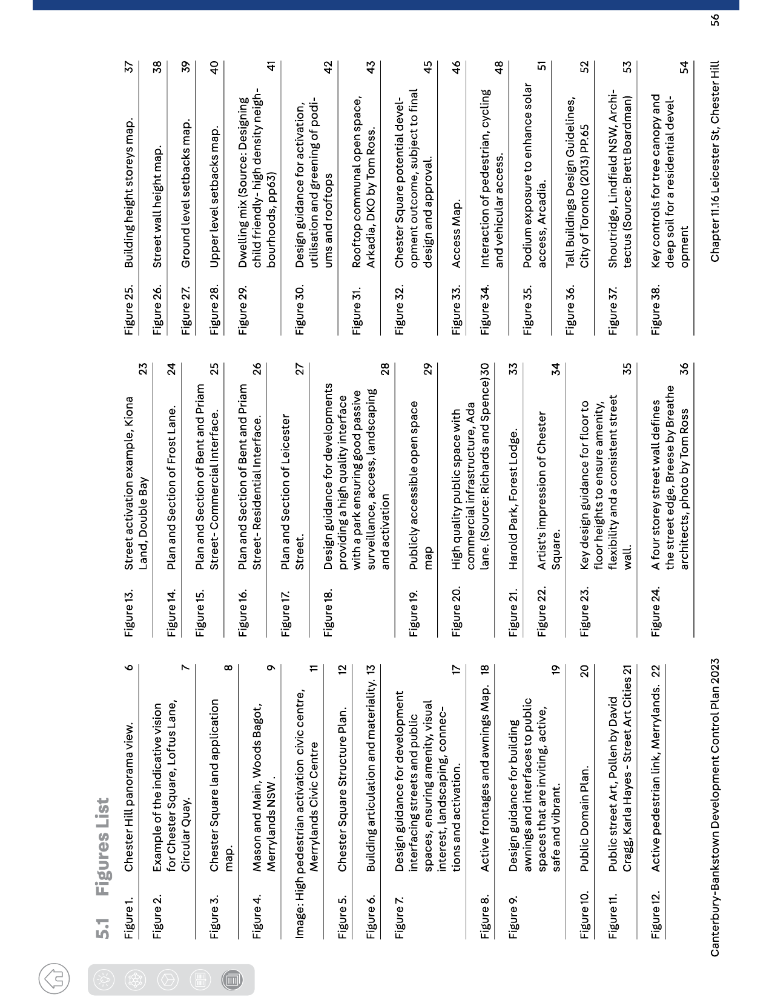

### 4.6 Landscaping

#### Objectives

O1. Prioritise tree retention to ensure significant trees are conserved as much as possible.

O2. Contribute to the overall minimum 30% tree canopy target, and ensure sufficient deep soilis provided to support healthy growth of mature trees.

#### Controls

Ci. Landscape design and minimum landscaped areas are to be provided in accordance with the relevant provisions of the Canterbury Bankstown DCP 2023.

C2. Deep soil targets are to be provided in accordance with the Apartment Design Guide (ADG).

C3. Where site conditions allow, deep soil areas should be consolidated to one location on site for effective planting, derived from local parent geology, unobstructed by structures and services and connected to the local groundwater to assist with detention of stormwater (where required).

LEGEND 7" 4

. 4 Site boundary

‘_}

| Area included in canopy area

| Area excluded in canopy area

| | Deep soil zone

Canterbury-Bankstown Development Control Plan 2023

Figure 38.

‘own spread of _3min diametre. -

Deep soil zone compliant with ADG requirements.

——

Key controls for tree canopy and deep soil for a residential development

Chapter 11.16 Leicester St, Chester Hill

54

> [End of OCR text from page 54.]

> [Page 55 is a scanned picture of text. The text below was read by OCR (machine reading) and may contain errors; check it against the original PDF.]

## SECTION 5 APPENDIX

5.1 Figures List 56

Canterbury-Bankstown Development Control Plan 2023 Chapter 11.16 Leicester St, Chester Hill

> [End of OCR text from page 55.]

> [Page 56 is a scanned picture of text. The text below was read by OCR (machine reading) and may contain errors; check it against the original PDF.]

Figure 1.

Chester Hill panorama view. 6

Figure 2.

Example of the indicative vision for Chester Square, Loftus Lane, Circular Quay. 7

Figure 3.

Chester Square land application

map. 8

Figure 4.

Mason and Main, Woods Bagot, Merrylands NSW. 9

Image: High pedestrian activation civic centre,

Merrylands Civic Centre 11

Figure 5.

Chester Square Structure Plan. 12

Figure 6.

Building articulation and materiality. 13

Figure 7.

Design guidance for development interfacing streets and public

spaces, ensuring amenity, visual interest, landscaping, connec-

tions and activation. 17

Figure 8.

Active frontages and awnings Map. 18

Figure 13.

Street activation example, Kiona Land, Double Bay 23

Figure 14.

Plan and Section of Frost Lane. 24

Figure 15.

Plan and Section of Bent and Priam Street- Commercial Interface. 25

Figure 25.

Building height storeys map.

37

Figure 26.

Street wall height map.

38

Figure 27.

Ground level setbacks map.

39

Figure 28.

Upper level setbacks map.

40

Figure 16.

Plan and Section of Bent and Priam Street- Residential Interface. 26

Figure 17.

Plan and Section of Leicester Street. 27

Figure 18.

Design guidance for developments providing a high quality interface

with a park ensuring good passive

#### surveillance, access, landscaping

and activation 28

Figure 19.

Publicly accessible open space map 29

Figure 29.

Dwelling mix (Source: Designing child friendly- high density neigh-bourhoods, pp63)

41

Figure 30.

Design guidance for activation, utilisation and greening of podi-ums and rooftops

42

Figure 31.

Rooftop communal open space, Arkadia, DKO by Tom Ross.

43

Figure 32.

Chester Square potential devel-opment outcome, subject to final design and approval.

45

Figure 20.

High quality public space with commercial infrastructure, Ada

lane. (Source: Richards and

Figure 9.

Design guidance for building

awnings and interfaces to public spaces that are inviting, active,

safe and vibrant. 19

Figure 21.

Harold Park, Forest Lodge. 33

Figure 22.

Artist's impression of Chester Square. 34

Figure 10.

Public Domain Plan. 20

Figure 11.

Public street Art, Pollen by David Cragg, Karla Hayes - Street Art Cities 21

Figure 23.

Key design guidance for floor to

floor heights to ensure amenity, flexibility and a consistent street

wall. 35

Figure 33.

Access Map.

46

Figure 34.

#### Interaction of pedestrian, cycling

and vehicular access.

48

Figure 35.

Podium exposure to enhance solar access, Arcadia.

51

Figure 36.

Tall Buildings Design Guidelines, City of Toronto (2013) PP.65

Figure 37.

Shoutridge, Lindfield NSW, Archi-tectus (Source: Brett Boardman)

Figure 12.

Active pedestrian link, Merrylands. 22

Canterbury-Bankstown Development Control Plan 2023

Figure 24.

A four storey street wall defines the street edge, Breese by Breathe architects, photo by Tom Ross 36

Figure 38.

Key controls for tree canopy and deep soil for a residential devel-opment

54

Chapter 11.16 Leicester St, Chester Hill

56

> [End of OCR text from page 56.]
