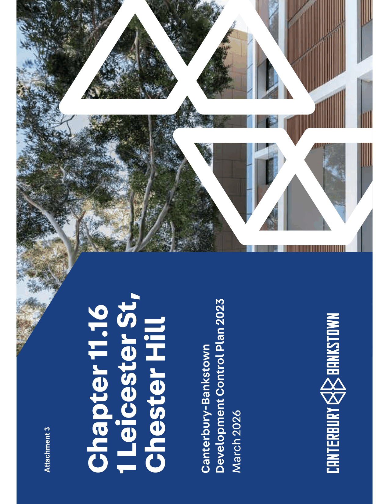

# Canterbury-Bankstown Development Control Plan 2023 - Chapter 11.16 1 Leicester Street - Chester Hill

> This chapter is split into 18 section file(s), one per numbered heading, in the order they appear in the PDF.

Source PDF: [2026.07.17 - DCP 2023 - AMENDMENT 15 - Chapter 11.16 - Leicester Street.pdf](2026.07.17%20-%20DCP%202023%20-%20AMENDMENT%2015%20-%20Chapter%2011.16%20-%20Leicester%20Street.pdf)

> [Page 1 is a scanned picture of text. The text below was read by OCR (machine reading) and may contain errors; check it against the original PDF.]

#### Attachment 3

#### Chapter 11.16

<!-- sections -->
## Sections

1. [1 Leicester St,](01-leicester-st.md)
2. [1.2 Application of this DCP](02-1-2-application-of-this-dcp.md)
3. [1.3 Vision and Character](03-1-3-vision-and-character.md)
4. [1.4 Design Excellence](04-1-4-design-excellence.md)
5. [1.5 Connecting to Country](05-1-5-connecting-to-country.md)
6. [2.3 Streets](06-2-3-streets.md)
7. [2.3.1 Frost Lane and Charles Place](07-2-3-1-frost-lane-and-charles-place.md)
8. [2.4 Publicly Accessible Open](08-2-4-publicly-accessible-open.md)
9. [3.2 Dwelling Mix and Flexible Housing Al](09-3-2-dwelling-mix-and-flexible-housing-al.md)
10. [3.1 Building Envelope and](10-3-1-building-envelope-and.md)
11. [3.2 Dwelling Mix and Flexible](11-3-2-dwelling-mix-and-flexible.md)
12. [3.3 Private Communal Space =< | :](12-3-3-private-communal-space.md)
13. [4.1 Public Community Facility](13-4-1-public-community-facility.md)
14. [4.2 Access and Parking](14-4-2-access-and-parking.md)
15. [4.3 Sustainability](15-4-3-sustainability.md)
16. [4.4 Waste Management](16-4-4-waste-management.md)
17. [4.5.2 Wind effects](17-4-5-2-wind-effects.md)
18. [4.6 Landscaping](18-4-6-landscaping.md)
