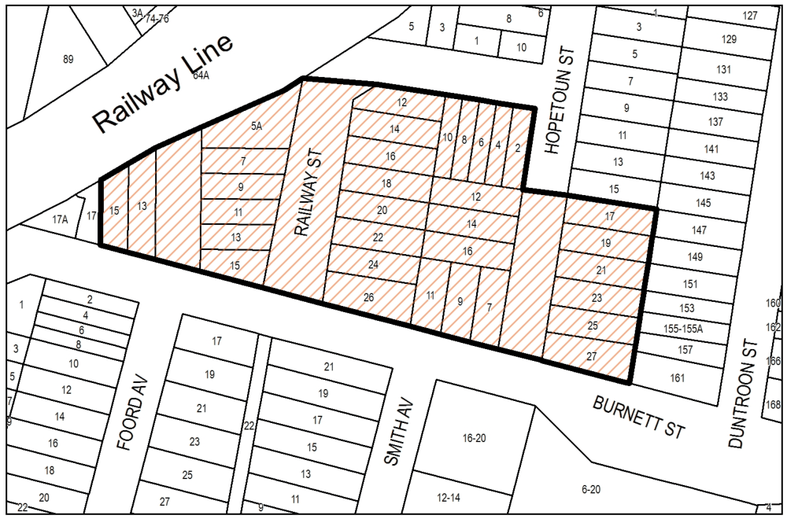

## SECTION 5–CHARACTER STATEMENT: RAILWAY STREET HERITAGE

#### Statement of significance

The Railway Street Heritage Conservation Area is of local heritage significance.

> [Picture on page 41: a picture, saved as a picture (images/character-statement-hurlstone-park-heritage-page-41-4.gif, 150 dpi).]

Railway Street Heritage Conservation Area – Boundaries

The area is of historical significance as an area developed between the late 19th and early 20th century and which includes:

• Section 17 of Sophia Campbell's original 1876 subdivision of Hurlstone Park.

• William Augustus Starkey's 1878–1879 purchase of four allotments (Lots 4 and 8) of Section 17.

• The western half of the 1901 1st Subdivision of Jeffreys Estate (DP 3849).

The area is also of historical significance as having been the location of stone quarries in the mid-20th century, which is reflected in both the steep landscape context and incorporation of sandstone into a number of dwellings along Hopetoun Street.

The area is of aesthetic significance as its close proximity to the railway has resulted in a transitional architectural character. This ranges from the more modest Federation and Inter-war period workman's cottages located within the vicinity of the railway including 5A to15 Foord Avenue and 2 to 10 Railway Street; to the increasingly ornate Federation-period dwellings found at higher elevations such as 7 to 11 Burnett Street; and 19, 23, 25 and 27 Hopetoun Street.

It is also of aesthetic significance for its historic plantings and stepped landscape character, with wide, shaded streets that descend toward the railway line. The steep landscape context of the area facilitates elevated views over the station from Hopetoun Street.

#### Key character elements

Subdivision and public domain elements

• Mature pine plantings and walkways along Railway Street and within the vicinity of the railway line.

• Elevated location of dwellings along Hopetoun Street, which enjoy views over the railway and mature plantings within its vicinity.

• Relatively wide streets.

• Street trees.

Elements that contribute to the streetscape (visible from the public domain)

• A cohesive group of Inter-war period dwellings at 5A to15 Foord Avenue, which retain their overall form and scale, original facebrick facades, brick verandah columns, windows, awnings, and decorative gable infills. Some retain their original roofs and finials. A low-set brick boundary wall with textured brickwork runs the length of these properties and further enhances their cohesive appearance.

• Inter-War period workers cottages at 2 to 10 Railway Street, which retain their original face brick facades, gable infill decoration, verandah columns, windows, and overall form.

• Federation period dwellings with intricate timber fretwork and decorative gable infills at 7, 9 and 11 Burnett Street.

• Heritage item ‘Hopetoun Street Group’ (Items I136, I137, I138, and I139) at 19, 23, 25 and 27 Hopetoun Street, which comprise ornate Federation period dwellings with sandstone bases, face brick facades, sandstone boundary walls, and chimneys.

• Original details of houses such as: o Front verandahs with original detailing. o Original roof forms, some with original cladding of slate or unglazed terracotta tiles and original chimneys.

o Gable ends facing the street with original timber shingled, roughcast stucco or imitation half-timbered finishes (Federation and Inter-war periods).

o Face brickwork (Federation and Inter-war periods) and rendered or painted brickwork or weatherboard (Victorian period).

o Original timber-framed windows and timber panelled doors consistent with the periods and styles of houses.

Non-contributory elements

• Late 20th century or more recent houses.

• Carports or garages within building envelopes.

• Uncharacteristic first floor additions to single storey houses that are visible from the street.

• Changes to materials and fabric: Cement rendering of original face brickwork, modern roof cladding (e.g. concrete tiles), loss of chimneys, later addition windows.

• Changes to original roof forms.

• Infilled or altered front verandahs.

• Modern front fences of unsympathetic design and materials.

#### Building contribution rankings

All buildings within Heritage Conservation Areas have been assigned Building Contribution rankings which relate to the operation of the DCP controls. These rankings are defined in the following table. The ranking for each building within the Railway Street HCA is outlined in the final table.

| Ranking No. | Building contribution ranking | Definition of ranking |
|---|---|---|
| 1 | Contributory 1 | A building that clearly reflects the heritage values of a key period of significance for the HCA (for example a well-conserved Federation Queen Anne Style house). |
| 2 | Contributory 2 | A building that has been altered but is still identifiable as dating from a key period of significance for the HCA and retains its overall form (for example a Federation Queen Anne Style house which has altered window openings, cement rendered walls). |
| 3 | Non-Contributory | Either a building which does not date from a key period of significance for the area (for example a late 20th century or more recent building) or a building which has been altered to a level that the period of construction is no longer readily discernible. |

It is noted that some sites may have features that are significant even though the whole of the place may not have the same significance.

| Number | Street | Ranking |
|---|---|---|
| 7 | Burnett Street | 1 |
| 9 | Burnett Street | 2 |
| 11 | Burnett Street | 2 |
| 13 | Burnett Street | 1 |
| 15 | Burnett Street | 1 |
| 5A | Foord Avenue | 1 |
| 7 | Foord Avenue | 1 |
| 9 | Foord Avenue | 1 |
| 11 | Foord Avenue | 1 |
| 13 | Foord Avenue | 1 |
| 15 | Foord Avenue | 1 |
| 12 | Hopetoun Street | 3 |
| 14 | Hopetoun Street | 1 |

| Number | Street | Ranking |
|---|---|---|
| 16 | Hopetoun Street | 1 |
| 17 | Hopetoun Street | 2 |
| 19 | Hopetoun Street | Heritage item |
| 21 | Hopetoun Street | 3 |
| 23 | Hopetoun Street | Heritage item |
| 25 | Hopetoun Street | Heritage item |
| 27 | Hopetoun Street | Heritage item |
| 2 | Railway Street | 1 |
| 4 | Railway Street | 1 |
| 6 | Railway Street | 1 |
| 8 | Railway Street | 1 |
| 10 | Railway Street | 1 |
| 12 | Railway Street | 1 |
| 14 | Railway Street | 3 |
| 16 | Railway Street | 1 |
| 18 | Railway Street | 1 |
| 20 | Railway Street | 2 |
| 22 | Railway Street | 3 |
| 24 | Railway Street | 3 |
| 26 | Railway Street | 1 |
