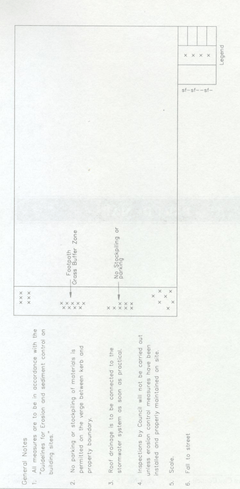
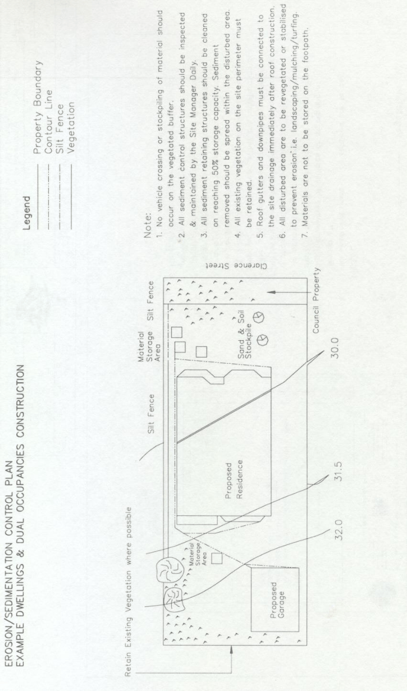
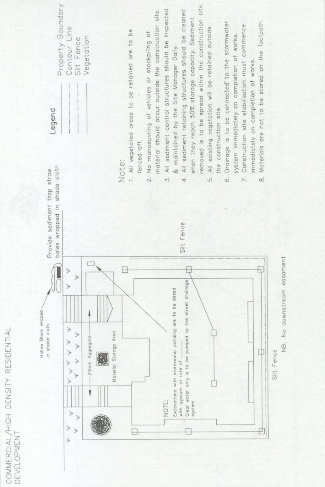
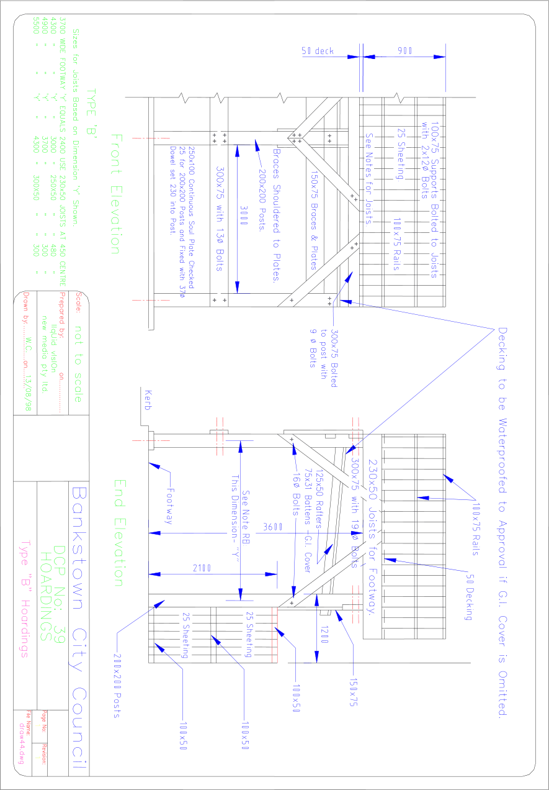
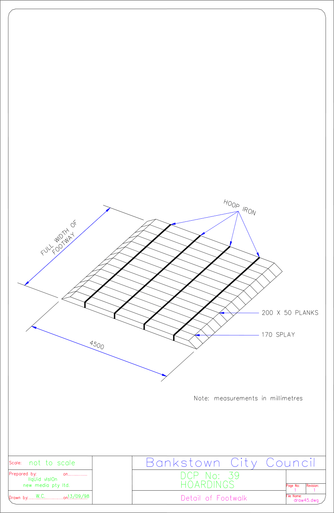

## SECTION 6–WASTE MANAGEMENT PLAN (CONSTRUCTION STAGE)

#### Explanation

Attention to design, estimating of materials and waste sensitive construction techniques and management practices can achieve significant rewards in managing waste. The principal aim of managing this activity is to maximise resource recovery and minimise residual waste from demolition activities.

#### Objectives

O1 To maximise reuse and recycling of materials.

O2 To minimise waste generation.

O3 To ensure appropriate collection and storage of waste.

O4 To minimise the environmental impacts associated with waste management.

O5 To avoid illegal dumping.

O6 To promote improved project management.

O7 To optimise adaptive reuse opportunities of existing building/structures.

#### Development controls

#### Construction of buildings and structures

6.1 A waste management plan must accompany the application. The waste management plan must:

(a) Estimate volumes of materials to be used and incorporate these volumes into a purchasing policy so that the correct quantities are purchased.

(b) Identify potential reuse and recycling opportunities of excess construction materials.

(c) Incorporate the use of prefabricated components and recycled materials.

(d) Arrange for the delivery of materials so that materials are delivered ‘as needed’ to prevent the degradation of materials through weathering and moisture damage.

(e) Consider organising to return excess materials to the supplier or manufacturer.

(f) Allocate an area for the storage of materials for use, recycling and disposal (considering slope, drainage, location of waterways, stormwater outlets and vegetation).

(g) Arrange contractors for the transport, processing and disposal of waste and recycling. Ensure that all contractors are aware of the legal requirements for disposing of waste.

(h) Promote separate collection bins or areas for the storage of residual waste.

(i) Clearly sign post the purpose and content of the bins and storage areas.

(j) Implement measures to prevent damage by the elements, odour and health risks, and windborne litter.

(k) Minimise site disturbance and limit unnecessary excavation.

(l) Ensure that all waste is transported to a place that can lawfully be used as a waste facility.

6.2 The applicant must retain all records demonstrating lawful disposal of waste and keep them readily accessible for inspection by regulatory authorities such as Council, EPA or SafeWork NSW.

#### APPENDICES

Appendix 1–Example of a typical erosion and sediment control plan for dwelling houses and dual occupancies

> [Picture on page 25: a picture, saved as a picture (images/demolition-and-construction-guide-page-25-4.gif, 150 dpi).]

Appendix 1–Example of a typical erosion and sediment control plan for dwelling houses and dual occupancies

> [Picture on page 26: a picture, saved as a picture (images/demolition-and-construction-guide-page-26-3.gif, 150 dpi).]

Appendix 1–Example of a typical erosion and sediment control plan for commercial/high density residential development

> [Picture on page 27: a picture, saved as a picture (images/demolition-and-construction-guide-page-27-3.gif, 150 dpi).]

#### Appendix 2–Type B hoardings

> [Picture on page 28: a picture, saved as a picture (images/demolition-and-construction-guide-page-28-2.gif, 150 dpi).]

> [Picture on page 29: a picture, saved as a picture (images/demolition-and-construction-guide-page-29-1.gif, 150 dpi).]
