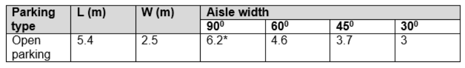
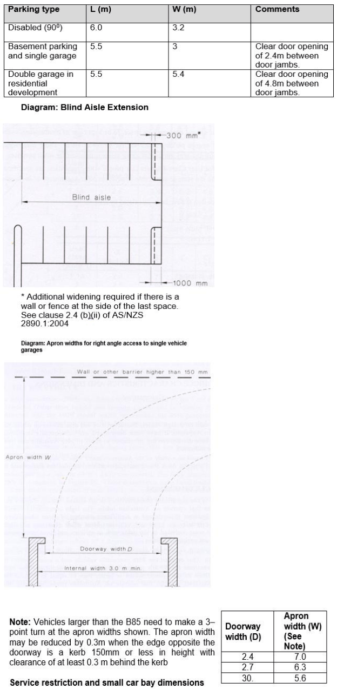
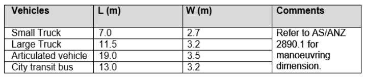
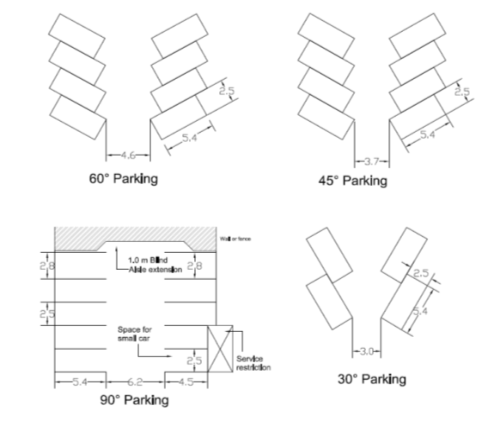
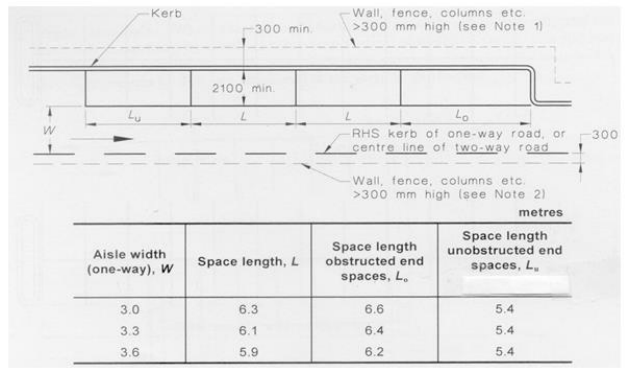
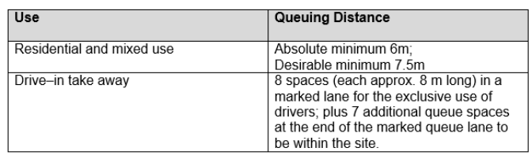
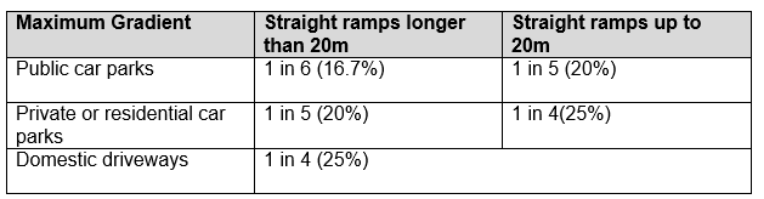
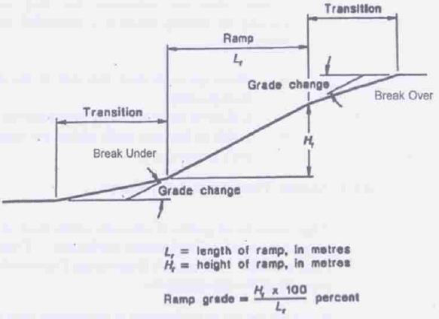
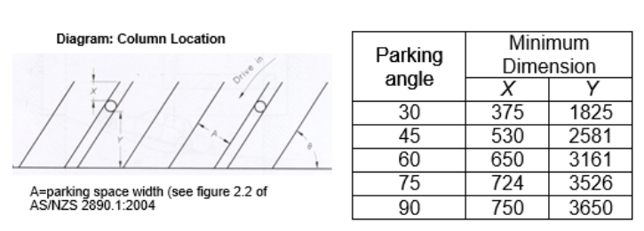

## SECTION 11–CAR PARK DESIGN

#### Explanation

A developer must ensure the car park is designed to comply with AS 2890 parking facilities series, which includes:

(a) Australian Standard AS 2890.1, Off-street car parking

(b) Australian Standard AS 2890.2, Off-street commercial vehicle facilities

(c) Australian Standard AS 2890.3, Bicycle parking

(d) Australian Standard AS 2890.6, Off-street parking for people with disabilities.

#### Development controls

#### Minimum parking bay dimensions

11.1 The following minimum dimensions are generally required for each parking space.

> [Picture on page 50: a picture, saved as a picture (images/development-engineering-standards-guide-page-50-12.gif, 150 dpi).]

Note 1: Width of the end parking bays with obstruction on one side is 2.8m. Note 2: All dimensions in this DCP are minimum dimensions, unless specified otherwise. Note 3: All dimensions are in metres (m), unless specified otherwise. Note 4: *Council may consider a 6m absolute minimum aisle width depending upon the site constraint on a condition that 5.5m bay length should be maintained to produce a 17m wide parking module. However, Council considers 6.2m to be a desirable aisle width.

#### Parking bay dimensions for people with disabilities and residential garages

11.2 Parking bay dimensions for people with disabilities and residential garages are as follows:

> [Picture on page 51: a picture, saved as a picture (images/development-engineering-standards-guide-page-51-1.gif, 150 dpi).]

#### Service restriction and small car bay dimensions

11.3 Service provisions such as air conditioning vents or lift shafts may reduce the length of parking bays. However, this provision must not cause adverse impact on the traffic.

11.4 Service restriction spaces (not less than 4.2m in length) should be considered where the number of parking spaces exceeds 25.

11.5 Service restriction spaces must be considered as spaces for small cars as specified in clause 11.7.

11.6 Development may include parking spaces for small cars measuring 4.2m x 1.7m. The minimum dimensions required for parking small car are 4.5m X 2.3m. The number of small car spaces shall be a maximum of 10% of the total car parking provision.

#### Service bay dimensions

11.7 Service bay dimensions for different vehicles are to be as follows:

> [Picture on page 52: a picture, saved as a picture (images/development-engineering-standards-guide-page-52-13.gif, 150 dpi).]

#### Parking layouts

11.8 Parking spaces and areas are to be designed according to the following diagram.

> [Picture on page 52: a picture, saved as a picture (images/development-engineering-standards-guide-page-52-16.gif, 150 dpi).]

#### Parallel parking

11.9 Council prefers 90 degree parking which provides the most efficient use of space with two-way vehicle movement. Where space is limited, 60 degree, 45 degree or 30 degree parking may be used instead. With these arrangements, appropriate signs must be used for drivers not to enter aisles the wrong way and reversing into parking spaces.

Note: A parking aisle is a roadway or an area used by vehicles to gain access to, and to manoeuvre into and out of parking spaces. Two-way aisles are prohibited for parking angles other than 90 degrees.

> [Picture on page 53: a picture, saved as a picture (images/development-engineering-standards-guide-page-53-10.gif, 150 dpi).]

#### Access driveway width and design

11.10 The queuing area between the vehicular control point and the property boundary should be sufficient to allow a free influx of traffic which will not adversely affect traffic or pedestrian flow in the frontage road.

#### Queuing distance

11.11 Parking studies are necessary to determine minimum queuing length for developments fronting state roads.

> [Picture on page 53: a picture, saved as a picture (images/development-engineering-standards-guide-page-53-18.gif, 150 dpi).]

Note: Refer to Australian Standard AS 2890.1 for queuing distance for other land uses.

11.12 The queuing area between the vehicular control point and the property boundary should be sufficient to allow a free influx of traffic which will not adversely affect traffic or pedestrian flow in the frontage road.

#### Circulation roadway and ramp gradients

11.13 Limiting requirements for grades on circulation roadways and ramps shall be as follows:

> [Picture on page 54: a picture, saved as a picture (images/development-engineering-standards-guide-page-54-4.gif, 150 dpi).]

Note: Gradient of access driveway, grade change and grade transition are to be in accordance with the Australian Standard AS 2890.1.

#### Gradient within parking module

11.14 The maximum gradients within a parking module including a motorcycle parking area shall be as follows:

(a) Measured parallel to the angle of parking – 1 in 20 (5%).

(b) Measured in any other direction – 1 in 16 (6.25%).

(c) Within parking spaces for people with disabilities – see AS/ANZ 2890.6.

#### Internal circulation

11.15 ‘Dead end’ aisles longer than 15m should be avoided. Internal vehicular movements should be able to take place wholly within the site. Circulation patterns which involve the use of a public street are to be avoided.

> [Picture on page 54: a picture, saved as a picture (images/development-engineering-standards-guide-page-54-17.gif, 150 dpi).]

#### Column location and spacing

11.16 Columns should not be located at the edge of a parking aisle as they increase the difficulty of manoeuvring into a parking space. It is also desirable to avoid locating a column directly opposite a car door. The dimensions for locating columns in a short span structure are illustrated in the adjoining diagram.

> [Picture on page 55: a picture, saved as a picture (images/development-engineering-standards-guide-page-55-6.gif, 150 dpi).]

Note: The envelope around parked vehicle to be clear of columns, walls and obstructions.

#### Sign posting and line marking

11.17 All car parking spaces should be clearly line marked consistently as illustrated in the Australian Standard AS 2890.1.

11.18 Where customer or visitor parking is provided, signposting should be provided to indicate the location of these spaces.

11.19 Segregated entries and exits are to be signposted to that effect.

11.20 In large car parks, means of egress should be indicated by directional signs which need to be shown on application plans.

11.21 The space should be painted blue.

#### APPENDICES

#### Appendix 1–Definitions

annual exceedence probability (AEP) means the statistical chance of having a flood of a given or larger size occurring in any given year. For example, a 1% AEP flood discharge has a 1% (1 in 100) chance of occurring or being exceeded in any one year.

applicant means the person or company, also referred to in this Guide as the ‘developer’, who is responsible for meeting all of the requirements associated with an application on a property. The applicant must have all owners' written consent to make application for development on any particular property. The applicant is generally the person to whom all correspondence from Council will be directed.

Australian rainfall and runoff (AR&R) means the publication by Engineers Australia, which describes the industry standards for estimating rainfall and runoff for the purpose of designing stormwater drainage systems.

average recurrence interval (ARI) means the long term average number of years between the occurrence of a flood as big as, or larger than, the selected event. For example, floods with discharge as great as, or greater than, the 20-year ARI flood event will occur on average once every 20 years. A flood with a discharge as great as or greater than the 100-year ARI flood will occur on average once every 100 years.

carriageway means the portion of a public road reserve intended for the use of vehicles to travel, usually measured from kerb face to kerb face. This area is also referred to as roadway.  In private land, the carriageway is the driveway surface, within an access corridor, intended for the use of vehicles to travel.

catchment means the source area from which stormwater runoff flows to a nominated location.

common drainage easement means known as an easement to drain water created over a nominated portion of an allotment for the purpose of legally benefiting and draining stormwater collected from upstream allotments.

common drainage line (CDL), also referred to as IAD ‘Inter-Allotment Drainage’, means the existing or proposed drainage pipes located within and through private property for the drainage of stormwater from upstream allotments and catchments. The drainage pipes are usually, but not always, located within a common drainage easement, and are owned and maintained by the property owners who benefit from the common drainage line.

construction certificate (CC) means the certificate issued by a PCA which states that construction drawings have complied with the requirements of the development consent. The CC must be issued prior to any works commencing on the site.

Council drainage easement or easement to drain water means an easement that has been or is to be created, through privately owned land, to benefit the Council for the purpose of maintaining or constructing stormwater infrastructure for draining stormwater through or over the land.

Council infrastructure refers to the physical improvements of Council's road and drainage assets.

drainage reserve means a parcel of land owned by Council for the purpose of draining Council's stormwater either in open channels, in underground pipes or over land.

dual occupancy has the same meaning as the Canterbury-Bankstown Local Environmental Plan 2023. For the purpose of this Guide, it means a single building containing two dwellings – either subdivided or not.

easement means the portion of land where a beneficiary has legal entitlement to utilise for nominated use such as but not limited to draining stormwater, providing services, electricity water, gas and draining sewage. The easement width, location and terms are noted on the Deposited Plan and 88B instrument or transfer documents and registered with the NSW Land Registry Services.

floodway means the area of a floodplain, generally related to large open channels, creeks or rivers, where a significant discharge of water occurs during floods. A floodway, if partially or fully blocked, would cause a significant redistribution of flood flow, and or a significant increase in flood levels.

foot paving means the formalised surface, generally constructed of concrete, for the use of footway pedestrian traffic.

footway means the portion of the Council road reserve between the road reserve boundary and the face of kerb or edge of road shoulder if there is no kerb.

footway damage inspection report (FDI) means the report, including the footway damage inspection results, required to be conducted by Council prior to any demolition and/or non-exempt development occurring on a site.

multi-unit residential development includes residential flat buildings, shop top housing, multi dwelling housing, multi dwelling housing (terraces) and manor houses.

NSW Land Registry Services (formerly known as Land and Property Information) means the NSW government body which records and maintains property title information.

occupation certificate (OC) means the certificate, issued by a PCA, stating the development, as constructed, complies with all of the relevant conditions of the application consent relating to the occupation of the site, and the development site is suitable for occupation for its approved use.

on-site detention (OSD) means the temporary storage of stormwater to reduce peak stormwater discharge rates during major storm events. OSD is intended to limit the stormwater discharge rates from a development site to at or below stormwater discharge rates of the existing site.

overland flow path (OLFP) means the natural or formed route that stormwater runoff will take when it cannot enter the below ground, stormwater system.

owner means the person or corporation registered with the NSW Land Registry Services as nominated on Certificate of Title.

principal certifying authority (PCA) means an accredited certifier appointed by an applicant to perform certain functions.

public road means any area of road reserve, form or unformed, that is opened or dedicated to the public as road.

road authority means the body, typically Council or Transport for NSW (TfNSW), authorised under the Roads Act 1993, with powers and responsibilities for ownership and maintenance of roads under its control. Council is the road authority for all local and regional roads in Canterbury-Bankstown and TfNSW is the road authority for all state roads. See Appendix 2 for a list of regional and state roads.

road reserve means the publicly or privately owned area between allotments of land generally intended for vehicular and footway traffic providing access to and from those allotments of land. Road reserve is usually comprised of the carriageway or roadway and the footway on both sides. The terms road reserve, road and public road are deemed to have the same meaning in this guideline.

single dwelling has the same meaning as dwelling house in the Canterbury-Bankstown Local Environmental Plan 2023. In this document, single dwelling also refers to secondary dwelling.

state road means a roadway under the control of the TfNSW. Council, however, controls footways along state roads, except the M5 Motorway (state roads within Canterbury- Bankstown are listed in Appendix 2).

stormwater system comprises all components of stormwater infrastructure, both privately and or publicly owned, including but not limited to, rivers, natural creeks, channels, pipelines, OLFP, surface inlet pits, culverts, table drains, roadways, kerb and gutters. OSD, downpipes and roof gutters.

stormwater system report (SSR) means the Council provided report, issued to a developer upon application to Council, for the information pertaining to the existing stormwater systems in the vicinity of the development site. These stormwater systems are usually owned by Council, but may also be owned by Sydney Water, other authorities, or privately owned.

street boundary alignment levels (SBALs) means the Council provided levels issued upon application to Council for the required design finished surface levels of the footway area in front of a development. They include design levels at the property boundary.

subdivision certificate (SC) means the certificate required to be issued by the Council, or in some circumstances, a PCA that states that all of the conditions of the development consent, pertaining to the subdivision of the land, have been complied with. This certificate must be issued prior to submitting plans for registration at the NSW Land Registry Services.

vehicular footway crossing (VFC) means the concrete pavement constructed across the footway for vehicular traffic to access the property driveway.

work permit (WP) means the required permit that a developer must obtain, from Council, for any works to be constructed on any Council land, Council road and/or Council infrastructure. A work permit (Part D) is generally required for most developments which incorporates the footway damage inspection, VFC plans and specification, SBALs, road opening permit, approval of stormwater connection plan to Council's systems and all associated inspections.

Appendix 2–State and regional roads in the former Bankstown Local Government Area

| State roads |  |  |  |
|---|---|---|---|
| Item | Road | From | To |
| 1 2 3 4 5 6 7 8 9 10 11 12 13 14 15 16 17 18 | ALFORDS POINT ROAD BORONIA ROAD BRUNKER ROAD CANTERBURY ROAD DAVIES ROAD FAIRFORD ROAD HENRY LAWSON DRIVE HUME HIGHWAY JUNO PARADE M5 MILPERRA ROAD NEWBRIDGE ROAD PUNCHBOWL ROAD ROBERTS ROAD ROOKWOOD ROAD STACEY STREET WILEY AVENUE WOODVILLE ROAD | DAVIES ROAD HUME HIGHWAY ROOKWOOD ROAD MILPERRA ROAD FAIRPORTD ROAD STACEY STREET HUME HIGHWAY CITY COUNDARY BORONIA ROAD CITY BOUNDARY NEWBRIDGE ROAD CITY BOUNDARY CANTERBURY RD HUME HIGHWAY HUME HIGHWAY HUME HIGHWAY ROBERTS ROAD HUME HIGHWAY | CITY BOUNDARY JUNO PARADE HUME HIGHWAY PUNCHBOWL RD ALFORDS POINT RD DAVIES ROAD CITY BOUNDARY CITY BOUNDARY PUNCHBOWL RD CITY BOUNDARY CANTERBURY ROAD MILPERRA ROAD CITY BOUNDARY WILEY AVENUE CITY BOUNDARY FAIRFORD ROAD KING GEORGES ROAD CITY BOUNDARY |
| Proposed state roads |  |  |  |
| 1 | THE RIVER ROAD | MILPERRA ROAD | M5 |

| Regional roads |  |  |  |
|---|---|---|---|
| Item | Road | From | To |
| 1 | ALLDER STREET | BRUNKER ROAD | RAILWAY BRIDGE |
| 2 | ALMA ROAD | DAVIES ROAD | FARADAY ROAD |
| 3 | ASHFORD AVENUE | BULLECOURT AVE | MILPERRA ROAD |
| 4 | AUBURN ROAD | WATER PIPELINE | HUME HIGHWAY |
| 5 | BEACONSFIELD STREET | THE RIVER ROAD | HORSLEY ROAD |
| 6 | BIRDWOOD ROAD | OWEN ROAD | GEORGES CRES |
| 7 | BRAESMERE ROAD | TOWER STREET | PARK ROAD |
| 8 | BRANDON AVENUE | CHAPEL ROAD | GREENWOOD AVE |
| 9 | BRUNKER ROAD | ROOKWOOD ROAD | ALLDER STREET |
| 10 | BULLECOURT AVENUE | HORSLEY ROAD | ASHFORD AVENUE |
| 11 12 13 | CARLINGFORD ROAD CHAPEL ROAD CHAPEL ROAD | WATER PIPELINE CANTERBURY ROAD RICKARD ROAD | WALDRON ROAD BRANDON AVENUE HUME HIGHWAY |
| 14 | CHRISTINA ROAD | WALDRON ROAD | RIVER AVE |
| 15 | EDGAR STREET | MILPERRA ROAD | HUME HIGHWAY |
| 16 | FARADAY ROAD | ALMA ROAD | URANUS ROAD |
| 17 | FERRIER ROAD | RAILWAY BRIDGE | AUBURN ROAD |
| 18 | GIBSON AVENUE | WATSON ROAD | CANTERBURY ROAD |
| 19 | GREENWOOD AVENUE | BRANDON AVENUE | MARION STREET |
| 20 | HAIG AVENUE | GEORGES CRESCENT | HENRY LAWSON DR |
| 21 | HECTOR STREET | HUME HIGHWAY | WATER PIPELINE |
| 22 | HORSLEY ROAD | BEACONSFIELD RD | BULLECOURT AVE |

| 23 | KOALA ROAD | WATTLE STREET | WILEY AVE |
|---|---|---|---|
| 24 | MACAULEY AVENUE | STACEY STREET | CHAPEL ROAD |
| 25 | MACLAURIN AVENUE | PARK ROAD | HENRY LAWSON DR |
| 26 | MARION STREET | GREENWOOD AVE | OWEN ROAD |
| 27 | MARION STREET | GREENWOOD AVE | MEREDITH STREET |
| 28 | MEREDITH STREET | MARION AVENUE | RICKARD ROAD |
| 29 | MILLER ROAD | HUME HIGHWAY | WALDRON ROAD |
| 30 | OWEN ROAD | MARION STREET | BIRDWOOD ROAD |
| 31 | PARK ROAD | BRAESMERE ROAD | MACLAURIN AVE |
| 32 | QUEEN STREET | BEACONSFIELD ROAD | MILPERRA ROAD |
| 33 | RICKARD ROAD | MEREDITH STREET | CHAPEL ROAD |
| 34 | RICKARD ROAD | STACEY STREET | CHAPEL ROAD |
| 35 | ROBERTS ROAD | WILEY AVENUE | WATTLE STREET |
| 36 | SPHINX AVENUE | GIBSON AVENUE | THE RIVER RD |
| 37 | THE RIVER ROAD | HENRY LAWSON DR | M5 |
| 38 | TOWER STREET | THE RIVER ROAD | BRAESMERE ROAD |
| 39 | URANUS ROAD | FARADAY ROAD | THE RIVER ROAD |
| 40 | WALDRON ROAD | CARLINGFORD ROAD | CHRISTINA ROAD |
| 41 | WATERLOO ROAD | WATTLE STREET | HUME HIGHWAY |
| 42 | WATSON ROAD | FAIRFORD ROAD | GIBSON ROAD |
| 43 | WATTLE STREET | KOALA ROAD | STACEY STREET |
| 44 | WELLINGTON ROAD | AUBURN ROAD | WOODS ROAD |
| 45 | WOODS ROAD | WELLINGTON ROAD | CARLINGFORD ROAD |
| Proposed regional roads |  |  |  |
| 1 | BULLECOURT AVENUE | HENRY LAWSON DRIVE | ASHFORD AVENUE |
| 2 | MUIR ROAD | ROOKWOOD ROAD | HUME HIGHWAY |

#### Appendix 3–Australian rainfall intensity

Base data to construct IFD curves:

|  | 1I1 | 12I2 | 72I2 | 1I50 | 1I50 | 1I50 | F2 | F50 | G |
|---|---|---|---|---|---|---|---|---|---|
|  | 35.5 | 7.6 | 2.5 | 72 | 15.1 | 5.2 | 4.29 | 15.8 | 0 |
|  |  |  |  |  | ARI(y) |  |  |  |  |
| TIME 1.1 | 1 | 2 | 5 | 10 (mm/hr) | 20 | 50 | 100 | 200 | 500 |
| 5 mins | 88.5 | 114 | 145 | 163 | 187 | 219 | 242 | 266 | 299 |
| 6 mins | 83.0 | 107 | 136 | 153 | 176 | 206 | 228 | 251 | 281 |
| 7 mins | 78.3 | 101 | 129 | 145 | 167 | 195 | 216 | 238 | 266 |
| 8 mins | 74.4 | 95.6 | 123 | 138 | 159 | 185 | 206 | 226 | 254 |
| 9 mins | 70.9 | 91.2 | 117 | 132 | 152 | 177 | 197 | 216 | 243 |
| 10 mins | 67.9 | 87.4 | 112 | 126 | 145 | 170 | 189 | 208 | 233 |
| 12 mins | 62.8 | 80.8 | 104 | 117 | 135 | 158 | 175 | 193 | 217 |
| 14 mins | 58.6 | 75.5 | 97.1 | 110 | 126 | 148 | 164 | 181 | 203 |
| 15 mins | 56.8 | 73.1 | 94.2 | 106 | 122 | 144 | 160 | 176 | 198 |
| 16 mins | 55.1 | 71.0 | 91.5 | 103 | 119 | 139 | 155 | 171 | 192 |
| 18 mins | 52.1 | 67.1 | 86.6 | 97.9 | 113 | 132 | 147 | 162 | 182 |
| 20 mins | 49.5 | 63.8 | 82.4 | 93.2 | 107 | 126 | 140 | 155 | 174 |
| 25 mins | 44.2 | 57.1 | 73.8 | 83.6 | 96.5 | 113 | 126 | 139 | 157 |
| 30 mins | 40.2 | 51.9 | 67.3 | 76.3 | 88.1 | 104 | 115 | 127 | 143 |
| 40 mins | 34.5 | 44.5 | 57.9 | 65.7 | 75.9 | 89.4 | 99.6 | 110 | 124 |
| 50 mins | 30.4 | 39.4 | 51.3 | 58.3 | 67.4 | 79.4 | 88.6 | 98.0 | 111 |
| 1 hour | 27.4 | 35.5 | 46.3 | 52.7 | 61.0 | 72.0 | 80.4 | 88.9 | 100 |
| 1.5 hour | 21.5 | 27.8 | 36.2 | 41.2 | 47.7 | 56.2 | 62.7 | 69.3 | 78.3 |
| 2 hour | 18.0 | 23.3 | 30.3 | 34.4 | 39.8 | 46.9 | 52.4 | 57.9 | 65.3 |
| 3 hour | 14 | 18.1 | 23.5 | 26.7 | 30.8 | 36.3 | 40.5 | 44.7 | 50.5 |
| 4.5 hour | 10.8 | 14.0 | 18.2 | 20.7 | 23.9 | 28.1 | 31.3 | 34.6 | 39.0 |
| 6 hour | 9.1 | 11.7 | 15.2 | 17.2 | 19.9 | 23.4 | 26.1 | 28.8 | 32.4 |
| 9 hour | 7.0 | 9.1 | 11.8 | 13.3 | 15.4 | 18.1 | 20.2 | 22.3 | 25.1 |
| 12 hour | 5.9 | 7.6 | 9.8 | 11.1 | 12.9 | 15.1 | 16.8 | 18.5 | 20.9 |
| 15 hour | 5.2 | 6.7 | 8.7 | 9.8 | 11.3 | 13.3 | 14.9 | 16.4 | 18.5 |
| 18 hour | 4.6 | 6.0 | 7.8 | 8.8 | 10.2 | 12.0 | 13.4 | 14.8 | 16.7 |
| 24 hour | 3.9 | 5.1 | 6.6 | 7.5 | 8.7 | 10.2 | 11.4 | 12.6 | 14.2 |
| 30 hour | 3.4 | 4.4 | 5.8 | 6.6 | 7.6 | 9.0 | 10.0 | 11.1 | 12.6 |
| 36 hour | 3.1 | 4.0 | 5.2 | 5.9 | 6.8 | 8.1 | 9.0 | 10.0 | 11.3 |
| 48 hour | 2.5 | 3.3 | 4.3 | 4.9 | 5.7 | 6.8 | 7.6 | 8.4 | 9.5 |
| 72 hour | 1.9 | 2.5 | 3.3 | 3.8 | 4.4 | 5.2 | 5.8 | 6.5 | 7.3 |
