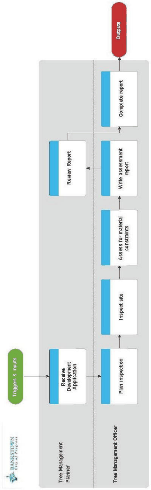

#### 15 Witnesses required for cross examination

If a party, the local council or the Heritage Council of NSW requires any expert or any other witness for cross-examination, notice is to be given at least 5 working days before the final hearing.

#### Liberty to re-list

Each party has the liberty to re-list the matter before the Court on two days Notice to the other party, the Court, the local council and the Heritage Council of NSW.

Schedule B

Supplementary directions for an order to prevent injury to any person and the

#### “injury” is an illness, allergy or similar medical condition.

□ 1. Further to direction 6 of the principal directions in this

matter, the applicant is to provide, by the close of business on ……………………………, any statement of medical or arboricultural evidence and any supporting medical or arboricultural peer reviewed literature relied upon in support of a claim that a tree which is the subject of the application is a “likely cause of injury to any person”;

□ 2. Any expert evidence concerning matters contained in 1 above

is to include acknowledgement that the expert has read and agrees to be bound by the Expert Witness Code of Conduct in Schedule 7 of the Uniform Civil Procedure Rules 2005.

Reproduced with permission © Land and Environment Court of New South Wales.

#### APPENDIX H–DEVELOPMENT APPLICATION (TREE REFERRAL PROCESS)

> [Picture on page 66: a picture, saved as a picture (images/tree-management-manual-page-66-2.gif, 150 dpi).]

### 5.0 Write assessment report Tree Management Officer

#### Summary

a. Write up Tree Assessment Report with recommendations.

b. Provide hard copy report and drawings to Tree Management Planner for review

c. Any contentious issues are to be discussed with Maintenance Coordinator Parks and any relevant others

### 6.0 Review report Tree Management Planner

#### Objective

To assess DA tree referrals with a quality response in ten working days.

#### Background

Customer is the DA Planners, they value quick turnaround time and accurate, quality advice/knowledge. Owner Maintenance Coordinator - Parks Expert Tree Management Planner

a. Review report and send comments/feedback to

#### Procedure

Tree Management Officer.

### 1.0 Receive Development Application Tree Management Planner

### 7.0 Complete report Tree Management Officer

a. Update report with any required

a. Enter details on Tree Referral Spreadsheet.

b. Review documents

c. Checks all details and drawings required. (FTQ 40%) NOTE: What if there is missing information?

d. Assess complexity of assessment using Nearmap and DA

changes from Tree Management Planner.

b. Provide hard copy report to Tree Management

information.

e. Allocate work to team members. NOTE: What if it is a complex issue?

Planner.

c. Update spreadsheet

d. Email report to Planners and cc Admin Officer.

e. Provide hard copy report to Admin Officer for

### 2.0 Plan inspection Tree Management Officer

return to Development Services.

a. Update Tree Referral spreadsheet

b. Plan work geographically

c. Check Previous Incident Register

### 3.0 Inspect site Tree Management Officer

a. Visit site and inspect.

b. Update spreadsheet NOTE: What if site access issues? NOTE: What if inaccurate information on plans/drawings? NOTE: What if an Environmentally Endangered Community (EEC) issue identified on the site?

NOTE: FTQ 75% complete.

### 4.0 Assess for material constraints Tree Management Officer

a. Where the tree may present a material constraint on proposed development phone the Planner to discuss issue. (50% of the time)

b. Confirm outcome of discussion via email with Planner. NOTE: What if no material constraint? TreeAZ http://www.treeaz.com/
