# Canterbury-Bankstown Development Control Plan 2023 - Tree Management Manual

> This chapter is split into 14 section file(s), one per numbered heading, in the order they appear in the PDF.

Source PDF: [2024.08.06 - Tree Management Manual.pdf](2024.08.06%20-%20Tree%20Management%20Manual.pdf)

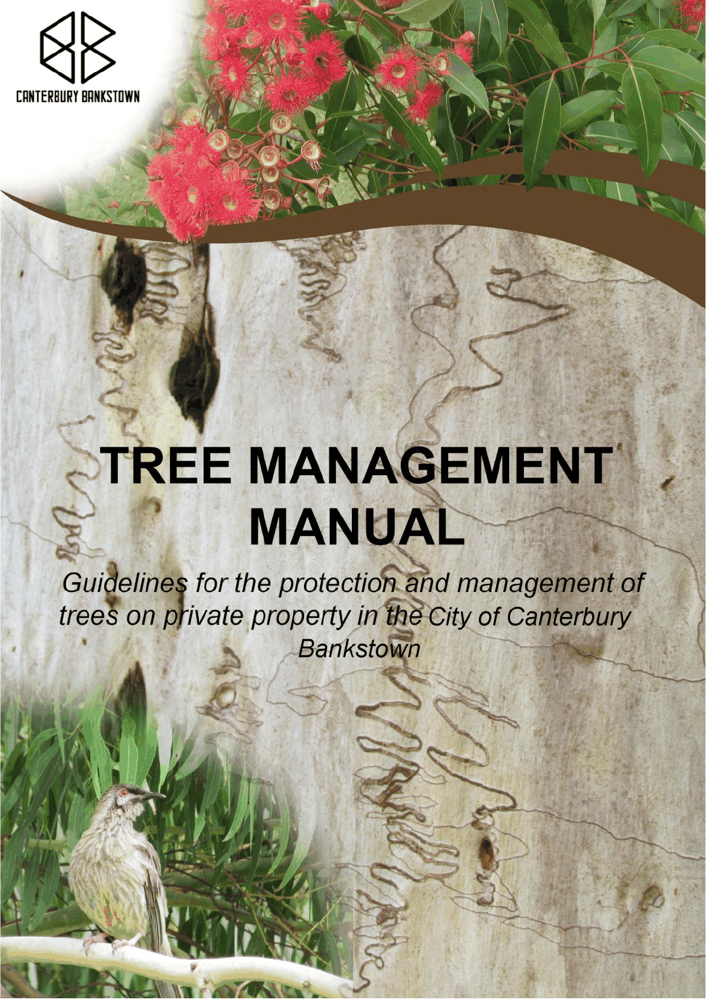

> [Page 1 is a scanned picture of text. The text below was read by OCR (machine reading) and may contain errors; check it against the original PDF.]

CANTERBURY BANKSTOWN

#### UAL

ye

for the protectio@ eR and of

trees on private property in thé City of Canterbury _ Bankstow? n MR

#### S

> [End of OCR text from page 1.]

> The PDF's contents list (page numbers of the printed document) is not repeated here - see Sections below.

#### June 2023

### 1.0 INTRODUCTION

This Manual has been prepared as a supplement to the development controls contained in the Canterbury-Bankstown Development Control Plan 2023.

This Manual provides information to assist the community to better manage the trees growing on their property. It also sets out Council’s requirements for applications lodged under the DCP. It contains information on:

• application requirements for tree pruning or removal;

• the type of documentation required with an application;

• how Council will assess your application;

• trees growing on a neighbouring property;

• management of trees on development sites;

• tree pruning guidelines;

• native wildlife and habitat trees;

• tree planting.

#### June 2023

### 2.0 THE VALUE OF TREES IN CANTERBURY-BANKSTOWN

Trees are a vital component of the urban environment of Canterbury-Bankstown. They provide essential ecological, environmental, social, health, heritage and amenity values, all contributing to make Canterbury-Bankstown a pleasant place to live and work.

As well as these direct values to residents, urban trees also have equally important values in their own right in maintaining and enhancing biodiversity and natural ecosystems and processes.

Figure 1: The benefits of trees in the urban environment

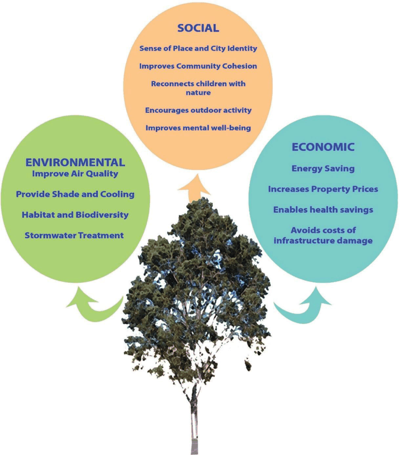

> [Picture on page 4: a picture, saved as a picture (images/tree-management-manual-page-4-8.gif, 150 dpi).]

### 3.0 TREE APPLICATION REQUIRMENTS

Under the Canterbury-Bankstown Development Control Plan 2023, approval from Council is required to undertake certain defined tree works. This approval will be in the form of either a tree permit or development consent, depending on the location of the property and the type of tree work involved.

The following diagram illustrates when approval is required, and what type of application needs to be submitted to Council.

Table 1: Tree application requirements

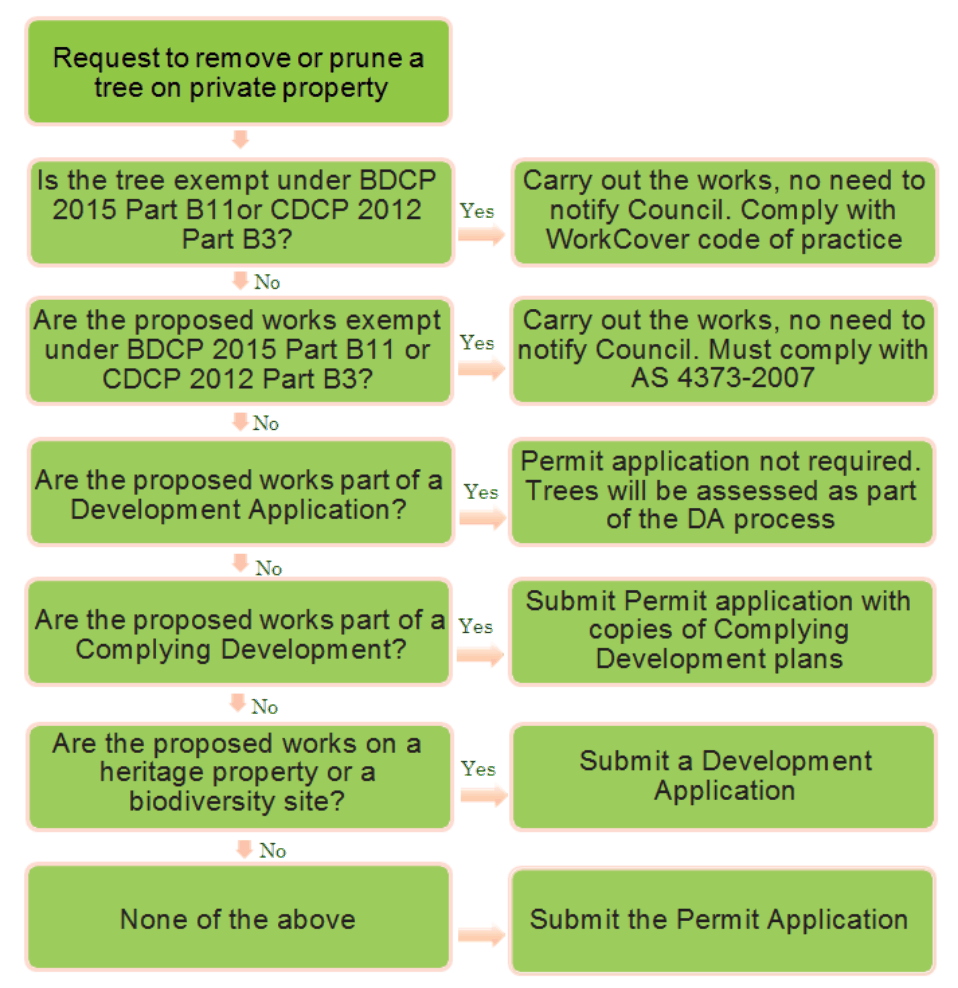

> [Picture on page 5: a picture, saved as a picture (images/tree-management-manual-page-5-9.gif, 150 dpi).]

Figure 2: Tree location and application requirements

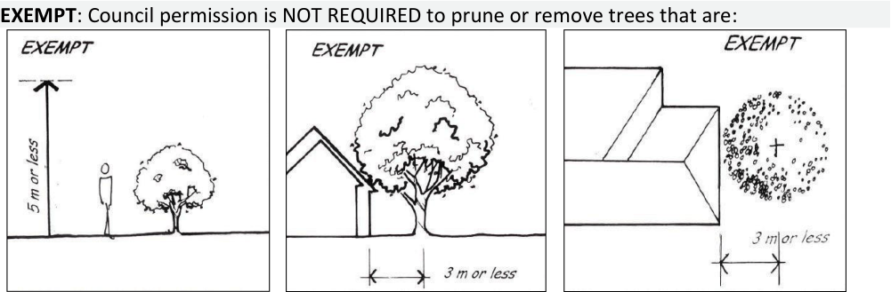

> [Picture on page 6: a picture, saved as a picture (images/tree-management-manual-page-6-2.gif, 150 dpi).]

EXEMPT: Council permission is NOT REQUIRED to prune or remove trees that are:

Less than 5m high

Within 3m of an existing dwelling, measured from the centre of the trunk @ 1.4m above ground level (existing) to the outside wall of the dwelling

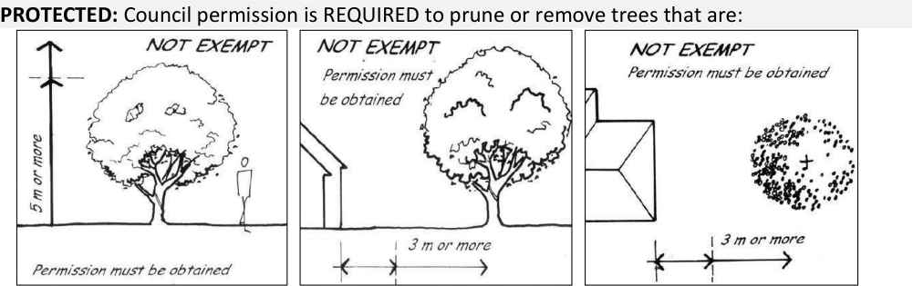

> [Picture on page 6: a picture, saved as a picture (images/tree-management-manual-page-6-8.gif, 150 dpi).]

PROTECTED: Council permission is REQUIRED to prune or remove trees that are:

More than 5m high

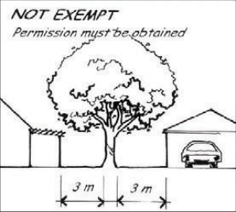

> [Picture on page 6: a picture, saved as a picture (images/tree-management-manual-page-6-11.gif, 150 dpi).]

More than 3m from an existing dwelling, measured from the centre of the trunk @ 1.4m above ground level (existing) to the outside wall of the dwelling

Trees within 3m of a secondary dwelling verandah, patio, deck, garage, carport or similar ancillary structure are NOT exempt.

### 4.0 TREE REPORTS

### 4.1 General

Council may require a tree report to be submitted by the applicant to provide additional information to allow a thorough assessment of the application. This is generally the case where the applicant considers that the tree is unsafe, or is concerned that the tree may be causing damage to buildings, structures or underground services.

To ensure that the tree report is of a professional standard and suitable for the purpose, it must be prepared by a qualified arborist with a minimum qualification of AQF Level 5, Diploma of Horticulture (Arboriculture) and/or equivalent recognised experience.

Depending on the reasons for the application, the tree report may need to be prepared in association with a structural engineer, licensed plumber, qualified pest controller, or other expert as relevant expert where relevant.

Note that a report on alleged tree damage prepared by a structural engineer, plumber, pest inspector or other expert must have input from, or be accompanied by a report from, a qualified arborist.

Tree reports are to be presented as a professional technical report, include relevant supporting documentation where necessary, provide an objective assessment, and reflect the arborist’s expert opinion.

### 4.2 Reports for tree permit applications

#### 4.2.1 Arborist reports

A tree report submitted in support of a tree permit applications must include the following information:

• Name, address and contact details, ABN, qualifications and experience of the arborist carrying out the inspection and preparing the report.

• The purpose of the report (the brief) and the name, address and contact details of who commissioned the report.

• Address of the property where the trees are located.

• The owner of the property where the trees are located.

• Consideration of all relevant planning laws, regulations and planning instruments pertaining to the property.

• The date the site inspection was undertaken.

• A plan of the site showing the location of the subject trees. The trees are to be numbered to correspond with the report.

• The scope of the inspection and details of the methodology used in the assessment.

• Survey data for the subject trees – including, but not limited to, the scientific and common names; height and crown spread; DBH; approximate age of the tree; the health and condition of the tree; any pests, diseases or structural defects: and any other information relevant to the brief.

• Results of an aerial inspection of the tree if necessary.

• Results of a non-destructive internal inspection of any hollows, cavities or decayed sections if necessary.

• Details of relevant site history and previous work activities that may have impacted on the tree

– including previous pruning work, excavation, soil level changes, or construction activity.

• Wildlife habitats, nesting hollows, shelter sites, and similar.

• Tree hazard assessment if relevant to the scope of the report. The accepted methodology to be used is that of Matheny & Clark (1994) or the ISA Risk Assessment Manual (Dunster, Smiley, Matheny & Lilly, 2013).

• Supporting documentation where relevant to the aim of the report.

• Photographs of the trees for identification purposes and to illustrate issues discussed in the report.

• A detailed consideration of the management options available to the applicant, e.g. building repairs, tree root barriers, pruning or tree removal.

• A recommendation for the preferred management option. This will require details and discussion of the supporting evidence and observations relied upon to substantiate the conclusions reached. Note: It is not acceptable to declare a tree as unsafe, hazardous or similar, without the necessary supporting evidence.

• Proposed replacement tree planting options should the recommendation of the report include removal of the subject tree.

This list of requirements is not exhaustive, and other site specific details may need to be assessed to provide adequate information to Council to assist in the assessment process.

#### 4.2.2 Structural engineer report

Structural engineer reports accompanying a tree permit application must be prepared in consultation with a qualified arborist, and must be able to demonstrate a direct causal link between the tree and the observed damage.

Figure 3: Damage to a brick wall of a dwelling

It is important to investigate to determine the actual cause of any damage to a building or structure.

Damage that may initially appear to be due to tree root activity could also be symptomatic of other problems, such as soil subsidence, inadequately designed or poorly constructed footings, or expansion and contraction of reactive clay soils.

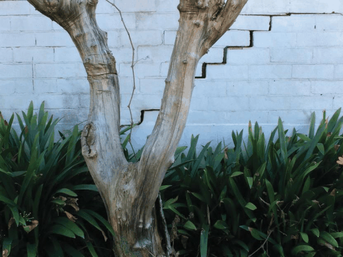

> [Picture on page 9: a picture, saved as a picture (images/tree-management-manual-page-9-15.gif, 150 dpi).]

This will often entail on-site investigation and exploratory excavation and root mapping supervised by an arborist.

The information required in the report is similar to that required for an arborist report. The report must consider all viable options to mitigate significant damage to the structure by means other than the removal of the subject tree.

#### 4.2.3 Plumber report

Tree root entry into a sewer/stormwater line must be preceded by a failure of the line. In Canterbury-Bankstown many of the older clay pipes fail due to soil movement causing separation between the pipe sections and deterioration of the mortar at the joints, causing water to leak into the surrounding soil. If a pipe is leaking the roots growing in that area will eventually find the source of the leak and enter the pipe, usually resulting in a blockage. Roots will continue to enter the pipe unless the damaged pipe is repaired or replaced. Removal of the suspected tree will not remediate the problem, as roots from other nearby trees, shrubs and other plants can and will also enter the pipe.

Tree root entry is not an issue with uPVC pipes, providing they have been installed correctly.

In situations where tree roots are alleged to be causing damage to or blocking a sewer line, the tree permit application must be accompanied by a plumber report.

Figure 4: Example of tree root entry into a damaged earthenware pipeline

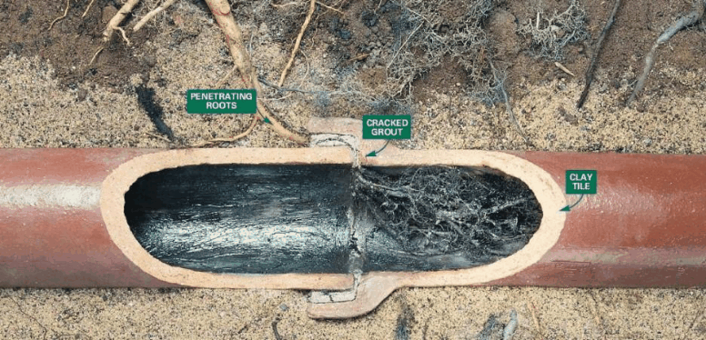

> [Picture on page 10: a picture, saved as a picture (images/tree-management-manual-page-10-2.gif, 150 dpi).]

The report must be prepared in consultation with a qualified arborist, and must be able to demonstrate a direct causal link between the tree and the blockage or other observed damage.

The information required in the report is similar to that required for an arborist report.

The report must consider all viable options to mitigate the pipe damage or blockage by means other than the removal of the subject tree. Often many of the older earthenware sewer lines, as discussed above, are in a state of disrepair and may need to be replaced with newer uPVC pipes.

#### 4.2.4 Pest inspection report

In situations where there has been termite damage to a structure, or where a tree is suspected of containing a termite colony, an application to remove the tree must be accompanied by an arborist report, prepared in liaison with a pest inspector or allied expert.

The report must be able to demonstrate the presence of an active termite colony in the subject tree, and a direct causal link to the termite infestation in the structure.

The information required in the report is similar to that required for an arborist report. The report shall also include results of non-destructive internal inspection of the tree to determine the extent, or otherwise, of termite damage to the tree.

The report must consider all viable options to remedy the situation by means other than the removal of the subject tree.

### 5.0 TREE PERMIT APPLICATION ASSESSMENT

### 5.1 Matters for consideration

In determining a tree permit application to prune or remove a tree, Council’s tree management officers will base their assessment on the information provided by the applicant, together with an on ground visual assessment of the tree. Refer to Appendix A for an explanation of the visual tree assessment (VTA) process.

Council will take into consideration one or more of the following criteria when making a decision to remove or prune a tree:

• the location of the tree;

• the suitability of the tree to the site conditions;

• the useful life expectancy of the tree;

• the landscape values of the tree;

• the cultural, historical, social or scientific values of the tree;

• the local ecosystem and biodiversity values of the tree;

• whether the tree has caused, or has the potential to cause, significant damage to structures or injury to persons in the foreseeable future, and the availability of reasonable options to remedy the situation.

Most of these matters can be addressed in an arborists report accompanying the application.

Note: The role of Council’s tree management officers is to administer the Canterbury- Bankstown Development Control Plan 2023, an adopted planning policy of Council. It is not the role of Council’s tree management officers to carry out a safety or risk assessment of trees on private property, or to provide advice on such matters. It is the responsibility of the tree owner to engage a qualified arborist experienced in risk assessment to undertake any such assessment on the condition of the tree. Council will however consider the tree report in assessing a tree permit application.

### 5.2 What is not considered

The following are not considered valid reasons to remove a tree:

• normal shedding of leaves, fruit, seeds, bark, twigs and small branches;

• the presence of spiders, insects, birds or other fauna;

• leaf drop into gutters, pools, lawns, paving or similar;

• shading of lawns, gardens or swimming pools – particularly if seasonal;

• to reduce fruit, sap or bird droppings onto cars, paving or similar;

• minor lifting of fences, pathways, garden edging, car port slabs or other ancillary structures by tree roots;

• to erect a fence, car port, BBQ, or similar ancillary structure.

### 6.0 TREE PERMIT REVIEW PROCESS

All applicants have the right of review if they believe Council has erred in its judgement, its decision is harsh or unreasonable, of if new information has become available.

#### First review

There will be no fee for this review, and the applicant will not be required to provide any additional supporting information, although they may choose to do so and it could assist in the review process.

The applicant will be advised in writing of the outcome.

Figure 5: Tree Management Order (TMO) first review process

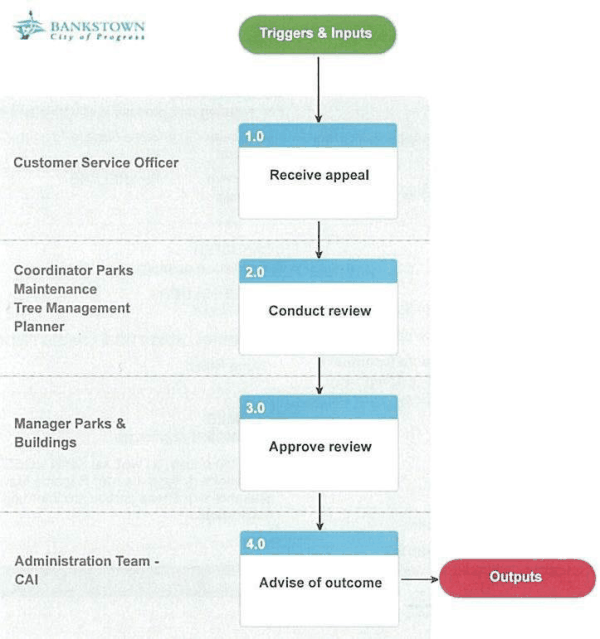

> [Picture on page 12: a picture, saved as a picture (images/tree-management-manual-page-12-10.gif, 150 dpi).]

#### Second review

Should the applicant require a second review, this review attracts a fee (set at 50% of the TMO application fee) and must be accompanied by relevant supporting documentation – such as an arborist report, structural engineer report, or similar. Council will not process the review without supporting documentation.

The second review will be undertaken by the Manager, and the applicant will be advised in writing of the outcome. If the review upholds the original decision to retain the tree/s, a report will be prepared for Council for further consideration.

Figure 6: TMO second review process

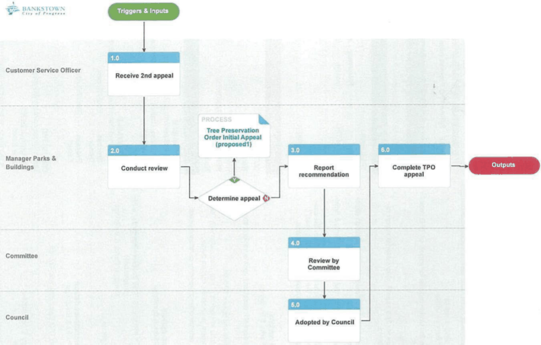

> [Picture on page 13: a picture, saved as a picture (images/tree-management-manual-page-13-2.gif, 150 dpi).]

### 7.0 TREES GROWING ON A NEIGHBOURING PROPERTY

Trees can become the subject of a dispute between adjoining property owners for reasons such as overhanging branches, dropping of branches and other debris, or tree roots causing damage to paving or structures, or from hedges blocking sunlight to a window or a view from a dwelling.

Council has no jurisdiction and cannot intercede in a dispute between neighbours over a private tree issue. Nor can Council provide permission to prune or remove a neighbour’s tree without their consent. The only circumstances where Council can order the owner of a tree to prune or remove the tree is if it is a declared noxious weed under the Noxious Weeds Act 1993, or if the tree poses a direct danger to public space under the control and management of Council.

The easiest way to resolve these matters is to contact your neighbour and discuss your concerns about the tree/s, and request they apply for a Tree Management Order (TMO) permit from Council to undertake removal/pruning of the tree/s. Until Council receives an application form for a TMO permit, Council cannot undertake an inspection of the tree/s.

Adjoining property owners who cannot agree how to resolve an issue with a tree that has become dangerous or is damaging one of the adjoining properties, or a hedge that severely obstructs sunlight to the window of a dwelling or a view from the dwelling of an adjoining property, may make an application to the Land and Environment Court for orders under the Trees (Dispute Between Neighbours) Act 2006 (the Trees Act).

The Trees Act requires property owners to take reasonable action in dealing with trees or hedges impacting on their neighbours. Should a resident consider that their neighbours are not willing to undertake reasonable action in terms of their concerns, they may wish to seek assistance through the courts in these matters.

The Trees Act aims to provide a simple, inexpensive and accessible process for resolving neighbour disputes over trees.

The Trees Act contains two operative parts. The first is Part 2 dealing with damage to property or the likelihood of injury to persons. The second is Part 2A dealing with high hedges that severely obstruct sunlight to a window of a dwelling or a view from a dwelling.

Figure 7: The tree dispute process (Source: http://www.lec.justice.nsw.gov.au)

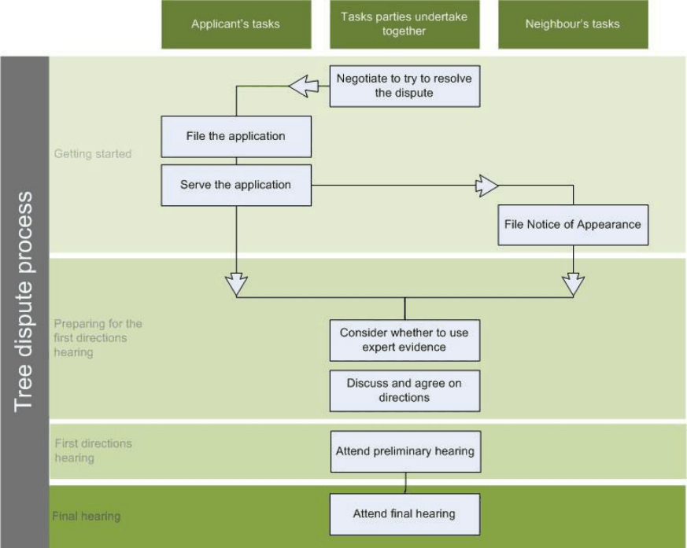

> [Picture on page 15: a picture, saved as a picture (images/tree-management-manual-page-15-2.gif, 150 dpi).]

The following documents produced by the Land and Environment Court provide assistance in understanding the scope of the Trees Act, and the processes involved:

• Tree disputes: understanding the law

• Practice Note: Class 2 Tree Applications

Copies of these documents have also been included in the appendices. It is advisable to visit the Land and Environment Court web site for the latest information or updated versions.

More information, application form and fees and charges can be found on the trees disputes section of the Land and Environment Court website.

Should a resident contact Council regarding an issue they have with a tree on an adjoining private property, Council will advise them of the requirements and responsibilities under the Trees Act, and will provide the necessary information to allow the resident to pursue the matter in the Land and Environment Court.

### 8.0 TREES ON DEVELOPMENT SITES

### 8.1 General

Trees that are in good health and condition, that can be sustained in the medium to long term, and that make a positive contribution to visual, ecological and natural heritage values, shall be retained as part of any new development. Mature trees cannot be replaced in the short to medium term, and it is better to retain them to add to the value of a development than to wait decades for replacement trees to grow to a similar size.

Early assessment of trees that are suitable for retention and incorporating those trees in the proposed development can create a positive outcome for all stakeholders – residents, Council, developers and the local environment.

When planning for a new development, the opportunities and constraints provided by the existing trees on the site should be considered from the early stages of the design process. All existing trees, together with all trees located within 5m of the boundaries of the site on adjoining properties, should be assessed by a qualified arborist as part of the initial site analysis. This information is then used to inform the design process.

Those trees identified as suitable for retention can then be factored into the design and accorded appropriate tree protection measures.

In general, the development site tree management process can be summarised as follows:

Table 2: Development site tree management process

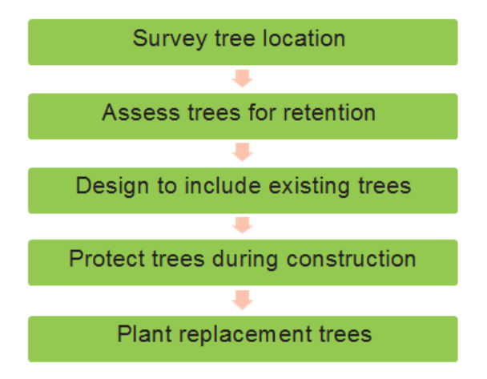

> [Picture on page 16: a picture, saved as a picture (images/tree-management-manual-page-16-20.gif, 150 dpi).]

The full tree management process through the various stages of site development is detailed in the Australian Standard AS 4970–2009, Protection of trees on development sites, and reference should be made to that document when planning and submitting a development application.

### 8.2 Design options to retain trees

Often trees can be retained on site through the use of alternative design options. In this way tree retention can be incorporated in a cost effective manner, and at the same time not restrict opportunities for site development. Design options include:

• altering the development footprint;

• relocating / minimizing driveway widths to retain existing trees;

• altering hard surface design;

• utilizing permeable pavement;

• changes to construction techniques to avoid damage to tree root systems, including: o discontinuous footings, o pier and beam footings; o hand, hydraulic or pneumatic excavation.

A project arborist will be able to advise and prepare documentation on site specific measures.

### 8.3 DA tree assessment process

Development applications that may impact on trees growing on the property, on the adjoining property, and street trees on the nature strip, are referred to Council’s tree management officers for assessment.

There are a number of methodologies for assessing the suitability for retention of a tree on a development site. Council uses the TreeAZ methodology, an internationally recognised system for tree assessment. It is a refinement of the SULE method in widespread use. Further information can be found at http://www.treeaz.com.

Trees that are assessed as suitable for retention are protected in accordance with the requirements detailed in the Australian Standard AS 4970–2009, Protection of trees on development sites, together with any relevant site specific conditions as determined by Council and included in the development consent.

Figure 8: Development application tree referral process. Refer also to Appendix H for further details on the process

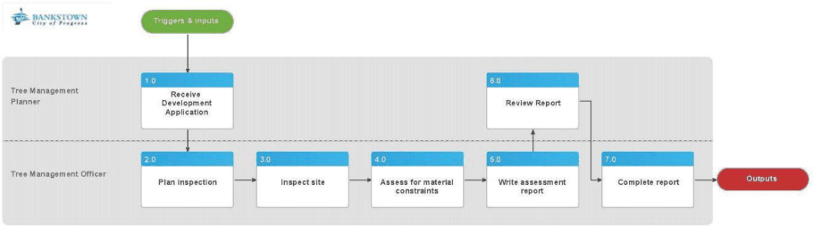

> [Picture on page 18: a picture, saved as a picture (images/tree-management-manual-page-18-3.gif, 150 dpi).]

### 8.4 Tree protection zones

#### 8.4.1 General

Trees that are required to be retained as part of an approved development must be protected from damage caused by site disturbance and construction activities. Generally such tree protection measures will be imposed as part of the conditions of consent.

Tree protection zones (TPZ) and structural root zones (SRZ) are fundamental to the retention and protection of trees on development sites, and fenced off tree protection zones are mandatory on all development sites within Canterbury-Bankstown. Refer to Figure 9 for further details on SRZ and TPZ requirements.

#### 8.4.2 Tree protection zone (TPZ)

The tree protection zone (TPZ) is the area above and below ground required for tree viability, and is the minimum area set aside for the protection of the tree. The TPZ is a radial distance measured from the trunk of the tree calculated in accordance with the Australian Standard AS 4970–2009, Protection of trees on development sites. Minor encroachments of less than 10% are allowed into this area, however such incursions must be approved by Council or the project arborist.

#### 8.4.3 Structural root zone (SRZ)

The structural root zone (SRZ) is the minimum area required for tree stability. The SRZ is a radial distance measured from the trunk of the tree calculated in accordance with the Australian Standard AS 4970–2009, Protection of trees on development sites. No encroachment within this area is allowed, unless it has been demonstrated by the project arborist that there will be little or no adverse impact on the tree.

Table 3 provides some example TPZs and SRZs. This can be used as a guide for planning purposes. Note that all measurements are in metres, the zone dimensions are the radius from the centre of the trunk, and if a tree falls between two trunk diameters that it should be rounded up to the larger diameter.

Table 3: Example SRZs and TPZs

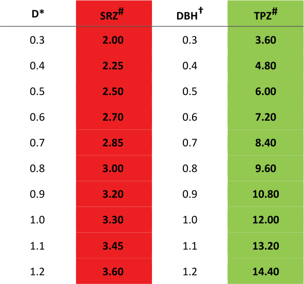

> [Picture on page 19: a map, saved as a picture (images/tree-management-manual-page-19-2.gif, 150 dpi); the street names and other small labels are on the picture.]

\* D = the diameter of the trunk in metres measured immediately above the root buttress/trunk flare. † DBH = the diameter of the trunk in metres measured at 1.4m above ground level (existing).

\# Radial distance in metres extending from the centre of the trunk of the tree. NB: The minimum SRZ radius is 1.5m. The minimum TPZ radius is 2m. The minimum TPZ of palms, ferns and cycads is 1m outside the crown projection.

Refer to the Australian Standard AS 4970–2009, Protection of trees on development sites for further information on how to calculate the zones, and detailed requirements in respect of works prohibited within these areas. (refer also to Figure 9).

In some situations, non-destructive tree root investigation methods – such as high pressure air or water excavation tools, or careful trenching using small hand tools by an arborist – may be required to determine the exact location of the tree roots.

Figure 9: The structural root zone (SRZ) and tree protection zone (TPZ)

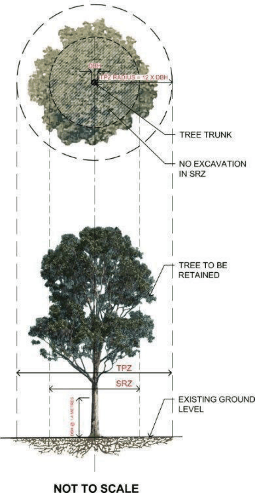

> [Picture on page 20: a picture, saved as a picture (images/tree-management-manual-page-20-2.gif, 150 dpi).]

The following works are prohibited within a TPZ:

• mechanical excavation;

• stockpiling of building materials, debris or soil;

• vehicular traffic, except on existing paved surfaces;

• installation of sewer and storm water lines and pits;

• site sheds and plant storage;

• wash down of equipment;

• trenching for building, wall or fence footings;

• soil level changes.

Generally, a 1.8m high chain mesh fence is to be erected either around the perimeter of the TPZ or as otherwise specified by Council.

Shade cloth or similar can be attached to the fence to prevent cement dust and other particulate matter from blowing into the tree protection zone.

Figure 10: Example of tree protection fence signage. Also refer to the Australian Standard AS 4970–2009, Protection of trees on development sites – Appendix C for a suggested TPZ sign

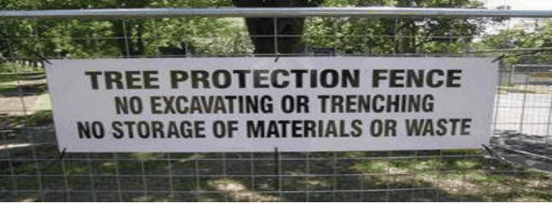

> [Picture on page 21: a picture, saved as a picture (images/tree-management-manual-page-21-3.gif, 150 dpi).]

Figure 11: Example of a fenced off tree protection zone at an open site

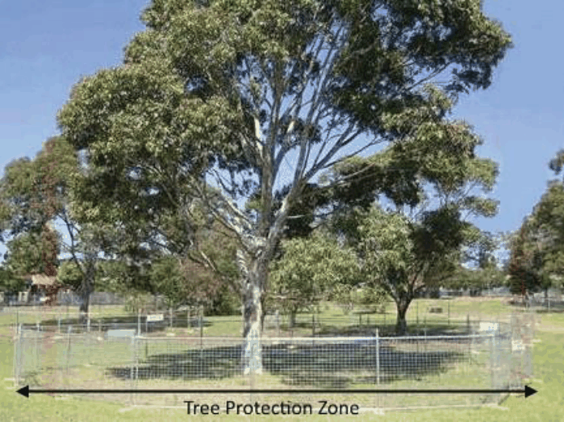

> [Picture on page 21: a picture, saved as a picture (images/tree-management-manual-page-21-5.gif, 150 dpi).]

Often in construction sites the actual location of the protection fence will need to be modified to take into account existing or proposed buildings, paving, site access, or other minor encroachments. This will be determined either by the project arborist or as conditioned by Council.

As well as fenced off exclusion zones, other tree protection measures may include:

• Ground protection – such as deep woodchip mulch, rumble boards, steel plates or similar – to avoid compaction and mechanical impact damage,

• Branch and trunk protection to prevent mechanical impact injury.

Once again, site specific tree protection measures will be determined either by the project arborist or as conditioned by Council. For guidance purposes only, an example of a standard tree protection condition is included at Appendix B.

### 8.5 Arboricultural impact assessment

An arboricultural impact assessment submitted as supporting documentation with a development application involving tree removal and /or tree protection must comply with the Australian Standard AS 4970–2009, Protection of trees on development sites, and include the following information:

• Name, address and contact details, ABN and qualifications and experience of the arborist carrying out the inspection and preparing the report.

• The purpose of the report (the Brief) and the name, address and contact details of who commissioned the report.

• Address of the property where the trees are located.

• The owner of the property where the trees are located.

• Consideration of all relevant planning laws, regulations and planning instruments pertaining to the property.

• The date the site inspection was undertaken.

• The scope of the inspection and details of the methodology used in the assessment.

• Survey data for the subject trees – including, but not limited to, the scientific and common names; height and crown spread; DBH; approximate age of the tree; the health and condition of the tree; any pests, diseases or structural defects; and the retention value of the trees.

• A plan of the site at no smaller than 1:100 scale showing the location of the subject trees, clearly identify trees to be removed and retained. The trees are to be individually numbered to correspond with the report.

• Consideration of all aspects of proposed above and below ground works.

• The Tree Protection Zone (TPZ) and Structural Root Zone (SRZ) of all the trees on the site, including those indicated for removal, must also be clearly marked on the site plan.

• Details of any tree root mapping exercise, if required.

• Wildlife habitats, nesting hollows, shelter sites, and similar.

• Supporting documentation where relevant to the aim of the report.

• Photographs of the trees for identification purposes and to illustrate issues discussed in the report.

• A detailed consideration of the management options available to the applicant, including development redesign.

• Design and construction methods to minimise impacts on retained trees.

• Tree protection measures and plan.

• Proposed replacement tree planting options should the development entail the removal of trees from the site.

This list of requirements is not exhaustive, and other site specific details may need to be assessed to provide adequate information to Council to assist in the assessment process.

### 8.6 Tree management plan

Council may also require the applicant to submit a tree management plan for the site, either with the initial development application or prior to the issue of the construction certificate. This is to ensure effective protection of the trees on site and compliance with the Australian Standard AS 4373–2007, Pruning of amenity trees and Australian Standard AS 4970–2009, Protection of trees on development sites.

The tree management plan shall be prepared by a qualified arborist – minimum Australian Qualification Framework (AQF) Level 5 Diploma of Horticulture (Arboriculture) and/or equivalent experience and with experience on development and construction sites. All trees to be retained and protected, and trees located on adjoining properties within 5m of the subject property boundary, are to be covered by this tree management plan. The plan shall generally comply with the Australian Standard AS 4970–2009, Protection of trees on development sites and any conditions imposed by Council as part of the development consent, or as otherwise required by Council.

The details of this tree management plan are to be site specific – it is not acceptable to just append sample generic conditions and should include, but are not limited to, the following tree management procedures:

• a site plan showing the locations of all trees to be retained, including the associated SRZs and TPZs;

• project Implementation;

• monitoring and control (hold points);

• record keeping and documentation;

• conflict resolution;

• tree pruning and removal procedures;

• tree protection procedures for all stages of the development;

• general tree care procedures;

• specific tree care and protection procedures (for each tree if necessary);

• ongoing monitoring and maintenance procedures, including post-development care.

### 9.0 COMPLYING DEVELOPMENT

### 9.1 General

Complying development is a form of planning approval that can be issued by an accredited certifier or a council in the form of a complying development certificate (CDC). The types of development that can be done as complying development are identified in the State Environmental Planning Policy (Exempt and Complying Development Codes) 2008 (the SEPP).

### 9.2 Trees that can be removed

The SEPP authorises the removal of certain trees to allow development on a property without the need for council approval. This provision overrides the Canterbury-Bankstown Development Control Plan 2023. As at January 2015, a tree can be removed as part of a complying development for residential development if it is;

• within 3m of a building or structure bigger than 25m2;

• not on a council significant tree register;

• not higher than 8m if the development is for a new house, as long as the tree is not required to be retained as a condition of consent for the subdivision, and

• not higher than 6m for alterations and additions for a house.

It is the responsibility of the property owner to check with the NSW Government for up-to-date information on tree removal and tree protection measures for complying development.

Note that the removal or damage of protected trees is a breach of the Canterbury-Bankstown Development Control Plan 2023, and may lead to prosecution.

### 9.3 Trees that require council consent for removal

The SEPP also defines a category of ‘protected tree’ that cannot automatically be removed as part of the complying development. These trees are protected under the Canterbury- Bankstown Development Control Plan 2023, and require approval from Council for removal. The SEPP also specifies tree protection measures that must be implemented, including tree guards and tree protection fencing for all retained trees, to ensure that they are not damaged during construction.

Applications for a permit to remove a protected tree on a complying development site must be accompanied with an A3 sized copy of the site plans, and other supporting reports or documentation as per a regular application. An arborist report may also be required.

Should Council not grant approval under the Canterbury-Bankstown Development Control Plan 2023 for the removal of the protected tree, then a redesign of the proposal or the submission of a development application will be necessary.

### 9.4 Street trees

When planning a complying development, you must take into consideration any council street tree located on the nature strip forward of or adjacent to the property. Street trees are valuable community assets, and removal for the purposes of constructing a vehicle footpath crossing may not be approved. For further information in this matter, contact Council’s Customer Service Centre on (02) 9707 9000 and ask to speak to a tree management officer.

Figure 12: Tree retention and removal under complying development (adapted from Planning and Environment Information Sheet 3.7 – Tree protection and removal requirements)

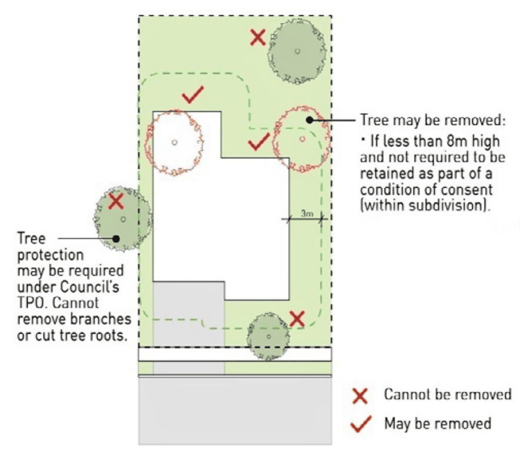

> [Picture on page 25: a picture, saved as a picture (images/tree-management-manual-page-25-9.gif, 150 dpi).]

Note the comments in respect of the tree on the adjoining property. Trees to be retained must be protected in accordance with the Australian Standard AS 4970–2009, Protection of trees on development sites.

### 10.0 BUSH FIRE PRONE LAND

Special tree and vegetation management controls apply to properties located in bush fire prone land. A copy of the Bush Fire Prone Land Map can be viewed on Council’s website (www.cbcity.nsw.gov.au).

The objective of the controls is to reduce fuel loads within a certain specified distance from the asset to be protected (e.g. a dwelling), thus helping to reduce heat levels, flame contact, and ember attack on life and property.

Detailed information on these controls can be found in Planning for bush fire protection and Standards for asset protection zones. These publications are available on the NSW Rural Fire Service (RFS) website.

In addition to the above controls, in 2014 the RFS implemented the 10/50 Vegetation Clearing Code of Practice for New South Wales. This Code provides specific tree and vegetation clearing measures for those properties located in the 10/50 vegetation clearing entitlement area as identified on a map published on the RFS website.

The RFS provides an online tool to check whether a property is located in the entitlement area.

Figure 13: 10/50 Vegetation clearance zone (Source: NSW Rural Fire Service)

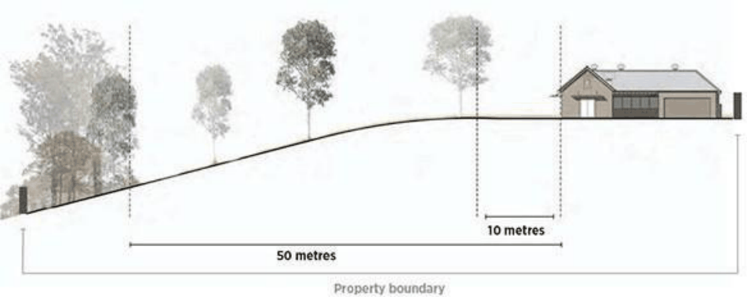

> [Picture on page 26: a picture, saved as a picture (images/tree-management-manual-page-26-18.gif, 150 dpi).]

These vegetation management controls may vary from time to time, and it is advisable to check either with Council or the NSW Rural Fire Service for the latest information.

### 11.0 EMERGENCY TREE WORK

The Canterbury-Bankstown Development Control Plan 2023 allows for the pruning or removal of a dangerous tree without consent from council where it can be proved by the owner of the tree that it was the only reasonable option to avoid an immediate threat to human life or property. This situation may occur when a tree has been badly damaged or becomes unstable following a severe storm event, or when excavation or similar works within the SRZ of the tree results in significant damage to the supporting root system.

Evidence supporting the need to remove the tree must be forwarded to Council immediately following the works. The evidence shall consist of a report by a qualified arborist together with photographs illustrating the cause of the immediate danger.

If a qualified arborist is unavailable and it is an emergency situation, a report together with appropriate photographs from the NSW State Emergency Service (SES) or other recognised emergency agency will be sufficient.

Figure 14: The main stem of this Coral tree (Erythrina x sykesii) collapsed onto the roof of an adjacent dwelling during a storm event

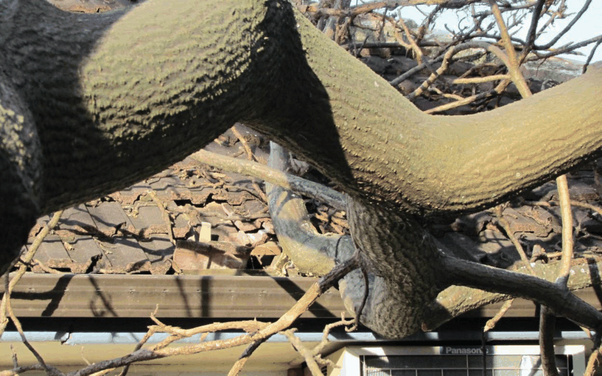

> [Picture on page 27: a picture, saved as a picture (images/tree-management-manual-page-27-16.gif, 150 dpi).]

### 12.0 TREE PRUNING

### 12.1 General requirements

Pruning is the systematic removal of branches. The classes of pruning works are detailed in the Australian Standard AS 4373–2007, Pruning of amenity trees. Pruning is not lopping, or topping, or the cutting back of branches flush with the stem or trunk. These practices all injure the tree and can create potential hazards.

Figure 15: A qualified arborist safely carrying out tree pruning work.

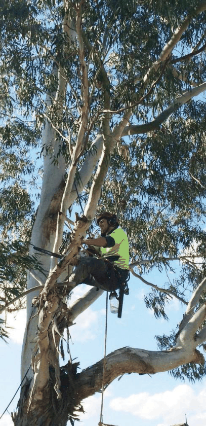

> [Picture on page 28: a picture, saved as a picture (images/tree-management-manual-page-28-8.gif, 150 dpi).]

All pruning works on prescribed trees in Canterbury- Bankstown must be carried out to the approved standards to avoid unnecessary damage to the tree and, more importantly, to ensure the safety of the person carrying out the work.

Accordingly, Council recommends that pruning works should be carried out by a suitably qualified person (minimum of AQF Level 3 – refer to Table 4 for AQF framework) with experience in arboriculture, and in accordance with:

• Australian Standard AS 4373–2007, Pruning of amenity trees;

• WorkCover Amenity Tree Industry – Code of Practice;

• Conditions specified under a permit or development consent granted by Council.

Figure 16: The difference between pruning and lopping cuts

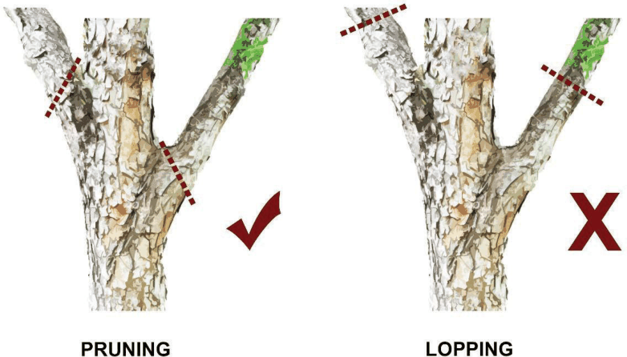

> [Picture on page 29: a picture, saved as a picture (images/tree-management-manual-page-29-2.gif, 150 dpi).]

Pruning retains the trees own natural protection zone within the branch collar, and this inhibits the spread of any potential infection into the tree. Pruning will also help prevent the development of epicormic branch growth at the site of the cut.

Conversely, lopping allows the expansion of infection and decay into the branch stub and ultimately into the tree itself, and also generally encourages the development of weakly attached epicormic growth at the site of the cut. All of this is detrimental to the health and structure of the tree, and can lead to tree decline and increased maintenance costs.

### 12.2 Reasons for pruning

In the urban environment trees often require pruning for a number of reasons, including:

• building clearance;

• allow access for people and vehicles;

• repair storm damage;

• power line clearance;

• maintenance pruning to remove dead, diseased and defective branches;

• formative pruning of young trees to remove faults and develop good branch structure.

Some tree maintenance is permissible without Council approval. Please refer to the Canterbury-Bankstown Development Control Plan 2023 for the full list of exemptions.

It is the tree owner’s responsibility to ensure all maintenance works comply with the Canterbury-Bankstown Development Control Plan 2023 or any tree permit or development conditions issued by Council.

A permit from Council is required for pruning works that do not come under this general exemption. The permit will specify the amount of pruning that can be carried out and any other conditions that are applicable.

In general, using a qualified arborist and complying with the standards should ensure that the pruning will achieve the desired objective without unduly damaging the tree or compromising its health and structural integrity. The outcome should be a sound and healthy tree; not a tree with branch stubs, epicormic growth, or other problems which will cause ongoing maintenance and further expense for the owner.

Table 4: Australian Qualification Framework (AQF), these qualifications apply to arboriculturists as well as horticulturists with specialist knowledge in arboriculture

#### AQF level       Skill level

2

Skilled labourer, tree worker

3

Trade, practicing arborist

4

Supervising arborist, report writing

5

Manager, consulting arborist, report writing

### 13.0 PROTECTING NATIVE FAUNA

Old and decaying trees, particularly trees with hollows and cavities, often provide nesting habitat for many native tree dwelling species, particularly birds, small insectivorous bats, and arboreal mammals such as sugar gliders.

Figure 17: A pair of rainbow lorikeets (Trichoglossus moluccanus) nesting in a hollow in a dead tree

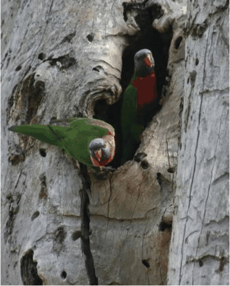

> [Picture on page 31: a picture, saved as a picture (images/tree-management-manual-page-31-6.gif, 150 dpi).]

The more potential habitat trees that are removed, the less nesting sites there are left available for these important native species. Tree removal is a major factor contributing to the decline in numbers and diversity of native bird and mammal species, and the loss of hollow bearing trees is listed as a key threatening process under the Biodiversity Conservation Act 2016.

For this reason, subject to safety considerations, Council encourages the retention of such habitat trees, either intact or suitably pruned for hazard reduction purposes.

All native fauna species are protected under the National Parks and Wildlife Act 1974, and penalties apply to anyone who causes harm to these protected fauna. Special measures designed to reduce the risk of injury or death to native fauna must be employed when planning to prune or remove trees that contain hollows or cavities, or are otherwise suspected of harbouring native fauna. These include:

• Prior inspection of the tree to determine the presence or otherwise of fauna or occupied nests. This may require advice from an ecologist or wildlife specialist.

• Removal of any fauna present by a licensed wildlife carer prior to the commencement of the tree work.

• Consider scheduling the work until after the end of the breeding season. If eggs or young are present, do not disturb or interfere with them and reschedule the work until after the end of the breeding season and the hollow/nest has been vacated.

• Careful dismantling of the tree to avoid injury or death to any native fauna that may have returned to the tree.

Figure 18: Sugar glider (Petaurus breviceps) making good use of a nest box in a Council reserve

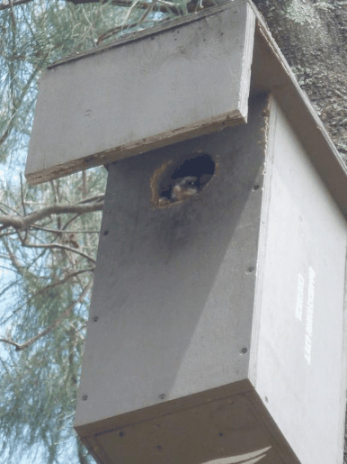

> [Picture on page 32: a picture, saved as a picture (images/tree-management-manual-page-32-2.gif, 150 dpi).]

If you have to remove an existing or potential habitat tree from the property, Council encourages the installation of suitable nest boxes (there are different nest box designs depending on the species you are trying to attract) to remaining trees or other appropriate structures on the site to help provide replacement habitat.

Please contact Council’s Resource Recovery and Sustainability team on (02) 9707 9000 for further information on nest boxes.

### 14.0 TREE PLANTING

### 14.1 General

A key component of the controls in the Canterbury-Bankstown Development Control Plan 2023 is to provide for additional replacement tree planting to ensure the ongoing environmental amenity of Canterbury-Bankstown is enhanced for the future.

It is a condition of all approvals granted under the DCP that the applicant will be required to plant replacement trees at a ratio of at least three trees for every one tree removed, site conditions permitting. Where there is limited planting opportunity on the property, Council may consider equivalent offset planting on an alternative site. Council may undertake random audits to determine compliance with replacement tree planting conditions.

### 14.2 Tree supply

Generally, replacement trees planted in accordance with a tree permit shall be a minimum of 45 litre container size. Replacement trees planted in accordance with a development consent shall be a minimum of 75 litre container size.

Figure 19: Good quality advanced sized trees grown to NATSPEC standard in a production nursery

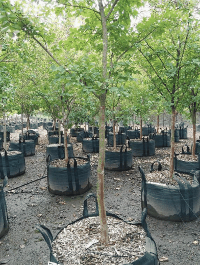

> [Picture on page 33: a picture, saved as a picture (images/tree-management-manual-page-33-16.gif, 150 dpi).]

To ensure healthy trees and long term viability, all trees shall comply with NATSPEC Specifying Trees

(2003) or Australian Standard AS 2303–2018, Tree stock for landscape use. The Nursery and Garden Industry Australia can provide advice on appropriate tree production nurseries and suppliers.

Normally the property owner is free to select the tree species of their choice, as long as the tree complies with any quality and performance requirements specified on the permit or the development consent and is not a species listed as exempt under the Canterbury-Bankstown Development Control Plan 2023. However, given their suitability for the region and their biodiversity values, Council encourages the planting of locally occurring indigenous trees wherever possible; and in some situations this may be a mandatory requirement. A list of local occurring indigenous tree species is included at Appendix C.

### 14.3 Tree planting

Figure 20: Tree planting guidelines (from CBC Standard Dwg No. S-203)

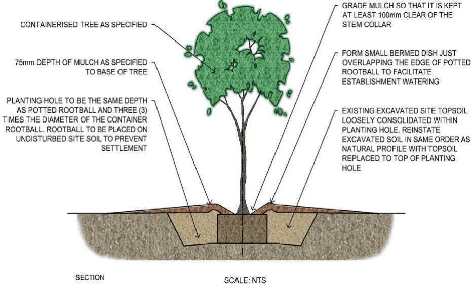

> [Picture on page 34: a picture, saved as a picture (images/tree-management-manual-page-34-3.gif, 150 dpi).]

Figure 21: Recently planted Corymbia ficifolia cv. (Dwarf Flowering Eucalypt)

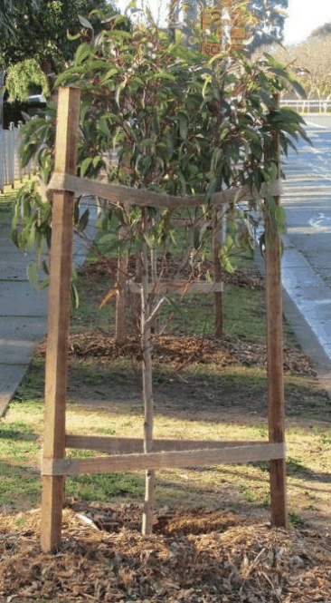

> [Picture on page 34: a picture, saved as a picture (images/tree-management-manual-page-34-5.gif, 150 dpi).]

A correctly planted tree will establish quicker, be healthier, more structurally sound, and less vulnerable to pests and diseases than a poorly planted tree.

One of the most common mistakes is to plant the tree too deep into the ground, leading to tree failure.

Spending time to get it correct at planting time will prevent a lot of problems, save costs in the long term, and result in a better environment.

#### REFERENCES

Australian Standard AS 4373–2007, Pruning of amenity trees

Australian Standard AS 4970–2009, Protection of trees on development sites

Australian Standard AS 2303–2018, Tree stock for landscape use

Canterbury-Bankstown Local Environment Plan 2023

Canterbury-Bankstown Development Control Plan 2023

State Environmental Planning Policy (Exempt and Complying Development Codes) 2008

NSW Rural Fire Service, 10/50 Vegetation Clearing Code of Practice for New South Wales

Land and Environment Court, Tree disputes: understanding the law

Land and Environment Court, Practice Note: Class 2 Tree Applications

Office of Environment and Heritage (2013), The Native Vegetation of the Sydney Metropolitan Area – Volume 2: Vegetation Community Profiles

Barrell, J (1993), Safe useful life expectancy (SULE)

Barrell, J (2010), TreeAZ – Australia and New Zealand

Clark, R (2003), Specifying trees: a guide to assessment of tree quality

Matheny, N and Clark, J (1994), Evaluation of hazard trees in urban areas

Mattheck, C and Breloer, H (1994), The body language of trees

Dunster, Smiley, Matheny & Lilly, (2013) ISA Risk Assessment Manual

Statewide Mutual (2013), Best Practice Manual – Trees and Tree Roots

WorkCover New South Wales (1998), Code of practice: Amenity tree industry

#### DEFINITIONS

arborist means a person with training to AQF Level 3 in Arboriculture, or above, or equivalent recognised and relevant experience.

aerial inspection means an inspection of the parts of the tree not visible from the ground, particularly branch and stem unions. May also include evaluation of internal decay. Requires climbing or an elevated work platform (EWP).

Australian Qualification Framework (AQF) means a national framework for education and training in Australia.

consultant arborist means a person with training to AQF Level 5 in Horticulture (Arboriculture), or above, and/or equivalent recognized and relevant experience.

crown means the portion of the tree consisting of branches and leaves and any part of the trunk (or stem) from which branches arise.

crown lifting means the removal of the lower branches, usually to provide clearance for persons and vehicles.

crown thinning means reducing the crown density of the tree by removing smaller (secondary) branches and retaining the major structural branches.

diameter at breast height (DBH) means the diameter of the trunk of the tree measured at 1.4m above ground level.

deadwood means dead branches within the crown. Some deadwood is part of the natural growth cycle of a number of trees.

deadwooding means the removal of dead branches.

decay means the breakdown of woody tissue within the tree, commonly caused by fungi infection.

dieback means the death of growth tips and branches, often progressing further down the stem. Often an indication of underlying stress and a decline in tree health.

dwelling means a room or suite of rooms occupied or used or so constructed or adapted as to be capable of being occupied as a separate domicile, but does not include permanent fixed structures such as deck, garages and similar structures that are attached to the building.

dying or dead tree means a tree that no longer has a functioning xylem and/or phloem system; evidenced by permanent leaf loss, permanent desiccation of branches and stems, and bark peeling off back to the sapwood.

exotic tree means a tree species not originating from Australia.

indigenous tree means a tree species originating from Australia.

injury means damage to the trunk, crown or root system of a tree or any other activity that is likely to compromise the health and/or structure of the tree, including trenching, excavation or soil level changes within the tree protection zone (TPZ) of the tree.

line clearance means pruning to maintain safety clearances around overhead services. The minimum safety clearance for insulated cable with less than 100m span (e.g. the service line from the power pole to the property) is 0.5m.

lopping means cutting branches or stems between branch unions or internodes.

prescribed tree means a tree listed the Canterbury-Bankstown Development Control Plan 2023.

prune means the systematic removal of branches. Pruning is not lopping, topping or the cutting of branches flush with the stem trunk. Refer to the Australian Standard AS 4373– 2007, Pruning of amenity trees.

reduction pruning means reducing the length of a branch by pruning it back to an internal branch or stem.

remedial pruning means the removal of diseased, damaged or lopped branches back to undamaged or healthy tissue on trees that have already lost their natural structure due to disease, storm damage or other mechanical injury.

ringbark means a circumferential cut made around the trunk of a tree which removes a band of tissue to the depth of and including the cambium.

secondary dwelling means a self-contained dwelling on the same lot of land as the principal dwelling.

selective pruning means pruning or removing branches that are causing a specific problem.

stem/bark inclusion means where bark turns inwards at the point of branch or stem attachment, preventing the development of sound connective wood.

structural root zone (SRZ) means the area required for tree stability. The SRZ is a radial distance measured from the trunk of the tree calculated in accordance with the Australian Standard AS 4970–2009, Protection of trees on development sites.

topping means reducing the height of the tree by lopping the branches or stems.

tree means, for the purpose of this Manual, a long lived perennial plant with one or more stems or trunks.

tree protection zone (TPZ) means the area above and below ground required for tree viability. The TPZ is a radial distance measured from the trunk of the tree calculated in accordance with the Australian Standard AS 4970–2009, Protection of trees on development sites.

urban forest means the totality of trees and shrubs on all public and private land in and around urban areas (including bush land, parkland, gardens, and street trees) and is measured as a canopy cover percentage of the total area, and is recognised as a primary component of the urban ecosystem (Local Government NSW Urban Forestry Policy).

visual tree assessment (VTA) means a method of tree assessment in widespread use by the arboriculture industry for assessment and defect analysis.

#### APPENDIX A–VISUAL TREE ASSESSMENT

Visual Tree Assessment (VTA) is an internationally recognised method of tree assessment developed by Mattheck and Breloer (1994), and is in widespread use by the arboriculture industry for assessment and defect analysis.

Basically, some tree defects can be detected on the basis of visual inspection from the ground, whereas other defects will require more detailed assessment. Following inspection the data is analysed, and tree management recommendations are made. In practice VTA is basically a three stage process:

1\. Visual inspection from the ground for obvious defect symptoms such as external signs of decay, physical damage, growth defects, tree vitality, root heave, etc. If there are no obvious signs of any symptoms the investigation process is concluded.

This is the extent of VTA carried out by Council’s tree management officers in assessing a tree application.

If defect symptoms are identified or suspected, the process escalates to stage two.

2\. A more detailed inspection of the tree is carried out, including climbing, drilling, resistance measurement, ultrasonic investigation, root mapping, soil removal, to confirm the physical condition of the tree.

If a defect is confirmed, the process moves to stage three.

3\. The defect is quantified and the structural integrity of the tree is evaluated using recognised strength measurement criteria. In practice, this assessment is undertaken by a suitably qualified professional arborist.

Stages 2 and 3 of the VTA process are carried out by a qualified arborist engaged by the owner of the tree.

The results of the VTA process are used to help determine the appropriate tree management outcome for the site, and are usually presented in the form of an arborist report.

#### APPENDIX B–EXAMPLE OF A STANDARD TREE PROTECTION CONDITION

#### Condition No: XX – Trees to be retained and protected: On-site

The following tree/s shall be retained and protected from removal and damage for the duration of the development:

| Tree species | Location | Protection Zones* |
|---|---|---|
| n x Scientific name (Common name) |  | TPZ SRZ |

\* TPZ and SRZ in metres measured from the centre of the trunk of the tree.

Tree protection measures shall comply with the Australian Standard AS 4970–2009, Protection of trees on development sites, together with the following conditions:

• The tree/s to be retained and protected together with their relevant tree protection zone (TPZ) and structural root zone (SRZ) shall be marked on all demolition and construction drawings.

• All contractors and workers on site shall be briefed on the tree protection and management procedures in place as part of their site induction. A written record of the induction process is to be kept on site.

• A designated tree protection zone shall be created on site by erecting a tree protection fence at n metre radius from the trunk of the (subject tree/s). The fence is to be constructed of chain wire mesh 1.8m high supported by steel posts. The fence is to be installed prior to demolition / construction, shall not be removed or altered, and is to remain in place for the duration of the site works;

• The applicant will display in a prominent location on the tree protection fence a durable, weather resistant sign of a similar design, layout and type size as per Appendix C of the Australian Standard AS 4970–2009, Protection of trees on development sites clearly showing:

a. the development consent number;

b. the name and contact phone number of the nominated consultant arborist;

c. the purpose of the protection zone;

d. the penalties for disregarding the protection zone;

• No vehicular access, excavations for construction or installation of services shall be carried out within the fenced tree protection zone.

• All utility services, pipes, stormwater lines and pits shall be located outside the fenced tree protection zone.

• Building materials, chemical storage, site sheds, wash out areas, and similar shall not be located within the fenced tree protection zone.

• Trees marked for retention must not to be damaged or used to display signage, or as fence or cable supports for any reason.

• Tree roots with a diameter greater than 25mm are to be cut cleanly using sharp hand tools and not torn or ripped by machinery.

OR

• Root mapping is to be undertaken on (subject tree/s) within (specify location to be mapped). All work shall incorporate the recommendations following the root mapping.

• No ripping or rotary hoeing within the Tree Protection Zone of trees to be retained is permitted. Any approved excavation within the Tree Protection Zone of protected trees must be carried out by hand under the care and control of a qualified arborist

– minimum Australian Qualification Framework (AQF) Level 5 or equivalent – to avoid unnecessary damage to tree roots.

• In exceptional circumstances, the tree protection fencing may be temporarily relocated to allow site access for construction purposes subject to the prior approval of the project arborist, the installation of ground protection measures, and following the clearly identified tagging of all protected trees, provided such fencing is immediately replaced on completion of the works. No damage to root systems or soil compaction will be accepted during such works.

• If the approving authority consents to materials, machinery or access over specifically nominated areas of the tree protection zone, the roots and surface soil within this area shall be mulched to a minimum depth of 100mm of hardwood wood chip overlaid with rumble boards, steel plates, or similar. This ground protection measure must be maintained for the duration of the site works.

• The trees are to be watered during dry spells, i.e. two to three weeks without adequate rainfall. The root zone should be thoroughly watered and then left to drain. A temporary/permanent irrigation system is to be installed on site where works longer than one month in duration are expected and when appropriate shall be part of the landscaping works.

• Any pruning works shall be carried out by a qualified arborist and shall comply with the Australian Standard AS 4373–2007, Pruning of amenity trees.

#### APPENDIX C–LOCALLY OCCURRING INDIGENOUS TREE SPECIES

| Genus | Species | Common Name |
|---|---|---|
| Acacia | binervia | Coast Myall |
| Acacia | decurrens | Green Wattle |
| Acacia | meansii | Black Wattle |
| Acacia | parramattensis | Sydney Green Wattle |
| Allocasuarina | littoralis | Black She-Oak |
| Alphitonia | excelsa | Red Ash |
| Angophora | bakeri | Narrow-leaved Apple |
| Angophora | costata | Smooth-barked Apple |
| Angophora | floribunda | Rough-barked Apple |
| Angophora | subvelutina | Broad-leaved Apple |
| Banksia | integrifolia | Coast Banksia |
| Banksia | serrata | Old Man Banksia |
| Brachychiton | populneus | Kurrajong |
| Callistemon | salignus | Willow Bottlebrush |
| Casuarina | glauca | Swamp Oak |
| Ceratopetalum | apetalum | Coachwood |
| Ceratopetalum | gummiferum | NSW Christmas Bush |
| Corymbia | gummifera | Red Bloodwood |
| Corymbia | maculata | Spotted Gum |
| Elaeocarpus | reticulatis | Blueberry Ash |
| Eucalyptus | amplifolia | Cabbage Gum |
| Eucalyptus | baueriana | Blue Box |
| Eucalyptus | beyeriana | Beyer’s Ironbark |
| Eucalyptus | bosistoana | Bosisto’s Box |
| Eucalyptus | botryoides | Bangalay |
| Eucalyptus | capitellata | Brown Stringybark |
| Eucalyptus | crebra | Narrow-leaved Ironbark |
| Eucalyptus | eugenioides | Thin-leaved Stringybark |
| Eucalyptus | fibrosa | Broad-leaved Ironbark |
| Eucalyptus | globoidea | White Stringybark |
| Eucalyptus | haemastoma | Broad-leaved Scribbly Gum |
| Eucalyptus | longifolia | Woollybutt |
| Eucalyptus | moluccana | Grey Box |
| Eucalyptus | oblonga | Narrow-leaved Stringybark |
| Eucalyptus | paniculata subsp paniculata | Grey Ironbark |
| Eucalyptus | parramattensis subsp parramattensis | Drooping Red Gum |
| Eucalyptus | pilularis | Blackbutt |
| Eucalyptus | piperita | Sydney Peppermint |
| Eucalyptus | punctata | Grey Gum |
| Eucalyptus | racemosa | Narrow-leaved Scribbly Gum |
| Eucalyptus | resinifera subsp resinifera | Red Mahogany |
| Eucalyptus | robusta | Swamp Mahogany |
| Eucalyptus | saligna | Sydney Blue Gum |
| Eucalyptus | Saligna x botryoides |  |
| Eucalyptus | sclerophylla | Hard-leaved Scribbly Gum |
| Eucalyptus | sideroxylon | Mugga Ironbark |
| Eucalyptus | siderophloia | Grey-leaved Ironbark |

| Eucalyptus | signata | Northern Scribbly Gum |
|---|---|---|
| Eucalyptus | sparsifolia | Narrow-leaved Stringybark |
| Eucalyptus | tereticornis | Forest Red Gum |
| Eucalyptus | umbra | Bastard Mahogany |
| Ficus | rubiginosa | Port Jackson Fig |
| Glochidion | ferdinandi var ferdinandi | Cheese Tree |
| Melaleuca | decora | White Feather Honey Myrtle |
| Melaleuca | linariifolia | Snow-in-Summer |
| Melaleuca | styphelioides | Prickly-leaved Paperbark |
| Melia | azedarach | White Cedar |
| Pittosporum | undulatum | Sweet Pittosporum |
| Syncarpia | glomulifera | Turpentine |
| Syzygium | smithii | Lilly Pilly |

#### APPENDIX D–ECOLOGICAL COMMUNITIES IN THE CITY OF CANTERBURY BANKSTOWN

<!-- sections -->
## Sections

1. [1 ENDANGERED ECOLOGICAL COMMUNITIES](01-endangered-ecological-communities.md)
2. [2 OTHER VEGETATION COMMUNITIES](02-other-vegetation-communities.md)
3. [1 Time and place of final hearing](03-1-time-and-place-of-final-hearing.md)
4. [2 Notice of appearance](04-2-notice-of-appearance.md)
5. [3 Service of directions](05-3-service-of-directions.md)
6. [4 Proof of service](06-4-proof-of-service.md)
7. [5 Issue of subpoenas to produce documents](07-5-issue-of-subpoenas-to-produce-documents.md)
8. [6 Applicant’s evidence](08-6-applicant-s-evidence.md)
9. [9 Respondent’s evidence and alternative orders](09-respondent-s-evidence-and-alternative.md)
10. [11 Local Council’s Evidence](10-11-local-council-s-evidence.md)
11. [12 Heritage Council’s evidence](11-12-heritage-council-s-evidence.md)
12. [13 Access for Inspections](12-13-access-for-inspections.md)
13. [14 Expert Evidence](13-14-expert-evidence.md)
14. [15 Witnesses required for cross examination](14-15-witnesses-required-for-cross-examination.md)
