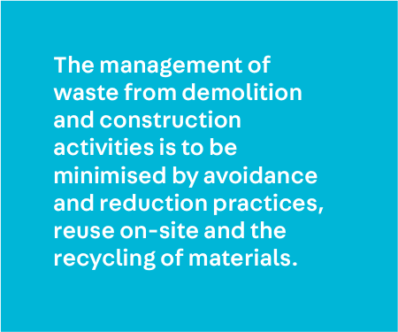

## 3. Demolition and Construction

> [Picture on page 7: a picture, saved as a picture (images/waste-design-for-new-developments-guide-b-multi-dw-page-7-2.gif, 150 dpi).]

The management of

#### waste from demolition

#### and construction

activities is to be

#### minimised by avoidance

and reduction practices,

reuse on-site and the

#### recycling of materials.

The WMP is to detail how this will be achieved and is to be submitted with any new DA (this may include DAs for the change-of-use of a development).

The storage, handling and disposal of any demolition and construction waste must be undertaken in accordance with the requirements of the Protection of Environment Operations Act 1997 and associated regulations.

If the application involves the demolition of a residential property, a Vacant Land Charge Application must be submitted. The application form can be found on Council’s website: https://www.cbcity.nsw.gov.au/council/ forms/waste-recycling

The WMP is to address demolition and construction waste and include:

•	 Confirmation if the development involves the removal of asbestos, quantities, the licence details of asbestos removalist and the designated disposal site licensed to accept asbestos-related waste;

•	 Details regarding how all other waste is to be minimised within the development and

•	 Expected amounts and types of materials to be reused or left over for removal from the site;

•	 Details regarding the types of waste and likely quantities of waste to be produced;

•	 A site plan showing storage areas away from public access for reusable materials and recyclables during demolition and construction, and the vehicle access to these areas;

•	 Designation of appropriately licensed facilities (recycling and landfill) to receive the construction and demolition waste. It is recommended the legitimacy and compliance of the facility is checked. The ABN Lookup and Environmental Protection Authority Public Register services can be used;

•	 Details of the nominated person, responsible for retaining waste dockets from facilities and for ensuring site is clean, tidy and no litter or materials leave or blow off the site; and

•	 Confirmation that all waste going to landfill is not hazardous.
