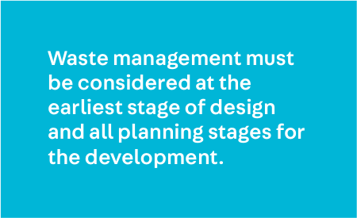

## 2. Waste Management and the

### Development Application Process

> [Picture on page 7: a picture, saved as a picture (images/waste-design-for-new-developments-guide-c-resident-page-7-3.gif, 150 dpi).]

Waste management must

be considered at the

#### earliest stage of design

and all planning stages for

#### the development.

This Guide is to be read in conjunction with Council’s Planning and Building Application Lodgement Guide and should be used when developing a Waste Management Plan.

### 2.1	 Waste Management Plan

A Waste Management Plan (WMP) is required to accompany all Development Applications and should comply with the requirements contained within this Guide and the Canterbury-Bankstown Development Control Plan 2021.

The WMP is an important planning document that will not only be utilised as part of the development application process, but during construction and for the ongoing use of the development. Conditions of consent will be used to enforce the commitments contained within the WMP, including the requirement that the ongoing management section of the WMP is included in the by-laws of strata properties. This will ensure that all relevant parties (i.e. residents, property managers) are aware of the WMP and that it will continue to apply as a working reference for the life of the building and community living there.

#### Council has a template WMP

#### to support all Development

#### Applications which addresses

#### the demolition, construction

and ongoing operation of the

#### development. It is mandatory to use

#### Council’s template.

The WMP is to provide the following:

•	 Details of the handling of construction and demolition waste streams of the development, including the types and estimated quantities and recycling or disposal locations to be utilized;

•	 Details of the ongoing management of waste streams by residents, including the types and estimated quantities;

•	 Separate plans of the proposed

development that show the location and space allocated to the waste management facilities, along with the nominated waste collection point;

•	 Identification of the travel path of access to the bin storage area/s by residents and collection staff;

•	 Identification of the travel and swept paths for on-site collection (if applicable) by an Heavy Rigid Vehicle (HRV);

•	 Details of ongoing management, storage and collection of waste, including responsibility for cleaning, transfer of bins between storage areas and collection points, implementation and maintenance of signage, and security of storage areas; and

•	 Where appropriate to the nature of the development, a summary document for residents to inform them of the building’s ongoing waste management arrangements. The completed WMP, including drawings submitted by the applicant, will be used in the Council assessment of the waste management systems for the new development.
