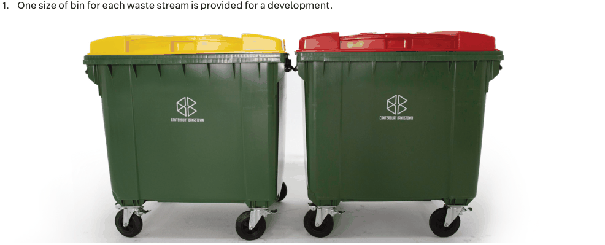

## 4. Waste Management

### Considerations

### 4.1	 General

### Considerations

It is essential that you have read the components of this Guide that are relevant to your development type in selecting and designing a waste management facilities. It is important that you:

•	 Ensure all dwellings have internal waste storage;

•	 Have a thorough understanding of the waste generated by your development and the number of bins to be allocated by Council and stored within the development;

•	 Ensure that the development can be integrated with Council’s standard HRV waste service; and

•	 Consider what access is required to the site by collection staff and/or vehicles to facilitate the safe and efficient waste servicing of the development.

Understanding the waste infrastructure required, such as bin allocation and the size (and dimensions) of bins ensures that the bin storage area for the development can be designed and integrated into the overall design of the development. This will maximise convenience for future residents, as well as ensuring amenity impacts such as visual, noise and odour are minimised.

The nominated collection point must be able to be accessed by collection staff. It is vital that you understand and plan for the access arrangements required. This includes providing adequate vehicular access and manoeuvring for an HRV where on-site collection is required.

Council or its contractors are solely to provide the waste services to all residential development types as required under the Local Government Act 1993.

### 4.2	 Waste Generation Rates

The following generation rates in Table 1 will need to be used to identify the number of bins needed for the development. Identifying the number of bins and the size of the bins in Table 2 and 3 will ensure that the waste management facilities designed meet the developments ongoing waste needs. When calculating the number of bins needed, it should be noted that bin allocations are rounded up to the next whole number (for example the calculation of

4.1 bins will be rounded to 5 bins).

#### Table 1: Weekly Waste Generation Rates per Dwelling

| General Waste | Recycling | Garden Organics |
|---|---|---|
| 140L | 120L | 120L* |

\*Developments are allocated 1 bin per 10 dwellings.

### 4.3	 Standard Waste Service

#### 4.3.1	 Collection Services

The collect and return service is not suitable for developments that are located on classified roads and roads with high vehicle and pedestrian traffic.

Kerbside waste collection is considered unsuitable in RFB developments due to amenity and safety issues, the number of bins requiring collection, the size of the bins and time taken to empty the bins. Council offers two waste collection services for RFBs:

If collect and return is deemed unsuitable by Council, the development must be designed to be serviced on-site, either at ground level, basement or via a loading dock and the development will need to accommodate an HRV.

•	 Collect and Return: collection staff enter the development to collect bins from a nominated area and return them once emptied; and

#### 4.3.2	Bin Sizes for Residential

#### Developments

•	 On-site collection: collection occurs within a development site’s boundary by an HRV at a nominated area.

An adequate bin storage area is to be provided within the development site to store all allocated bins. The following Tables identify the bin types, sizes and dimensions.

The type of service available for your development varies depending on the number of dwellings, on-site conditions, amenity and safety issues, the number of bins requiring collection, the size of the bins and time taken to empty the bins.

#### Table 2: Bin sizes for developments

| Waste Stream |  |  |
|---|---|---|
| General Waste 660L, 1,100L or hook lift bin with compactor | Recycling 660L or 1,100L | Garden Organics 240L |

NOTE:

> [Picture on page 10: a picture, saved as a picture (images/waste-design-for-new-developments-guide-c-resident-page-10-40.gif, 150 dpi).]
> Words printed on the picture (title and legend, copied from the PDF):
> 1\.	 One size of bin for each waste stream is provided for a development.

#### Table 3: Standard bin dimensions

| Standard Bin Type | Dimensions (Additional 15cm is to be provided around each bin) Height Width Depth |  |  |
|---|---|---|---|
| 240L Mobile Garbage Bin (MGB) | 1,060mm | 580mm | 730mm |
| 660L Bulk Bin | 1,250mm | 1,370mm | 850mm |
| 1,100L Bulk Bin | 1,470mm | 1,370mm | 1,245mm |
| Hook Lift / Compactor Bin (10m3-30m3) | 2.5m | 2.5m | 6m |

NOTES:

1\.	 It is important to understand the size of bins that will be allocated by Council for your development. Check with Council if you need assistance in identifying the most appropriate bin size/s.

2\.	 An additional 15cm is to be provided around each bin in the design of the waste bin storage area, to ensure it can function effectively and efficiently, and to avoid damage to walls and doors from bins scraping against them.

3\.	 Dimensions are a guide only and may differ depending on the manufacturer.
