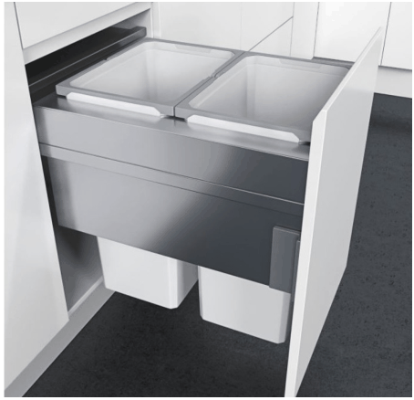
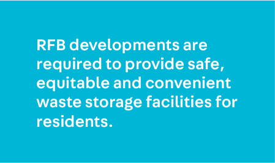
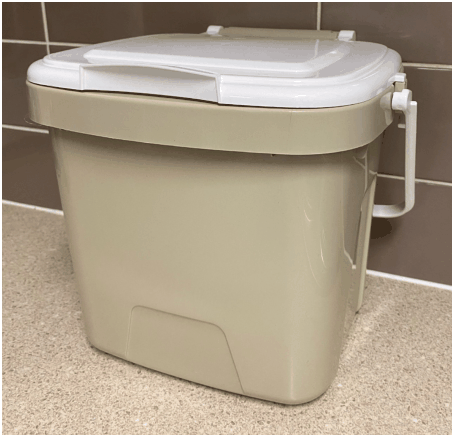

## 5. Waste Management Facilities

> [Picture on page 12: a picture, saved as a picture (images/waste-design-for-new-developments-guide-c-resident-page-12-2.gif, 150 dpi).]

> [Picture on page 12: a picture, saved as a picture (images/waste-design-for-new-developments-guide-c-resident-page-12-3.gif, 150 dpi).]

RFB developments are

required to provide safe,

#### equitable and convenient

waste storage facilities for

#### residents.

### 5.1	 Internal Waste and

### Recycling Storage

#### Example of waste storage cupboard (source: www.furnwaregroup.com.au)

> [Picture on page 12: a picture, saved as a picture (images/waste-design-for-new-developments-guide-c-resident-page-12-13.gif, 150 dpi).]

To ensure each dwelling has the minimum infrastructure to be able to separate out, reuse and/or recycle items, the following internal waste storage and separation facilities are to be provided:

•	 A waste storage cupboard in the kitchen capable of holding a minimum 40L of waste (approximately two days) and to enable a minimum 20L of recyclable waste to be stored in a separate container and not in plastic bags;

•	 Suitable space in the kitchen for a 3-5L caddy to collect food waste. This is to encourage on-site composting and reduction in waste to landfill; and

•	 Suitable space storage space for other recyclable items, such as light globes and batteries.

#### Example of food waste caddy

### 5.2	 General Requirements

#### 5.2.1	 Low Rise Buildings

This size development is two to four storeys, with usually four to twelve units. These developments are called walk-ups, as they do not have a lift and access to the upper levels is by stairs.

There are two servicing options that are available for this type of development:
