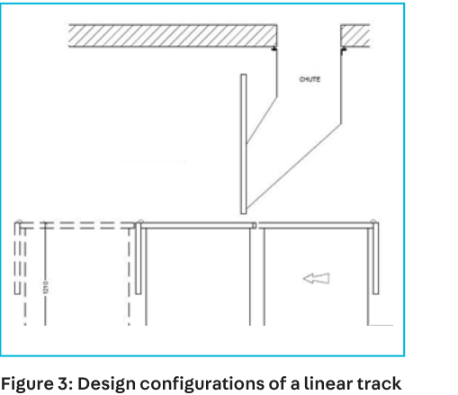
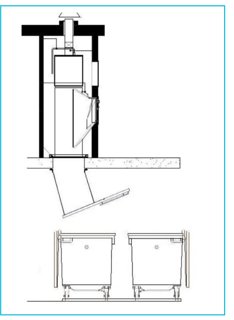
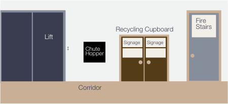
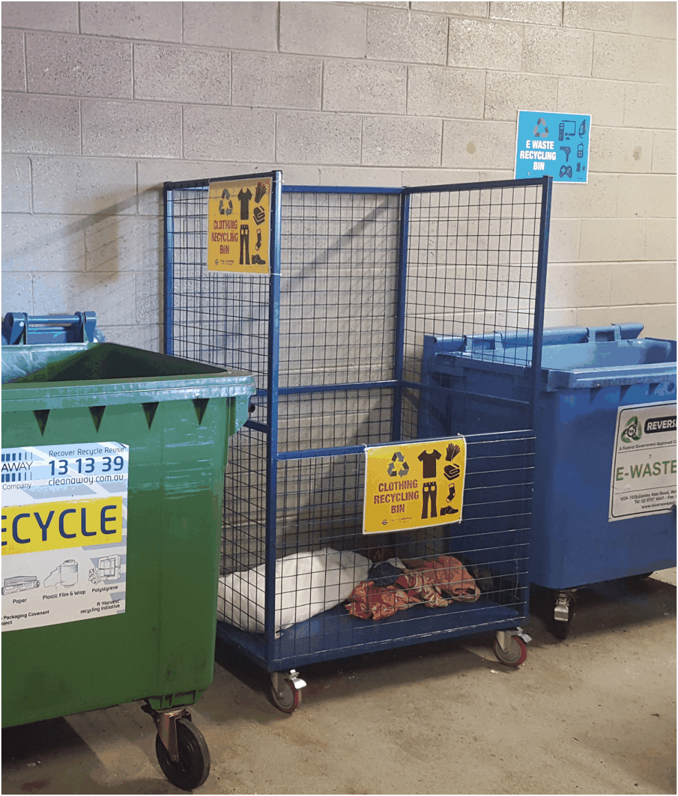

## 22 Waste Design for New Developments – Guide C

> [Picture on page 22: a picture, saved as a picture (images/waste-design-for-new-developments-guide-c-resident-page-22-100.gif, 150 dpi).]

Figure 3: Design configurations of a linear track

Figure 3: Design configurations of a linear track

Figure 3: Design configurations of a linear track

system accommodating 1,100L bins.

system accommodating 1,100L bins.

system accommodating 1,100L bins.

#### Figure 3: Design configurations of a linear track

> [Picture on page 22: a picture, saved as a picture (images/waste-design-for-new-developments-guide-c-resident-page-22-105.gif, 150 dpi).]

system accommodating 1,100L bins.

Figure 5: Cross section of a chute inlet throughout various level of the building.

Figure 5: Cross section of a chute inlet throughout various level of the building.

Figure 5: Cross section of a chute inlet throughout various level of the building.

Figure 5: Cross section of a chute inlet throughout various level of the building.

The following requirements apply to waste chute systems installed in developments:

#### General requirements:

•	 The waste chute will only be used to transfer garbage and not recycling;

•	 There will be no mechanical compaction of waste at the base of the chute;

•	 The bins at the base of the chute must have capacity for at least three days of waste;

•	 The bins can be mounted on an automatic carousel or linear track system for easy rotation and to ensure capacity for three days;

•	 Waste chute disposal points (hoppers) are to be provided on each residential level of the development. The maximum travel distance from each dwelling to the chute hopper is 30m;

•	 Access to the chute hopper is to be in accordance with AS 1428 (Set) - 2003: Design for access and mobility;

•	 The chute is to terminate in the bin storage area and discharge directly into a 660L or 1,100L bin; and

•	 Signage is to be placed on the chute hopper on every residential level indicating how to use the system effectively and the acceptable material.

#### Construction:

•	 Chute systems are to be designed so they can be constructed to satisfy manufacturer’s requirements and can ensure required 660L or 1,100L bins fit at the base of the system;

•	 Must be designed and constructed so it can function effectively (gravity fed) and aligns as it passes through each level of the development;

•	 Designed in accordance with the requirements of the Building Code of Australia including fire rating, noise reduction and ventilation;

•	 Must be constructed and installed to prevent the transmission of noise and vibration to the structure of the development during its use and operation;

•	 The chute is to be cylindrical in cross-section and the internal diameter is to be a minimum 500 mm and adequate for material being deposited;

•	 The hopper doors are to be a minimum 500mm opening, fitted with door closers and have an effective self-sealing system; and

•	 Must be constructed to alleviate any odour.

#### Bin storage area:

•	 Must be located where the chute terminates;

•	 Must be large enough to fit the allocated number of bins with additional room for manoeuvring bins;

•	 Where volume-handling equipment (eg. bin lifting equipment) and/or an automatic carousel/ linear track system are to be installed, the bin storage area must be of adequate size to accommodate all required equipment and to operate it;

•	 Resident access to the chute termination point is to be restricted. Bin storage and the chute termination point may be two separate areas, next to each other; and

•	 A cross section of the chute system within the building is to be provided to show that the chute aligns as it passes through each level of the development.

ste service

ficient

to enable isfactory

sure

eir roles

e at

ed by

nal

upation

bulky

e building ng

ials

p top

m², for

llection

vide

accessed ea should rea to

hibits

llow easy ildings,

vided. It

planning

placed by

1.5m aisle

n storage area

#### 5.3.9 Recycling Cupboards

Hopper

Level 2

Level 1

Hopper

Developments that propose the use of waste chute system must also plan for recycling cupboards on each residential floor directly on the corridor adjacent to the chute hopper. The cupboards should have an opening large enough for loose recycling to be placed into the bins behind. To prevent occupants from dumping excess rubbish, the cupboard should be locked, accessible only to the caretaker.

Lift Well

Garbage

Chute

Bin Storage

Room

A caretaker will need to rotate recycling bins from the recycling cupboard to the bin storage area/s , at a minimum every three days (this is based on generation rate of number of dwellings on the floor). A bin lifting machine will be needed to empty 240L bins into larger 660L or 1,100L bins for collection. Storage of bin lifting machine needs to be shown on site plans. No mechanical compaction will be used during this process.

#### Figure 4: Waste chute system

> [Picture on page 24: a picture, saved as a picture (images/waste-design-for-new-developments-guide-c-resident-page-24-60.gif, 150 dpi).]
> Words printed on the picture (title and legend, copied from the PDF):
> Fire
> Stairs
> Recycling Cupboard
> Lift
> Signage Signage
> Chute
> Hopper
> Corridor

#### Figure 5: Recycling cupboard and chute

hopper design

#### Figure 6: Recycling cupboard and chute hopper design

0.15m

1.25m

1100L

Bin

1.37m

2m

Drain

Approved sewer connection

Double Doors

Bin Lifting

Machine

Waste Management Guide for new developments | 13

The following requirements apply to recycling cupboards installed in developments:

General requirements:

•	 Must be conveniently located for residents on each residential level of the development (maximum distance of 30m);

•	 Access is to be in accordance with AS 1428 (Set) - 2003: Design for access and mobility;

•	 Located directly adjacent to the hopper and contain only recycling bins;

•	 Must be of adequate size to accommodate enough recycling bins, which allows for three days of recycling generated by the number of dwellings on that floor;

•	 Signage is to be placed on the recycling cupboard on every residential level indicating how to use the system effectively and accepted material;

•	 A site caretaker will be required to rotate recycling bins from the cupboards to the bin storage area at a minimum every three days; and

•	 A service lift is required to transfer bins between the recycling cupboards, bin storage area and the collection point.

Construction:

•	 Designed to fit 240L bins facing forward;

•	 Designed so the doors are of sufficient width to allow the transfer/rotation of 240L bins; and

•	 The floor is to be constructed of a durable and impervious material with a smooth finish.

#### 5.3.10	 Bulky Waste

Council provides a collection service for bulky household waste, such as whitegoods, mattresses and household furniture. The amount of material accepted per collection is defined in Council’s Waste Service Policy.

All dwellings are to have adequate storage within the dwelling or garage to store bulky waste waiting collection.

All developments are to provide an area within the building footprint for residents to store bulky waste awaiting collection to prevent the illegal dumping of materials on the kerbside or within common areas.

The size of the bulky waste area must be appropriate to the development, see Table 7 for the minimum area required.

#### Table 7: Minimum Size of Bulky Waste Area

| Number of Dwellings 20 or less | Minimum Area Required 4 m2 |
|---|---|
| 21 to 30 | 5m2 |
| 31 to 40 | 6m2 |
| 41 to 50 | 7m2 |
| 51 to 60 | 8m2 |
| 61 to 70 | 9m2 |
| 71 to 80 | 10m2 |
| 81 to 90 | 11m2 |
| 91 to 100 | 12m2 |
| More than 101 | 13 m2 + 2 m2 per 50 additional units (or part thereof) above 101 units |

The bulky waste storage area is to be separate to the bin storage area/s, however the design is to comply with the requirements detailed in Section 5.3.1 of this Guide. Multiple buildings will require separate areas.

Where on-site collection is required for waste and recycling, on-site collection of bulky waste is also required. Section 5.3.3 and 5.3.4 of the Guide are required to be complied with.

#### 5.3.11	Supplementary Recycling Service

Developments with more than 50 dwellings will receive additional recycling services to increase recovery of material and to prevent the illegal dumping of materials on the kerbside or in common areas. Separate additional recycling storage area/s are to be provided for residents to store household items, such as clothing, mattresses, polystyrene, bulky cardboard and electronic waste.

The minimum area required is 9m2 and the area is to be designed to comply with the requirements detailed in Section 5.3.1 of the Guide.

The area/s must be separate to the bin storage area or room(s) and the bulky waste storage area.

The area/s must not be visible from any street frontage.

Where there are multiple buildings, separate areas must be provided.

On-site collection of additional recycling materials is required where waste and recycling bins are collected on-site. Section 5.3.3 and 5.3.4 of the Guide are required to be complied with.

### 5.4	 Design for Ongoing Use

Considering the ongoing management of waste systems in medium and high rise developments is an important consideration at the design stage to ensure amenity of residents is maintained and caretaker and collection staff safety is assured.

Selection of the waste management system, including the ongoing role and responsibilities of the caretaker can also impact on the future operational costs of the development, which will be passed onto residents for the life of the building.

It is important for both the designer and developer to identify, establish and communicate responsibilities of both residents and caretakers to ensure effective management of waste at the operational stage of the development.

Council recommends an active caretaker be employed for medium to high rise developments to ensure effective and efficient ongoing waste management. A site caretaker or manager will be required to:

•	 Maintain and clean all bin storage areas and recycling cupboards;

•	 Cleaning and maintenance schedules for all waste equipment;

•	 Maintain and clean temporary holding areas (if applicable);

> [Picture on page 27: a picture, saved as a picture (images/waste-design-for-new-developments-guide-c-resident-page-27-1.gif, 150 dpi).]

#### Example of Supplementary Recycling Service

•	 Clean and wash all bins regularly;

•	 Manage all bin transfers and rotations;

•	 Ensure waste chute system and associated waste service equipment functions effectively and in accordance with manufacturer’s specifications;

•	 Manage bulky waste and additional recycling storage areas and arrange appropriate collections;

•	 Ensure the loading bay is kept clear of parked cars;

•	 Ensure the turntable and related devices are maintained in working order;

•	 Providing training to collection staff in the use of the turntable when requested;

•	 Manage the communal composting area;

•	 Arranging the prompt removal of dumped rubbish;

•	 Ensuring the recycling bins are free of contamination (which includes but not limited to garbage, plastic bags, clothing, polystyrene, etc);

•	 Ensuring there is suitable signage for each bin hopper and recycling cupboard on each floor and bin storage room. Council can assist with education signage;

•	 Ensuring all residents are informed and kept up to date in the use of the waste management system; and

•	 Checking the number of bins and reporting any damages to Council.

The site caretaker or manager is to undertake the above actions at a minimum twice a week for enough hours to enable the waste management system to operate to a satisfactory standard.

### 5.5	 High-Capacity

### Collection Systems

In large developments of more than 400 apartments, larger capacity bins with or without static compactors may be considered. Council must be consulted as part of the pre-lodgement process if a high capacity collection system is being considered.

Generally known as ‘hook-lift’ bins, these systems come in a range of sizes with up to 40m3 capacity which, when combined with a 3:1 compaction ratio, can hold up to 90m3 of waste. This means that the frequency of collection can be significantly reduced, depending on the quantities.

Hook-lift bins require waste collection vehicles to reverse directly onto them, so the building will require enough turning and manoeuvring space for an HRV and additional height. Access for these kinds of vehicles should be modelled using turning circle software during the design stage.

### 5.6	 Inspections by Council

If designed for on-site collection from the basement, at completion of the basement level construction an authorised Council waste officer is to inspect the development, and an engineer certificate is to be submitted to certify that the waste management facilities comply with the Development Approval and WMP. Specifically, the path of travel for the Heavy Rigid Vehicle (HRV), size of waste storage areas, access to water and sewer connections, finished materials, pathway and door way dimensions, and that all waste facilities are fit for purpose.

Where collection staff or vehicles are required to enter private property to perform the service, prior to the issuing of the Occupational Certificate and delivery of bins, an authorised Council waste officer is to inspect that the communal bin storage area and bin-carting route have been constructed in accordance with the approved plans and to confirm the development can be serviced by Council.

Conditions of consent will be imposed requiring these inspections be undertaken. Contact Council on 9707 9000 to arrange these inspections.

### 5.7	 Deed of Agreement

### and Indemnity

Where collection staff or vehicles are required to enter private property to perform the service, Council will require an unimpeded easement for access to undertake on-site or collect and return service. The development is also required to indemnify Council and its Contractors against claims for wear and tear of access roads or other parts of the building.

A condition of consent will be imposed requiring an Indemnity Agreement to be entered into prior to the issue of the Occupation Certificate and delivery of bins.
