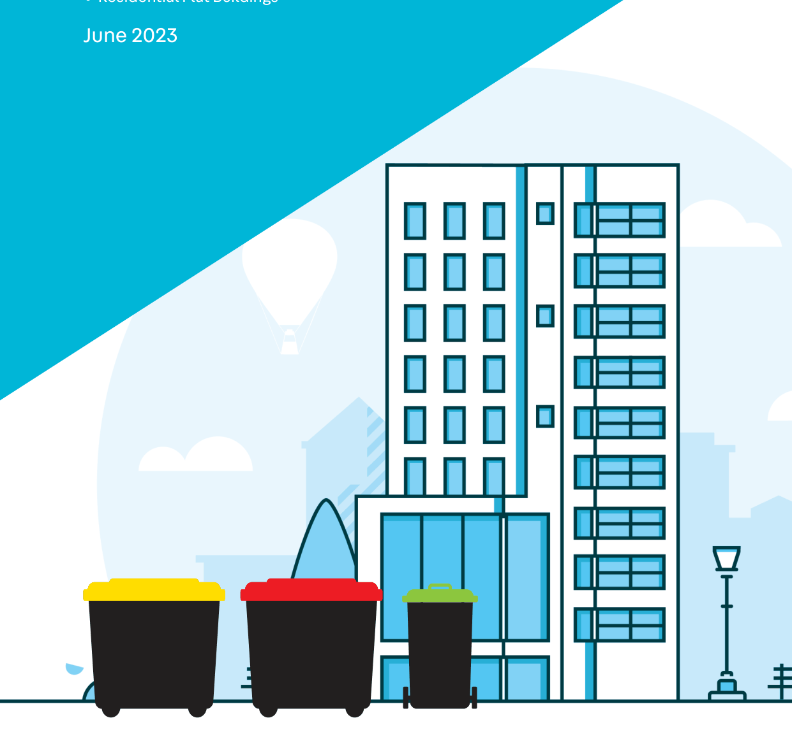

# Canterbury-Bankstown Development Control Plan 2023 - Waste Design for New Developments - Guide C - Residential Flat Buildings

> This chapter is split into 12 section file(s), one per numbered heading, in the order they appear in the PDF.

Source PDF: [2023.06.23 - DCP 2023 - CONSOLIDATED - Waste Design for New Developments - Guide C.pdf](2023.06.23%20-%20DCP%202023%20-%20CONSOLIDATED%20-%20Waste%20Design%20for%20New%20Developments%20-%20Guide%20C.pdf)

Waste Design for

### New Developments –

### Guide C

> [Picture on page 1: a picture, saved as a picture (images/waste-design-for-new-developments-guide-c-resident-page-1-4.gif, 150 dpi).]

#### •	 Residential Flat Buildings

### June 2023

> The PDF's contents list (page numbers of the printed document) is not repeated here - see Sections below.

<!-- sections -->
## Sections

1. [1 Introduction](01-introduction.md)
2. [2 Waste Management and the](02-waste-management-and-the.md)
3. [3 Demolition and](03-demolition-and.md)
4. [4 Waste Management](04-waste-management.md)
5. [4 3.3	 Service Frequency](05-4-3-3-service-frequency.md)
6. [5 Waste Management Facilities](06-5-waste-management-facilities.md)
7. [1 Collect and Return Service](07-1-collect-and-return-service.md)
8. [2 On-Site Servicing](08-2-on-site-servicing.md)
9. [22 Waste Design for New Developments – Guide C](09-22-waste-design-for-new-developments-guide.md)
10. [6 Advanced Waste](10-6-advanced-waste.md)
11. [7 Treatment and Management](11-7-treatment-and-management.md)
12. [8 Glossary of Terms](12-8-glossary-of-terms.md)
