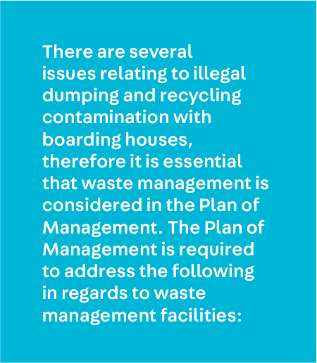

## 6. Plan of Management

> [Picture on page 20: a picture, saved as a picture (images/waste-design-for-new-developments-guide-d-boarding-page-20-2.gif, 150 dpi).]

#### There are several

#### issues relating to illegal

#### dumping and recycling

contamination with

boarding houses,

#### therefore it is essential

that waste management is

considered in the Plan of

Management. The Plan of

#### Management is required

#### to address the following

#### in regards to waste

#### management facilities:

•	 Monitoring of bin usage and ensuring that recycling bins are free of contamination (which includes but not limited to, garbage, plastic bags, clothing, polystyrene etc);

•	 Maintenance and cleaning of all bin storage areas;

•	 Cleaning and washing of all bins;

•	 Management of bulky waste storage areas and arrangements for appropriate collections;

•	 Management and removal of dumped rubbish;

•	 Ensuring there is suitable signage for all waste management facilities, including facilities in rooms;

•	 Ensuring all lodgers/tenants are informed and kept up to date in the use of the waste management system; and

•	 Maintenance and cleaning of temporary collection areas (if applicable).

### 6.1	 Inspections by Council

If designed for on-site collection from the basement, at completion of the basement level construction, an authorised Council waste officer is to inspect the development, and an engineering certificate is to be submitted to certify that the waste management facilities comply with the Development Approval and WMP. Specifically, the path of travel for the HRV, size of waste storage areas, access to water and sewer connections, finished materials, pathway and door way dimensions, and that all waste facilities are fit for purpose.

Prior to the issuing of the Occupation Certificate and delivery of bins, an authorised Council waste officer is to inspect that the communal bin storage area and bin-carting route have been constructed in accordance with the approved plans and to confirm the development can be serviced by Council.

Conditions of consent will be imposed requiring these inspections be undertaken. Contact Council on 9707 9000 to arrange these inspections.

### 6.2	 Deed of Agreement

### and Indemnity

Where collection staff or vehicles are required to enter private property to perform the service, Council will require an unimpeded easement for access to undertake on-site or collect and return service. The development is also required to indemnify Council or its Contractors against claims for wear and tear of access roads or other parts of the building.

A condition of consent will be imposed requiring an Indemnity Agreement to be entered into prior to the issue of the Occupation Certificate and delivery of bins.
