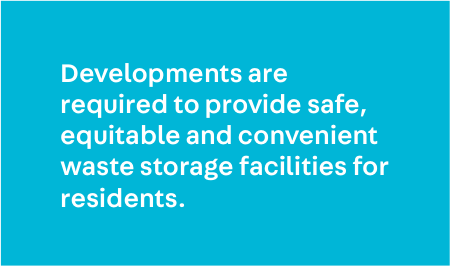
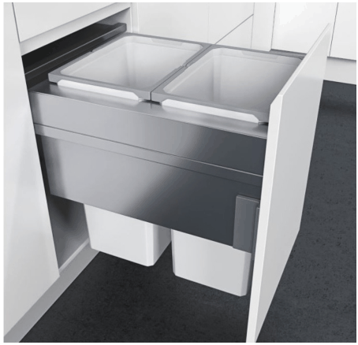
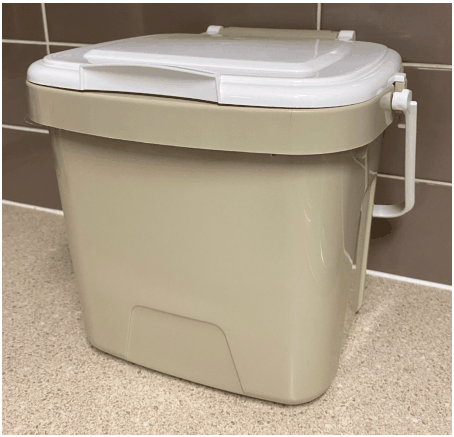
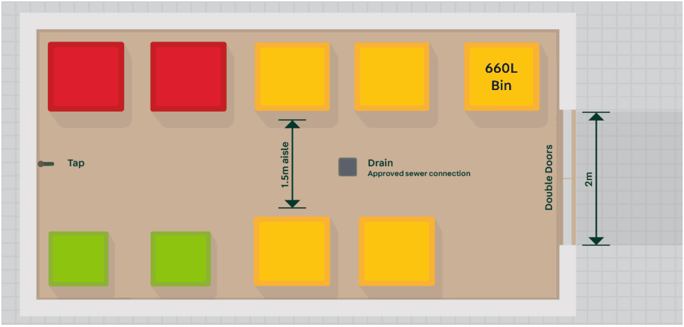
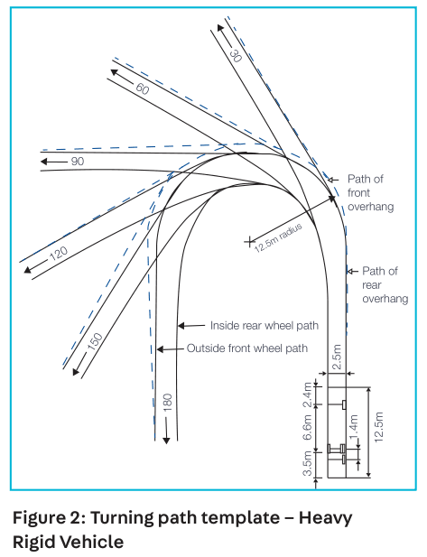
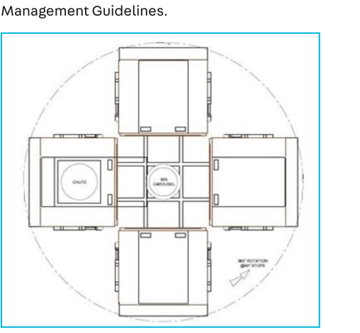

## 6. Residential Waste

### Management Facilities

> [Picture on page 14: a picture, saved as a picture (images/waste-design-for-new-developments-guide-e-mixed-us-page-14-3.gif, 150 dpi).]

> [Picture on page 14: a picture, saved as a picture (images/waste-design-for-new-developments-guide-e-mixed-us-page-14-4.gif, 150 dpi).]

Developments are

required to provide safe,

#### equitable and convenient

waste storage facilities for

#### residents.

### 6.1	 Internal Waste and

### Recycling Storage

To ensure each dwelling has the minimum infrastructure to be able to separate out, reuse and/or recycle items, the following internal waste storage and separation facilities are to be provided:

#### Example of waste storage cupboard (source: www.furnwaregroup.com.au)

> [Picture on page 14: a picture, saved as a picture (images/waste-design-for-new-developments-guide-e-mixed-us-page-14-19.gif, 150 dpi).]

•	 A waste storage cupboard in the kitchen capable of holding a minimum 40L of waste (approximately two days) and to enable a minimum 20L of recyclable waste to be stored in a separate container and not in plastic bags;

•	 Suitable space in the kitchen for a 3-5L caddy to collect food waste. This is to encourage on-site composting and reduction in waste to landfill; and

•	 Suitable space storage space for other recyclable items, such as light globes and batteries.

#### Example of food waste caddy

### 6.2	 General Requirements

There are three potential service options and layouts for this type of development.

1\.	 660L or 1,100L bins for garbage and recycling, with bins stored in a communal area: Residents would be required to carry all waste and recyclable from their dwelling direct to the communal storage area (maximum distance of 30m);

2\.	Provide a waste storage cupboard on each floor for three days storage of waste and recycling: A service lift is required for the caretaker to move the bin storage area and/ or bin collection area. The caretaker should use a bin lifter to empty the waste into larger 660L or 1,100L bins, which are then emptied by Council; and

3\.	Install a waste chute system for general waste leading to a central waste storage area in the basement: The chute would empty into a bulk bin on a carousel. There would be a cupboard on each floor for a recycling MGB (stores three days of recycling generated by the number of dwellings on that floor) and chute hoper. A service lift is required for the caretaker to empty the recycling bins on each floor every three days. A bin lifter is to be used to empty the recycling into bulk bins which are then emptied by Council.

Bins would be collected directly from the communal bin storage area by collect and return service, or if deemed unsuitable by Council, the development must be designed to facilitate on-site collection with an HRV.

In all of the above layouts, if garden organics bins are provided, these would need to be presented to the kerbside for collection by a caretaker/property manager. In addition, separate bulky waste storage area/s and space for additional recycling storage are required.

### 6.3	 Specific Requirements

#### 6.3.1	 Communal Bin Storage Area

A communal bin storage area must be designed so it can be integrated into the overall design of the development and located so it can be accessed conveniently and will not impact on residential amenity in regard to noise, odour and visual impacts.

The bin storage area must be able to accommodate the required number of bins and the volume of waste and recycling expected to be generated between collections. The standard service is one or two collections per

week. This frequency could be increased for larger developments, only after discussion with Council’s waste management assessment officers.

In determining the appropriate location point for the bin storage area consideration should be given to the following factors:

#### Size and Layout:

•	 The development must provide a communal bin storage area that is of sufficient size to accommodate all bins allocated for the development. For medium and high rise developments, more than one bin storage area may be required to maximise accessibility for residents;

•	 Sufficient space must be provided to ensure adequate room is provided to manoeuvre, clean and maintain all waste and recycling bins for the development (minimum aisle space of 1.5m and 15cm between bins);

•	 Sufficient space must be provided for any required equipment to manage waste and bins (including washing, cleaning and bin lifting);

•	 Size must not be excessive, to discourage the dumping of bulky waste in the bin storage area; and

•	 The area is free from obstructions and steps, so as not to restrict the movement and servicing of the bins.

#### Location:

•	 The maximum walking distance from any entrance of a residential dwelling to the storage area must not exceed 30 metres (lift travel distance not included);

•	 Located where its use and operation will not adversely impact the amenity of occupants in terms of appearance, noise and odour;

•	 Located on the ground floor or basement footprint. If bins are to be collected directly from the communal bin storage area by collect and return service, it must be located on the ground floor;

•	 If bins are required to be moved for collection, it is done in a safe and efficient manner in accordance with Work Health and Safety legislation. A bin tug or pull may be needed;

•	 The area cannot be viewed or easily accessed by the public domain;

•	 Amenity for residential occupants and adjoining residential properties is protected; and

•	 Positioned to prevent theft and vandalism and restrict unauthorised access to prevent illegal dumping.

#### Design:

•	 A designated room or enclosure, with a roof;

•	 Must be integrated into the overall design of the development; and

•	 Screened from public view.

#### Access:

•	 Located so access for all intended users is safe and convenient and in accordance with AS 1428 (Set) - 2003: Design for access and mobility; and

•	 Any doorways will be at least 2m wide and open outwards.

#### Construction:

•	 Floors must be constructed of concrete at least 75mm thick, graded and drained to a Sydney Water approved drainage fitting;

•	 The floors must be finished to a smooth, even surface;

•	 The walls and floors must be constructed of solid impervious material;

•	 A minimum 2.1m unobstructed room height is required in accordance with the Building Code of Australia;

•	 Ceilings must be finished with a smooth faced non- absorbent material capable of being cleaned;

•	 Walls, ceiling and floors must be finished in a light colour;

•	 Is to be provided with an adequate supply of hot and cold water mixed through a centralised mixing valve with hose cock;

•	 A close-fitting and self-closing door or gate operable from within the room;

•	 Must be constructed to prevent the entry of birds and vermin;

•	 Be provided with adequate light and ventilation. Light source must be through controlled light switches located both outside and inside the room; and

•	 For developments planning a waste chute system, further specifications for bin storage areas is provided in sections 6.3.9 and 6.3.10.

> [Picture on page 17: a picture, saved as a picture (images/waste-design-for-new-developments-guide-e-mixed-us-page-17-18.gif, 150 dpi).]
> Words printed on the picture (title and legend, copied from the PDF):
> Bin

#### 660L

#### Figure 1: Communal bin storage area

#### 6.3.2	Bin-Carting Route (Collect

and Return)

For the collect and return service, the bin-carting route from the communal bin storage area to the kerbside collection point, must comply with the following requirements:

•	 Direct and less than 10 metres;

•	 Include a layback at the nominated collection point;

•	 Minimum 2m wide solid and impervious surface;

•	 Does not pass through any internal walkways, doors or rooms;

•	 Non-slip, free from obstacles and steps;

•	 A maximum grade of 1:30 (3%);

•	 Not be within a driveway or carpark; and

•	 Compliant with Work, Health and Safety for collection staff.

#### 6.3.3 Temporary Collection Area

(Collect and Return)

The temporary collection area will be required to be of sufficient size to allow the temporary storage of all allocated bins for the development and will require a caretaker to transfer all allocated bins from the communal bin storage area to the temporary collection area the day before the designated collection day and return them once emptied.

The bin-carting route from the communal bin storage area to the temporary collection area is to be:

•	 Direct and less than 30 metres;

•	 Minimum 2m wide solid and impervious surface;

•	 Non-slip, free from obstacles and steps;

•	 A maximum grade of 1:30 (3%);

•	 Wholly within property boundaries;

•	 Without crossing a private lot;

•	 Compliant with Work, Health and Safety legislation. To reduce manual handling, bin handling equipment should be used e.g. bin tug; and

•	 The collection vehicle will stop at the nominated kerbside collection point and will collect and return bins to the temporary collection area. The health and safety of all users including caretakers and collection staff is an important consideration when selecting an appropriate location for this area.

Requirements of the temporary collection area:

•	 Located on the ground floor;

•	 Within 10m from the nominated kerbside collection point;

•	 Any doorways a minimum 2m;

•	 Only temporarily store bins so they can be serviced;

•	 Be located fully within the development site.

•	 Be of sufficient size to accommodate all bins with additional room for manoeuvring (minimum aisle space of 1.5m and 15cm between bins); and

•	 Be clearly separated from car parking bays, footpaths and landscaped areas.

#### 6.3.4	On-Site Collection

All developments are required to provide safe vehicle access and be designed to enable the HRV to manoeuvre and load all allocated bins. A collection loading area is to be nominated which is within 5m of the bin storage area/s, located on the ground floor or basement footprint.

A temporary bin collection area will be required if the truck is not able to park within 5m of the bin storage area. The caretaker or property manager will be required to move the bins from the storage area to the temporary collection area ready for collection, and return them when emptied (see section 6.3.7).

Requirements of the nominated loading area:

•	 Access requirements for an HRV are as per Australia Standard (AS) 2890.2 Parking Facilities: Off Street Commercial Vehicle Facilities;

•	 The collection vehicle loading area is to be nominated on the submitted plans. The loading area is to be within 5 metres of the bin storage or temporary holding area;

•	 The loading area is to be a separate parking area for the collection vehicle, which is located so as not to impede or restrict other vehicle and pedestrian movements during collection times and minimises impact on residents; and

•	 Include an extra 2m at the rear of the vehicle parking area to allow for staff safety and emptying of bins.

#### 6.3.5	Bin-Carting Route

(On-Site Collection)

The bin carting route from the communal bin storage area to the collection loading area, must comply with the following requirements:

•	 Direct and less than 5 metres;

•	 Minimum 2m wide solid and impervious surface;

•	 Does not pass through any internal walkways, doors or rooms;

•	 Non-slip, free from obstacles and steps;

•	 A maximum grade of 1:30 (3%);

•	 Not be within a driveway; and

•	 Compliant with Work, Health and Safety for collection staff.

#### 6.3.6	Designing for Waste Collection

#### Vehicle Access

The HRV must be able to safely and efficiently access the site and nominated loading area to collect all bins. The development’s security measures such as gates and security doors should not prevent vehicle access to the collection point which would result in waste being unable to be collected.

When designing for an HRV to access the site and designated loading area the following factors are to be taken into consideration early in the design phase:

•	 The route of travel (including vehicle manoeuvring areas and ramps) for the waste collection vehicle to the collection point is to satisfy the dimensions of an HRV as per AS2890.2, and include adequate vehicle clearances for the vehicle. An extract from

AS2890.2 is provided below;

•	 An HRV must be able to enter and exit the site in a forward direction. The loading area/collection point should be located to minimise manoeuvring within the site (only one reverse movement allowed);

•	 The route of travel is to be adequately surfaced and of sufficient strength to support a collection vehicle at maximum capacity (approximately 30 tonnes);

•	 The grades of entry and exit ramps must not exceed the capabilities of an HRV and are to comply with AS2890.2 Parking Facilities: Off- Street Commercial Vehicle Facilities;

•	 A turntable is acceptable to facilitate safe and adequate manoeuvring on-site provided it is suitable for the specifications of the HRV; and

•	 The designated loading area is be located off the turntable or it is not shared by other vehicles requiring a loading dock access.

ngs

#### On-site collection requirements for residential

flat buildings:

on

#### Loading area:

•  A waste collection vehicle loading area is to be

Table 5: An extract of dimensions and turning circles from the Australian Standard 2890.2 Parking

nominated on the submitted plans. The loading area Facilities Part 2: Off Street Commercial Vehicle Facilities for Heavy Rigid Vehicles.

is to be within 10m of the bin storage area;

ed;

• Located so as not to impede or restrict other vehicle

| and pedestrian • Clearly Overall and length landscaped • Located to | movements separated Overall from car width areas; and minimise impact | during collection parking Wheel bays, base on residents | Design times; footpaths, turning radius within | Swept circle | Clearance height | Maximum roadway/ramp grade | Maximum rate of change of grade |
|---|---|---|---|---|---|---|---|
| and adjoining located 12.5m near room windows. | the development sensitive 2.5m land | site. It is uses 6.6m or any | not to be habitable 12.5m | 27.8m | 4.5m | 1:6.5 (15.4%) | 1:16 (6.25%) in 7m of travel |

pment

public

h

15cm

paths

#### Bin-carting route:

•  Ensure bin transfer complies with requirements of Work Health and Safety legislation; and

•  The bin-carting route to the loading area from the storage area:

e when

s);

•  Be direct and as short as possible;

• Wholly within property boundaries;

o

fer

Swept paths for HRV must be shown on submitted plans which illustrates the vehicle entering/exiting in a forward direction and access to the nominated loading area and/or bin storage area/s. Scaled plans accompanying the development application are to illustrate:

• Is to be solid, concrete and non-slip;

• Is a minimum of 2m wide;

o

• Free from obstructions and steps; and

•	 Manoeuvring, gradients, clearance heights and turning paths for the route of travel that comply with AS 2890.2 for HRV; and

•  Is to be a maximum distance of 10m to the designated truck loading area and a maximum grade of 1:30.

•	 An HRV can park safely within a designated loading area on-site whilst servicing the bins.

> [Picture on page 20: a map, saved as a picture (images/waste-design-for-new-developments-guide-e-mixed-us-page-20-48.gif, 150 dpi); the street names and other small labels are on the picture.]
> Words printed on the picture (title and legend, copied from the PDF):
> Inside rear wheel path
> 150 Outside front wheel path
> - Heavy rigid vehicle

Figure 3: Turning path template

Figure 2: Turning path template – Heavy

ay

on

rvice

m a

hicle

vehicle

opment

aste

ith

provide

on

m the

#### Rigid Vehicle

#### 6.3.7	Turntable

Large mixed use developments can reduce vehicle turning circles in Table 5 and Figure 2, by using a mechanical turntable (or similar) equipment. Turntables allow safe entry and exit for collection vehicles in a forward direction where space is limited.

A comparison between the area required for an HRV to enter/exit a traditional loading bay and a turntable loading bay arrangement is provided below.

#### Table 6: Area analysis loading bay configurations

|  | Figures |
|---|---|
| Truck size (m) | 12.5 |
| Turntable loading Bay Area (m2) | 219 |
| Conventional Loading Bay Area (m2) | 281 |
| Site Area Saving (m2) | 28% |

Extract from Penrith City Council. (Residential Flat Building Waste Management Guidelines).

Any development that is seeking to utilise turntables needs to demonstrate compliance with the required dimensions for an HRV, including the diameter for the turntable and required clearance heights. In addition, the following needs to be addressed:

•	 The use of the turntable is always to be available to collection vehicles;

•	 The installation, operation and ongoing servicing is to be at no cost to Council;

•	 A servicing and maintenance inspection plan are to be prepared before the Occupation Certificate is issued;

•	 A contingency plan to be prepared before the Occupation Certificate is issued and include: ⚬The use of a manual system is to be available in case of a breakdown; and ⚬Breakdown assistance is to be provided within 4 hours.

•	 Establishment of a sinking fund contribution by developer to ensure the turntable continues to work and property has funds up front to fund repairs once operational.

#### 6.3.8	Temporary Collection Area

(On-Site Collection)

Where developments cannot locate the communal bin storage area within 5m of the nominated loading area, a temporary collection area must be provided.

This area is required to be of sufficient size to allow the temporary storage of all allocated bins for the development and will require a caretaker to transfer all allocated bins from the bin storage area to the temporary collection area the day before the designated collection day and return them once emptied. The bin carting route from the bin storage area to the temporary collection area is to be:

•	 Direct and less than 30 metres;

•	 Solid, impervious and a minimum

2 metres wide;

•	 Non-slip, free from obstacles and steps;

•	 A maximum grade of 1:30 (3%);

•	 Wholly within property boundaries;

•	 Without crossing a private lot; and

•	 Compliant with Work, Health and Safety legislation. To reduce manual handling, bin handling equipment should be used e.g. bin tug.

Council’s collection truck will park in the nominated loading area and collect and return bins to the temporary collection area. The health and safety of all users including caretakers and collection staff is an important consideration when selecting an appropriate location for this area.

Requirements of the temporary collection area:

•	 Within 5m from the nominated loading area;

•	 Doorways a minimum 2m;

•	 Only temporarily store bins so they can be serviced;

•	 Be located fully within the development site;

•	 Be of sufficient size to accommodate all bins with additional room for manoeuvring (minimum aisle space of 1.5m and 15cm between bins); and

•	 Be clearly separated from car parking bays, footpaths and landscaped areas.

#### 5.3.8 Waste Chute Systems

#### 5.3.8 Waste Chute Systems

High rise developments should consider providing a waste chute system and consult with Council as part of the pre-lodgement process.

#### 5.3.8 Waste Chute Systems

#### 6.3.9	Waste Chute Systems

The benefits of a waste chute system are:

High rise developments should consider providing a waste chute system and consult with Council as part of the pre-lodgement process.

Developments that are considering providing a waste chute system should consult with Council as part of the pre-lodgement process.

High rise developments should consider providing a waste chute system and consult with Council as part of the pre-lodgement process.

The benefits of a waste chute system are:

• Promotes and encourages recycling through the co-location of general waste and recycling facilities on each floor; and

The benefits of a waste chute system are:

The benefits of a waste chute system are:

• Promotes and encourages recycling through the co-location of general waste and recycling facilities on each floor; and

•	 Promotes and encourages recycling through the co-location of general waste and recycling facilities on each floor; and

• Ensures the convenient transfer of waste from different floors of the development without the need for residents to manually cart and carry waste down stairs or lifts.

• Promotes and encourages recycling through the co-location of general waste and recycling facilities on each floor; and

• Ensures the convenient transfer of waste from different floors of the development without the need for residents to manually cart and carry waste down stairs or lifts.

•	 Ensures the convenient transfer of waste from different floors of the development without the need for residents to manually cart and carry waste down stairs or lifts.

• Ensures the convenient transfer of waste from different floors of the development without the need for residents to manually cart and carry waste down stairs or lifts.

While there are benefits of introducing a waste chute system there are also significant ongoing costs associated with operational and maintenance requirements. These systems are likely to require a full-time caretaker due to the frequency of bin rotation required and potential for chutes to become blocked by incorrect use by occupants.

While there are benefits of introducing a waste chute system there are also significant ongoing costs associated with operational and maintenance requirements. These systems are likely to require a full-time caretaker due to the frequency of bin rotation required and potential for chutes to become blocked by incorrect use by occupants.

While there are benefits of introducing a waste chute system there are also significant ongoing costs associated with operational and maintenance requirements. These systems are likely to require a full-time caretaker due to the frequency of bin rotation required and potential for chutes to become blocked by incorrect use by occupants.

Waste chute images are from Penrith City Council’s Residential Flat Building Waste Management Guidelines.

While there are benefits of introducing a waste chute system there are also significant ongoing costs associated with operational and maintenance requirements. These systems are likely to require a full-time caretaker due to the frequency of bin rotation required and potential for chutes to become blocked by incorrect use by occupants.

Waste chute images are from Penrith City Council’s Residential Flat Building Waste Management Guidelines.

Waste chute images are from Penrith City Council’s Residential Flat Building Waste

> [Picture on page 22: a picture, saved as a picture (images/waste-design-for-new-developments-guide-e-mixed-us-page-22-89.gif, 150 dpi).]
> Words printed on the picture (title and legend, copied from the PDF):
> Waste chute images are from Penrith City
> Council’s Residential Flat Building Waste
> Management Guidelines.

Management Guidelines.

Figure 4: Design configuration of a circular carousel accommodating 1,100L bins.

Figure 4: Design configuration of a circular carousel accommodating 1,100L bins.

Figure 4: Design configuration of a circular carousel accommodating 1,100L bins.

Figure 4: Design configuration of a circular carousel accommodating 1,100L bins.

Waste Design for New Developments – Guide C
