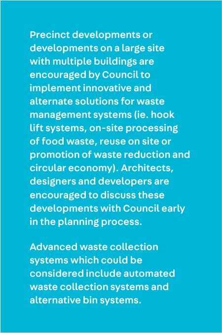

## 8. Advanced Waste

### Collection Systems

> [Picture on page 38: a picture, saved as a picture (images/waste-design-for-new-developments-guide-e-mixed-us-page-38-3.gif, 150 dpi).]

### 8.1	 Automated Waste

### Collection Systems

Automated waste collection is an integrated network of underground pipes and chute inlets that transport both waste and recycling directly from residential or commercial buildings to a centralised collection point using a vacuum transport. These systems can collect all waste and recycling from an area up to 2.5 kilometres from the central collection point.

Precinct developments or developments on a large site with multiple buildings are encouraged by Council to implement innovative and alternate solutions for waste management systems (ie. hook lift systems, on-site processing of food waste, reuse on site or promotion of waste reduction and circular economy). Architects, designers and developers are encouraged to discuss these developments with Council early in the planning process.

Automated waste collection system are most effective when included at the design stage for new developments. This allows for optimum conveyance pipe layout across the precinct and the incorporation of waste and recycling chutes in multiple buildings integrated with the system.

Advanced waste collection systems which could be considered include automated waste collection systems and alternative bin systems.

Developers interested in installing these systems within a new development should contact Council waste and planning staff at the earliest stage possible. The key requirements for bins, collection points, access and waste collection for service rooms referred to in this Guide may be open to amendment if an automated waste collection system is considered.

Benefits of automated waste collection include:

•	 Improved amenity for residents and businesses (reduced odour, noise, spillage and vermin);

•	 Reduced need for space allocated to waste management systems;

•	 Reduced or eliminated vehicle collection and access at individual buildings, as waste collection would be at a central location (on-site or off, away from residential buildings); and

•	 Lower fuel and vehicle costs, decreased carbon dioxide emissions, noise and traffic congestion from having fewer waste collection vehicle movements.

If an automated waste collection system is included in a development, the following requirements will need to be taken into account:

•	 The ventilation, air intake and air outlet units will need to be located to minimise nuisance to neighbouring premises;

•	 Central collection point needs to be at least one day’s waste or recycling output of the building;

•	 Waste and recycling collection points and storage stations shall be accessible to collection vehicles, and be located to minimise nuisance to neighbouring premises;

•	 Space for bulky and additional recycling storage will still be required; and

•	 Adequate measures shall be taken to minimise noise resulting from the operation of the system.

### 8.2	 Underground Bins

Underground bins involve installing large collection containers below ground level. The user does not see the container, with the inlet a small bin above ground.

Underground bins are available in a range of sizes including over 5,000 litres.

Underground bins have the

following advantages:

•	 They allow for large waste storage capacity;

•	 They can be configured for different waste streams (recycling, general waste, organics);

•	 They have a small above-ground footprint;

•	 Waste stored underground improves amenity by reducing odour and vermin;

•	 Less collections mean fewer waste collection vehicle movements in residential streets;

•	 They can make waste collection easier where space for bin storage is restricted; and

•	 Access can be restricted using a key control panel.

Other considerations:

•	 To service underground bins, power to operate the hydraulic lift must be supplied from on-site mains or from the waste collection vehicle; and

•	 HVR access and safe servicing of bins are key issues when deciding on suitable location of underground bin systems.
